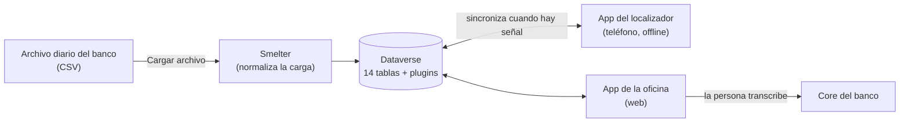

# Cobranza Móvil

Solución de **Power Platform** para la cobranza en campo de un banco. Los **localizadores** visitan a los clientes con mora y registran cada visita y cada pago en una app de teléfono que funciona **sin señal**. Después, la oficina **transcribe** esas interacciones al sistema central del banco (*core*) desde una app web.

## Quién la usa

| Rol | App | Qué hace |
|---|---|---|
| **Localizador** | Teléfono | Ve su cartera, registra interacciones y pagos, actualiza datos del cliente |
| **BackOffice** | Web | Transcribe al *core* las interacciones del día y revisa las ya transcritas |
| **Solicitante** | Web | Pide asignaciones Especiales y sigue sus solicitudes |
| **Supervisor** | Web | Aprueba Especiales, reasigna cuentas y mira la cartera de cada localizador |
| **Admin** | Web | Carga el archivo diario, monitorea la carga, reconcilia, da de alta cuentas y administra localizadores, datos maestros y listas |

## Documentación

### Para quien usa la app → [`docs/usuarios/`](docs/usuarios/)

| Guía | Para |
|---|---|
| [Conceptos básicos](docs/usuarios/00-conceptos.md) | Todos: cartera, interacción, tipos de asignación, qué pasa sin señal |
| [App del localizador](docs/usuarios/01-localizador.md) | Localizador |
| [Transcripción](docs/usuarios/02-backoffice.md) | BackOffice |
| [Solicitudes de Especiales](docs/usuarios/03-solicitante.md) | Solicitante |
| [Supervisión](docs/usuarios/04-supervisor.md) | Supervisor |
| [Administración diaria](docs/usuarios/05-admin.md) | Admin |
| [Preguntas frecuentes](docs/usuarios/06-preguntas-frecuentes.md) | Todos |

### Para quien desarrolla o mantiene la solución → [`docs/tecnica/`](docs/tecnica/)

| # | Documento | Qué explica |
|---|---|---|
| 01 | [Arquitectura](docs/tecnica/01-arquitectura.md) | Componentes, flujo de datos de punta a punta y por qué se diseñó así |
| 02 | [Modelo de datos](docs/tecnica/02-modelo-de-datos.md) | Las 14 tablas, sus relaciones, claves alternativas y cascadas |
| 03 | [Seguridad](docs/tecnica/03-seguridad.md) | Roles, dueños de registros, protección del número de tarjeta (PAN) |
| 04 | [Plugins y Custom APIs](docs/tecnica/04-plugins-y-custom-apis.md) | Cada plugin y Custom API: mensaje, etapa, qué hace y dónde está su código |
| 05 | [App del localizador](docs/tecnica/05-app-localizador.md) | Pantallas, perfil *offline*, sincronización |
| 06 | [App de la oficina](docs/tecnica/06-app-backoffice.md) | Pantallas por rol, componentes, patrones de carga por tramos |
| 07 | [Carga diaria](docs/tecnica/07-carga-diaria.md) | Formato del archivo, plantillas de Smelter, partición y validaciones |
| 08 | [Ciclo de vida de los datos](docs/tecnica/08-ciclo-de-vida.md) | Cuánto vive cada dato y los trabajos de borrado programado |
| 09 | [Instalación y despliegue](docs/tecnica/09-instalacion-y-despliegue.md) | Instalar en un ambiente nuevo, publicar cambios, variables de entorno |
| 10 | [Pruebas](docs/tecnica/10-pruebas.md) | Pruebas de plugins y suites de punta a punta |
| 11 | [Mantenimiento](docs/tecnica/11-mantenimiento.md) | Tareas recurrentes, diagnóstico y cómo hacer los cambios más comunes |
| 12 | [Decisiones de diseño](docs/tecnica/12-decisiones.md) | Las decisiones que conviene conocer antes de cambiar algo |

[Glosario](docs/glosario.md) · [Historial de cambios](CHANGELOG.md) · [Documentación de construcción (histórico)](docs/historico/)

## Estructura del repositorio

| Carpeta | Contenido |
|---|---|
| [`apps/localizador-canvas/`](apps/localizador-canvas/) | Código fuente de la app del teléfono (canvas, `.pa.yaml`) |
| [`apps/backoffice-canvas/`](apps/backoffice-canvas/) | Código fuente de la app de la oficina (canvas, `.pa.yaml`) |
| [`plugins/`](plugins/) | Plugins y Custom APIs en C# y sus pruebas unitarias |
| [`solutions/`](solutions/) | La solución de Dataverse desempaquetada |
| [`scripts/`](scripts/) | Scripts de instalación, despliegue y mantenimiento |
| [`tests/`](tests/) | Suites de punta a punta de las dos apps |
| [`test-data/`](test-data/) | Archivos de carga de ejemplo y su generador. Nunca datos reales |
| [`docs/`](docs/) | Esta documentación |

## Convenciones

- **Idioma:** documentación y comentarios en español. El esquema de Dataverse usa el prefijo `sanic_`.
- **Comentarios en el código:** cortos y explicativos, sin códigos de seguimiento internos.
- **Commits:** [Conventional Commits](https://www.conventionalcommits.org/) (`feat:`, `fix:`, `docs:`…).
- **Datos:** el repositorio nunca guarda números de tarjeta, claves ni datos reales de clientes.
