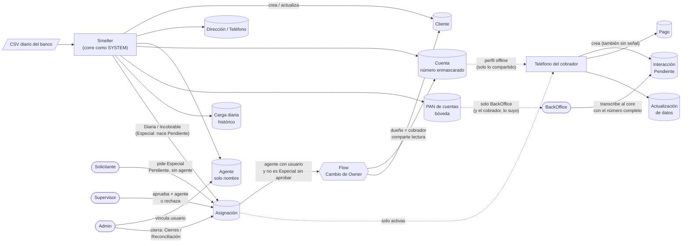
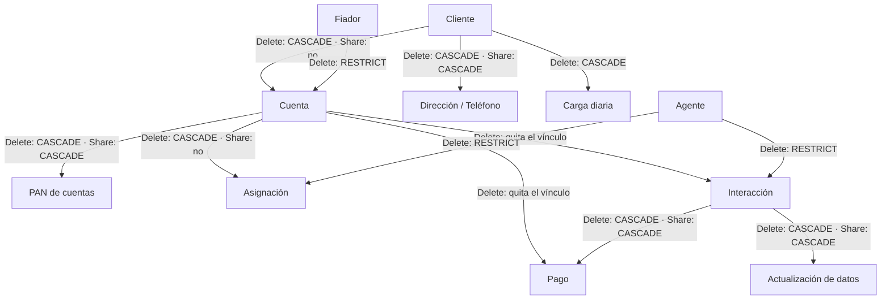
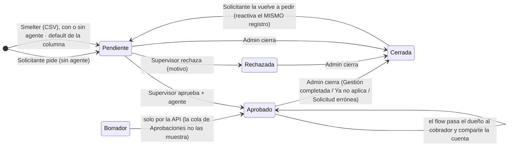
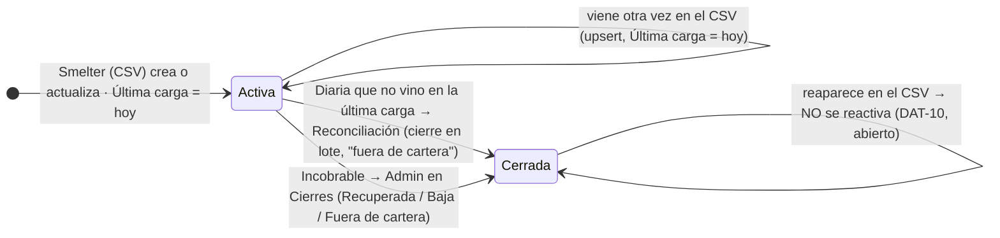
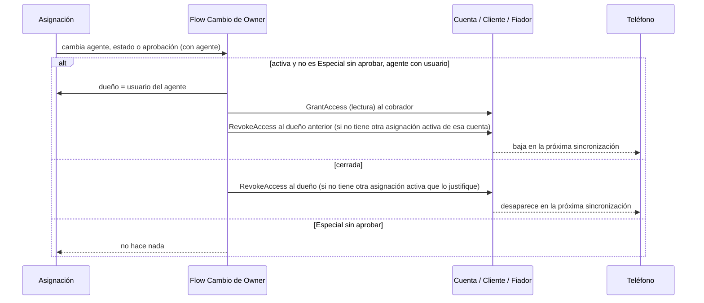
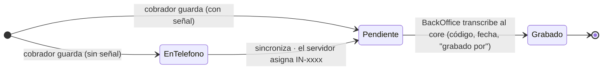
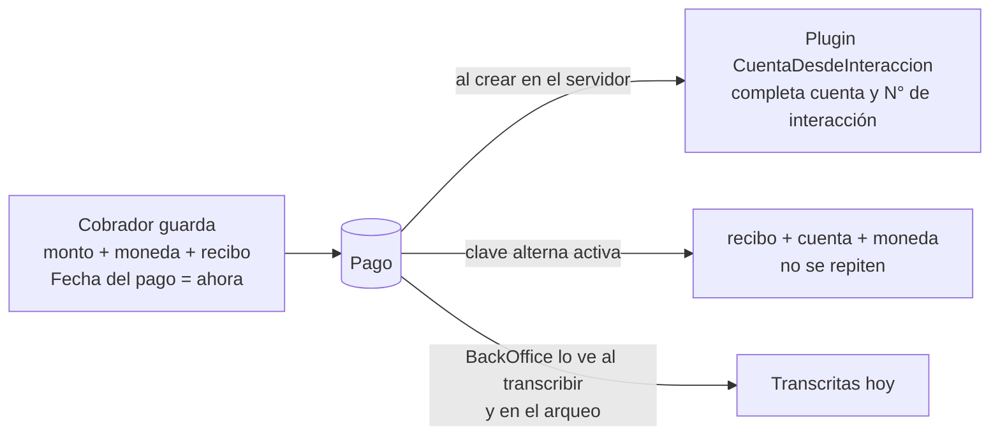
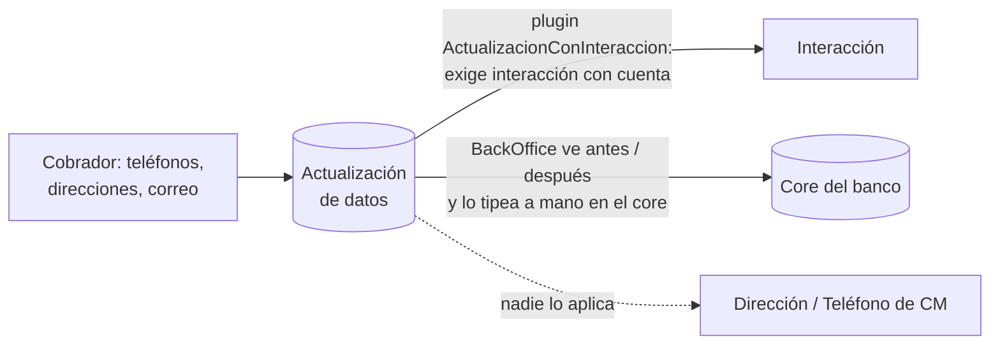
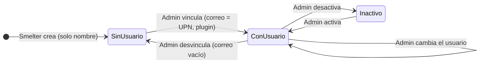

# Ciclo de vida de los datos: Cobranza Móvil

Para cada tabla de la solución `cm_core_cobranzamovil`, este documento responde:

- quién **crea** las filas;
- quién las **cambia** y qué columnas;
- **qué estados** atraviesan;
- **cómo terminan**: cierre lógico o borrado;
- qué **automatismos** del servidor intervienen (plugins, flow, cascadas);
- cómo viajan al **teléfono**.

Estado de DEV al **2026-10-06**. Lo marcado "verificado" se consultó en vivo: cascadas, claves, privilegios y perfil offline.

> Idea central: en esta solución **casi nada se borra**. Las asignaciones se **cierran** (`[AS] Estado = false`), las
> interacciones pasan a **Grabado**, y el histórico (carga diaria, pagos) se acumula. Borrar solo puede el rol Admin por la
> API, y lo hacen los scripts de QA o de migración.

---

## 1. Vista global

**El día típico, en orden:**

1. **Carga (madrugada).** Smelter procesa el CSV y hace upsert en este orden: cliente, agente, dirección y teléfono, cuenta,
   bóveda, asignación. Además deja la foto del día en carga diaria. El número de tarjeta completo solo se escribe en la
   bóveda; el plugin **PanGuard** rechaza un número en claro en cualquier otra columna vigilada.
2. **Reparto.** Por cada asignación con agente, el **flow** pasa el dueño al usuario del cobrador y le **comparte** (solo
   lectura) la cuenta, el cliente y el fiador. Por cascada se comparten también la bóveda, las direcciones y los
   teléfonos. Si el agente no tiene usuario, no pasa nada (DAT-07, abierto).
3. **Especiales.**
   - El Solicitante pide una Especial: queda Pendiente y sin agente.
   - El Supervisor la aprueba eligiendo cobrador, o la rechaza.
   - El plugin **AprobacionEspecial** impide que otro rol lo haga, y el flow solo comparte las aprobadas.
4. **Calle.** El teléfono baja su cartera por el perfil offline: asignaciones activas y 90 días de historial. El cobrador
   registra interacciones, pagos y actualizaciones de datos, aunque no tenga señal.
5. **Sincronización.** El servidor numera (IN-, PG-, AD-). El plugin **CuentaDesdeInteraccion** completa la cuenta y el N°
   de interacción del pago.
6. **Oficina.** El BackOffice transcribe cada interacción al core (con el número completo de la bóveda) y la marca
   **Grabada**.
7. **Cierre.**
   - Reconciliación cierra las Diarias que no vinieron en la última carga.
   - Cierres cierra las Incobrables y las Especiales.
   - El flow revoca el compartido.
   - En la próxima sincronización, la asignación desaparece del teléfono.

---

## 2. Relaciones y qué pasa al borrar (verificado)

Cómo se lee:
- **Share CASCADE:** compartir el padre comparte los hijos. Por eso al compartir el cliente, el cobrador ve sus
  direcciones y teléfonos; y al compartir la cuenta, ve su número en la bóveda.
- **Delete CASCADE:** borrar el padre borra los hijos. **Borrar un cliente borra sus cuentas, sus asignaciones y su
  bóveda.** Nadie lo hace desde las apps, pero el rol Admin puede por la API (DAT-18).
- **RESTRICT:** no se puede borrar un agente o un fiador que tenga hijos.
- **Quita el vínculo:** si se borra una cuenta, sus interacciones y pagos quedan sin cuenta, pero no se borran.

**Reparent** (qué pasa cuando un registro se guarda apuntando a un padre):
- Con `Cascade`, todos los que tienen acceso al padre reciben lectura **heredada** del hijo. Esto pasa también cuando la
  carga vuelve a escribir el mismo padre.
- **Hasta el 2026-10-06** estaba en `Cascade` en Cliente→Cuenta y Cuenta→Asignación. Cada carga diaria le daba al
  cobrador lectura heredada de **todas las cuentas de sus clientes**, con su bóveda (número completo) y sus asignaciones,
  aunque no estuvieran asignadas a él. Era el defecto 2 de la prueba integral.
- Desde esa fecha está en `NoCascade` en **Cliente→Cuenta, Cliente→Carga diaria y Cuenta→Asignación**
  (`scripts/seguridad/paso1_cascadas_auditoria.py`).
- Sigue en `Cascade`, a propósito, en Cuenta→Bóveda, Cliente→Teléfono/Dirección e Interacción→Pago/Actualización. Ahí la
  audiencia es la misma que la del compartido que el diseño quiere.

---

## 3. Asignación: la tabla con más vida

La asignación tiene **dos ejes independientes**:
- **Estado:** Activa o Cerrada (`[AS] Estado`).
- **Aprobación:** Borrador, Pendiente, Aprobado, Rechazada. Solo tiene sentido para las **Especiales**.

### 3.1 Especial

**Reglas del servidor:**
- Solo Supervisor, Admin o la identidad de servicio pueden aprobar, rechazar o poner agente (plugin **AprobacionEspecial**).
- El flow **no comparte** una Especial que no esté Aprobada.
- La carga de Smelter (SYSTEM, sin roles de CM) puede crear Especiales con agente, pero quedan sin compartir hasta que el
  Supervisor las aprueba.

**Especiales del CSV:**
- La plantilla de Smelter **no manda** el estado de aprobación, así que Dataverse pone el valor por defecto de la columna
  (**Pendiente**) al crear. Verificado: las asignaciones QA creadas por la API sin ese campo quedaron Pendientes.
- Así, una Especial nueva del CSV entra sola en la cola del Supervisor. Como el valor no se manda, la carga diaria **no
  lo pisa** después.
- Las **47 Especiales en Borrador** de DEV son de la carga mock de junio, anterior al cambio del default. La cola de
  Aprobaciones solo muestra Pendientes, así que esas 47 no llegan al Supervisor.

**Lo que ve el cobrador:** solo las **Aprobadas y activas**.

**Detalles:**
- Una **Rechazada** sigue Activa y bloquea volver a pedir la misma cuenta hasta que el Admin la cierra (DAT-14).
- Volver a pedir una Cerrada **reactiva el mismo registro**, por la clave alterna cuenta + tipo.

### 3.2 Diaria e Incobrable

**Freno del cierre en lote:** la app no deja cerrar si las desaparecidas superan el **30%** o si no hay carga de hoy. Es un
freno de la app, no del servidor.

**Cambios del cobrador:** solo el orden de su ruta (`[AS] Orden`), también sin conexión.

**Abiertos:**
- **DAT-10:** una Diaria cerrada que vuelve en el CSV no se reactiva.
- **DAT-15:** la reclasificación de Diaria a Incobrable no está implementada.
- **DAT-29:** no hay pantalla de reasignación manual.
- **S-11:** el Supervisor puede escribir cualquier columna.

### 3.3 Qué pasa con el acceso del cobrador

---

## 4. Interacción

**Quién crea:** solo el cobrador. Escribe la cuenta, el agente, el comentario, el GPS (6 decimales) y la fecha de captura,
que la pone el teléfono.

**Grabado es terminal solo por costumbre.** Nada en el servidor impide volver a transcribir, ni que el cobrador edite su
interacción después (**S-9, abierto**).

**En el teléfono:** últimos 90 días (por fecha de modificación).

**Si se borra:** se borran sus pagos y su actualización de datos (cascada).

---

## 5. Pago

- **Sin estados:** un pago no se aprueba ni se cierra; es un hecho registrado.
- **Validaciones:**
  - **App:** monto mayor que 0, recibo obligatorio (hasta 30 caracteres), confirmación si supera el saldo vencido y bloqueo
    de doble toque.
  - **Servidor:** la clave alterna impide duplicar un recibo en la misma cuenta y moneda.
- **Abierto (S-9):** el cobrador puede **editar o reasignar** su pago después de grabarlo. Es el hueco más sensible:
  toca la plata.
- **En el teléfono:** últimos 90 días.

---

## 6. Actualización de datos

- **Sin estados ni cierre (DAT-19, abierto).** No hay "aplicada" o "pendiente". El BackOffice la transcribe junto con la
  interacción, y los datos maestros de CM se renuevan recién con la próxima carga del banco, si el core los actualizó.
- **Para saber de qué cliente es:** se sigue el camino actualización → interacción → cuenta → CIF. El plugin garantiza que
  ese camino exista.

---

## 7. Datos maestros (los crea la carga)

| Tabla | Crea | Cambia | Fin | Teléfono | Notas |
|---|---|---|---|---|---|
| **Carga diaria** | Smelter (una foto por día, idempotente) | Nadie | Se acumula; sin retención definida | No | Monitoreo cuenta las de hoy; Reconciliación compara contra la última |
| **Cliente** | Smelter; Admin en Maestros (anti-duplicado de CIF) | Smelter en cada carga; Admin (nombre y datos) | No se borra | Sí, lo compartido | Lo que edita el Admin lo pisa la carga siguiente; las apps leen el nombre de la cuenta (DAT-26) |
| **Cuenta** | Solo Smelter | Smelter (saldos, mora, datos del cliente) | No se borra | Sí, lo compartido | Número enmascarado `****1234` |
| **PAN de cuentas** (bóveda) | Solo Smelter | Nadie | Se borra solo con la cuenta | Sí, lo compartido (por cascada) | Lee **BackOffice** (todo) y el cobrador (lo suyo, "Ver número", 30 s) |
| **Dirección / Teléfono** | Smelter; Admin agrega | Smelter (clave CIF + tipo) | No se borra | Sí (por cascada del cliente) | No hay editar ni borrar en las apps |
| **Fiador** | Smelter | Smelter | No se borra (RESTRICT) | No | El flow lo comparte, pero no está en el perfil |
| **Agente** | Smelter (solo el nombre) | Admin vincula o desvincula el usuario, activa o desactiva; el plugin **EmailDesdeUsuario** pone el correo = UPN en minúsculas | Se desactiva | Sí | Sin usuario, el flow no reparte sus asignaciones (DAT-07) |

### 7.1 Agente

---

## 8. Brechas abiertas del ciclo de vida

| # | Brecha | Efecto |
|---|---|---|
| DAT-07 / DAT-08 | El flow no reparte si el agente no tiene usuario, ni cuando se le vincula después | Asignaciones que no llegan a ningún teléfono hasta el próximo cambio |
| DAT-10 | Una Diaria cerrada que reaparece en el CSV no se reactiva | El cobrador no la ve aunque el banco la volvió a mandar |
| DAT-14 | Una Especial Rechazada sigue Activa | Bloquea volver a pedirla hasta que el Admin la cierra |
| DAT-15 | No hay reclasificación de Diaria a Incobrable | — |
| DAT-18 | Borrar un cliente o una cuenta borra en cascada | Solo el Admin, por la API; ninguna app lo hace |
| DAT-19 | La actualización de datos no tiene ciclo | Nadie la marca como aplicada |
| DAT-20 | No se puede crear una cuenta desde el backoffice | Todo pasa por la carga |
| DAT-26 | Lo que el Admin edita en un cliente lo pisa la carga | — |
| S-9 | El cobrador edita lo ya grabado | Montos, fechas y GPS modificables después |

Fuentes: `docs/auditoria/contrato-de-datos.md` (secciones 3.x y DAT-xx, del 2026-10-03), `localizador-bugs-codigo.md`
(cierres posteriores), `fase2-pan-diseno.md` (bóveda), `scripts/seguridad/paso2_flow.py` (flow),
`scripts/pan/paso7_perfil_offline.py` (perfil), `plugins/` (reglas del servidor), y consultas en vivo a DEV del 2026-10-06.
