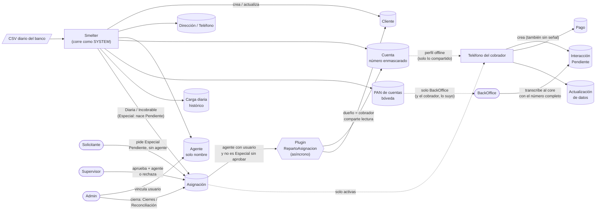
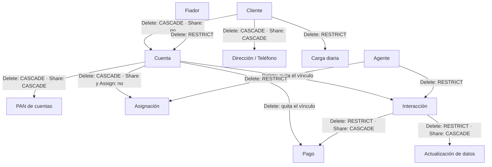
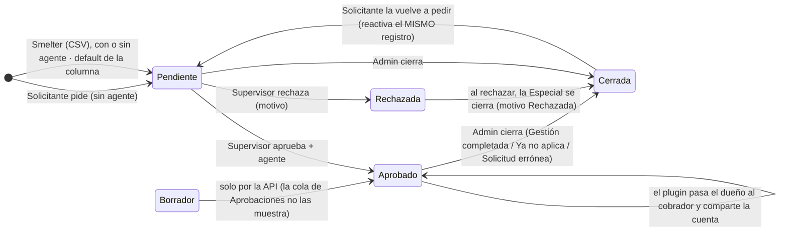
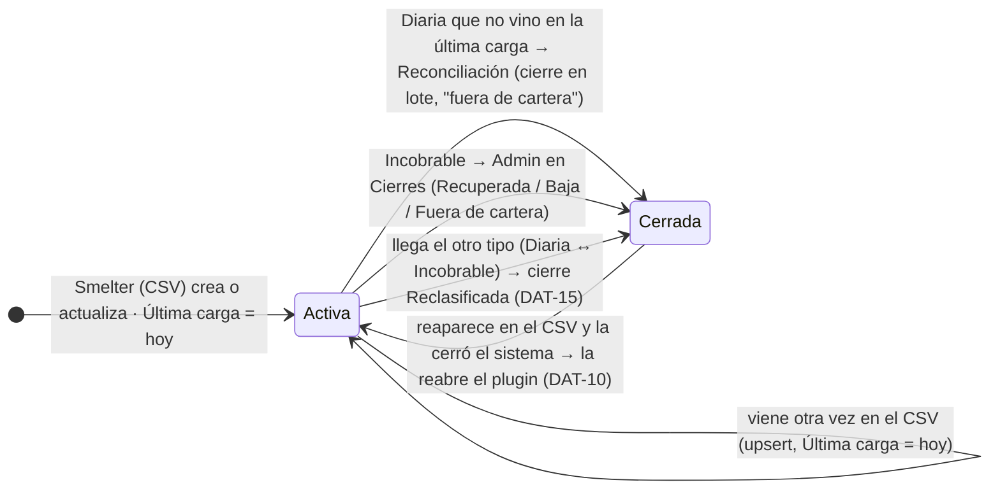
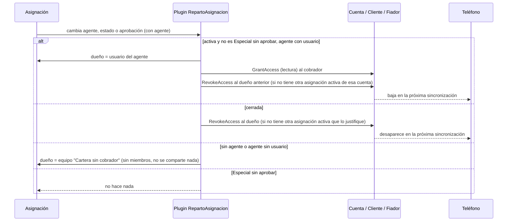
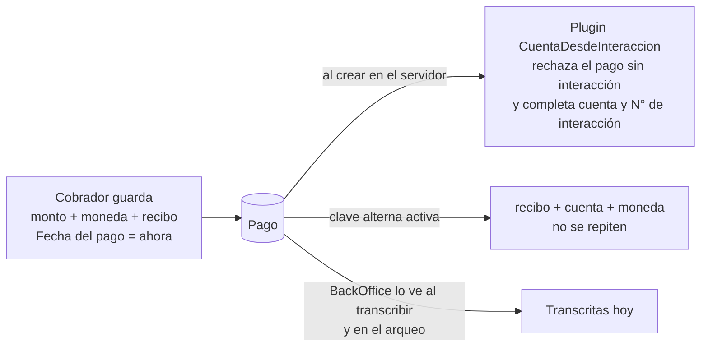
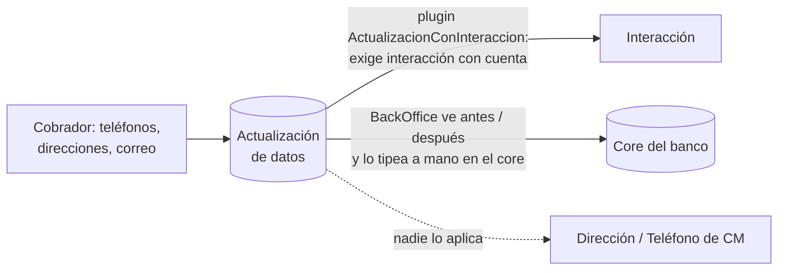
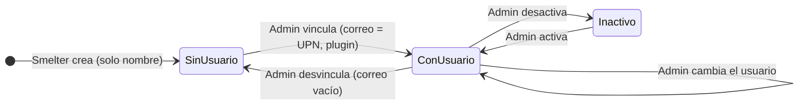

# Ciclo de vida de los datos: Cobranza Móvil

Para cada tabla de la solución `cm_core_cobranzamovil`, este documento responde:

- quién **crea** las filas;
- quién las **cambia** y qué columnas;
- **qué estados** atraviesan;
- **cómo terminan**: cierre lógico o borrado;
- qué **automatismos** del servidor intervienen (plugins, cascadas);
- cómo viajan al **teléfono**.

Estado de DEV al **2026-10-06**, con el reparto, las reglas del servidor y las cascadas actualizados al **2026-10-14** (el flow de owner lo reemplazaron los plugins `RepartoAsignacion` y `RepartoPorAgente`, ver `docs/referencia/03-catalogo-de-tablas.md` C.3; plugins en C.2, ensamblado 1.0.6.1). Lo marcado "verificado" se consultó en vivo: cascadas, claves, privilegios y perfil offline.

> Idea central: en esta solución **casi nada se borra**. Las asignaciones se **cierran** (`[AS] Estado = false`), las
> interacciones pasan a **Grabado**, y el histórico (carga diaria, pagos) se acumula. Borrar solo puede el rol Admin por la
> API, y lo hacen los scripts de QA o de migración.

---

## 1. Vista global



**El día típico, en orden:**

1. **Carga (madrugada).** Smelter procesa el CSV y hace upsert en este orden: cliente, agente, dirección y teléfono, cuenta,
   bóveda, asignación. Además deja la foto del día en carga diaria. El número de tarjeta completo solo se escribe en la
   bóveda; el plugin **PanGuard** rechaza un número en claro en cualquier otra columna vigilada.
2. **Reparto.** Por cada asignación, el plugin asíncrono **RepartoAsignacion** pasa el dueño al usuario del cobrador y le
   **comparte** (solo lectura) la cuenta, el cliente y el fiador. Por cascada se comparten también la bóveda, las
   direcciones y los teléfonos. Si no hay agente, o el agente no tiene usuario, el dueño pasa al equipo sin miembros
   "CM · Cartera sin cobrador" y nadie la ve en el teléfono (DAT-07, cerrado). Cuando se vincula o cambia el usuario de un
   agente, **RepartoPorAgente** vuelve a repartir sus asignaciones activas (DAT-08). Detalle en el catálogo, C.3.
3. **Especiales.**
   - El Solicitante pide una Especial: queda Pendiente y sin agente.
   - El Supervisor la aprueba eligiendo cobrador, o la rechaza.
   - El plugin **AprobacionEspecial** impide que otro rol lo haga, y el reparto solo comparte las aprobadas.
   - Una Diaria o Incobrable nace en Borrador y no como pendiente de aprobación (DAT-28).
4. **Calle.** El teléfono baja su cartera por el perfil offline: asignaciones activas y 90 días de historial. El cobrador
   registra interacciones, pagos y actualizaciones de datos, aunque no tenga señal.
5. **Sincronización.** El servidor numera (IN-, PG-, AD-). El plugin **InteraccionDelCobrador** exige cuenta y agente en la
   interacción y pone el agente del cobrador (DAT-13, SEC-08). El plugin **CuentaDesdeInteraccion** rechaza un pago sin
   interacción y completa la cuenta y el N° de interacción del pago.
6. **Oficina.** El BackOffice transcribe cada interacción al core (con el número completo de la bóveda) y la marca
   **Grabada**. El plugin **GrabacionInteraccion** pone la fecha y el usuario de grabación y no deja grabarla dos veces (DAT-11).
7. **Cierre.**
   - Reconciliación cierra las Diarias que no vinieron en la última carga. Si el banco las vuelve a mandar, el plugin
     **CargaSobreAsignacion** las reabre (DAT-10).
   - Si una cuenta cambia de Diaria a Incobrable (o al revés), **Reclasificacion** cierra la anterior (DAT-15).
   - Cierres cierra las Incobrables y las Especiales.
   - **RepartoAsignacion** revoca el compartido.
   - En la próxima sincronización, la asignación desaparece del teléfono.

---

## 2. Relaciones y qué pasa al borrar (verificado)



Cómo se lee:
- **Share CASCADE:** compartir el padre comparte los hijos. Por eso al compartir el cliente, el cobrador ve sus
  direcciones y teléfonos; y al compartir la cuenta, ve su número en la bóveda.
- **Delete CASCADE:** borrar el padre borra los hijos. **Borrar un cliente borra sus cuentas, sus asignaciones y su
  bóveda.** Nadie lo hace desde las apps, pero el rol Admin puede por la API.
- **RESTRICT:** no se puede borrar un agente o un fiador que tenga hijos. Desde el 2026-10-14 (DAT-18) tampoco un cliente
  que tenga carga diaria, ni una interacción que tenga pagos o actualizaciones de datos.
- **Quita el vínculo:** si se borra una cuenta, sus interacciones y pagos quedan sin cuenta, pero no se borran.

**Reparent** (qué pasa cuando un registro se guarda apuntando a un padre):
- Con `Cascade`, todos los que tienen acceso al padre reciben lectura **heredada** del hijo. Esto pasa también cuando la
  carga vuelve a escribir el mismo padre.
- **Hasta el 2026-10-06** estaba en `Cascade` en Cliente→Cuenta y Cuenta→Asignación. Cada carga diaria le daba al
  cobrador lectura heredada de **todas las cuentas de sus clientes**, con su bóveda (número completo) y sus asignaciones,
  aunque no estuvieran asignadas a él. Era el defecto 2 de la prueba integral.
- Desde esa fecha está en `NoCascade` en **Cliente→Cuenta, Cliente→Carga diaria y Cuenta→Asignación**
  (`scripts/seguridad/paso1_cascadas_auditoria.py`).
- Sigue en `Cascade`, a propósito, en Cuenta→Bóveda, Cliente→Teléfono/Dirección e Interacción→Pago/Actualización (salvo el
  borrado, que ahí es Restrict). Ahí la audiencia es la misma que la del compartido que el diseño quiere.
- **Assign** (reasignar el dueño del padre): desde el 2026-10-14 (DAT-18) Cuenta→Asignación está en `NoCascade`, así que
  reasignar la cuenta ya no pisa el dueño que puso `RepartoAsignacion`.

---

## 3. Asignación: la tabla con más vida

La asignación tiene **dos ejes independientes**:
- **Estado:** Activa o Cerrada (`[AS] Estado`).
- **Aprobación:** Borrador, Pendiente, Aprobado, Rechazada. Solo tiene sentido para las **Especiales**.

### 3.1 Especial



**Reglas del servidor:**
- Solo Supervisor, Admin o la identidad de servicio pueden aprobar, rechazar o poner agente (plugin **AprobacionEspecial**).
- El reparto **no comparte** una Especial que no esté Aprobada (el plugin no hace nada hasta que se aprueba).
- Cada rol escribe solo las columnas de su pantalla (plugin **ColumnasAsignacion**, S-11, cerrado el 2026-10-14): el Supervisor,
  aprobación, agente, resolutor, motivo de rechazo, estado, motivo y fecha de cierre; el Solicitante, las de volver a pedir; el
  Localizador, solo el orden.
- La carga de Smelter (SYSTEM, sin roles de CM) puede crear Especiales con agente, pero quedan sin compartir hasta que el
  Supervisor las aprueba.

**Especiales del CSV:**
- La plantilla de Smelter **no manda** el estado de aprobación, así que Dataverse pone el valor por defecto de la columna
  (**Pendiente**) al crear. Verificado: las asignaciones QA creadas por la API sin ese campo quedaron Pendientes.
- Así, una Especial nueva del CSV entra sola en la cola del Supervisor. Como el valor no se manda, la carga diaria **no
  lo pisa** después.
- Una Diaria o Incobrable, en cambio, nace en **Borrador** (DAT-28, plugin **AprobacionEspecial**). El default de la columna
  sigue en Pendiente porque las Especiales del CSV lo necesitan para entrar en la cola. Las 6 filas que había en DEV se corrigieron.
- Las **47 Especiales en Borrador** de DEV son de la carga mock de junio, anterior al cambio del default. La cola de
  Aprobaciones solo muestra Pendientes, así que esas 47 no llegan al Supervisor.

**Lo que ve el cobrador:** solo las **Aprobadas y activas**.

**Detalles:**
- **Rechazar cierra la Especial** (estado inactivo, motivo "Rechazada" y fecha de cierre), así que el Solicitante original puede
  volver a pedirla (DAT-14, parcial, 2026-10-14). Nueva solicitud avisa con un mensaje claro si la cuenta ya tiene una Especial
  pedida por otra persona. **Sigue abierto:** un Solicitante no ve la Especial de otro (lectura Basic); falta decidir entre una
  Custom API y una lectura más amplia.
- Volver a pedir una Cerrada **reactiva el mismo registro**, por la clave alterna cuenta + tipo.

### 3.2 Diaria e Incobrable



**Freno del cierre en lote:** la app no deja cerrar si no hay carga de hoy o si hay una en curso. Si las desaparecidas superan el **30%**, muestra una alerta roja y pide una confirmación explícita, pero deja cerrar (decisión 2026-10-25). Es un
freno de la app, no del servidor.

**Cambios del cobrador:** solo el orden de su ruta (`[AS] Orden`), también sin conexión. El servidor lo impone (S-11).

**Cerrados el 2026-10-14:**
- **DAT-10:** el plugin **CargaSobreAsignacion** reabre una Diaria o Incobrable que cerró el sistema ("fuera de cartera" o
  "Reclasificada a …") cuando reaparece en el CSV. No reabre lo que cerró una persona ni las Especiales.
- **DAT-31:** ese mismo plugin ya no pisa la fecha de asignación si tenía valor.
- **DAT-15:** el plugin **Reclasificacion** deja una sola activa entre Diaria e Incobrable por cuenta y cierra la anterior con
  motivo "Reclasificada a {tipo}". Las Especiales conviven.
- **DAT-29:** pantalla *Reasignar* del backoffice. El Supervisor reasigna las Especiales aprobadas activas y el Admin también las
  Incobrables activas; solo escribe el agente y el reparto mueve el dueño. Las Diarias no se reasignan a mano: gana el CSV.
- **S-11:** el Supervisor ya no escribe cualquier columna (ver las reglas del servidor, arriba).

### 3.3 Qué pasa con el acceso del cobrador



---

## 4. Interacción

```mermaid
stateDiagram-v2
    direction LR
    [*] --> EnTelefono: cobrador guarda (sin señal)
    [*] --> Pendiente: cobrador guarda (con señal)
    EnTelefono --> Pendiente: sincroniza · el servidor asigna IN-xxxx
    Pendiente --> Grabado: BackOffice transcribe al core (código; fecha y "grabado por" los pone el servidor)
    Grabado --> [*]
```

**Quién crea:** solo el cobrador. Escribe la cuenta, el comentario, el GPS (6 decimales) y la fecha de captura, que la pone
el teléfono. El plugin **InteraccionDelCobrador** exige cuenta y agente; si la crea un cobrador, el agente es el vinculado a su
usuario (lo pone el servidor, aunque la app mande otro) y nace Pendiente, sin código, fecha ni usuario de grabación (DAT-13, SEC-08).

**Grabado es terminal, y ahora lo impone el servidor.** El cobrador crea pero no edita su interacción (S-9, cerrado el
2026-10-14). Desde el 2026-10-14 el plugin **GrabacionInteraccion** (DAT-11) no deja volver a grabar una interacción Grabada ni
cambiar su código: la segunda persona del BackOffice recibe un error en vez de pisar la grabación. Pasar a Grabado exige el
código, la fecha y el usuario de grabación los pone el servidor, y el BackOffice solo puede escribir las columnas de grabación.
**Límite:** dos grabaciones en el mismo milisegundo podrían pasar las dos, porque el plugin lee el estado previo antes de que la
fila quede bloqueada.

**En el teléfono:** últimos 90 días (por fecha de modificación).

**Si se borra:** si tiene pagos o actualización de datos, no se puede (Restrict desde el 2026-10-14, DAT-18).

---

## 5. Pago



- **Sin estados:** un pago no se aprueba ni se cierra; es un hecho registrado.
- **Validaciones:**
  - **App:** monto mayor que 0, recibo obligatorio (hasta 30 caracteres), confirmación si supera el saldo vencido y bloqueo
    de doble toque.
  - **Servidor:** la clave alterna impide duplicar un recibo en la misma cuenta y moneda, y el plugin rechaza un pago sin
    interacción (DAT-13).
- **Cerrado (S-9, 2026-10-14):** el cobrador crea el pago pero no lo edita ni lo reasigna. Era el hueco más sensible: toca la
  plata.
- **En el teléfono:** últimos 90 días.

---

## 6. Actualización de datos



- **Sin estados ni cierre, por decisión del dueño (DAT-19, cerrado el 2026-10-14).** La actualización de datos termina en el
  core del banco, así que no hacen falta más estados. El BackOffice la transcribe junto con la interacción, y los datos
  maestros de CM se renuevan recién con la próxima carga del banco, si el core los actualizó.
- **Para saber de qué cliente es:** se sigue el camino actualización → interacción → cuenta → CIF. El plugin garantiza que
  ese camino exista.

---

## 7. Datos maestros (los crea la carga)

| Tabla | Crea | Cambia | Fin | Teléfono | Notas |
|---|---|---|---|---|---|
| **Carga diaria** | Smelter (una foto por día, idempotente) | Nadie | Se acumula; un trabajo diario borra lo de más de 60 días (DEC-019) | No | Monitoreo cuenta las de hoy; Reconciliación compara contra la última |
| **Cliente** | Smelter; Admin en Maestros (anti-duplicado de CIF) | Smelter en cada carga; Admin (nombre y datos) | No se borra | Sí, lo compartido | Lo que edita el Admin lo pisa la carga siguiente; las apps leen el nombre de la cuenta (DAT-26) |
| **Cuenta** | Solo Smelter | Smelter (saldos, mora, datos del cliente) | No se borra | Sí, lo compartido | Número enmascarado `****1234` |
| **PAN de cuentas** (bóveda) | Solo Smelter | Nadie | Se borra solo con la cuenta | Sí, lo compartido (por cascada) | Lee **BackOffice** (todo) y el cobrador (lo suyo, "Ver número", 30 s) |
| **Dirección / Teléfono** | Smelter; Admin agrega | Smelter (clave CIF + tipo) | No se borra | Sí (por cascada del cliente) | No hay editar ni borrar en las apps |
| **Fiador** | Smelter | Smelter | No se borra (RESTRICT); un trabajo diario borra los fiadores sin nombre | No | El plugin lo comparte, pero no está en el perfil. Los sin nombre salen de las filas del CSV con `NombreFianza` vacío (la corrección de origen es de Smelter) |
| **Agente** | Smelter (solo el nombre) | Admin vincula o desvincula el usuario (el backoffice solo escribe ese lookup), activa o desactiva; el plugin **EmailDesdeUsuario** pone el correo = UPN en minúsculas (DAT-17) | Se desactiva | Sí | Sin usuario, sus asignaciones van al equipo "Cartera sin cobrador" (DAT-07); al vincularlo, **RepartoPorAgente** las reparte (DAT-08) |

### 7.1 Agente



---

## 8. Brechas abiertas del ciclo de vida

| # | Brecha | Efecto |
|---|---|---|
| DAT-14 (parcial) | Un Solicitante no ve la Especial que pidió otro (lectura Basic). Rechazar ya cierra la Especial, así que el que la pidió puede volver a pedirla | Intenta crear y recibe un error; falta decidir entre una Custom API y una lectura más amplia |
| DAT-20 | No se puede crear una cuenta desde el backoffice | Todo pasa por la carga |
| DAT-26 | Lo que el Admin edita en un cliente lo pisa la carga | — |

**Cerradas el 2026-10-14:** DAT-10, DAT-15, DAT-18 (borrar un cliente con carga diaria o una interacción con pagos ya no se
puede, y reasignar la cuenta no baja a sus asignaciones), DAT-19 (por decisión: termina en el core) y S-9 (el cobrador crea
pero no edita ni reasigna; cerrado en el commit `0ca6427`). Detalle en `docs/auditoria/contrato-de-datos.md` y en el catálogo.

Fuentes: `docs/auditoria/contrato-de-datos.md` (secciones 3.x y DAT-xx, del 2026-10-03), `localizador-bugs-codigo.md`
(cierres posteriores), `fase2-pan-diseno.md` (bóveda), `docs/referencia/03-catalogo-de-tablas.md` C.3 (reparto; el flow de `scripts/seguridad/paso2_flow.py` quedó apagado),
`scripts/pan/paso7_perfil_offline.py` (perfil), `plugins/` (reglas del servidor), y consultas en vivo a DEV del 2026-10-06.
