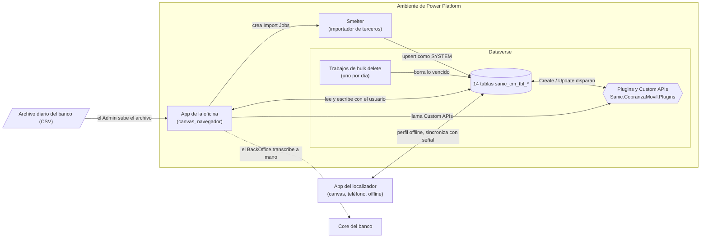
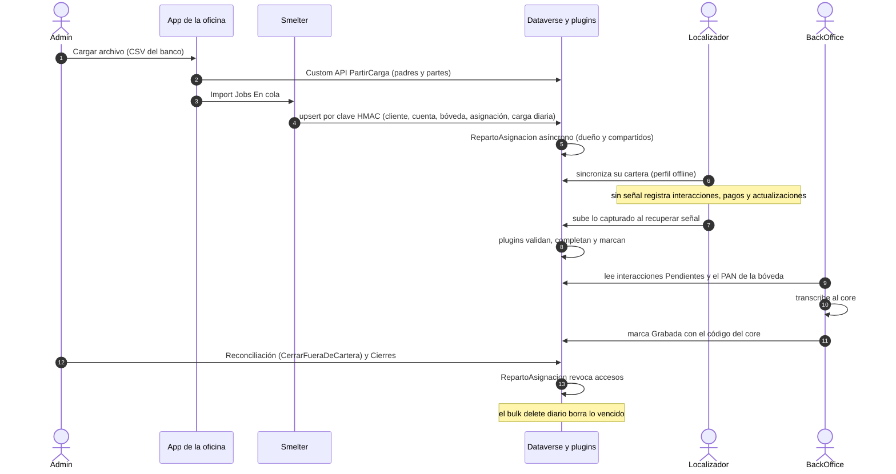

# Arquitectura

Visión de punta a punta de Cobranza Móvil: qué componentes tiene, cómo viajan los datos en un día de operación y por qué se diseñó así. Está escrito para quien recibe la solución sin contexto y la tiene que instalar, mantener o modificar en otro tenant. El detalle de cada pieza está en los documentos 02 a 11; este documento los enlaza sin repetirlos.

## Cómo funciona

### Componentes

| Componente | Qué es | Para qué está |
|---|---|---|
| App del localizador | *Canvas app* (app de Power Apps con pantallas diseñadas a mano) que corre en el teléfono con un *offline profile* (la definición de qué filas de Dataverse se copian al dispositivo) | El **localizador** ve su cartera y registra visitas y pagos aunque no tenga señal. En el código histórico el localizador aparece como «cobrador» (`InteraccionDelCobrador`, «Cartera sin cobrador») |
| App de la oficina | *Canvas app* web, con pantallas por rol | Carga del archivo, transcripción al core, Especiales, reasignación, reconciliación, administración |
| Dataverse | 14 tablas con prefijo `sanic_cm_tbl_` dentro de la *solution* (paquete que transporta el esquema, las apps y los roles entre ambientes) `cm_core_cobranzamovil` | Única fuente de verdad. Detalle en [Modelo de datos](02-modelo-de-datos.md) |
| Ensamblado de plugins | Un *plugin* es código C# que Dataverse ejecuta dentro de la operación de guardado. Una *Custom API* es un mensaje propio de Dataverse, respaldado por un plugin, que las apps llaman como una función | Toda la lógica que no se puede delegar al teléfono ni a la pantalla. Detalle en [Plugins y Custom APIs](04-plugins-y-custom-apis.md) |
| Smelter | Herramienta de importación de terceros que corre en el mismo ambiente. Se configura con plantillas; no se modifica su código | Convierte el CSV del banco en registros de Dataverse. Detalle en [Carga diaria](07-carga-diaria.md) |
| Trabajos de *bulk delete* | Trabajos programados nativos de Dataverse que borran en masa las filas que cumplen una consulta | Retención: nada vive más de lo necesario. Detalle en [Ciclo de vida](08-ciclo-de-vida.md) |
| Roles y equipos | Roles `SR \| CM \| <perfil>` asignados por equipo, más el *owner team* (equipo que puede ser dueño de registros) «CM · Cartera sin cobrador» | Quién ve y escribe qué. Detalle en [Seguridad](03-seguridad.md) |

Las 14 tablas: `sanic_cm_tbl_cliente`, `sanic_cm_tbl_cuenta`, `sanic_cm_tbl_cuentapan` (bóveda del número de tarjeta), `sanic_cm_tbl_cargadiaria`, `sanic_cm_tbl_asignacion`, `sanic_cm_tbl_interaccion`, `sanic_cm_tbl_pago`, `sanic_cm_tbl_actualizaciondatos`, `sanic_cm_tbl_agente`, `sanic_cm_tbl_producto`, `sanic_cm_tbl_fiador`, `sanic_cm_tbl_direccion`, `sanic_cm_tbl_telefono` y `sanic_cm_tbl_opcionlista`.

### Un día de operación

1. **Carga.** El Admin sube el CSV en [`scrCargaArchivo.pa.yaml`](../../apps/backoffice-canvas/Src/scrCargaArchivo.pa.yaml). La Custom API [`PartirCarga.cs`](../../plugins/Sanic.CobranzaMovil.Plugins/PartirCarga.cs) parte el archivo en un job de «padres» (producto, fiador, agente) y hasta 4 jobs de «partes» por cliente, para que la carga corra en paralelo. Smelter hace *upsert* (crear o actualizar según una clave) por *alternate key* (clave alternativa: columnas únicas distintas del id) y escribe como el usuario SYSTEM.
2. **Reparto de asignaciones.** Por cada asignación, el plugin asíncrono [`RepartoAsignacion.cs`](../../plugins/Sanic.CobranzaMovil.Plugins/RepartoAsignacion.cs) pone como dueño al usuario del agente y le comparte en lectura la cuenta, el cliente y el fiador. Sin usuario, el dueño pasa al equipo «CM · Cartera sin cobrador», que no tiene miembros.
3. **Sincronización y trabajo offline.** El teléfono baja lo que el localizador puede leer: sus asignaciones activas y 90 días de historial ([`paso7_perfil_offline.py`](../../scripts/pan/paso7_perfil_offline.py)). Sin señal, registra interacciones, pagos y actualizaciones de datos en la base local.
4. **Subida.** Al recuperar señal, el runtime offline sube lo pendiente con la identidad del localizador. Los plugins exigen cuenta y agente, ponen el agente del usuario, completan lookups (*lookup*: columna que apunta a otra fila) y marcan lo dudoso.
5. **Transcripción.** El BackOffice abre [`scrTranscripcion.pa.yaml`](../../apps/backoffice-canvas/Src/scrTranscripcion.pa.yaml), lee el número completo de la bóveda, lo graba en el core y marca la interacción **grabada**. [`GrabacionInteraccion.cs`](../../plugins/Sanic.CobranzaMovil.Plugins/GrabacionInteraccion.cs) impide grabarla dos veces y pone la fecha y el usuario.
6. **Reconciliación y cierres.** El Admin cierra en [`scrReconciliacion.pa.yaml`](../../apps/backoffice-canvas/Src/scrReconciliacion.pa.yaml) las Diarias que no vinieron en la última carga (Custom API [`CerrarFueraDeCartera.cs`](../../plugins/Sanic.CobranzaMovil.Plugins/CerrarFueraDeCartera.cs)) y en [`scrCierres.pa.yaml`](../../apps/backoffice-canvas/Src/scrCierres.pa.yaml) las Incobrables y Especiales. Cada cierre dispara el reparto, que revoca el acceso; la asignación desaparece del teléfono en la siguiente sincronización.
7. **Borrado programado.** Los trabajos de [`paso10_borrado_programado.py`](../../scripts/seguridad/paso10_borrado_programado.py) borran la carga diaria a los 7 días, las cuentas 14 días después de salir de cartera y lo que capturó el teléfono a los 2 años.

### Por qué una canvas app offline en el teléfono

- **El offline es requisito de negocio.** El localizador trabaja en la calle, muchas veces sin datos; si la app se bloquea sin señal, la visita vuelve al papel.
- **Canvas con perfil offline propio** permite controlar qué baja al teléfono: solo las filas que la seguridad por fila le deja leer, y un filtro adicional (asignaciones activas, 90 días). El perfil autogenerado se rearma con cada publicación, puede quedar trabado y no viaja en la solución.
- **La pantalla controla la exposición del PAN**: «Ver número» lo guarda en una variable de contexto y un temporizador lo oculta a los 30 s ([`scrDetalleCuenta.pa.yaml`](../../apps/localizador-canvas/Src/scrDetalleCuenta.pa.yaml)).
- **Límites asumidos:** un solo nivel de lookup en filtros offline, y cada copia a una colección se corta en 2.000 filas. Por eso el pago tiene su propio lookup a la cuenta y la cartera se trae por tramos. Detalle en [App del localizador](05-app-localizador.md).

### Por qué la lógica crítica vive en plugins

- **El servidor es la única fuente confiable.** Lo que manda el teléfono (agente, fecha de captura, cuenta) se puede manipular o llegar tarde; el plugin pone el agente del usuario aunque la app mande otro ([`InteraccionDelCobrador.cs`](../../plugins/Sanic.CobranzaMovil.Plugins/InteraccionDelCobrador.cs)).
- **Corre para todos los caminos.** Las reglas de negocio de formulario no corren en canvas ni en la API; un plugin corre igual desde las dos apps, desde Smelter y desde la Web API.
- **Lo que viene del teléfono no se rechaza: se marca.** El runtime offline descarta en silencio lo que el servidor rechaza y no lo reintenta. Por eso un recibo repetido entra con `sanic_cm_pg_reciborepetido` ([`ReciboRepetido.cs`](../../plugins/Sanic.CobranzaMovil.Plugins/ReciboRepetido.cs)) y una actualización sin interacción entra con `sanic_cm_ad_sinvincular` ([`ActualizacionConInteraccion.cs`](../../plugins/Sanic.CobranzaMovil.Plugins/ActualizacionConInteraccion.cs)). Las únicas excepciones deliberadas están en [Trampas](#trampas-y-errores-conocidos).
- **Nunca trazan valores.** [`PluginBase.cs`](../../plugins/Sanic.CobranzaMovil.Plugins/PluginBase.cs) solo traza nombres de columnas y tipos de excepción, para que ninguna traza ni mensaje de error contenga un PAN.

### Cómo se protege el número de tarjeta (PAN)

El número de cuenta del archivo del banco es el PAN real, así que la solución está en alcance de PCI DSS. Detalle completo en [Seguridad](03-seguridad.md).

| Capa | Mecanismo |
|---|---|
| Almacenamiento | El PAN completo vive solo en la bóveda `sanic_cm_tbl_cuentapan`, 1:1 con la cuenta. Las demás tablas guardan `****1234` y los últimos 4 |
| Claves | Las uniones y el upsert usan una clave sustituta HMAC-SHA256 del PAN (`*_clavepan`), que calcula Smelter con una clave secreta K. Ningún plugin conoce K |
| Acceso | La bóveda se protege con seguridad por fila (no por columna): el localizador la ve por el compartido en *cascade* (propagación automática de padre a hijo) desde la cuenta; el BackOffice la lee entera; Solicitante y Supervisor no tienen privilegios |
| Red de seguridad | [`PanGuard.cs`](../../plugins/Sanic.CobranzaMovil.Plugins/PanGuard.cs) rechaza 5 o más dígitos seguidos en las columnas de número visibles |
| Pantalla | Enmascarado por defecto; «Ver número» en el teléfono durante 30 s; el PAN no se guarda en colecciones ni en `SaveData` |

## Piezas y archivos

| Pieza | Dónde está |
|---|---|
| App del localizador | [`apps/localizador-canvas/Src/`](../../apps/localizador-canvas/Src/) — arranque en [`App.pa.yaml`](../../apps/localizador-canvas/Src/App.pa.yaml) |
| App de la oficina | [`apps/backoffice-canvas/Src/`](../../apps/backoffice-canvas/Src/) — fórmulas globales e interruptores en [`App.pa.yaml`](../../apps/backoffice-canvas/Src/App.pa.yaml) |
| Plugins y Custom APIs | [`plugins/Sanic.CobranzaMovil.Plugins/`](../../plugins/Sanic.CobranzaMovil.Plugins/) — nombres de tablas y columnas en [`Esquema.cs`](../../plugins/Sanic.CobranzaMovil.Plugins/Esquema.cs) |
| Pruebas de plugins | [`plugins/Sanic.CobranzaMovil.Plugins.Tests/`](../../plugins/Sanic.CobranzaMovil.Plugins.Tests/) |
| Registro de plugins y Custom APIs | [`paso5_plugins.py`](../../scripts/pan/paso5_plugins.py), [`paso12_custom_api.py`](../../scripts/pan/paso12_custom_api.py) |
| Perfil offline | [`paso7_perfil_offline.py`](../../scripts/pan/paso7_perfil_offline.py) |
| Plantillas de Smelter | [`paso6_plantilla.py`](../../scripts/pan/paso6_plantilla.py), [`paso20_plantillas_paralelas.py`](../../scripts/pan/paso20_plantillas_paralelas.py) |
| Cascadas y auditoría | [`paso1_cascadas_auditoria.py`](../../scripts/seguridad/paso1_cascadas_auditoria.py) |
| Equipo «Cartera sin cobrador» | [`paso5_cartera_sin_cobrador.py`](../../scripts/seguridad/paso5_cartera_sin_cobrador.py) |
| Borrado programado | [`paso10_borrado_programado.py`](../../scripts/seguridad/paso10_borrado_programado.py) |
| Solución desempaquetada | [`solutions/unpacked/`](../../solutions/unpacked/) (puede estar atrasada respecto del ambiente) |
| Pruebas de punta a punta | [`tests/`](../../tests/) — ver [Pruebas](10-pruebas.md) |

## Cómo se modifica

**Agregar una regla de negocio.** Va en un plugin, no en la pantalla:

1. Crear la clase heredando de [`PluginBase.cs`](../../plugins/Sanic.CobranzaMovil.Plugins/PluginBase.cs) y llamar a `ExigirRegistro` con tabla, etapa y mensaje, para que un registro mal hecho falle cerrado.
2. Si la regla toca algo que crea el teléfono, **marcar en vez de rechazar**.
3. Si corre en cada fila de la carga, evitar consultas: usar `RolesCm.DelLlamadorSalvoSistema` y filtros de columnas en el paso.
4. Registrar el paso en [`paso5_plugins.py`](../../scripts/pan/paso5_plugins.py) y subir la versión del ensamblado. Detalle en [Plugins y Custom APIs](04-plugins-y-custom-apis.md).

**Agregar una tabla que el teléfono necesite.** Agregarla a la solución, darle privilegios al rol Localizador, sumarla a `TABLAS` (y a `FILTROS` si hace falta acotarla) en [`paso7_perfil_offline.py`](../../scripts/pan/paso7_perfil_offline.py) y refrescar las fuentes de la app. Detalle en [App del localizador](05-app-localizador.md).

**Agregar una columna al archivo del banco.** Se edita solo la plantilla principal «Cobranza movil» y después se corre [`paso20_plantillas_paralelas.py`](../../scripts/pan/paso20_plantillas_paralelas.py); `PartirCarga` se niega a partir si las plantillas derivadas no coinciden. Detalle en [Carga diaria](07-carga-diaria.md).

**Instalar en otro ambiente.** El orden importa (cascadas antes de la primera carga, equipo sin cobrador antes del reparto). Ver [Instalación y despliegue](09-instalacion-y-despliegue.md).

## Trampas y errores conocidos

- ⚠️ **Los rechazos del servidor pierden datos offline.** Hay rechazos deliberados que pueden descartar una captura hecha sin señal: una interacción en una cuenta que ya no es del localizador fuera de la tolerancia de 48 h, o de un localizador desactivado ([`InteraccionDelCobrador.cs`](../../plugins/Sanic.CobranzaMovil.Plugins/InteraccionDelCobrador.cs)), y un pago sin interacción ([`CuentaDesdeInteraccion.cs`](../../plugins/Sanic.CobranzaMovil.Plugins/CuentaDesdeInteraccion.cs)). Cualquier rechazo nuevo sobre interacción, pago o actualización de datos amplía esa pérdida.
- ⚠️ **2 minutos por plugin.** Smelter escribe en trozos de 100 filas dentro de un solo mensaje; un plugin síncrono lento sobre una tabla de la carga puede hacer que se deshaga el trozo entero. Por eso el reparto es asíncrono y falla cerrado si se lo registra síncrono.
- **2.000 filas.** Cada copia a una colección de canvas se corta en 2.000 filas. La cartera, la reasignación y los pagos del día se traen por los 20 tramos de [`TramoCartera.cs`](../../plugins/Sanic.CobranzaMovil.Plugins/TramoCartera.cs); el cierre masivo va al servidor por lotes.
- **Sin roles de CM no hay restricción.** Los plugins que miran roles tratan a quien no tiene ningún rol `SR | CM | ` como SYSTEM o administrador del entorno y no lo frenan ([`RolesCm.cs`](../../plugins/Sanic.CobranzaMovil.Plugins/RolesCm.cs)). En producción, ninguna persona de la operación debe quedar sin rol de CM.
- **Quitar un permiso no limpia el teléfono hasta la próxima sincronización.** Una cuenta revocada sigue en el dispositivo hasta que sincroniza.
- **El archivo del banco queda en el job de Smelter** con los PAN completos. Se borra con [`paso10_purgar_archivos.py`](../../scripts/pan/paso10_purgar_archivos.py); no hay un borrado automático en el código de este repositorio.
- **La app de la oficina deduce el rol del nombre del equipo** «CM · <perfil> · <entorno>» ([`App.pa.yaml`](../../apps/backoffice-canvas/Src/App.pa.yaml)). Renombrar un equipo deja a sus miembros sin pantallas.
