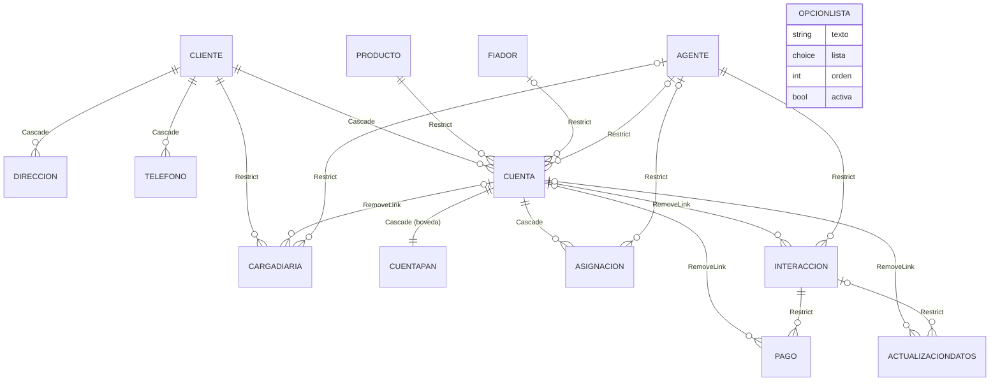

# Modelo de datos

Este documento describe las 14 tablas de Dataverse de la solución: para qué sirve cada una, sus columnas importantes, sus claves alternativas, cómo se relacionan y qué pasa en cada relación al borrar, compartir o reasignar. Está pensado para quien tiene que modificar el esquema, escribir un plugin o diagnosticar un dato raro en otro ambiente.

Los plugins que mantienen estas columnas se describen en [Plugins y Custom APIs](04-plugins-y-custom-apis.md); quién puede leer o escribir cada tabla, en [Seguridad](03-seguridad.md); cuánto vive cada dato, en [Ciclo de vida de los datos](08-ciclo-de-vida.md); y cómo llegan los datos del banco, en [Carga diaria](07-carga-diaria.md).

## Cómo funciona

El modelo tiene tres zonas:

| Zona | Tablas | Quién escribe |
|---|---|---|
| **Datos del banco** (la carga los crea o los pisa; el agente solo se crea, y la carga diaria agrega una fila por día) | `cliente`, `direccion`, `telefono`, `producto`, `fiador`, `agente`, `cuenta`, `cuentapan`, `cargadiaria` | La carga diaria a través de Smelter (la herramienta de importación que corre dentro del ambiente) |
| **Cartera** (lo que cada localizador tiene que cobrar) | `asignacion` | La carga, el Solicitante (Especiales) y el Supervisor o el Admin (aprobar, reasignar, cerrar) |
| **Lo que registra el localizador** (crece; nunca se pisa) | `interaccion`, `pago`, `actualizaciondatos` | La app del localizador, con o sin señal |

Además, `opcionlista` guarda las opciones de las listas desplegables que edita el Admin.

La **cuenta** es el grano del modelo: una tarjeta o un préstamo en mora. Todo lo demás cuelga de ella o de su cliente. El número completo de la tarjeta (PAN) vive **solo** en la bóveda (`cuentapan`); el resto de las tablas guarda el número enmascarado (`****1234`), los últimos 4 dígitos y una clave HMAC del número. El porqué de este diseño está en [Seguridad](03-seguridad.md).

Todas las tablas usan el prefijo `sanic_cm_tbl_` y sus columnas, `sanic_cm_<siglas>_` (por ejemplo, `sanic_cm_ct_` para cuenta). En este documento se abrevia `sanic_cm_tbl_cuenta` como `cuenta` y `sanic_cm_ct_clavepan` como `ct_clavepan` cuando no hay ambigüedad.

### Diagrama de relaciones

Cada línea es un *lookup* (una columna que apunta a otra tabla) y la etiqueta es el comportamiento al borrar el padre.

No se dibujan los lookups a usuarios del sistema (`systemuser`): `ag_usuarioid`, `as_solicitadopor`, `as_resolutorid` e `in_grabadopor`, todos con `RemoveLink`.

## Las 14 tablas

Todas las tablas son de propiedad de usuario (*UserOwned*: cada fila tiene un dueño, usuario o equipo, y la seguridad por fila se apoya en él), salvo `opcionlista`, que es de la organización. La columna «Req.» de la metadata (`ApplicationRequired`) solo la exigen los formularios y las apps; el servidor no la hace cumplir. Donde una columna obligatoria importa de verdad, la exige un plugin y se indica.

### `sanic_cm_tbl_cliente` — «CM | TBL | Cliente»

El deudor. Raíz del subárbol de datos de contacto. Nace de la carga (o del alta de cuenta del Admin) y la carga lo pisa en cada importación.

| Columna | Visible | Para qué |
|---|---|---|
| `sanic_cm_cl_cif` | [CL] CIF | Identificador del cliente en el banco. Clave alternativa. |
| `sanic_cm_cl_nombre` | [CL] Nombre | Nombre principal. |
| `sanic_cm_cl_departamento`, `_distrito`, `_trabajo` | [CL] … | Datos de ubicación y empleo. |

Clave alternativa: `sanic_cm_pk_cliente_cif` (`cl_cif`). El cliente no tiene correo: un correo nuevo solo existe en `actualizaciondatos`.

### `sanic_cm_tbl_direccion` — «CM | TBL | Direccion»

Una fila por cliente y tipo de dirección: `Casa`, `EC` (donde recibe el estado de cuenta) o `Trabajo`. Guarda el dato actual; la carga lo pisa.

| Columna | Visible | Para qué |
|---|---|---|
| `sanic_cm_dr_direccion` | [DR] Direccion | Texto de la dirección (nombre principal). |
| `sanic_cm_dr_tipo` | [DR] Tipo | `Casa`, `EC` o `Trabajo`. Lo fija la plantilla de Smelter. |
| `sanic_cm_dr_cif` | [DR] CIF | Copia del CIF del cliente, para la clave. |
| `sanic_cm_dr_clienteid` | [DR] Cliente | *Lookup* al cliente. |

Clave alternativa: `sanic_cm_pk_direccion_cif_tipo` (`dr_cif` + `dr_tipo`). La clave va sobre el CIF en texto y no sobre el *lookup* porque Smelter deduplica con valores de la propia fila del archivo.

### `sanic_cm_tbl_telefono` — «CM | TBL | Telefono»

Igual que la dirección, con tipos `Celular` y `Casa`.

| Columna | Visible | Para qué |
|---|---|---|
| `sanic_cm_tl_numero` | [TL] Numero | Número (texto de 20; puede traer ceros o guiones). |
| `sanic_cm_tl_tipo` | [TL] Tipo | `Celular` o `Casa`. |
| `sanic_cm_tl_cif` | [TL] CIF | Copia del CIF, para la clave. |
| `sanic_cm_tl_clienteid` | [TL] Cliente | *Lookup* al cliente. |

Clave alternativa: `sanic_cm_pk_telefono_cif_tipo` (`tl_cif` + `tl_tipo`).

### `sanic_cm_tbl_producto` — «CM | TBL | Producto»

Catálogo de productos (tipo de tarjeta o préstamo). Lo crea la carga; nadie lo edita en las apps.

| Columna | Visible | Para qué |
|---|---|---|
| `sanic_cm_pr_codigo` | [PR] Codigo | Código del producto (nombre principal). Clave alternativa. |
| `sanic_cm_pr_tipo` | [PR] Tipo | Nombre que ve el localizador. Se copia a `ct_tipoproducto`. |

Clave alternativa: `sanic_cm_pk_producto_codigo` (`pr_codigo`). Cambiar el tipo de un producto **no** se propaga a las cuentas que ya lo tienen.

### `sanic_cm_tbl_fiador` — «CM | TBL | Fiador»

El fiador de la cuenta. Muchas cuentas no tienen.

| Columna | Visible | Para qué |
|---|---|---|
| `sanic_cm_fi_nombre` | [FI] Nombre | Nombre principal. Clave alternativa. Sin fiador, la plantilla escribe `(sin fiador)`. |
| `sanic_cm_fi_direccion` | [FI] Direccion | Dirección del fiador. |

Clave alternativa: `sanic_cm_pk_fi_nombre` (`fi_nombre`). Dos fiadores distintos con el mismo nombre exacto se funden en uno: la clave es el único identificador que trae el archivo.

### `sanic_cm_tbl_agente` — «CM | TBL | Agente»

El registro que representa a un **localizador**. La carga lo crea solo con el nombre; el Admin lo vincula a un usuario.

| Columna | Visible | Para qué |
|---|---|---|
| `sanic_cm_ag_nombre` | [AG] Nombre | Nombre tal como viene en el archivo. Clave alternativa. |
| `sanic_cm_ag_usuarioid` | [AG] Usuario | Usuario de Entra ID del localizador. Sin él, sus asignaciones quedan a nombre del equipo «CM · Cartera sin cobrador · \<entorno\>» (nombre histórico: «cobrador» es el localizador), que no tiene miembros. |
| `sanic_cm_ag_emailusuario` | Email Usuario | UPN del usuario en minúsculas. Lo escribe [`EmailDesdeUsuario`](../../plugins/Sanic.CobranzaMovil.Plugins/EmailDesdeUsuario.cs): la app del teléfono encuentra su agente con `Lower(User().Email)`. |
| `sanic_cm_ag_activo` | [AG] Activo | Baja lógica. Por defecto, Sí. Un agente inactivo no puede registrar interacciones ([`InteraccionDelCobrador`](../../plugins/Sanic.CobranzaMovil.Plugins/InteraccionDelCobrador.cs)) ni recibir un alta de cuenta ([`AltaCuenta`](../../plugins/Sanic.CobranzaMovil.Plugins/AltaCuenta.cs)). |

Clave alternativa: `sanic_cm_pk_agente_nombre` (`ag_nombre`). Si el banco cambia el nombre del agente en el archivo, la carga crea **otro** agente y hay que volver a vincular el usuario. La plantilla de Smelter no actualiza agentes existentes (solo crea los que faltan).

### `sanic_cm_tbl_cuenta` — «CM | TBL | Cuenta»

La cuenta en mora: el grano del modelo. Guarda el estado **actual**; la carga la pisa cada día y la foto de cada día queda en `cargadiaria` (solo los últimos 7 días).

| Columna | Visible | Para qué |
|---|---|---|
| `sanic_cm_ct_numerodecuenta` | [CT] Numero de cuenta | Nombre principal, **enmascarado** (`****1234`). No es único. [`PanGuard`](../../plugins/Sanic.CobranzaMovil.Plugins/PanGuard.cs) rechaza 5 o más dígitos seguidos. |
| `sanic_cm_ct_clavepan` | Clave PAN (HMAC) | HMAC-SHA256 del número, en hexadecimal. Identidad de la cuenta. Clave alternativa. |
| `sanic_cm_ct_ultimos4` | Últimos 4 | Para buscar y mostrar. |
| `sanic_cm_ct_clienteid`, `_productoid`, `_fiador`, `_agenteid` | [CT] … | *Lookups*. `ct_agenteid` lo escribe la carga y ninguna app lo lee: el localizador de la cuenta es el de la **asignación**. |
| `sanic_cm_ct_cifcliente`, `_nombrecliente`, `_nombrefiador`, `_direccionfiador` | CIF Cliente, Nombre Cliente… | Copias en texto. El teléfono solo resuelve un nivel de *lookup* sin señal, así que las pantallas leen estas copias. |
| `sanic_cm_ct_tipoproducto` | Tipo Producto | Copia de `pr_tipo`; la escribe [`TipoDesdeProducto`](../../plugins/Sanic.CobranzaMovil.Plugins/TipoDesdeProducto.cs). |
| Saldos, pago mínimo, contagiado (`_saldovencidonio`, `_saldovencidousd`, `_pagominimonio`, `_pagominimousd`, `_totalsaldovencido`, `_contagiadousd`) | [CT] … | Montos del día (*Decimal*, no *Money*: cada columna tiene su moneda en el nombre). |
| `sanic_cm_ct_diasmora`, `_nivelmora`, `_ciclo` | [CT] … | Mora. |
| `sanic_cm_ct_ultimopago` | [CT] Último pago | Fecha del último pago que informa el banco, sin zona horaria (*DateOnly*). |
| `sanic_cm_ct_fechapago` | [CT] Fecha Pago | **Texto**, tal como llega del banco. |
| `sanic_cm_ct_tipoespecial`, `_nota`, `_retironio`, `_retirousd` | [CT] … | Datos de una Especial que manda el banco. [`EspecialDesdeCuenta`](../../plugins/Sanic.CobranzaMovil.Plugins/EspecialDesdeCuenta.cs) los copia a la asignación, que es donde los leen las apps. |
| `sanic_cm_ct_tramo` | [CT] Tramo | 0 a 19. Ver «Tramo» más abajo. |

Clave alternativa: `sanic_cm_ak_ct_clavepan` (`ct_clavepan`). Una tarjeta reemitida con otro número es otra cuenta, porque la identidad es el HMAC del número.

### `sanic_cm_tbl_cuentapan` — «CM | TBL | PAN de cuenta» (la bóveda)

Una fila por cuenta con el número completo. Es el **único** lugar del modelo donde está el PAN. Se usa una tabla aparte con seguridad por fila, y no una columna con seguridad de columna, porque una clave alternativa no puede incluir una columna protegida y porque el modo sin señal respeta la seguridad por fila.

| Columna | Visible | Para qué |
|---|---|---|
| `sanic_cm_cp_name` | Número (enmascarado) | Nombre principal: `****1234`. Es lo que se ve si la tabla aparece en un *lookup*. |
| `sanic_cm_cp_pan` | PAN | Número completo. Sin auditoría de columna y fuera de la búsqueda avanzada. |
| `sanic_cm_cp_clavepan` | Clave PAN (HMAC) | Clave de la carga. |
| `sanic_cm_cp_cuentaid` | Cuenta | *Lookup* a la cuenta, en relación **parental** (todo en cascada). |

Claves alternativas: `sanic_cm_ak_cp_clavepan` (`cp_clavepan`) y `sanic_cm_ak_cp_cuentaid` (`cp_cuentaid`, garantiza una bóveda por cuenta). La tabla tiene auditoría de lectura (cada consulta queda registrada) y viaja al teléfono.

### `sanic_cm_tbl_cargadiaria` — «CM | TBL | Carga diaria»

Una foto por cuenta y por día con los montos y la mora de esa fecha. La escribe solo la carga; la reconciliación la usa para saber cuál fue la última carga. Se conserva 7 días: la borra un trabajo de *bulk delete* (ver [Ciclo de vida](08-ciclo-de-vida.md)).

| Columna | Visible | Para qué |
|---|---|---|
| `sanic_cm_cd_numerocuenta` | [CD] Numero cuenta | Nombre principal, enmascarado. |
| `sanic_cm_cd_clavepan` | Clave PAN (HMAC) | Parte de la clave. |
| `sanic_cm_cd_fechacarga` | [CD] FechaCarga | Fecha del archivo (columna `FechaCarga`), sin zona horaria. |
| `sanic_cm_cd_cuenta`, `_clienteid`, `_agenteid` | [CD] … | *Lookups*. El agente es el que tenía la cuenta **ese día**. |
| `sanic_cm_cd_tipoasignacion` | [CD] Tipo Asignacion | Tipo del día, en texto. |
| Montos y mora | [CD] … | Mismas columnas que la cuenta. |

Clave alternativa: `sanic_cm_ak_cd_clavepan_fecha` (`cd_clavepan` + `cd_fechacarga`): subir dos veces el mismo día actualiza, no duplica. Es la única tabla transaccional **sin auditoría**: cada carga crea miles de filas y la auditoría las duplicaría.

### `sanic_cm_tbl_asignacion` — «CM | TBL | Asignacion»

Qué cuenta tiene que cobrar qué localizador, de qué tipo y en qué estado. Es la cartera viva. Su dueño (`ownerid`) lo pone el plugin [`RepartoAsignacion`](../../plugins/Sanic.CobranzaMovil.Plugins/RepartoAsignacion.cs), y es lo que hace que la asignación aparezca en el teléfono del localizador.

| Columna | Visible | Para qué |
|---|---|---|
| `sanic_cm_as_numero` | [AS] Numero | Autonumérico `AS-{SEQNUM:4}`. Nombre principal. |
| `sanic_cm_as_cuentaid` | [AS] Cuenta | *Lookup* a la cuenta. |
| `sanic_cm_as_clavepan` | Clave PAN (HMAC) | Copia de la clave de la cuenta, para la clave alternativa. La completa y valida [`ClaveDesdeCuenta`](../../plugins/Sanic.CobranzaMovil.Plugins/ClaveDesdeCuenta.cs). |
| `sanic_cm_as_agenteid` | [AS] Agente | Localizador asignado. |
| `sanic_cm_as_tipo` | [AS] Tipo | Diaria, Incobrable o Especial (ver option sets). |
| `sanic_cm_as_estado` | [AS] Estado | Sí/No: **Sí = Activa**, No = Cerrada. Por defecto, Activa. |
| `sanic_cm_as_estadoaprobacion` | [AS] Estado de aprobacion | Solo tiene sentido en las Especiales. |
| `sanic_cm_as_orden` | [AS] Orden | Orden de visita que elige el localizador. Es lo único que el localizador puede cambiar. |
| `sanic_cm_as_ultimacarga` | Última carga | Fecha de la última carga que trajo la asignación (*DateOnly*). Solo la escribe la carga. La reconciliación cierra las Diarias cuya última carga es anterior a la carga del día. |
| `sanic_cm_as_fechaasignada` | [AS] Fecha asignada | Día en que se asignó (*DateOnly*). La carga no la pisa si ya tenía valor. |
| `sanic_cm_as_motivo`, `_fechacierre` | [AS] Motivo, Fecha de cierre | Por qué y cuándo se cerró. |
| `sanic_cm_as_notas`, `_retironio`, `_retirousd` | Notas, Retiro NIO/USD | Datos de la Especial. Las notas guardan `"Tipo — nota"`. |
| `sanic_cm_as_solicitadopor`, `_resolutorid`, `_motivorechazo` | [AS] Solicitado por, [AS] Resolutor… | Quién pidió la Especial, quién la aprobó o rechazó y por qué. |
| `sanic_cm_as_tramo` | [AS] Tramo | Tramo de su cuenta (0 a 19). |

Clave alternativa: `sanic_cm_ak_as_clavepan_tipo` (`as_clavepan` + `as_tipo`): una asignación por cuenta y tipo. Por eso, volver a pedir una Especial cerrada **reactiva la misma fila** en lugar de crear otra. La regla «una sola activa entre Diaria e Incobrable» no es una clave: la aplica el plugin [`Reclasificacion`](../../plugins/Sanic.CobranzaMovil.Plugins/Reclasificacion.cs).

### `sanic_cm_tbl_interaccion` — «CM | TBL | Interaccion»

Lo que el localizador registra en una visita: comentario, ubicación, si hubo pago y si hay datos para actualizar. Es el rastro de la gestión y lo que la oficina transcribe al *core*.

| Columna | Visible | Para qué |
|---|---|---|
| `sanic_cm_in_numerointeraccion` | [IN] Numero de Interaccion | Autonumérico `IN-{SEQNUM:4}`. Lo asigna el servidor al sincronizar: sin señal está vacío. |
| `sanic_cm_in_cuentaid` | [IN] Cuenta | Cuenta visitada. Obligatoria (la exige [`InteraccionDelCobrador`](../../plugins/Sanic.CobranzaMovil.Plugins/InteraccionDelCobrador.cs)). |
| `sanic_cm_in_agente`, `_nombreagente` | [IN] Agente, [IN] NombreAgente | Localizador. Si quien crea es un localizador, el servidor pone el agente vinculado a su usuario, no el que manda la app. |
| `sanic_cm_in_comentario` | [IN] Comentario | Texto libre (2.000). |
| `sanic_cm_in_fechacaptura` | Fecha de captura | La pone el teléfono al registrar (puede llegar horas después). |
| `sanic_cm_cd_aplicapago` | [IN] Aplica pago | Sí/No. ⚠️ El prefijo es `cd`, no `in`: es un nombre heredado que no se puede renombrar. |
| `sanic_cm_in_actualizainfo` | [IN] Actualiza info | Sí/No: hay una actualización de datos asociada. |
| `sanic_cm_in_latitud`, `_longitud` | [IN] Latitud, [IN] Longitud | GPS con 6 decimales. |
| `sanic_cm_in_estadograbacion` | [IN] Estado grabacion | Pendiente o Grabado (ver option sets). |
| `sanic_cm_in_codigograbacion`, `_fechagrabacion`, `_grabadopor` | [IN] Codigo Grabacion… | Código del *core*, fecha y usuario de la transcripción. La fecha y el usuario los pone [`GrabacionInteraccion`](../../plugins/Sanic.CobranzaMovil.Plugins/GrabacionInteraccion.cs). |
| `sanic_cm_in_ultimos4`, `_cifcliente`, `_clavepan` | [IN] Últimos 4, [IN] CIF cliente, [IN] Clave PAN | Identidad de la cuenta guardada en la interacción. Ver la sección siguiente. |

Sin clave alternativa: cada interacción es un hecho fechado y se identifica por su GUID.

### `sanic_cm_tbl_pago` — «CM | TBL | Pago»

Un pago cobrado en una visita. Una interacción puede tener varios (por ejemplo, uno en córdobas y otro en dólares). El recibo es físico; acá se anota su número.

| Columna | Visible | Para qué |
|---|---|---|
| `sanic_cm_pg_numero` | [PG] Numero | Autonumérico `PG-{SEQNUM:4}`. |
| `sanic_cm_pg_interaccion` | [PG] Interaccion | Interacción a la que pertenece. Obligatoria (la exige [`CuentaDesdeInteraccion`](../../plugins/Sanic.CobranzaMovil.Plugins/CuentaDesdeInteraccion.cs)). |
| `sanic_cm_pg_cuentaid` | Cuenta | Copia de la cuenta de la interacción. Existe porque sin señal no se puede navegar pago → interacción → cuenta. |
| `sanic_cm_pg_numerointeraccion` | [PG] Numero Interaccion | Copia del número de la interacción; la oficina busca los pagos por él. |
| `sanic_cm_pg_monto`, `_moneda` | [PG] Monto, [PG] Moneda | Importe y moneda (NIO o USD). |
| `sanic_cm_pg_numerorecibo` | [PG] Numero recibo | Número del recibo físico (hasta 30). |
| `sanic_cm_pg_reciborepetido` | [PG] Recibo repetido | Sí si el número de recibo ya existía en otro pago. Lo marca [`ReciboRepetido`](../../plugins/Sanic.CobranzaMovil.Plugins/ReciboRepetido.cs) para que la oficina lo revise. |
| `sanic_cm_pg_fecha` | Fecha del pago | Fecha y hora del cobro. |
| `sanic_cm_pg_tramo` | [PG] Tramo | Tramo calculado del id de la **interacción**, para que los pagos de una visita caigan juntos. |

Sin clave alternativa, **a propósito**: una clave sobre el recibo rechazaría el pago repetido antes de que corra cualquier plugin, y el teléfono descarta en silencio lo que el servidor rechaza. El pago se perdería.

### `sanic_cm_tbl_actualizaciondatos` — «CM | TBL | Actualizacion de dato»

Los datos de contacto nuevos que el cliente pidió cambiar en una visita. Es un pedido para la oficina, que lo tipea en el *core*: **no** modifica `cliente`, `direccion` ni `telefono`.

| Columna | Visible | Para qué |
|---|---|---|
| `sanic_cm_ad_numero` | [AD] Numero | Autonumérico `AD-{SEQNUM:4}`. |
| `sanic_cm_ad_interaccionid` | [AD] Interaccion | Interacción de la visita. |
| `sanic_cm_ad_cuentaid`, `_fechacaptura` | [AD] Cuenta, [AD] Fecha de captura | Sin señal, el *lookup* a una interacción recién creada llega vacío. Con la cuenta y la misma fecha de captura, [`ActualizacionConInteraccion`](../../plugins/Sanic.CobranzaMovil.Plugins/ActualizacionConInteraccion.cs) encuentra la interacción y la vincula. |
| `sanic_cm_ad_sinvincular` | [AD] Sin vincular | Sí si llegó sin poder vincularse. [`VincularActualizacionPendiente`](../../plugins/Sanic.CobranzaMovil.Plugins/VincularActualizacionPendiente.cs) la vincula cuando llega la interacción. |
| `_telefonocasa`, `_telefonocelular`, `_telefonotrabajo`, `_direccioncasa`, `_direccionec`, `_direcciontrabajo`, `_correoelectronico` | [AD] … | Solo se completa lo que cambió. |

### `sanic_cm_tbl_opcionlista` — «CM | TBL | Opción de lista»

Las opciones de las listas desplegables de las apps. Las edita el Admin en la pantalla de listas; es de la organización (sin dueño por fila), todos los roles la leen y viaja completa al teléfono.

| Columna | Visible | Para qué |
|---|---|---|
| `sanic_cm_ol_texto` | [OL] Texto | Texto que se muestra (nombre principal, hasta 100). |
| `sanic_cm_ol_lista` | [OL] Lista | A qué lista pertenece (ver option sets). |
| `sanic_cm_ol_orden` | [OL] Orden | Orden; la primera activa es la opción por defecto. |
| `sanic_cm_ol_activa` | [OL] Activa | Las opciones no se borran: se desactivan. |

Lo elegido se guarda como **texto** en la asignación o la interacción, así que renombrar o desactivar una opción no cambia el historial. El tipo de Especial que manda el banco en el archivo no pasa por esta lista.

## La identidad de la cuenta en la interacción

La cuenta y su bóveda se borran 14 días después de dejar de venir en la carga, pero la interacción, sus pagos y sus actualizaciones viven 2 años. Como `cuenta → interaccion` es `RemoveLink`, al borrarse la cuenta la interacción queda con `in_cuentaid` vacío y ya no se sabría a qué cuenta del banco corresponde.

Por eso, al crearse, el plugin [`IdentidadEnInteraccion`](../../plugins/Sanic.CobranzaMovil.Plugins/IdentidadEnInteraccion.cs) copia a la interacción tres datos de la cuenta:

| Columna de la interacción | Copia de | Para qué |
|---|---|---|
| `sanic_cm_in_ultimos4` | `ct_ultimos4` | Mostrar `****1234` en las apps cuando la cuenta ya no está. |
| `sanic_cm_in_cifcliente` | `ct_cifcliente` | Identificar al cliente en el *core*. |
| `sanic_cm_in_clavepan` | `ct_clavepan` | Identificar la cuenta exacta sin guardar el número: el HMAC se puede recalcular desde el número que tiene el banco. |

Nunca se copia el número completo. Los pagos y las actualizaciones heredan esta identidad a través de su interacción. Las apps leen primero la cuenta y, si falta, estas columnas: por ejemplo, `Coalesce(ThisRecord.'[IN] Cuenta'.'Últimos 4', ThisRecord.'[IN] Últimos 4', "")` en [`scrTranscripcion.pa.yaml`](../../apps/backoffice-canvas/Src/scrTranscripcion.pa.yaml). El plugin solo completa lo vacío y nunca rechaza: si no encuentra la cuenta, deja pasar la interacción, porque el teléfono descarta lo rechazado.

## Relaciones y cascadas

Cada relación 1:N de Dataverse define qué le pasa al hijo cuando se borra, se reasigna (*Assign*), se comparte (*Share*/*Unshare*) o se cambia de padre (*Reparent*) el registro padre. `Cascade` aplica lo mismo al hijo; `NoCascade` no lo toca; `Restrict` impide borrar el padre mientras tenga hijos; `RemoveLink` borra el padre y deja el *lookup* del hijo vacío.

| Padre → hijo | *Lookup* | Delete | Assign | Share / Unshare | Reparent | Por qué |
|---|---|---|---|---|---|---|
| cliente → direccion, telefono | `dr_clienteid`, `tl_clienteid` | Cascade | Cascade | Cascade | Cascade | Son datos del cliente: se van con él, y quien ve al cliente ve sus direcciones y teléfonos. |
| cliente → cuenta | `ct_clienteid` | Cascade | Cascade | **NoCascade** | **NoCascade** | Compartir un cliente con un localizador no debe darle sus **otras** cuentas. Con Reparent en cascada, cada vez que la carga reescribe la cuenta, Dataverse daría lectura heredada a quien vea al cliente. |
| cliente → cargadiaria | `cd_clienteid` | **Restrict** | Cascade | NoCascade | NoCascade | La historia financiera no se borra arrastrada por el cliente. |
| cuenta → cuentapan | `cp_cuentaid` | Cascade | Cascade | Cascade | Cascade | Relación parental: compartir la cuenta comparte la bóveda; revocar la cuenta la revoca; nunca queda un número sin cuenta. |
| cuenta → asignacion | `as_cuentaid` | Cascade | **NoCascade** | NoCascade | NoCascade | La asignación tiene su propio dueño, el que pone `RepartoAsignacion`; reasignar o compartir la cuenta no debe pisarlo. |
| cuenta → interaccion, pago, actualizaciondatos, cargadiaria | `in_cuentaid`, `pg_cuentaid`, `ad_cuentaid`, `cd_cuenta` | **RemoveLink** | NoCascade | NoCascade | NoCascade | Lo que registró el localizador vive más que la cuenta. Por eso la interacción guarda su propia identidad. |
| interaccion → pago, actualizaciondatos | `pg_interaccion`, `ad_interaccionid` | **Restrict** | Cascade | Cascade | Cascade | Una interacción con pagos no se puede borrar por accidente. El borrado programado borra primero pagos y actualizaciones y unos días después las interacciones. |
| agente → cuenta, asignacion, interaccion, cargadiaria | `ct_agenteid`, `as_agenteid`, `in_agente`, `cd_agenteid` | Restrict | NoCascade | NoCascade | NoCascade | El agente es historia: se desactiva, no se borra. |
| producto → cuenta | `ct_productoid` | Restrict | NoCascade | NoCascade | NoCascade | Catálogo compartido. |
| fiador → cuenta | `ct_fiador` | Restrict | NoCascade | NoCascade | NoCascade | Catálogo compartido; un fiador sin cuentas lo borra el trabajo programado. |
| systemuser → agente, asignacion, interaccion | `ag_usuarioid`, `as_solicitadopor`, `as_resolutorid`, `in_grabadopor` | RemoveLink | NoCascade | NoCascade | NoCascade | Borrar un usuario no debe borrar datos de negocio. |

Efecto neto al borrar una cuenta: se borran su bóveda y sus asignaciones; sus interacciones, pagos, actualizaciones y filas de carga diaria quedan sin cuenta. Los trabajos de borrado programado (*bulk delete*, borrado en masa que Dataverse corre en segundo plano) se apoyan en estas reglas: ver [Ciclo de vida](08-ciclo-de-vida.md).

## Claves alternativas

Una clave alternativa (*alternate key*) es una combinación de columnas que Dataverse obliga a ser única y que permite hacer *upsert* (crear o actualizar) sin conocer el GUID. Smelter deduplica y resuelve los *lookups* **solo** por clave alternativa, así que cada tabla que escribe la carga tiene una.

| Tabla | Clave | Columnas |
|---|---|---|
| cliente | `sanic_cm_pk_cliente_cif` | `cl_cif` |
| direccion | `sanic_cm_pk_direccion_cif_tipo` | `dr_cif`, `dr_tipo` |
| telefono | `sanic_cm_pk_telefono_cif_tipo` | `tl_cif`, `tl_tipo` |
| producto | `sanic_cm_pk_producto_codigo` | `pr_codigo` |
| fiador | `sanic_cm_pk_fi_nombre` | `fi_nombre` |
| agente | `sanic_cm_pk_agente_nombre` | `ag_nombre` |
| cuenta | `sanic_cm_ak_ct_clavepan` | `ct_clavepan` |
| cuentapan | `sanic_cm_ak_cp_clavepan` y `sanic_cm_ak_cp_cuentaid` | `cp_clavepan`; `cp_cuentaid` |
| cargadiaria | `sanic_cm_ak_cd_clavepan_fecha` | `cd_clavepan`, `cd_fechacarga` |
| asignacion | `sanic_cm_ak_as_clavepan_tipo` | `as_clavepan`, `as_tipo` |

`interaccion`, `pago`, `actualizaciondatos` y `opcionlista` no tienen: nacen en las apps con su GUID. Las claves sobre la clave HMAC las crea [`paso1_esquema.py`](../../scripts/pan/paso1_esquema.py) (bóveda) y [`paso3b_claves.py`](../../scripts/pan/paso3b_claves.py) (cuenta y carga diaria; la de asignación solo con `--incluir-asignacion`, una vez resueltos los duplicados por clave y tipo). Las demás vienen en la *solution*. Todas tienen que estar en estado `Active`; la de asignación lo está en el ambiente de desarrollo.

## Option sets y estados

Un *option set* (o *choice*) es una columna de lista cerrada que guarda un número y muestra una etiqueta. Los plugins comparan por número: las constantes están en [`Esquema.cs`](../../plugins/Sanic.CobranzaMovil.Plugins/Esquema.cs).

| Columna | Option set | Valores | Notas |
|---|---|---|---|
| `as_tipo` | `sanic_choice_cm_tipoasignacion` (global) | 1 Diaria · 2 Incobrable · 3 Especial | Por defecto **3**: una asignación creada sin tipo nace Especial y pasa por aprobación. Las Diarias e Incobrables solo las puede crear la carga ([`AprobacionEspecial`](../../plugins/Sanic.CobranzaMovil.Plugins/AprobacionEspecial.cs)). |
| `as_estadoaprobacion` | `sanic_choice_cm_estadoaprobacionespecial` (global) | 1 Borrador · 2 Pendiente aprobacion · 3 Aprobado · 4 Rechazada | Por defecto **2**, para que las Especiales del archivo entren solas a la cola del Supervisor. Las Diarias e Incobrables nacen en Borrador (lo fuerza `AprobacionEspecial`). Rechazar también cierra la asignación. |
| `as_estado` | Sí/No local | Sí = Activa · No = Cerrada | Por defecto Activa. La carga no lo escribe; [`CargaSobreAsignacion`](../../plugins/Sanic.CobranzaMovil.Plugins/CargaSobreAsignacion.cs) reabre lo que cerró el sistema. |
| `in_estadograbacion` | `sanic_cm_choice_estadograbacioninteraccion` (global) | 1 Pendiente · 2 Grabado | Por defecto Pendiente. Grabado es terminal: exige código y no se puede volver a grabar. |
| `pg_moneda` | `sanic_choice_cm_monedaenpago` (global) | 1 NIO · 2 USD | Sin valor por defecto. |
| `ol_lista` | Local de `opcionlista` | 1 Tipo de Especial · 2 Motivo de cierre Incobrable · 3 Motivo de cierre Especial · 4 Mensaje rápido | Ver [`paso23_listas.py`](../../scripts/pan/paso23_listas.py). |
| `in_actualizainfo`, `cd_aplicapago`, `ad_sinvincular`, `pg_reciborepetido`, `ag_activo`, `ol_activa` | Sí/No local | | |

Los motivos de cierre que pone el sistema son texto fijo: `fuera de cartera` (reconciliación) y `Reclasificada a <tipo>` (reclasificación). `CargaSobreAsignacion` los reconoce para decidir qué reabrir, así que **no** deben cambiarse.

### Tramo

`as_tramo`, `ct_tramo` y `pg_tramo` son enteros de 0 a 19 que calcula [`TramoCartera`](../../plugins/Sanic.CobranzaMovil.Plugins/TramoCartera.cs) con un hash FNV-1a del id de la cuenta (de la interacción, en el pago). Existen porque una canvas app trae como máximo 2.000 filas por consulta: la app pide la cartera en 20 partes (`Filter(…, Tramo = n)`), cada una muy por debajo del límite. La asignación usa el id de su cuenta para que cuenta y asignaciones caigan en el mismo tramo.

## Piezas y archivos

| Pieza | Archivo | Qué define |
|---|---|---|
| Nombres lógicos | [`Esquema.cs`](../../plugins/Sanic.CobranzaMovil.Plugins/Esquema.cs) | Constantes de tablas, columnas y valores de option sets que usan los plugins. |
| Solución desempaquetada | [`solutions/unpacked/Entities/`](../../solutions/unpacked/Entities/) | Metadata de las tablas. ⚠️ Está atrasada: no incluye `cuentapan`, `opcionlista` ni las columnas agregadas por scripts, y todavía muestra columnas y claves que ya no existen (por ejemplo, `as_numerocuenta`, `as_fechasignacion`, `ct_fechaultimopago` y las claves viejas sobre el número). Para la verdad del esquema, mandan los scripts de esta tabla. |
| Bóveda, claves HMAC, *lookup* pago → cuenta | [`paso1_esquema.py`](../../scripts/pan/paso1_esquema.py) | Tabla `cuentapan`, columnas `*_clavepan`, `ct_ultimos4`, `pg_cuentaid`. |
| Claves alternativas HMAC | [`paso3b_claves.py`](../../scripts/pan/paso3b_claves.py) | Claves de cuenta, carga diaria y asignación. |
| Cascadas y auditoría | [`paso1_cascadas_auditoria.py`](../../scripts/seguridad/paso1_cascadas_auditoria.py) | Corta Share/Unshare/Reparent, pone los `Restrict` y enciende la auditoría. |
| Actualización sin señal | [`paso14_actualizacion_offline.py`](../../scripts/pan/paso14_actualizacion_offline.py) | `ad_cuentaid`, `ad_fechacaptura`. |
| Marcas en lugar de rechazos | [`paso15_marcas_offline.py`](../../scripts/pan/paso15_marcas_offline.py) | `ad_sinvincular`, `pg_reciborepetido`; quita la clave del recibo. |
| Identidad en la interacción | [`paso17_identidad_interaccion.py`](../../scripts/pan/paso17_identidad_interaccion.py) | `in_ultimos4`, `in_cifcliente`, `in_clavepan`. |
| Tramos | [`paso18_tramo_cartera.py`](../../scripts/pan/paso18_tramo_cartera.py) | `as_tramo`, `ct_tramo`, `pg_tramo`. |
| Listas editables | [`paso23_listas.py`](../../scripts/pan/paso23_listas.py) | Tabla `opcionlista`, privilegios y opciones iniciales. |
| Columnas retiradas | [`paso8_contraer.py`](../../scripts/pan/paso8_contraer.py) | Borra `as_numerocuenta`, `in_numerocuenta`, `pg_numerocuenta` y las claves viejas sobre el número. |
| Precisión GPS | [`precision_gps.py`](../../scripts/localizador/precision_gps.py) | `in_latitud` y `in_longitud` con 6 decimales. |
| Perfil sin señal | [`paso7_perfil_offline.py`](../../scripts/pan/paso7_perfil_offline.py) | Qué tablas y filas bajan al teléfono. |

Todos los scripts son idempotentes y, sin `--aplicar`, solo muestran el plan.

## Cómo se modifica

### Agregar una columna

1. Crear la columna en el ambiente de desarrollo con un script idempotente (como los de la tabla anterior) o desde el diseñador, siempre dentro de la *solution* `cm_core_cobranzamovil`. Respetar el prefijo `sanic_cm_<siglas>_` y el nombre visible `[XX] Nombre`.
2. Si un plugin la usa, agregar la constante en [`Esquema.cs`](../../plugins/Sanic.CobranzaMovil.Plugins/Esquema.cs).
3. Si la usa una app, refrescar la fuente de datos de la app ([`paso7_fuentes.py`](../../scripts/pan/paso7_fuentes.py)). ⚠️ La app guarda una copia del esquema; una fórmula que nombra una columna que la copia no conoce queda inerte sin aviso. [`paso7_esquema.py`](../../scripts/pan/paso7_esquema.py) lo detecta antes de desplegar.
4. Si la columna tiene que viajar al teléfono, verificar que la tabla esté en el perfil sin señal.
5. Si la escribe la carga, agregar el mapeo en la plantilla de Smelter: ver [Carga diaria](07-carga-diaria.md).

### Agregar una opción a una lista

No requiere cambios de esquema: el Admin la agrega en la pantalla de listas del backoffice ([`scrListas.pa.yaml`](../../apps/backoffice-canvas/Src/scrListas.pa.yaml)). Una **lista nueva** sí requiere un valor nuevo en `ol_lista` y cambios en la app que la usa.

### Cambiar una cascada

Editar la relación con un script como [`paso1_cascadas_auditoria.py`](../../scripts/seguridad/paso1_cascadas_auditoria.py), que lee la relación completa, cambia solo las acciones necesarias y publica. Antes de pasar algo a `Cascade` en Share o Reparent, revisar [Seguridad](03-seguridad.md): esas cascadas deciden qué ve cada localizador.

### Agregar una clave alternativa

Crearla **después** de que la columna tenga datos sin duplicados: un duplicado real hace fallar la creación del índice (los nulos no cuentan). El índice se crea en segundo plano; su estado (`EntityKeyIndexStatus`) tiene que llegar a `Active`. No agregar claves a tablas que escribe el teléfono (ver trampas).

## Trampas y errores conocidos

- ⚠️ **El servidor no exige `ApplicationRequired`.** Las obligatorias reales las imponen los plugins: `InteraccionDelCobrador` (cuenta y agente de la interacción) y `CuentaDesdeInteraccion` (interacción del pago). `ActualizacionConInteraccion` no rechaza una actualización sin interacción al crearla: la acepta marcada como sin vincular.
- ⚠️ **Lo que viene del teléfono no se rechaza: se marca.** El runtime sin señal descarta en silencio lo que el servidor rechaza y no lo reintenta. Por eso no hay clave alternativa en `pago` y existen `pg_reciborepetido` y `ad_sinvincular`. Cualquier validación nueva sobre `interaccion`, `pago` o `actualizaciondatos` tiene que seguir esta regla. Las únicas excepciones son las reglas de seguridad de `InteraccionDelCobrador` (cuenta y agente obligatorios, solo cuentas de la cartera propia), que sí rechazan.
- ⚠️ **Sin señal solo funciona un nivel de *lookup*.** Por eso la cuenta guarda copias en texto (`ct_nombrecliente`, `ct_cifcliente`…) y el pago guarda su propia cuenta (`pg_cuentaid`).
- ⚠️ **El número enmascarado no es único.** Dos cuentas pueden terminar en los mismos 4 dígitos. Nunca usar `ct_numerodecuenta` ni `ct_ultimos4` para unir datos: usar el *lookup* o `ct_clavepan`.
- ⚠️ **Nunca escribir el número completo fuera de `cp_pan`.** `PanGuard` rechaza 5 o más dígitos seguidos en `ct_numerodecuenta`, `cd_numerocuenta` y `cp_name`, pero no vigila otras columnas.
- **`sanic_cm_cd_aplicapago` está en la interacción** pese a su prefijo `cd`.
- **`ct_fechapago` es texto** y puede traer formatos distintos según el archivo.
- **`as_tipo` vale Especial por defecto.** Un alta por API sin tipo crea una Especial que queda pendiente de aprobación.
- **Renombrar el agente en el archivo crea otro agente.** Hay que volver a vincular el usuario.
- **La carga pisa los datos maestros.** Lo que el Admin edite en un cliente, dirección o teléfono lo reemplaza la próxima carga.
- **Límite de 2.000 filas por consulta** de una canvas app: por eso existen los tramos. Una tabla nueva que la app tenga que traer completa necesita el mismo tratamiento. ⚠️ A confirmar: en el paquete de la app del localizador, `References/DataSources.json` declara `MaxGetRowsCount` 500 por fuente y `Properties.json`, 2.000 para la app; no está confirmado cuál rige.
- **Columnas borradas que el código todavía nombra.** `sanic_cm_as_numerocuenta`, `sanic_cm_in_numerocuenta` y `sanic_cm_pg_numerocuenta` ya no existen, pero [`Esquema.cs`](../../plugins/Sanic.CobranzaMovil.Plugins/Esquema.cs) conserva sus constantes y `PanGuard` tiene reglas para asignación, interacción y pago que nunca corren (sus pasos solo están registrados en cuenta, carga diaria y bóveda). Son sobrantes: no recrear esas columnas.
