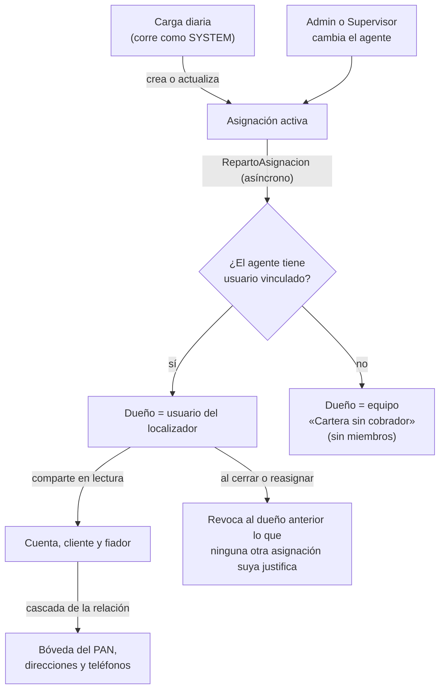

# Seguridad

Este documento explica quién puede ver y cambiar qué en Cobranza Móvil (CM): los roles de seguridad y sus privilegios por tabla, cómo se decide qué filas ve cada localizador y cómo se protege el número de tarjeta (PAN). Está pensado para quien instala la solución en otro tenant, da acceso a personas nuevas o cambia algo del modelo de seguridad. El detalle de cada tabla está en [Modelo de datos](02-modelo-de-datos.md) y el de cada plugin, en [Plugins y Custom APIs](04-plugins-y-custom-apis.md).

## Cómo funciona

La seguridad tiene tres capas. Cada una cubre lo que la anterior no puede expresar.

| Capa | Mecanismo de Dataverse | Qué decide |
|---|---|---|
| 1. Rol | *Security role* (conjunto de privilegios por tabla y profundidad) | Qué operaciones puede hacer cada perfil sobre cada tabla |
| 2. Fila | Dueño del registro (*owner*) y compartidos (*GrantAccess*) | Qué filas concretas ve el localizador |
| 3. Columna y regla | *Plugins* (código C# que corre en el servidor ante cada operación) | Qué columnas puede escribir cada rol y qué valores se rechazan |

La capa 3 existe porque la seguridad de columnas de Dataverse (*field-level security*, FLS) también se aplicaría a la carga diaria, que necesita escribir todas las columnas. Por eso las restricciones de columna se hacen en *plugins* que miran el rol del usuario que llama.

### Roles

Los roles de CM se reconocen por el prefijo `SR | CM | ` y viven en la unidad de negocio raíz. Viajan en la *solution* con sus privilegios; después de importar se revisan y se completan a mano algunos ajustes sobre roles del sistema ([Instalación, paso 4](09-instalacion-y-despliegue.md#4-ajustes-de-seguridad-posteriores-a-la-importación)). La definición de cada rol queda en [`solutions/unpacked/Roles/`](../../solutions/unpacked/Roles/).

| Rol | Quién lo tiene | Para qué |
|---|---|---|
| `SR \| CM \| Localizador` | La persona que sale a cobrar (en el código histórico, «cobrador») | Ver su cartera y registrar interacciones, pagos y actualizaciones de datos |
| `SR \| CM \| BackOffice` | Personal de oficina que transcribe | Leer todo y transcribir las interacciones al *core* |
| `SR \| CM \| Solicitante` | Quien pide asignaciones Especiales | Buscar cualquier cuenta y pedir una Especial |
| `SR \| CM \| Supervisor` | Responsable de los localizadores | Aprobar Especiales, reasignar, mirar carteras |
| `SR \| CM \| Admin` | Administrador funcional de CM | Carga diaria, reconciliación, alta de cuentas, agentes, datos maestros y listas |
| `SR \| CM \| Servicio - Cobranza` | Nadie en la operación normal: es opcional y queda reservado para un proceso automático futuro, que se asignaría a un *application user* (usuario de aplicación, identidad no humana de Dataverse) ([Instalación, paso 9](09-instalacion-y-despliegue.md#9-asignar-roles-a-las-personas-y-compartir-las-apps)) | Procesos automáticos de CM; los *plugins* la tratan como al Admin, con una diferencia: puede crear Diarias e Incobrables, que al Admin se le rechazan ([`AprobacionEspecial.cs`](../../plugins/Sanic.CobranzaMovil.Plugins/AprobacionEspecial.cs)) |
| `SR \| CM \| Cartera sin cobrador` | Solo el equipo «Cartera sin cobrador», nunca una persona | Permitir que ese equipo sea dueño de asignaciones (ver más abajo) |

[`RolesCm.cs`](../../plugins/Sanic.CobranzaMovil.Plugins/RolesCm.cs) obtiene los roles de CM del usuario que llama, tanto los asignados directamente como los heredados por un equipo. Los *plugins* lo usan así:

- **Sin ningún rol de CM** (SYSTEM, la carga, un administrador del ambiente): no se lo frena. Se asume que no es una persona de la operación.
- **Admin o Servicio**: tampoco se lo frena en los controles por rol.
- **Cualquier otro rol de CM**: se aplican los controles de columna y de regla.

### Matriz de privilegios por tabla

Privilegios efectivos de los roles tal como viajan en la *solution*. Notación: **C** Create, **R** Read, **W** Write, **D** Delete, **A** Append (vincular esta fila a otra), **T** AppendTo (que otra fila se vincule a esta), **S** Assign (cambiar el dueño), **H** Share (compartir). Profundidad: **(G)** Global, toda la organización; **(B)** Basic, solo lo propio o lo compartido. «—» = ningún privilegio.

| Tabla | Localizador | BackOffice | Solicitante | Supervisor | Admin | Servicio |
|---|---|---|---|---|---|---|
| `sanic_cm_tbl_cuenta` «CM \| TBL \| Cuenta» | R(B) T(G) | R(G) | R A T(G) | R(G) | Todo (G) | C R W A T(G) |
| `sanic_cm_tbl_cliente` «CM \| TBL \| Cliente» | R(B) T(G) | R(G) | R A T(G) | R(G) | Todo (G) | C R W A T(G) |
| `sanic_cm_tbl_direccion` «CM \| TBL \| Direccion» | R(B) | R(G) | R A T(G) | R(G) | Todo (G) | C R W A T(G) |
| `sanic_cm_tbl_telefono` «CM \| TBL \| Telefono» | R(B) | R(G) | R A T(G) | R(G) | Todo (G) | C R W A T(G) |
| `sanic_cm_tbl_fiador` «CM \| TBL \| Fiador» | R(B) T(G) | R(G) | R T(G) | R T(G) | Todo (G) | C R W A T(G) |
| `sanic_cm_tbl_asignacion` «CM \| TBL \| Asignacion» | R W A T(B) | R(G) | C A T(G), R W(B) | R W A T(G) | Todo (G) | C R W A T S(G) |
| `sanic_cm_tbl_interaccion` «CM \| TBL \| Interaccion» | C R A T(B) | R W A(G) | — | R(G) | Todo (G) | — |
| `sanic_cm_tbl_pago` «CM \| TBL \| Pago» | C R A T(B) | R(G) | — | R(G) | Todo (G) | — |
| `sanic_cm_tbl_actualizaciondatos` «CM \| TBL \| Actualizacion de dato» | C R A T(B) | R(G) | — | — | Todo (G) | — |
| `sanic_cm_tbl_agente` «CM \| TBL \| Agente» | R T(G) | R(G) | R T(G) | R T(G) | Todo (G) | C R W A T(G) |
| `sanic_cm_tbl_producto` «CM \| TBL \| Producto» | R T(G) | R(G) | R T(G) | R T(G) | Todo (G) | C R W A T(G) |
| `sanic_cm_tbl_cargadiaria` «CM \| TBL \| Carga diaria» | — | R(G) | — | — | Todo (G) | C R W A T(G) |
| `sanic_cm_tbl_cuentapan` «CM \| TBL \| PAN de cuenta» (bóveda) | R(B) | R(G) | — | — | — | — |
| `sanic_cm_tbl_opcionlista` «CM \| TBL \| Opción de lista» | R(G) | R(G) | R(G) | R(G) | C R W A T(G) | C R W A T(G) |

«Todo (G)» = C R W D A T S H con profundidad Global. El rol «Cartera sin cobrador» tiene solo R(B) sobre la asignación.

Además, los roles Localizador, BackOffice, Solicitante y Supervisor **no** tienen privilegios para crear, editar ni compartir *flows* ni para leer las trazas de *plugins* (`plugintracelog`). Admin y Servicio los conservan.

### Por qué cada rol tiene lo que tiene

| Decisión | Por qué | Dónde |
|---|---|---|
| El Localizador lee con profundidad **Basic** cuenta, cliente, dirección, teléfono y fiador | El teléfono baja lo que el usuario puede leer. Con Global, cada teléfono tendría una copia *offline* de toda la cartera del banco | Rol (viaja en la *solution*) |
| El Localizador **crea** interacciones, pagos y actualizaciones, pero **no las edita** ni reasigna | Evita que baje el monto o cambie el recibo de un pago ya transcrito, o que marque su interacción como grabada. La app solo crea registros | Rol (viaja en la *solution*) |
| El Localizador tiene W(B) en la asignación | Para cambiar el orden de su cartera. [`ColumnasAsignacion.cs`](../../plugins/Sanic.CobranzaMovil.Plugins/ColumnasAsignacion.cs) le permite solo esa columna | |
| El BackOffice tiene W(G) en la interacción | Para transcribir. [`GrabacionInteraccion.cs`](../../plugins/Sanic.CobranzaMovil.Plugins/GrabacionInteraccion.cs) limita la escritura a las cuatro columnas de grabación y rechaza volver a grabar una interacción ya grabada | |
| El Solicitante lee cuentas en Global | Tiene que poder buscar cualquier cuenta por sus últimos 4 dígitos para pedir una Especial | |
| El Solicitante tiene W(B) en la asignación pero no escribe ninguna columna | La Especial la crea la *Custom API* (operación propia de Dataverse respaldada por un *plugin*) `SolicitarEspecial`. `ColumnasAsignacion` no le deja editar ninguna columna | [`SolicitarEspecial.cs`](../../plugins/Sanic.CobranzaMovil.Plugins/SolicitarEspecial.cs) |
| El Supervisor tiene W(G) en la asignación | Aprueba, rechaza y reasigna. `ColumnasAsignacion` lo limita a estado de aprobación, agente, resolutor, motivo de rechazo, estado, motivo y fecha de cierre | [`AprobacionEspecial.cs`](../../plugins/Sanic.CobranzaMovil.Plugins/AprobacionEspecial.cs) |
| Nadie tiene Assign sobre la asignación salvo Admin y Servicio | El dueño lo pone el *plugin* de reparto al cambiar el agente; nadie lo mueve a mano | [`RepartoAsignacion.cs`](../../plugins/Sanic.CobranzaMovil.Plugins/RepartoAsignacion.cs) |
| Servicio no tiene privilegios sobre interacción, pago, actualización ni bóveda | Esas tablas las escriben personas (el localizador) o la carga; un proceso automático no las necesita | |
| Nadie tiene Create/Write sobre la bóveda | La bóveda la escribe solo la carga (como SYSTEM) | [Instalación, paso 4.2](09-instalacion-y-despliegue.md#42-revisar-los-privilegios-de-la-bóveda) |
| Sin *flows* para los roles operativos | Un *flow* corre con la identidad de su autor y podría copiar fuera todo lo que esa persona lee. Las apps no llaman a ningún *flow* | Rol (viaja en la *solution*) |
| Sin lectura de trazas para los roles operativos | Las trazas de *plugins* de otras soluciones del ambiente pueden contener datos | Rol (viaja en la *solution*) |

En un ambiente, el efecto de esta matriz se verifica a mano con los casos de [Pruebas, seguridad por rol](10-pruebas.md#1-seguridad-por-rol-seg). Para desarrolladores, la matriz celda por celda y con el motivo de cada una está también en [`esperado.js`](../../tests/integral/seguridad/esperado.js), que usan las pruebas automatizadas del repositorio.

### Visibilidad por filas: quién es dueño de qué

| Registro | Dueño | Quién más lo ve |
|---|---|---|
| Asignación activa con agente vinculado a un usuario | El usuario del localizador | El Solicitante que pidió la Especial (compartido en solo lectura) |
| Asignación activa sin agente, o con agente sin usuario | Equipo «Cartera sin cobrador» | Nadie de la operación por fila (los roles con lectura Global la ven igual) |
| Cuenta, cliente, fiador | SYSTEM cuando los crea la carga (también en `AltaCuenta`); el Admin, si crea un cliente desde Datos maestros | El localizador de cada asignación activa: compartido de lectura |
| Bóveda, direcciones, teléfonos | Heredan el acceso de su padre | La relación cuenta → bóveda y cliente → dirección/teléfono comparte en cascada (*cascade*: la acción sobre el padre se repite en los hijos) |
| Interacción, pago, actualización de datos | Quien la creó (el localizador) | Roles con lectura Global |

El reparto lo hacen dos *plugins* asíncronos que escriben con el servicio del sistema, porque dar y quitar acceso no es algo que deba poder hacer ninguna persona:

- [`RepartoAsignacion.cs`](../../plugins/Sanic.CobranzaMovil.Plugins/RepartoAsignacion.cs): ante el alta o el cambio de agente, estado o aprobación de una asignación, mueve el dueño, comparte cuenta, cliente y fiador, y revoca al dueño anterior lo que ninguna otra asignación activa suya justifica. Una Especial sin aprobar no se reparte.
- [`RepartoPorAgente.cs`](../../plugins/Sanic.CobranzaMovil.Plugins/RepartoPorAgente.cs): al vincular, cambiar o quitar el usuario de un agente, vuelve a escribir el mismo agente en sus asignaciones activas para que `RepartoAsignacion` las reparta. Procesa hasta 300 por ejecución y corta a los 90 segundos (cada reparto tarda unos 0,3 s y el límite de Dataverse es de 2 minutos); si quedan más, pide reintento. Dataverse da 5 ejecuciones por trabajo (unas 1.500 asignaciones): en la última, si quedan pendientes y esa vuelta movió alguna, vuelve a escribir el mismo usuario en el agente y eso encola un trabajo nuevo. Como Dataverse corta las cadenas de más de 8 trabajos, el techo es de unas 12.000 asignaciones por localizador.

El equipo «Cartera sin cobrador» ([`CarteraSinCobrador.cs`](../../plugins/Sanic.CobranzaMovil.Plugins/CarteraSinCobrador.cs)) es un *owner team* (equipo que puede ser dueño de registros) **sin miembros**. Existe porque Dataverse no deja asignar un registro a un dueño sin privilegio de lectura sobre la tabla, y la asignación no puede quedarse con el localizador anterior. No viaja en la *solution*: se crea a mano con el nombre `CM · Cartera sin cobrador · <entorno>` ([Instalación, paso 5](09-instalacion-y-despliegue.md#5-equipo-cartera-sin-cobrador)). Los *plugins* lo buscan por ese prefijo y exigen que haya exactamente uno. Es el único equipo de CM con nombre obligatorio.

Las relaciones que **no** propagan el compartido (cliente → cuenta, cliente → carga diaria, cuenta → asignación) están cortadas a propósito: compartir un cliente no debe compartir todas sus tarjetas, ni compartir una cuenta debe compartir las asignaciones de otros localizadores. El comportamiento de cada relación viaja con la *solution*. Las cascadas de cada relación están en [Modelo de datos](02-modelo-de-datos.md).

Además, [`InteraccionDelCobrador.cs`](../../plugins/Sanic.CobranzaMovil.Plugins/InteraccionDelCobrador.cs) impide que un localizador registre una interacción en una cuenta que no es de su cartera y pone el agente desde su usuario, de modo que nadie registra visitas a nombre de otro.

### Roles heredados por equipos de Entra ID

Los roles pueden asignarse a un equipo de Dataverse de tipo *Microsoft Entra ID security group* (equipo cuyos miembros son los de un grupo de Entra ID) en lugar de a cada usuario. `RolesCm` reconoce ambos casos. Para el rol Localizador, que trabaja con profundidad Basic, la propiedad del rol **Member's privilege inheritance** tiene que estar en *Direct User (Basic) access level and Team privileges*: con *Team privileges only*, el usuario solo podría usar los privilegios Basic sobre registros cuyo dueño es el equipo, y no vería las asignaciones de las que es dueño. Esta propiedad **no viaja** en la *solution*: no figura en la definición del rol de [`solutions/unpacked/Roles/`](../../solutions/unpacked/Roles/). *Direct User (Basic) access level and Team privileges* es el valor con que Dataverse crea un rol nuevo, así que en una instalación nueva los siete roles de CM quedan bien sin intervención. Solo hay que revisarla si alguien la cambió a mano, y una actualización de la *solution* no la corrige ([Instalación, paso 4.3](09-instalacion-y-despliegue.md#43-herencia-de-privilegios-para-roles-dados-por-equipo)).

La app de la oficina obtiene los perfiles de la persona con la *Custom API* `sanic_cm_MisRoles` ([`MisRoles.cs`](../../plugins/Sanic.CobranzaMovil.Plugins/MisRoles.cs)), que devuelve sus roles de CM efectivos: los directos y los de cualquier equipo, incluido un equipo de grupo de Entra ID. No depende del nombre del equipo: un rol de CM se puede dar por cualquier equipo, con cualquier nombre ([Instalación, paso 9](09-instalacion-y-despliegue.md#9-asignar-roles-a-las-personas-y-compartir-las-apps)).

### Protección del número de tarjeta (PAN)

| Medida | Qué hace | Dónde |
|---|---|---|
| Bóveda | El PAN completo vive solo en `sanic_cm_tbl_cuentapan` (columna `sanic_cm_cp_pan`), una fila por cuenta. El resto de las tablas guarda `****1234` y los últimos 4 | Tabla en la *solution*; ver [Modelo de datos](02-modelo-de-datos.md) |
| Quién lee la bóveda | BackOffice en Global (para transcribir al *core*). El Localizador en Basic: solo el PAN de las cuentas de su cartera, por la cascada desde la cuenta, para el botón «Ver número». Nadie más, tampoco el Admin | [Instalación, paso 4.2](09-instalacion-y-despliegue.md#42-revisar-los-privilegios-de-la-bóveda), [`scrDetalleCuenta.pa.yaml`](../../apps/localizador-canvas/Src/scrDetalleCuenta.pa.yaml), [`scrTranscripcion.pa.yaml`](../../apps/backoffice-canvas/Src/scrTranscripcion.pa.yaml) |
| Clave sustituta | Las tablas se unen por `clavepan` = HMAC-SHA256 del PAN con la clave K, en hexadecimal. Permite identificar la tarjeta sin guardarla | [`ClaveDesdeCuenta.cs`](../../plugins/Sanic.CobranzaMovil.Plugins/ClaveDesdeCuenta.cs), [`IdentidadEnInteraccion.cs`](../../plugins/Sanic.CobranzaMovil.Plugins/IdentidadEnInteraccion.cs) |
| Bloqueo en columnas de identificación | `PanGuard` rechaza 5 o más dígitos seguidos (con espacios o guiones entre medio) en el número enmascarado de cuenta (`sanic_cm_ct_numerodecuenta`) y de carga diaria (`sanic_cm_cd_numerocuenta`) y en el nombre de la bóveda (`sanic_cm_cp_name`). Sus seis pasos (Create y Update de las tres tablas) tienen que estar **activos** | [`PanGuard.cs`](../../plugins/Sanic.CobranzaMovil.Plugins/PanGuard.cs), [`PanDetector.cs`](../../plugins/Sanic.CobranzaMovil.Plugins/PanDetector.cs) |
| Bloqueo en textos libres de la oficina | `SolicitarEspecial` rechaza notas con 13 o más dígitos seguidos; `AltaCuenta` rechaza campos libres con 13 o más | [`SolicitarEspecial.cs`](../../plugins/Sanic.CobranzaMovil.Plugins/SolicitarEspecial.cs), [`AltaCuenta.cs`](../../plugins/Sanic.CobranzaMovil.Plugins/AltaCuenta.cs) |
| Enmascarado en textos libres del teléfono | `PanEnTextoLibre` revisa el comentario de la interacción (`sanic_cm_in_comentario`) y las tres direcciones de la actualización de datos (`sanic_cm_ad_direccioncasa`, `sanic_cm_ad_direccionec`, `sanic_cm_ad_direcciontrabajo`) en Create y Update. Cada secuencia de 13 a 19 dígitos que pasa Luhn se guarda como `•••• ` y sus últimos 4. **Nunca rechaza.** La app del localizador avisa, sin bloquear, cuando el comentario tiene 13 o más dígitos seguidos | [`PanEnTextoLibre.cs`](../../plugins/Sanic.CobranzaMovil.Plugins/PanEnTextoLibre.cs), [`PanDetector.cs`](../../plugins/Sanic.CobranzaMovil.Plugins/PanDetector.cs), [`scrInteraccion.pa.yaml`](../../apps/localizador-canvas/Src/scrInteraccion.pa.yaml) |
| Trazas sin datos | Los *plugins* trazan solo nombres de tablas, columnas, pasos y cantidades. Los mensajes de error nombran la columna, nunca el valor | [`PluginBase.cs`](../../plugins/Sanic.CobranzaMovil.Plugins/PluginBase.cs) |
| Archivo de carga | El CSV de origen trae los PAN completos y queda guardado en el trabajo de importación (*Import Job*) de Smelter. `PurgaArchivoCarga` (asíncrono) lo borra cuando el trabajo de cualquiera de las tres plantillas de CM («Cobranza movil», «· padres», «· partes») llega a un estado terminal, y en cada corrida barre hasta 50 trabajos de más de 7 días que todavía tengan archivo. Conserva los trabajos (contadores y registros). Los trabajos viejos que todavía tengan archivo los toma el barrido de las corridas siguientes | [`PurgaArchivoCarga.cs`](../../plugins/Sanic.CobranzaMovil.Plugins/PurgaArchivoCarga.cs) |

`PanDetector` usa el umbral de 5 dígitos en columnas de identificación porque ahí solo cabe un valor enmascarado (`****1234`, 4 dígitos). En textos libres usa 13 (el largo mínimo de un PAN) para no rechazar montos, fechas o teléfonos; en los que llegan del teléfono además exige el dígito verificador Luhn y un largo de 13 a 19, porque ahí no rechaza sino que reemplaza el texto, y un falso positivo borraría un dato bueno.

**Por qué en el teléfono se enmascara y no se rechaza:** el *runtime offline* (el motor que sincroniza la app sin conexión) descarta en silencio un registro que el servidor rechaza, y con él se perdería la visita entera. Ver [Decisiones de diseño](12-decisiones.md).

#### La clave K

- **Dónde está.** En la tabla protegida de Smelter (herramienta de importación de terceros que corre dentro del ambiente) `sanic_tbl_smlt_hmackey`, en la fila activa con nombre `cm-pan`, como 32 bytes en hexadecimal. La lee SYSTEM durante la carga. Ningún rol de CM tiene privilegios sobre esa tabla, y a *System Customizer* se le quitan a mano los que la plataforma le da automáticamente ([Instalación, paso 4.1](09-instalacion-y-despliegue.md#41-quitar-privilegios-a-system-customizer)).
- **Por qué en esa tabla.** Quien calcula el HMAC es Smelter, y Smelter lee la clave de su propia tabla. Ni CM ni Smelter tienen código que la lea de una *environment variable* (valor de configuración que viaja con la *solution*) ni de Azure Key Vault.
- **Quién la usa.** Solo Smelter, al calcular el HMAC durante la carga diaria y durante `AltaCuenta` (que es una importación de una fila con la misma plantilla). **Ningún *plugin* de CM conoce K**: `ClaveDesdeCuenta` e `IdentidadEnInteraccion` copian el HMAC ya calculado en la cuenta.
- **Cómo se genera y se carga.** Se genera con el generador del gestor de contraseñas de la organización (64 caracteres hexadecimales en minúscula, 32 bytes), se guarda en ese gestor y se carga a mano desde el portal de Power Apps ([Instalación, paso 7](09-instalacion-y-despliegue.md#7-clave-k)); no se pega en correos, *chats* ni documentos. Tiene que ser la misma K con la que se calcularon las claves existentes. Tiene que haber una sola fila activa `cm-pan`: con dos, Smelter falla.
- **No usa Azure Key Vault.** K vive en esta tabla en todos los ambientes, incluido el de producción; es una decisión firme del proyecto.
- **Rotación: fuera de alcance.** K no se rota; se carga una vez por ambiente. El motivo es el costo: rotar K obliga a recalcular, desde el PAN de la bóveda, `sanic_cm_ct_clavepan`, `sanic_cm_cp_clavepan`, `sanic_cm_as_clavepan` y `sanic_cm_cd_clavepan`, con la carga detenida, y después reemplazar la fila `cm-pan`. `sanic_cm_in_clavepan` de interacciones cuya cuenta ya se borró no se puede recalcular (la bóveda se borra con la cuenta): esas interacciones solo se pueden identificar con la K anterior, o por últimos 4 y CIF. Sin ese recálculo, la siguiente carga no reconoce ninguna cuenta y las duplica. Por eso no hay procedimiento de rotación.

⚠️ K está en la misma base que las claves que protege. Un *System Administrator* puede leerla y viaja en los respaldos y copias del ambiente. Con K y las claves se pueden recuperar PAN por fuerza bruta. Conviene limitar los *System Administrators* y documentar quién custodia K.

### Auditoría

| Qué | Configuración | Dónde |
|---|---|---|
| Asignación, interacción, pago, agente, actualización de datos | Auditoría de tabla encendida | Tabla (viaja en la *solution*) |
| Carga diaria | Sin auditoría: Smelter escribe miles de filas por carga y cada alta quedaría duplicada | |
| Bóveda | Auditoría de tabla y de **lectura** (*Retrieve* y *RetrieveMultiple*): queda registrado quién vio un PAN | Tabla (viaja en la *solution*) |
| `sanic_cm_cp_pan` y las columnas de número enmascaradas | Sin auditoría de columna: si no, el valor anterior en claro quedaría en el historial de auditoría | Columnas (viajan en la *solution*) |
| Opciones de lista | Auditoría de tabla encendida | Tabla (viaja en la *solution*) |

La auditoría de tabla solo registra si la auditoría está encendida también a nivel del ambiente, en el centro de administración de Power Platform ([Instalación, paso 12](09-instalacion-y-despliegue.md#12-ajustes-del-ambiente)).

## Piezas y archivos

| Pieza | Archivo |
|---|---|
| Roles con sus privilegios, cascadas y auditoría | Viajan en la *solution* `cm_core_cobranzamovil` ([Instalación, paso 3](09-instalacion-y-despliegue.md#3-revisar-lo-importado)); copia legible en [`solutions/unpacked/Roles/`](../../solutions/unpacked/Roles/) |
| Ajustes sobre roles del sistema (System Customizer, herencia de privilegios) | A mano: [Instalación, paso 4](09-instalacion-y-despliegue.md#4-ajustes-de-seguridad-posteriores-a-la-importación) |
| Equipo «Cartera sin cobrador» | A mano: [Instalación, paso 5](09-instalacion-y-despliegue.md#5-equipo-cartera-sin-cobrador); nombre fijo en [`Esquema.cs`](../../plugins/Sanic.CobranzaMovil.Plugins/Esquema.cs) |
| Clave K | A mano: [Instalación, paso 7](09-instalacion-y-despliegue.md#7-clave-k) |
| Roles del llamador | [`RolesCm.cs`](../../plugins/Sanic.CobranzaMovil.Plugins/RolesCm.cs) |
| Perfiles en la app de la oficina | *Custom API* `sanic_cm_MisRoles` ([`MisRoles.cs`](../../plugins/Sanic.CobranzaMovil.Plugins/MisRoles.cs)), llamada desde [`scrCarga.pa.yaml`](../../apps/backoffice-canvas/Src/scrCarga.pa.yaml) |
| Reparto de dueños y compartidos | [`RepartoAsignacion.cs`](../../plugins/Sanic.CobranzaMovil.Plugins/RepartoAsignacion.cs), [`RepartoPorAgente.cs`](../../plugins/Sanic.CobranzaMovil.Plugins/RepartoPorAgente.cs), [`CarteraSinCobrador.cs`](../../plugins/Sanic.CobranzaMovil.Plugins/CarteraSinCobrador.cs) |
| Columnas por rol | [`ColumnasAsignacion.cs`](../../plugins/Sanic.CobranzaMovil.Plugins/ColumnasAsignacion.cs), [`GrabacionInteraccion.cs`](../../plugins/Sanic.CobranzaMovil.Plugins/GrabacionInteraccion.cs), [`SolicitadoPor.cs`](../../plugins/Sanic.CobranzaMovil.Plugins/SolicitadoPor.cs) |
| Protección del PAN | [`PanGuard.cs`](../../plugins/Sanic.CobranzaMovil.Plugins/PanGuard.cs), [`PanEnTextoLibre.cs`](../../plugins/Sanic.CobranzaMovil.Plugins/PanEnTextoLibre.cs), [`PanDetector.cs`](../../plugins/Sanic.CobranzaMovil.Plugins/PanDetector.cs), [`PurgaArchivoCarga.cs`](../../plugins/Sanic.CobranzaMovil.Plugins/PurgaArchivoCarga.cs), [`ClaveDesdeCuenta.cs`](../../plugins/Sanic.CobranzaMovil.Plugins/ClaveDesdeCuenta.cs), [`IdentidadEnInteraccion.cs`](../../plugins/Sanic.CobranzaMovil.Plugins/IdentidadEnInteraccion.cs) |
| Verificación de la matriz | Casos manuales SEG de [Pruebas](10-pruebas.md#1-seguridad-por-rol-seg); para desarrolladores, [`esperado.js`](../../tests/integral/seguridad/esperado.js) |

## Cómo se modifica

### Dar acceso a una persona nueva

1. Asignarle el rol de CM que corresponde: directamente, agregándola a un equipo de Dataverse que tenga ese rol o al grupo de Entra ID cuyo equipo lo tiene ([Instalación, paso 9](09-instalacion-y-despliegue.md#9-asignar-roles-a-las-personas-y-compartir-las-apps)). El nombre del equipo es libre. Una persona tiene **un solo** rol operativo.
2. Compartirle la app que usa: la del localizador o la de la oficina (ver [App del localizador](05-app-localizador.md) y [App de la oficina](06-app-backoffice.md)).
3. **Solo si es localizador:** en la app de la oficina, pantalla **Agentes**, vincular su usuario al agente que lo representa ([`scrAgentes.pa.yaml`](../../apps/backoffice-canvas/Src/scrAgentes.pa.yaml)). Al guardar, `RepartoPorAgente` le pasa sus asignaciones activas y `RepartoAsignacion` le comparte las cuentas. El reparto es asíncrono: puede tardar unos minutos.
4. Verificar que el agente quede activo y con el correo del usuario: lo completa [`EmailDesdeUsuario.cs`](../../plugins/Sanic.CobranzaMovil.Plugins/EmailDesdeUsuario.cs), y la app del localizador encuentra a su agente por ese correo.

Para dar de baja a un localizador, se quita el usuario del agente (sus asignaciones pasan a «Cartera sin cobrador») y después se le quita el rol.

### Qué NO hacer

- **No** asignar el rol Localizador junto con BackOffice: la misma persona podría registrar y transcribir su propia visita.
- **No** compartir la app del localizador con personal de oficina: con lectura Global, el teléfono bajaría una copia *offline* de toda la cartera.
- **No** agregar miembros ni otros roles al equipo «Cartera sin cobrador»: un miembro vería todas las asignaciones sin localizador.
- **No** compartir ni reasignar cuentas o asignaciones a mano: el reparto los corrige, y un compartido manual puede quedar sin revocar.
- **No** dar privilegios sobre la bóveda ni sobre `sanic_tbl_smlt_hmackey` a ningún rol nuevo.
- **No** subir a Global la lectura del Localizador en cuenta, cliente, dirección, teléfono o fiador.

### Cambiar un privilegio de un rol

1. En el ambiente de desarrollo, admin center → ambiente → **Settings** → **Users + permissions** → **Security roles** → el rol `SR | CM | …` → buscar la tabla, cambiar el privilegio y su profundidad → **Save + close**.
2. Actualizar la matriz de este documento y la celda de [`esperado.js`](../../tests/integral/seguridad/esperado.js), con el motivo.
3. Si el cambio toca columnas y no tablas, modificar el diccionario `Permitidas` de `ColumnasAsignacion` o el arreglo `ColumnasGrabacion` de `GrabacionInteraccion`, y sus pruebas (xUnit con Moq, ver [Pruebas](10-pruebas.md)).
4. Exportar una versión nueva de la *solution* (el rol viaja en ella) e instalarla ([Instalación, actualizar a una versión nueva](09-instalacion-y-despliegue.md#actualizar-a-una-versión-nueva)).
5. Repetir los casos de seguridad por rol en el ambiente ([Pruebas](10-pruebas.md#1-seguridad-por-rol-seg)).

### Agregar un rol nuevo

1. Crear el rol en la unidad raíz con el prefijo `SR | CM | ` y agregarlo a la *solution*.
2. Decidir cómo lo tratan los *plugins*: por defecto, un rol de CM que no está en `Permitidas` no puede escribir ninguna columna de la asignación ni de la interacción (falla cerrado).
3. Agregar la constante en `RolesCm` y la fila del rol en `esperado.js`.

## Trampas y errores conocidos

- ⚠️ **El teléfono conserva lo que ya bajó.** Quitar un privilegio o revocar un compartido no cambia el registro, y la sincronización incremental solo baja lo que cambió. El localizador anterior conserva la fila hasta una sincronización completa o la reinstalación de la app (ver [App del localizador](05-app-localizador.md)).
- ⚠️ **Durante la importación de la *solution* el reparto puede no correr.** Mientras se importa, los pasos de *plugin* pueden quedar apagados, y sin **Enable plug-in steps and flows included in the solution** los que llegan inactivos quedan inactivos. Los cambios de asignación de ese intervalo pueden quedar sin dueño correcto o sin compartir. Por eso se importa sin cargas en curso y fuera del horario de los localizadores, y después se revisa que todos los pasos estén **On** ([Instalación, actualizar a una versión nueva](09-instalacion-y-despliegue.md#actualizar-a-una-versión-nueva)). Para un agente concreto, quitar y volver a poner su usuario en **Localizadores y usuarios** dispara `RepartoPorAgente`, que re-reparte sus asignaciones. ⚠️ A confirmar: no hay una pantalla que reconcilie todos los compartidos de una vez.
- **La *solution* desempaquetada del repositorio no refleja todos los ajustes.** La referencia es el rol importado desde el `.zip`. Después de importar en un ambiente nuevo, comparar en el editor de roles la bóveda y los ajustes del sistema con este documento ([Instalación, paso 4](09-instalacion-y-despliegue.md#4-ajustes-de-seguridad-posteriores-a-la-importación)).
- **Orden de instalación.** El equipo «Cartera sin cobrador» tiene que existir antes de la primera carga; si no, cada reparto sin localizador termina en error. Si en un ambiente con datos se baja la lectura del Localizador a Basic, los compartidos del reparto tienen que existir antes, o los teléfonos se quedan sin cartera.
- **Asignar como dueño a un usuario sin rol falla.** Dataverse exige que el nuevo dueño pueda leer la tabla: vincular a un agente un usuario sin el rol Localizador hace fallar el reparto.
- **Sin rol de CM, sin controles.** Los *plugins* no frenan a quien no tiene ningún rol de CM (por ejemplo, un *System Administrator*), porque así distinguen la carga (SYSTEM) de las personas.
- **Roles por equipo de Entra ID.** Los miembros de un grupo de Entra ID se incorporan al equipo de Dataverse la primera vez que entran al ambiente; hasta entonces `RolesCm` no les encuentra el rol.
- **El dueño de la asignación lo pone solo `RepartoAsignacion`.** No agregar un *flow* ni otra automatización que cambie el dueño: competiría con el reparto.
- **Textos libres del teléfono: solo números de tarjeta válidos.** `PanEnTextoLibre` enmascara secuencias de 13 a 19 dígitos que pasan Luhn; un número mal tipeado (que no pasa Luhn) o una tira de dígitos sin separadores más larga que 19 se guarda tal cual. Teléfonos y correo de la actualización de datos no se revisan.
- ⚠️ **Archivos de carga que no se purgan.** Una parte de la carga paralela que queda sin estado y nadie relanza ni descarta, o un trabajo real que queda sin estado y nadie cierra, conserva su archivo con los PAN completos: el *plugin* no los toca, porque todavía se podrían leer. Se resuelven con «▶ Relanzar partes», «✕ Descartar partes» o «✕ Descartar carga» en *Mis últimas cargas* de la pantalla Cargar archivo: al pasar a un estado terminal, el *plugin* borra el archivo (ver [Ciclo de vida](08-ciclo-de-vida.md)).
- **Nivel de trazas.** Es de toda la organización. En el ambiente de producción va en *Exception*; para diagnosticar se sube a *All* un rato y se vuelve a bajar (ver [Mantenimiento](11-mantenimiento.md)).

### Riesgos aceptados

- **El rol Admin ve y puede cambiar todo** en las tablas operativas (incluido borrar y compartir), salvo la bóveda del PAN. Ninguna pantalla del Admin borra ni comparte, pero el rol lo permite fuera de la app.
- **Quien tiene un rol de CM puede leer datos personales** (nombre, direcciones, teléfonos, fiador) de las filas que su rol le deja ver: el Localizador, de su cartera; BackOffice, Solicitante y Supervisor, de toda la cartera, aunque sus pantallas no los muestren todos.
- **El Localizador ve el PAN completo de las cuentas de su cartera**, y queda en el teléfono mientras la cuenta sea suya.
- **La clave K vive en el mismo ambiente** que las claves HMAC (ver arriba).
- **Exportar a Excel y crear *flows*** pueden seguir habilitados por roles de plataforma o de otras soluciones (por ejemplo, *Basic User*); se controlan con la política de datos (DLP) del centro de administración, fuera de CM.

Las decisiones de diseño detrás de este modelo están en [Decisiones de diseño](12-decisiones.md).
