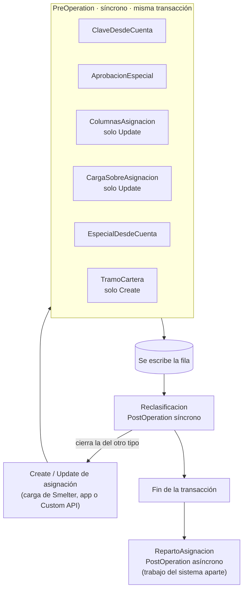

# Plugins y Custom APIs

Este documento describe cada *plugin* (código C# que Dataverse ejecuta dentro de su propio proceso al crear o modificar un registro) y cada *Custom API* (un mensaje propio de Dataverse que las apps invocan como si fuera una función) de Cobranza Móvil: dónde se registra, qué hace, por qué existe y dónde está su código y su prueba. Está pensado para quien tiene que cambiar una regla de negocio del servidor o diagnosticar un error que devuelve Dataverse.

Todo el código vive en un solo ensamblado, [`Sanic.CobranzaMovil.Plugins`](../../plugins/Sanic.CobranzaMovil.Plugins/), y sus pruebas (665, xUnit y Moq) en [`Sanic.CobranzaMovil.Plugins.Tests`](../../plugins/Sanic.CobranzaMovil.Plugins.Tests/). La versión del ensamblado (1.0.10.8) está en [`Sanic.CobranzaMovil.Plugins.csproj`](../../plugins/Sanic.CobranzaMovil.Plugins/Sanic.CobranzaMovil.Plugins.csproj). El modelo de datos se explica en [02 · Modelo de datos](02-modelo-de-datos.md) y los roles en [03 · Seguridad](03-seguridad.md); aquí solo se cita lo necesario.

## Resumen

### Plugins con pasos registrados

El ensamblado y sus pasos viajan en la *solution* `cm_core_cobranzamovil`; se ven en el portal de Power Apps → **Solutions** → la *solution* → **Plug-in steps** ([Instalación, paso 3](09-instalacion-y-despliegue.md#3-revisar-lo-importado)). Cada *plugin* comprueba su propio registro con `ExigirRegistro` (ver [Convenciones](#convenciones-comunes-a-todos-los-plugins)). «Pre» = *PreOperation* (etapa 20, dentro de la transacción, antes de escribir; puede modificar el registro). «Post» = *PostOperation* (etapa 40, después de escribir).

| Plugin | Tabla | Mensaje | Etapa y modo | Para qué |
|---|---|---|---|---|
| [PanGuard](#panguard) | cuenta, carga diaria y bóveda (ver ficha) | Create, Update | Pre, síncrono | Rechaza un número de tarjeta en claro |
| [PanEnTextoLibre](#panentextolibre) | interacción y actualización de datos (ver ficha) | Create, Update | Pre, síncrono | Enmascara un número de tarjeta en los textos libres; nunca rechaza |
| [ClaveDesdeCuenta](#clavedesdecuenta) | `sanic_cm_tbl_asignacion` «CM \| TBL \| Asignacion» | Create, Update | Pre, síncrono | Copia la clave HMAC de la cuenta a la asignación |
| [AprobacionEspecial](#aprobacionespecial) | `sanic_cm_tbl_asignacion` | Create, Update | Pre, síncrono | Solo Supervisor aprueba Especiales; solo la carga crea Diarias e Incobrables |
| [ColumnasAsignacion](#columnasasignacion) | `sanic_cm_tbl_asignacion` | Update | Pre, síncrono | Cada rol escribe solo sus columnas |
| [CargaSobreAsignacion](#cargasobreasignacion) | `sanic_cm_tbl_asignacion` | Update | Pre, síncrono | La carga reabre lo que cerró el sistema |
| [EspecialDesdeCuenta](#especialdesdecuenta) | `sanic_cm_tbl_asignacion` | Create, Update | Pre, síncrono | Copia nota y retiro de la Especial desde la cuenta |
| [TramoCartera](#tramocartera) | asignación, pago, cuenta | Create | Pre síncrono / Post asíncrono | Reparte la cartera en 20 tramos |
| [Reclasificacion](#reclasificacion) | `sanic_cm_tbl_asignacion` | Create, Update | **Post, síncrono** | Una sola activa entre Diaria e Incobrable por cuenta |
| [RepartoAsignacion](#repartoasignacion) | `sanic_cm_tbl_asignacion` | Create, Update | **Post, asíncrono** | Dueño, compartidos y revocaciones |
| [RepartoPorAgente](#repartoporagente) | `sanic_cm_tbl_agente` «CM \| TBL \| Agente» | Update | **Post, asíncrono** | Re-reparte al cambiar el usuario del agente |
| [EmailDesdeUsuario](#emaildesdeusuario) | `sanic_cm_tbl_agente` | Create, Update | Pre, síncrono | Correo del agente = UPN del usuario |
| [InteraccionDelCobrador](#interacciondelcobrador) | `sanic_cm_tbl_interaccion` «CM \| TBL \| Interaccion» | Create | Pre, síncrono | Cuenta y agente obligatorios; el agente lo pone el servidor |
| [IdentidadEnInteraccion](#identidadeninteraccion) | `sanic_cm_tbl_interaccion` | Create | Pre, síncrono | Guarda últimos 4, CIF y clave de la cuenta |
| [GrabacionInteraccion](#grabacioninteraccion) | `sanic_cm_tbl_interaccion` | Update | Pre, síncrono | Controla la transcripción al *core* |
| [VincularActualizacionPendiente](#vincularactualizacionpendiente) | `sanic_cm_tbl_interaccion` | Create | **Post, asíncrono** | Vincula la actualización de datos que llegó antes |
| [ActualizacionConInteraccion](#actualizacionconinteraccion) | `sanic_cm_tbl_actualizaciondatos` «CM \| TBL \| Actualizacion de dato» | Create, Update | Pre, síncrono | La actualización cuelga de una interacción |
| [CuentaDesdeInteraccion](#cuentadesdeinteraccion) | `sanic_cm_tbl_pago` «CM \| TBL \| Pago» | Create | Pre, síncrono | Completa cuenta y número de interacción del pago |
| [ReciboRepetido](#reciborepetido) | `sanic_cm_tbl_pago` | Create | Pre, síncrono | Marca el recibo repetido |
| [TipoDesdeProducto](#tipodesdeproducto) | `sanic_cm_tbl_cuenta` «CM \| TBL \| Cuenta» | Create, Update | Pre, síncrono | Copia el tipo del producto a la cuenta |
| [PurgaArchivoCarga](#purgaarchivocarga) | `sanic_tbl_smlt_importjob` (trabajo de importación de Smelter) | Update | **Post, asíncrono** | Borra el CSV del banco de los trabajos de CM terminados |

### Custom APIs

Las cinco son globales (sin tabla asociada), de tipo acción y sin pasos personalizados. Viajan en la *solution* como objetos de tipo *Custom API*.

| Custom API | Plugin | Pantalla que la llama | Quién puede |
|---|---|---|---|
| [`sanic_cm_SolicitarEspecial`](#sanic_cm_solicitarespecial) | [`SolicitarEspecial.cs`](../../plugins/Sanic.CobranzaMovil.Plugins/SolicitarEspecial.cs) | [`scrNuevaSolicitud`](../../apps/backoffice-canvas/Src/scrNuevaSolicitud.pa.yaml) | Solicitante, Admin, Servicio |
| [`sanic_cm_AltaCuenta`](#sanic_cm_altacuenta) | [`AltaCuenta.cs`](../../plugins/Sanic.CobranzaMovil.Plugins/AltaCuenta.cs) | [`scrAltaCuenta`](../../apps/backoffice-canvas/Src/scrAltaCuenta.pa.yaml) | Admin, Servicio + equipo de carga |
| [`sanic_cm_PartirCarga`](#sanic_cm_partircarga) | [`PartirCarga.cs`](../../plugins/Sanic.CobranzaMovil.Plugins/PartirCarga.cs) | [`scrCargaArchivo`](../../apps/backoffice-canvas/Src/scrCargaArchivo.pa.yaml) | Admin, Servicio + equipo de carga |
| [`sanic_cm_CerrarFueraDeCartera`](#sanic_cm_cerrarfueradecartera) | [`CerrarFueraDeCartera.cs`](../../plugins/Sanic.CobranzaMovil.Plugins/CerrarFueraDeCartera.cs) | [`scrReconciliacion`](../../apps/backoffice-canvas/Src/scrReconciliacion.pa.yaml) | Admin, Servicio |
| [`sanic_cm_MisRoles`](#sanic_cm_misroles) | [`MisRoles.cs`](../../plugins/Sanic.CobranzaMovil.Plugins/MisRoles.cs) | [`scrCarga`](../../apps/backoffice-canvas/Src/scrCarga.pa.yaml) | Cualquier usuario (solo ve lo suyo) |

«Quién puede» lo decide el código de cada plugin: ninguna Custom API tiene privilegio de ejecución propio. En todos los casos también pasa quien no tiene ningún rol de CM (la identidad del sistema o un administrador del ambiente), como se explica en [Clases de apoyo](#clases-de-apoyo).

## Cómo funciona

### Convenciones comunes a todos los plugins

- **Base común.** Todos heredan de [`PluginBase`](../../plugins/Sanic.CobranzaMovil.Plugins/PluginBase.cs): traza inicio, mensaje, etapa y profundidad, y convierte cualquier excepción inesperada en un error genérico. Así el usuario nunca ve un mensaje interno que podría citar un valor del registro.
- **Fallan cerrado si están mal registrados.** Cada plugin llama a `ExigirRegistro(tabla, etapa, mensajes)` y, si no coincide, lanza un error. Un paso en la etapa equivocada no se ignora en silencio. Hay dos excepciones a propósito: `PanEnTextoLibre` nunca lanza (corre sobre lo que llega del teléfono, que no se puede rechazar) y `PurgaArchivoCarga` registrado como síncrono no hace nada (no debe frenar la actualización de estado de Smelter); los dos dejan el problema en la traza.
- **Dos identidades.** `local.Service` usa los permisos del usuario que llama (mínimo privilegio). `local.ServicioSistema` usa la identidad del sistema y se reserva para lo que un rol de persona no debe poder hacer: leer roles, buscar en registros ajenos, dar y quitar acceso.
- **Pasos.** Todos con *rank* 1, despliegue solo en servidor y ejecución como el usuario que llama. El nombre del paso es `<Tipo>: <Mensaje> of <tabla>`; un paso nuevo tiene que seguir la misma convención para encontrarlo en la lista de pasos.
- **Trazas sin datos.** Ninguna traza ni mensaje de error contiene el valor de una columna: solo nombres de columna, cantidades y códigos de error.

### Qué pasa al escribir una asignación

La asignación es la tabla con más plugins. Este es el orden en que corren cuando la carga diaria crea o actualiza una:



Dentro de la etapa PreOperation todos tienen el mismo *rank*, por lo que el orden entre ellos no está garantizado: cada uno está escrito para no depender de lo que hagan los demás.

## Fichas de los plugins

### PanGuard

| | |
|---|---|
| Tablas y columna vigilada | `sanic_cm_tbl_cuenta` (`sanic_cm_ct_numerodecuenta`), `sanic_cm_tbl_cargadiaria` «CM \| TBL \| Carga diaria» (`sanic_cm_cd_numerocuenta`), `sanic_cm_tbl_cuentapan` «CM \| TBL \| PAN de cuenta» (`sanic_cm_cp_name`) |
| Mensaje | Create y Update (Update filtrado por la columna vigilada) |
| Etapa y modo | PreOperation, síncrono |
| Código / prueba | [`PanGuard.cs`](../../plugins/Sanic.CobranzaMovil.Plugins/PanGuard.cs) · [`PanGuardTests.cs`](../../plugins/Sanic.CobranzaMovil.Plugins.Tests/PanGuardTests.cs) |

- En las tres columnas rechaza 5 o más dígitos seguidos (tolera espacio, guion o espacio duro entre dígitos). El valor enmascarado `****1234` pasa.
- **Por qué:** es la red de seguridad PCI: el número completo solo vive en la bóveda `sanic_cm_tbl_cuentapan` (ver [03 · Seguridad](03-seguridad.md)). El mensaje nombra la columna, nunca el valor.
- ⚠️ Los seis pasos (Create y Update de las tres tablas) tienen que estar **activos** (**On**) desde el primer día. La importación puede dejarlos apagados: verificar su estado en **Plug-in steps** después de cada importación ([Instalación, paso 3](09-instalacion-y-despliegue.md#3-revisar-lo-importado)).

### PanEnTextoLibre

| | |
|---|---|
| Tablas y columnas | `sanic_cm_tbl_interaccion` (`sanic_cm_in_comentario`); `sanic_cm_tbl_actualizaciondatos` «CM \| TBL \| Actualizacion de dato» (`sanic_cm_ad_direccioncasa`, `sanic_cm_ad_direccionec`, `sanic_cm_ad_direcciontrabajo`) |
| Mensaje | Create y Update (Update filtrado por esas columnas) |
| Etapa y modo | PreOperation, síncrono |
| Código / prueba | [`PanEnTextoLibre.cs`](../../plugins/Sanic.CobranzaMovil.Plugins/PanEnTextoLibre.cs) · [`PanEnTextoLibreTests.cs`](../../plugins/Sanic.CobranzaMovil.Plugins.Tests/PanEnTextoLibreTests.cs), [`PanDetectorTests.cs`](../../plugins/Sanic.CobranzaMovil.Plugins.Tests/PanDetectorTests.cs) |

- En cada columna del *Target* busca números de tarjeta con `PanDetector.EnmascararPan`: una secuencia de 13 a 19 dígitos (con espacios, guiones o espacio duro entre medio) que pasa el dígito verificador Luhn. Cada una se reemplaza por `•••• ` y sus últimos 4 antes de guardarse. El resto del texto queda igual.
- En una racha de dígitos más larga (un teléfono pegado a la tarjeta con un espacio) prueba los tramos que empiezan y terminan en un borde de grupo, del más largo al más corto. Dentro de una tira de dígitos sin separadores no busca: casi cualquier ventana de 13 o más dígitos pasaría Luhn una vez de cada diez.
- **Nunca rechaza.** Un registro mal configurado, un *Target* que no es entidad o un valor que no es texto solo se trazan. La traza nombra la columna enmascarada, nunca el valor.
- Teléfonos y correo no se revisan: la app ya valida su formato.
- Sus pasos quedan siempre activos; no comparten el ciclo de activación de `PanGuard`.
- **Por qué no es una regla de `PanGuard`:** `PanGuard` rechaza, y lo que llega del teléfono sin conexión no se puede rechazar: el *runtime offline* descarta el registro en silencio y se pierde la visita. Por qué se enmascara en vez de rechazar: [12 · Decisiones](12-decisiones.md).
- La app del localizador muestra un aviso (`lblAvisoTarjeta` en [`scrInteraccion.pa.yaml`](../../apps/localizador-canvas/Src/scrInteraccion.pa.yaml)) cuando el comentario tiene 13 o más dígitos seguidos; no bloquea el guardado.

### ClaveDesdeCuenta

| | |
|---|---|
| Tabla | `sanic_cm_tbl_asignacion` |
| Mensaje | Create; Update filtrado por `sanic_cm_as_cuentaid`, `sanic_cm_as_clavepan` |
| Imagen previa | `PreImage` con `sanic_cm_as_cuentaid` (solo Update) |
| Etapa y modo | PreOperation, síncrono |
| Código / prueba | [`ClaveDesdeCuenta.cs`](../../plugins/Sanic.CobranzaMovil.Plugins/ClaveDesdeCuenta.cs) · [`ClaveDesdeCuentaTests.cs`](../../plugins/Sanic.CobranzaMovil.Plugins.Tests/ClaveDesdeCuentaTests.cs), [`CargaComoSistemaTests.cs`](../../plugins/Sanic.CobranzaMovil.Plugins.Tests/CargaComoSistemaTests.cs) |

- Si la asignación trae cuenta y no trae `sanic_cm_as_clavepan`, la copia de `sanic_cm_ct_clavepan` de la cuenta; si trae una distinta, rechaza.
- Cuando escribe la carga (identidad del sistema) y la cuenta llega referenciada por su *alternate key* (clave alternativa: una columna única que sirve para buscar el registro sin conocer su id), usa el valor de la referencia sin leer la cuenta.
- **Por qué:** la clave HMAC es la que une asignación y cuenta sin guardar el número de tarjeta; el plugin solo copia el HMAC ya calculado, nunca conoce la clave secreta.

### AprobacionEspecial

| | |
|---|---|
| Tabla | `sanic_cm_tbl_asignacion` |
| Mensaje | Create; Update filtrado por `sanic_cm_as_agenteid`, `sanic_cm_as_estadoaprobacion`, `sanic_cm_as_tipo` |
| Imagen previa | `PreImage` con esas tres columnas (solo Update) |
| Etapa y modo | PreOperation, síncrono |
| Código / prueba | [`AprobacionEspecial.cs`](../../plugins/Sanic.CobranzaMovil.Plugins/AprobacionEspecial.cs) · [`AprobacionEspecialTests.cs`](../../plugins/Sanic.CobranzaMovil.Plugins.Tests/AprobacionEspecialTests.cs), [`CargaComoSistemaTests.cs`](../../plugins/Sanic.CobranzaMovil.Plugins.Tests/CargaComoSistemaTests.cs) |

- Sobre una Especial, solo Supervisor, Admin o Servicio pueden aprobarla, rechazarla, ponerle o cambiarle el agente, o convertir en Especial una asignación con agente.
- Aprobar o rechazar (un Update que trae `Aprobado` o `Rechazada`, aunque sea el mismo valor) solo pasa si la Especial sigue `Pendiente` **en la base**: el plugin la vuelve a leer con `Retrieve` y, si otra persona ya la resolvió, rechaza con «Esta Especial ya la resolvió otra persona. Actualizá la lista.». Vale para todos, también sin roles de CM. Cerrar, reactivar (vuelve a `Pendiente`) o cambiar el localizador de una aprobada no pasan por este control.
- Solo la carga (o el Servicio) puede crear una Diaria o Incobrable, o convertir otra asignación en una; cualquier persona con rol de CM, Admin incluido, recibe error.
- En el Create, una Diaria o Incobrable nace con aprobación en Borrador (el valor por defecto de la columna es Pendiente, que necesitan las Especiales).
- En el Create, una persona solo puede ponerse a sí misma en «Solicitado por» (ver `SolicitadoPor` en [Clases de apoyo](#clases-de-apoyo)).
- **Por qué:** es la segregación de funciones de la Especial. Se hace en el servidor porque una *business rule* de formulario no corre en una canvas app ni en la API.

### ColumnasAsignacion

| | |
|---|---|
| Tabla | `sanic_cm_tbl_asignacion` |
| Mensaje | Update **sin filtro** de columnas |
| Etapa y modo | PreOperation, síncrono |
| Código / prueba | [`ColumnasAsignacion.cs`](../../plugins/Sanic.CobranzaMovil.Plugins/ColumnasAsignacion.cs) · [`ColumnasAsignacionTests.cs`](../../plugins/Sanic.CobranzaMovil.Plugins.Tests/ColumnasAsignacionTests.cs) |

- Localizador: solo `sanic_cm_as_orden`. Supervisor: aprobación, agente, resolutor, motivos, estado y fecha de cierre. Cualquier otro rol de CM (Solicitante incluido): ninguna columna `sanic_cm_as_*`.
- Admin, Servicio y quien no tiene roles de CM no se frenan; a la identidad del sistema no se le consultan los roles.
- **Por qué:** la seguridad de columna (*field-level security*) también aplicaría a la carga de Smelter. Va sin filtro a propósito: un filtro dejaría pasar las columnas que no lista.

### CargaSobreAsignacion

| | |
|---|---|
| Tabla | `sanic_cm_tbl_asignacion` |
| Mensaje | Update filtrado por `sanic_cm_as_ultimacarga` |
| Imagen previa | `PreImage` con estado, motivo, tipo y fecha asignada |
| Etapa y modo | PreOperation, síncrono |
| Código / prueba | [`CargaSobreAsignacion.cs`](../../plugins/Sanic.CobranzaMovil.Plugins/CargaSobreAsignacion.cs) · [`CargaSobreAsignacionTests.cs`](../../plugins/Sanic.CobranzaMovil.Plugins.Tests/CargaSobreAsignacionTests.cs) |

- Si la carga vuelve a traer una Diaria o Incobrable que cerró el sistema (motivo «fuera de cartera» o «Reclasificada a …»), la reabre. Los cierres de una persona y las Especiales no se reabren.
- No pisa la fecha asignada si ya tenía una.
- **Por qué:** la plantilla de Smelter no mapea el estado; sin esto una cuenta que vuelve a la cartera quedaría cerrada. Solo la carga escribe «última carga», por eso es el filtro.

### EspecialDesdeCuenta

| | |
|---|---|
| Tabla | `sanic_cm_tbl_asignacion` |
| Mensaje | Create; Update filtrado por `sanic_cm_as_ultimacarga` |
| Imagen previa | `PreImage` con tipo, cuenta, solicitante, notas y retiros (solo Update) |
| Etapa y modo | PreOperation, síncrono |
| Código / prueba | [`EspecialDesdeCuenta.cs`](../../plugins/Sanic.CobranzaMovil.Plugins/EspecialDesdeCuenta.cs) · [`EspecialDesdeCuentaTests.cs`](../../plugins/Sanic.CobranzaMovil.Plugins.Tests/EspecialDesdeCuentaTests.cs) |

- En una Especial sin solicitante (llegó por la carga o por el alta), copia de la cuenta lo que está vacío: notas como «Tipo — nota», retiro en córdobas y en dólares.
- **Por qué:** la plantilla de Smelter deja esos datos en la cuenta y las apps los leen de la asignación; así hay un solo lugar donde leerlos. Nunca pisa lo que escribió una persona.

### TramoCartera

| | |
|---|---|
| Pasos | Create de `sanic_cm_tbl_asignacion` (Pre, síncrono) · Create de `sanic_cm_tbl_pago` (Pre, síncrono) · Create de `sanic_cm_tbl_cuenta` (**Post, asíncrono**) |
| Columnas | `sanic_cm_as_tramo`, `sanic_cm_pg_tramo`, `sanic_cm_ct_tramo` |
| Código / prueba | [`TramoCartera.cs`](../../plugins/Sanic.CobranzaMovil.Plugins/TramoCartera.cs) · [`TramoCarteraTests.cs`](../../plugins/Sanic.CobranzaMovil.Plugins.Tests/TramoCarteraTests.cs) |

- Pone un tramo de 0 a 19: la asignación, el de su cuenta; la cuenta, el de su propio id; el pago, el de su interacción. Es un hash FNV-1a del id (los ids de Dataverse son secuenciales y reparten mal por sí solos).
- **Por qué:** una colección de una canvas app se corta en 2.000 filas; las apps traen la cartera de a un tramo por vez (ver [05 · App del localizador](05-app-localizador.md)). La cuenta va asíncrona porque su id recién existe después de crearla y así no frena la carga.
- El método público `Tramo(Guid)` es el mismo cálculo que debe usar cualquier relleno de datos.

### Reclasificacion

| | |
|---|---|
| Tabla | `sanic_cm_tbl_asignacion` |
| Mensaje | Create; Update filtrado por `sanic_cm_as_ultimacarga`, `sanic_cm_as_estado`, `sanic_cm_as_tipo` |
| Imagen previa | `PreImage` con tipo, estado y cuenta (solo Update) |
| Etapa y modo | **PostOperation, síncrono** |
| Código / prueba | [`Reclasificacion.cs`](../../plugins/Sanic.CobranzaMovil.Plugins/Reclasificacion.cs) · [`ReclasificacionTests.cs`](../../plugins/Sanic.CobranzaMovil.Plugins.Tests/ReclasificacionTests.cs) |

- Si una cuenta queda con una Diaria activa, cierra su Incobrable activa (y al revés) con motivo «Reclasificada a {tipo}». Las Especiales no se tocan.
- **Por qué:** una cuenta tiene una sola asignación activa entre Diaria e Incobrable. Va síncrono para cerrar en la misma transacción que la fila de la carga; si después la cuenta vuelve con el tipo anterior, `CargaSobreAsignacion` la reabre.

### RepartoAsignacion

| | |
|---|---|
| Tabla | `sanic_cm_tbl_asignacion` |
| Mensaje | Create; Update filtrado por `sanic_cm_as_agenteid`, `sanic_cm_as_estado`, `sanic_cm_as_estadoaprobacion` |
| Etapa y modo | **PostOperation, asíncrono**, con borrado automático del trabajo si termina bien |
| Identidad | Servicio del sistema |
| Código / prueba | [`RepartoAsignacion.cs`](../../plugins/Sanic.CobranzaMovil.Plugins/RepartoAsignacion.cs) · [`RepartoAsignacionTests.cs`](../../plugins/Sanic.CobranzaMovil.Plugins.Tests/RepartoAsignacionTests.cs) |

- Lee el estado **actual** de la asignación (no el del evento), así varias ejecuciones convergen.
- Activa (y no es una Especial sin aprobar): pasa el dueño al usuario del agente o, si no hay, al equipo «Cartera sin cobrador»; comparte la Especial aprobada en solo lectura con «Solicitado por»; comparte en lectura cuenta, cliente y fiador con el localizador; revoca al dueño anterior lo que ya no justifique otra asignación activa suya.
- Cerrada: revoca al dueño actual lo que ya no justifique.
- Cada paso corre aunque falle otro. Un compartido concurrente se reintenta con espera; si algo queda sin hacer, termina en error con reintento del servicio asíncrono (falla transitoria) o como trabajo fallido.
- **Por qué asíncrono:** Smelter escribe las filas en lotes de 100 dentro de un solo mensaje, y un plugin síncrono correría dentro de ese mensaje y su límite de 2 minutos. El plugin falla si se lo registra síncrono. El modelo de dueños y compartidos se explica en [03 · Seguridad](03-seguridad.md).

### RepartoPorAgente

| | |
|---|---|
| Tabla | `sanic_cm_tbl_agente` |
| Mensaje | Update filtrado por `sanic_cm_ag_usuarioid` |
| Etapa y modo | **PostOperation, asíncrono** |
| Identidad | Servicio del sistema |
| Código / prueba | [`RepartoPorAgente.cs`](../../plugins/Sanic.CobranzaMovil.Plugins/RepartoPorAgente.cs) · [`RepartoPorAgenteTests.cs`](../../plugins/Sanic.CobranzaMovil.Plugins.Tests/RepartoPorAgenteTests.cs) |

- Al vincular, cambiar o quitar el usuario de un agente, busca sus asignaciones activas cuyo dueño no corresponde (sin las Especiales por aprobar) y les vuelve a escribir el **mismo** agente. Eso dispara `RepartoAsignacion` en cada una.
- Hasta 1.000 por ejecución; si quedan más o alguna falla, pide reintento al servicio asíncrono.
- **Por qué:** el reparto solo corre al tocar la asignación; sin esto las Incobrables y Especiales nunca cambiarían de dueño. La lógica del reparto queda en un solo lugar.

### EmailDesdeUsuario

| | |
|---|---|
| Tabla | `sanic_cm_tbl_agente` |
| Mensaje | Create; Update filtrado por `sanic_cm_ag_usuarioid` |
| Etapa y modo | PreOperation, síncrono |
| Código / prueba | [`EmailDesdeUsuario.cs`](../../plugins/Sanic.CobranzaMovil.Plugins/EmailDesdeUsuario.cs) · [`EmailDesdeUsuarioTests.cs`](../../plugins/Sanic.CobranzaMovil.Plugins.Tests/EmailDesdeUsuarioTests.cs) |

- `sanic_cm_ag_emailusuario` = UPN en minúsculas del usuario vinculado; si se desvincula, queda vacío.
- **Por qué:** la app del localizador encuentra su agente con `Lower(User().Email)`, que devuelve el UPN. El correo nunca se escribe a mano.

### InteraccionDelCobrador

Nombre histórico: en el código el localizador aparece como «cobrador».

| | |
|---|---|
| Tabla | `sanic_cm_tbl_interaccion` |
| Mensaje | Create |
| Etapa y modo | PreOperation, síncrono |
| Código / prueba | [`InteraccionDelCobrador.cs`](../../plugins/Sanic.CobranzaMovil.Plugins/InteraccionDelCobrador.cs) · [`InteraccionDelCobradorTests.cs`](../../plugins/Sanic.CobranzaMovil.Plugins.Tests/InteraccionDelCobradorTests.cs) |

- Toda interacción tiene cuenta y agente (el «requerido» de la columna solo lo exige el formulario).
- Si la crea un localizador: el agente es el vinculado a su usuario (lo pone el servidor), el agente tiene que estar activo, y la interacción nace pendiente de transcribir, sin código, fecha ni usuario de grabación.
- El localizador solo registra en cuentas de su cartera (una asignación activa de la cuenta cuyo dueño es su usuario). Tolerancia: si la fecha de captura (no más de 5 minutos adelantada ni más de 48 horas atrás) es de cuando la cuenta era suya según la auditoría de dueño y estado de la asignación, la interacción entra.
- **Por qué:** nadie registra visitas a nombre de otro ni en cuentas ajenas, y una visita capturada sin señal no se pierde si mientras tanto reasignaron la cuenta. Requiere auditoría activa en `ownerid` y `sanic_cm_as_estado`; si no se puede leer, rige la regla estricta.

### IdentidadEnInteraccion

| | |
|---|---|
| Tabla | `sanic_cm_tbl_interaccion` |
| Mensaje | Create |
| Etapa y modo | PreOperation, síncrono |
| Código / prueba | [`IdentidadEnInteraccion.cs`](../../plugins/Sanic.CobranzaMovil.Plugins/IdentidadEnInteraccion.cs) · [`IdentidadEnInteraccionTests.cs`](../../plugins/Sanic.CobranzaMovil.Plugins.Tests/IdentidadEnInteraccionTests.cs) |

- Copia de la cuenta a la interacción los últimos 4, el CIF y la clave HMAC (solo lo vacío). Nunca rechaza.
- **Por qué:** la cuenta se borra al salir de cartera y la interacción vive más; con esos datos la oficina identifica la cuenta en el *core*. Ver [08 · Ciclo de vida](08-ciclo-de-vida.md).

### GrabacionInteraccion

| | |
|---|---|
| Tabla | `sanic_cm_tbl_interaccion` |
| Mensaje | Update **sin filtro** |
| Imagen previa | `PreImage` con estado y código de grabación |
| Etapa y modo | PreOperation, síncrono |
| Código / prueba | [`GrabacionInteraccion.cs`](../../plugins/Sanic.CobranzaMovil.Plugins/GrabacionInteraccion.cs) · [`GrabacionInteraccionTests.cs`](../../plugins/Sanic.CobranzaMovil.Plugins.Tests/GrabacionInteraccionTests.cs) |

- Una interacción grabada (ya transcrita) no se vuelve a grabar ni cambia su código: si dos personas tienen la misma abierta en [`scrTranscripcion`](../../apps/backoffice-canvas/Src/scrTranscripcion.pa.yaml), la segunda recibe un error. Este control se aplica a los roles con restricción; Admin, Servicio y quien no tiene roles de CM sí pueden corregir una grabación.
- Pasar a Grabado exige el código (a todos); la fecha y el usuario de grabación los pone el servidor, y fuera de una grabación descarta lo que una persona mande en esas dos columnas.
- BackOffice escribe solo las cuatro columnas de grabación; ningún otro rol de CM, salvo Admin y Servicio, escribe la interacción.
- **Por qué:** el permiso de escritura de BackOffice no debe tocar lo que capturó el localizador. Límite conocido: dos grabaciones en el mismo milisegundo podrían pasar las dos.

### VincularActualizacionPendiente

| | |
|---|---|
| Tabla | `sanic_cm_tbl_interaccion` |
| Mensaje | Create |
| Etapa y modo | **PostOperation, asíncrono** |
| Identidad | Servicio del sistema |
| Código / prueba | [`VincularActualizacionPendiente.cs`](../../plugins/Sanic.CobranzaMovil.Plugins/VincularActualizacionPendiente.cs) · [`VincularActualizacionPendienteTests.cs`](../../plugins/Sanic.CobranzaMovil.Plugins.Tests/VincularActualizacionPendienteTests.cs) |

- Si la interacción que llega «actualiza info» y tiene cuenta, le cuelga la actualización de datos sin vincular más vieja (últimas 24 horas) de la misma cuenta y localizador.
- **Por qué asíncrono:** si fallara en modo síncrono, se rechazaría la interacción y el teléfono la descartaría.

### ActualizacionConInteraccion

| | |
|---|---|
| Tabla | `sanic_cm_tbl_actualizaciondatos` |
| Mensaje | Create; Update filtrado por `sanic_cm_ad_interaccionid` |
| Etapa y modo | PreOperation, síncrono |
| Código / prueba | [`ActualizacionConInteraccion.cs`](../../plugins/Sanic.CobranzaMovil.Plugins/ActualizacionConInteraccion.cs) · [`ActualizacionConInteraccionTests.cs`](../../plugins/Sanic.CobranzaMovil.Plugins.Tests/ActualizacionConInteraccionTests.cs) |

- La actualización de datos cuelga de una interacción con cuenta; completa la cuenta si falta y rechaza si es de otra.
- Sin interacción (caso normal *offline*: el lookup a una interacción recién creada llega vacío), busca la del mismo localizador y cuenta, por fecha de captura (±2 segundos) o, sin fecha, la más vieja de las últimas 24 horas sin actualización. Si no la encuentra, la acepta con `sanic_cm_ad_sinvincular` = Sí.
- **Por qué:** por ese camino (actualización → interacción → cuenta → CIF) la oficina sabe de qué cliente es. Traza los nombres de las columnas recibidas porque el *runtime offline* descarta columnas en silencio.

### CuentaDesdeInteraccion

| | |
|---|---|
| Tabla | `sanic_cm_tbl_pago` |
| Mensaje | Create |
| Etapa y modo | PreOperation, síncrono |
| Código / prueba | [`CuentaDesdeInteraccion.cs`](../../plugins/Sanic.CobranzaMovil.Plugins/CuentaDesdeInteraccion.cs) · [`CuentaDesdeInteraccionTests.cs`](../../plugins/Sanic.CobranzaMovil.Plugins.Tests/CuentaDesdeInteraccionTests.cs) |

- Exige `sanic_cm_pg_interaccion` y completa `sanic_cm_pg_cuentaid` y `sanic_cm_pg_numerointeraccion` desde la interacción, con una sola lectura y solo si faltan.
- **Por qué:** el modo *offline* admite un solo nivel de lookup (pago → interacción → cuenta no funciona en el teléfono), y el número de interacción lo asigna el servidor.

### ReciboRepetido

| | |
|---|---|
| Tabla | `sanic_cm_tbl_pago` |
| Mensaje | Create |
| Etapa y modo | PreOperation, síncrono |
| Código / prueba | [`ReciboRepetido.cs`](../../plugins/Sanic.CobranzaMovil.Plugins/ReciboRepetido.cs) · [`ReciboRepetidoTests.cs`](../../plugins/Sanic.CobranzaMovil.Plugins.Tests/ReciboRepetidoTests.cs) |

- Si el número de recibo ya existe en otro pago, marca `sanic_cm_pg_reciborepetido` = Sí. No rechaza.
- **Por qué:** el teléfono solo ve los pagos propios y no puede validar la unicidad; la búsqueda usa el servicio del sistema y BackOffice revisa la marca al transcribir.

### TipoDesdeProducto

| | |
|---|---|
| Tabla | `sanic_cm_tbl_cuenta` |
| Mensaje | Create; Update filtrado por `sanic_cm_ct_productoid` |
| Imagen previa | `PreImage` con producto y tipo de producto (solo Update) |
| Etapa y modo | PreOperation, síncrono |
| Código / prueba | [`TipoDesdeProducto.cs`](../../plugins/Sanic.CobranzaMovil.Plugins/TipoDesdeProducto.cs) · [`TipoDesdeProductoTests.cs`](../../plugins/Sanic.CobranzaMovil.Plugins.Tests/TipoDesdeProductoTests.cs) |

- Copia el tipo del producto a `sanic_cm_ct_tipoproducto`. Si el producto no cambió y la cuenta ya tiene tipo, no lee nada.
- **Por qué:** la carga solo llena el lookup y la app del localizador muestra el tipo sin consultar productos. Cambiar el tipo de un producto **no** se propaga a sus cuentas existentes.

### PurgaArchivoCarga

| | |
|---|---|
| Tabla | `sanic_tbl_smlt_importjob` (trabajo de importación de Smelter, *Import Job*) |
| Mensaje | Update filtrado por `sanic_smlt_ij_status` |
| Etapa y modo | PostOperation, **asíncrono** (el trabajo del sistema se borra si termina bien) |
| Código / prueba | [`PurgaArchivoCarga.cs`](../../plugins/Sanic.CobranzaMovil.Plugins/PurgaArchivoCarga.cs) · [`PurgaArchivoCargaTests.cs`](../../plugins/Sanic.CobranzaMovil.Plugins.Tests/PurgaArchivoCargaTests.cs) |

- Solo mira los trabajos de las tres plantillas de CM: «Cobranza movil», «Cobranza movil · padres» y «Cobranza movil · partes» (las busca por nombre, igual que `PartirCarga`). Si no existe ninguna, no hace nada.
- **El trabajo que cambió de estado.** Lo vuelve a leer (el paso es asíncrono y el estado pudo cambiar) y, si está en un estado terminal (2 *Completed*, 3 *CompletedWithErrors* o 4 *Failed*), borra su archivo `sanic_smlt_ij_sourcefile`, sea prueba en seco o carga real.
- **Barrido.** En la misma corrida borra el archivo de hasta 50 trabajos más (`Esquema.MaximoPurgasPorCorrida`), los más viejos primero, de esas plantillas, con archivo y creados hace más de 7 días (`Esquema.DiasConservarArchivoCarga`) que estén en estado terminal o sean pruebas en seco sin estado (abandonadas: la pantalla nunca relanza una prueba). Así no queda nada para siempre por un paso que falló o por trabajos anteriores al *plugin*.
- Nunca toca un trabajo sin estado (salvo esas pruebas viejas), en cola ni procesando. El trabajo se conserva: solo se borra el archivo, y se conservan los contadores y los registros.
- Una columna de archivo no se vacía con `Update`: se borra con el mensaje `DeleteFile` y el id del archivo. Si un borrado falla, traza el tipo de error y sigue; lo toma el próximo barrido.
- Usa la identidad del sistema: el estado lo cambia el orquestador de Smelter (no un usuario de CM) y el barrido tiene que ver los trabajos de todos.
- **Por qué es seguro borrar al llegar a un estado terminal:** cada envío crea un trabajo nuevo con su archivo (la carga real no reutiliza el de la prueba en seco); `PartirCarga` solo lee el archivo de un trabajo **sin** estado; el trabajo de padres termina después de que se crearon las partes, cada una con su archivo; «Relanzar» solo pone en cola partes sin estado y «Descartar» las pasa a *Failed* sin correrlas.
- **Por qué asíncrono:** síncrono correría dentro de la actualización de estado de Smelter y frenaría a su orquestador. Por qué un *plugin* y no un *flow*: [12 · Decisiones](12-decisiones.md).
- ⚠️ Las partes sin estado no se barren (se pueden relanzar): una parte que nadie relanza ni descarta conserva su archivo. Lo mismo un trabajo real que queda sin estado y nadie cierra. Ver [08 · Ciclo de vida](08-ciclo-de-vida.md).

## Custom APIs

Las apps las invocan con `Environment.sanic_cm_<API>({...})`. Un error del plugin llega a la app como texto JSON con el código `0x80040265`; la función `TextoError` de [`App.pa.yaml`](../../apps/backoffice-canvas/Src/App.pa.yaml) extrae el mensaje legible.

### sanic_cm_SolicitarEspecial

Pide una asignación Especial para una cuenta. Plugin: [`SolicitarEspecial.cs`](../../plugins/Sanic.CobranzaMovil.Plugins/SolicitarEspecial.cs) · prueba: [`SolicitarEspecialTests.cs`](../../plugins/Sanic.CobranzaMovil.Plugins.Tests/SolicitarEspecialTests.cs). Pantalla: [`scrNuevaSolicitud`](../../apps/backoffice-canvas/Src/scrNuevaSolicitud.pa.yaml).

| Entrada | Tipo | Obligatorio | Descripción |
|---|---|---|---|
| `CuentaId` | Guid | Sí | Id de la cuenta |
| `Notas` | Texto | Sí | Tipo y motivo; hasta 2.000 caracteres, sin 13 o más dígitos seguidos |
| `RetiroNio` | Decimal | No | Retiro en córdobas, 0 a 1.000.000.000 |
| `RetiroUsd` | Decimal | No | Retiro en dólares, 0 a 1.000.000.000 |

| Salida | Tipo | Descripción |
|---|---|---|
| `AsignacionId` | Guid | La Especial creada, reactivada o existente |
| `Resultado` | Texto | `creada`, `reactivada` o `ya existe` |
| `SolicitadoPor` | Texto | Si ya existe, quién la pidió |
| `EstadoAprobacion` | Entero | 2 = Pendiente, 3 = Aprobado, 4 = Rechazada |

- Quién puede: Solicitante, Admin o Servicio (o sin roles de CM), y además tiene que poder leer la cuenta con sus propios permisos.
- Si hay una Especial activa, no la toca e informa quién la pidió. Si hay una cerrada, la reactiva con el servicio del sistema a nombre del llamador (dueño y «Solicitado por»), pendiente de aprobación y sin agente, y le quita el compartido al solicitante anterior. Si no hay, la crea con los permisos del llamador.
- **Por qué una API y no un `Patch`:** el Solicitante solo ve sus propias asignaciones y no podría encontrar una Especial cerrada de otra persona.

### sanic_cm_AltaCuenta

El Admin da de alta una cuenta como una importación de Smelter de **una fila**. Plugin: [`AltaCuenta.cs`](../../plugins/Sanic.CobranzaMovil.Plugins/AltaCuenta.cs) · prueba: [`AltaCuentaTests.cs`](../../plugins/Sanic.CobranzaMovil.Plugins.Tests/AltaCuentaTests.cs). Pantalla: [`scrAltaCuenta`](../../apps/backoffice-canvas/Src/scrAltaCuenta.pa.yaml).

| Entrada | Tipo | Obligatorio | Descripción |
|---|---|---|---|
| `CIF` | Texto | Sí | Hasta 20 caracteres |
| `NumeroCuenta` | Texto | Sí | 13 a 19 dígitos (acepta espacios o guiones), dígito verificador Luhn. Nunca se guarda en tablas de CM |
| `SaldoVencidoNIO`, `SaldoVencidoUSD`, `TotalSaldoVencido` | Decimal | Sí | Saldos, 0 a 1.000.000.000 |
| `DiasMora`, `NivelMora` | Entero | Sí | 0 a 100.000 |
| `ProductoId` | Guid | Sí | Producto existente |
| `AgenteId` | Guid | Sí | Agente existente y activo |
| `TipoAsignacion` | Texto | Sí | `Diaria`, `Incobrable` o `Especial` |
| `EsPrueba` | Booleano | Sí | `true` = prueba en seco de Smelter |
| `Cliente` | Texto | Para la plataforma no; el plugin lo exige si el cliente es nuevo | Nombre del cliente, hasta 200 caracteres |
| `DireccionCasa`, `DireccionEC`, `DireccionTrabajo`, `Departamento`, `Distrito`, `Trabajo`, `NumeroCelular`, `NumeroCasa` | Texto | No | Datos del cliente nuevo (si el cliente existe, se usan los de Dataverse). Direcciones y trabajo hasta 200 caracteres; departamento y distrito, 100; teléfonos, 20 |
| `ContagiadoUSD`, `PagoMinimoNIO`, `PagoMinimoUSD`, `RetiroNIO`, `RetiroUSD` | Decimal | No | Montos opcionales, 0 a 1.000.000.000 |
| `FechaUltimoPago`, `FechaPago` | Texto | No | `aaaa-mm-dd` |
| `Ciclo`, `NombreFianza`, `DireccionFianza`, `TipoEspecial`, `Nota` | Texto | No | Ciclo hasta 10 caracteres; nota, 400; el resto, 200 |

Ningún texto admite comillas ni saltos de línea (la fila va a un CSV), y ninguno salvo `CIF` admite 13 o más dígitos seguidos. Los largos máximos son los de la columna más corta a la que va cada valor: con uno mayor la prueba en seco de Smelter da bien y la carga falla después.

| Salida | Tipo | Descripción |
|---|---|---|
| `JobId` | Guid | El *Import Job* de Smelter, sin estado |
| `Advertencias` | Texto | Avisos para el Admin, uno por línea |

- Quién puede: Admin o Servicio (o sin roles de CM). Además el llamador tiene que ver la plantilla «Cobranza movil» de Smelter, o sea estar en el equipo de carga.
- Valida todo antes de crear nada y arma la fila en el servidor para evitar las trampas del *upsert* de la plantilla: la fecha de carga es la de la última carga diaria (no la de hoy, para no mover el corte de la reconciliación); agente y producto se escriben con los valores de Dataverse; si el cliente ya existe se usan sus datos actuales; si ese cliente ya tiene una cuenta con los mismos últimos 4, rechaza.
- Crea el job con los permisos del llamador y no le pone estado: la app lo pone en cola después.
- **Por qué pasar por Smelter:** el HMAC, la bóveda y el enmascarado los hace Smelter igual que con el archivo del banco; ningún plugin conoce la clave secreta del HMAC. Ver [07 · Carga diaria](07-carga-diaria.md).

### sanic_cm_PartirCarga

Parte un *Import Job* de la carga real para cargarlo en paralelo, o solo valida largos. Plugin: [`PartirCarga.cs`](../../plugins/Sanic.CobranzaMovil.Plugins/PartirCarga.cs) · prueba: [`PartirCargaTests.cs`](../../plugins/Sanic.CobranzaMovil.Plugins.Tests/PartirCargaTests.cs). Pantalla: [`scrCargaArchivo`](../../apps/backoffice-canvas/Src/scrCargaArchivo.pa.yaml) (botón de partir y botón de validar).

| Entrada | Tipo | Obligatorio | Descripción |
|---|---|---|---|
| `JobId` | Guid | Sí | Job de la plantilla «Cobranza movil», sin estado y con archivo |
| `Partes` | Entero | Sí | 1 a 4; con menos de 300 filas se hace una sola. Dataverse lo exige siempre; con `SoloValidar` se ignora (la app manda 1) |
| `SoloValidar` | Booleano | No | `true` = solo mide el largo de cada valor contra su columna, sin escribir |

| Salida | Tipo | Descripción |
|---|---|---|
| `PadresJobId` | Guid | El mismo `JobId`, convertido en el job de padres |
| `PartesJobIds` | Texto | Ids de las partes, separados por coma, en orden |
| `Partes` | Entero | Cantidad de partes creadas |
| `FilasArchivo`, `FilasPadres` | Entero | Filas del original y del archivo de padres |
| `FilasPartes` | Texto | Filas de cada parte, separadas por coma |

- Quién puede: Admin o Servicio (o sin roles de CM), y el llamador tiene que ver el job y las tres plantillas (equipo de carga).
- Convierte el job en el de **padres** (última fila de cada producto, fiador y agente; plantilla «Cobranza movil · padres») y crea hasta 4 jobs de **partes** (plantilla «Cobranza movil · partes») donde las filas que escriben un mismo registro van siempre juntas.
- Si algo falla, borra las partes creadas y devuelve el archivo original al job. Rechaza el archivo si un valor es más largo que su columna, porque la prueba en seco de Smelter no lo detecta.
- **Por qué:** en un solo job las filas se procesan en serie y la carga diaria tarda demasiado. El detalle de la partición está en [07 · Carga diaria](07-carga-diaria.md).

### sanic_cm_CerrarFueraDeCartera

Cierra por lotes las Diarias activas que quedaron fuera de la última carga. Plugin: [`CerrarFueraDeCartera.cs`](../../plugins/Sanic.CobranzaMovil.Plugins/CerrarFueraDeCartera.cs) · prueba: [`CerrarFueraDeCarteraTests.cs`](../../plugins/Sanic.CobranzaMovil.Plugins.Tests/CerrarFueraDeCarteraTests.cs). Pantalla: [`scrReconciliacion`](../../apps/backoffice-canvas/Src/scrReconciliacion.pa.yaml).

| Entrada | Tipo | Obligatorio | Descripción |
|---|---|---|---|
| `Corte` | Texto | Sí | Día de la última carga que vio la pantalla, `aaaa-mm-dd`. Si cambió, no cierra |
| `Esperadas` | Entero | Sí | Cuántas confirmó el Admin; si hay más, no cierra |
| `Lote` | Entero | No | 1 a 500 por llamado; 0 o vacío = 250 |
| `SoloContar` | Booleano | No | `true` = no cierra, solo cuenta |

| Salida | Tipo | Descripción |
|---|---|---|
| `Cerradas` | Entero | Cerradas en este llamado |
| `Restantes` | Entero | Las que siguen fuera de la carga |
| `Corte` | Texto | Día usado como corte |

- Quién puede: Admin o Servicio (o sin roles de CM). Cierra con los permisos del llamador, para que la auditoría muestre a la persona; los demás plugins de la asignación corren igual (`RepartoAsignacion` revoca la cuenta al localizador).
- La app llama en bucle mientras `Restantes` sea mayor que cero.
- **Por qué:** una lista de canvas app no pasa de 2.000 filas y un lote grande excedería los 2 minutos de un plugin.

### sanic_cm_MisRoles

Devuelve los perfiles de CM del usuario que llama, para el menú y los permisos de la app de la oficina. Plugin: [`MisRoles.cs`](../../plugins/Sanic.CobranzaMovil.Plugins/MisRoles.cs) · prueba: [`MisRolesTests.cs`](../../plugins/Sanic.CobranzaMovil.Plugins.Tests/MisRolesTests.cs). Pantalla: [`scrCarga`](../../apps/backoffice-canvas/Src/scrCarga.pa.yaml).

Sin entradas.

| Salida | Tipo | Descripción |
|---|---|---|
| `Roles` | Texto | Perfiles sin el prefijo `SR \| CM \| `, ordenados y separados por `\|` (por ejemplo `Admin\|BackOffice`); vacío si no tiene ninguno |
| `Version` | Texto | Versión de la *solution* `cm_core_cobranzamovil` instalada en el ambiente (formato `X.Y.Z.B`), leída en el servidor con el servicio del sistema; vacía si no se encuentra o no se puede leer |

- Quién puede: cualquier usuario; solo devuelve lo suyo. Lee los roles con el servicio del sistema (`RolesCm`), directos y de cualquier equipo del que sea miembro, también los de grupo de Entra ID.
- `Servicio - Cobranza` no se devuelve: es un rol reservado para procesos automáticos, no un perfil de la app.
- **Por qué:** canvas no deja navegar Equipo → Roles dentro de un `ForAll`; sin esta API la app tendría que deducir el perfil del nombre del equipo.
- **Por qué devuelve `Version`:** así la versión que muestran las apps es la de la *solution* importada, sin un sello escrito a mano en cada app. Para cambiarla basta con subir el número de versión de la *solution* al exportarla. La app de la oficina la muestra en el pie del menú (`gblVersion`, puesta en [`scrCarga`](../../apps/backoffice-canvas/Src/scrCarga.pa.yaml); «—» si no llegó).

Las cinco *Custom APIs* de CM viajan en la *solution* y su definición (parámetros de entrada y de respuesta) queda en la copia desempaquetada del repositorio, una carpeta por API en [`solutions/unpacked/customapis/`](../../solutions/unpacked/customapis/). Se revisan después de importar ([Instalación, paso 3](09-instalacion-y-despliegue.md#3-revisar-lo-importado)). ⚠️ Sin `sanic_cm_MisRoles`, la app de la oficina abre sin perfiles («Sin acceso») para todos.

## Clases de apoyo

No tienen pasos ni son Custom APIs: las usan los plugins.

| Clase | Qué hace | Prueba |
|---|---|---|
| [`PluginBase`](../../plugins/Sanic.CobranzaMovil.Plugins/PluginBase.cs) | Base `IPlugin` y `LocalContext`: servicios del llamador y del sistema, `ExigirRegistro`, `ObtenerTarget`, `ObtenerImagenPrevia`, trazas y errores sin valores | Indirecta (todas) |
| [`Esquema`](../../plugins/Sanic.CobranzaMovil.Plugins/Esquema.cs) | Nombres lógicos de tablas, columnas, valores de opción, parámetros y límites (`TramosCartera`, ventanas de tiempo) | Indirecta |
| [`RolesCm`](../../plugins/Sanic.CobranzaMovil.Plugins/RolesCm.cs) | Roles con prefijo `SR \| CM \| ` del llamador, directos y por equipo. Sin roles de CM = identidad del sistema o administrador del ambiente: no se frena | Indirecta |
| [`UsuarioSistema`](../../plugins/Sanic.CobranzaMovil.Plugins/UsuarioSistema.cs) | Reconoce a la identidad del sistema con un `WhoAmI` cacheado por organización, para no consultar roles en cada fila de la carga | [`CargaComoSistemaTests.cs`](../../plugins/Sanic.CobranzaMovil.Plugins.Tests/CargaComoSistemaTests.cs) |
| [`SolicitadoPor`](../../plugins/Sanic.CobranzaMovil.Plugins/SolicitadoPor.cs) | Una persona de CM solo puede ponerse a sí misma en «Solicitado por» | Indirecta |
| [`CarteraSinCobrador`](../../plugins/Sanic.CobranzaMovil.Plugins/CarteraSinCobrador.cs) | Busca el único *owner team* (equipo dueño de registros) cuyo nombre empieza con «CM · Cartera sin cobrador». Si no hay uno solo, falla | Indirecta |
| [`PanDetector`](../../plugins/Sanic.CobranzaMovil.Plugins/PanDetector.cs) | Detecta N dígitos seguidos, con separadores (`ContieneSecuenciaDeDigitos`); enmascara números de tarjeta en texto libre (`EnmascararPan`) y valida Luhn (`PasaLuhn`) | [`PanDetectorTests.cs`](../../plugins/Sanic.CobranzaMovil.Plugins.Tests/PanDetectorTests.cs) |
| [`FilaDeCarga`](../../plugins/Sanic.CobranzaMovil.Plugins/FilaDeCarga.cs) | Arma el CSV de una fila con las 33 columnas del archivo del banco; canoniza el número y valida Luhn | [`AltaCuentaTests.cs`](../../plugins/Sanic.CobranzaMovil.Plugins.Tests/AltaCuentaTests.cs) |
| [`ArchivoCsv`](../../plugins/Sanic.CobranzaMovil.Plugins/ArchivoCsv.cs) | Lee el CSV a nivel de bytes (RFC 4180) para partirlo sin alterar ninguna fila | [`ArchivoCsvTests.cs`](../../plugins/Sanic.CobranzaMovil.Plugins.Tests/ArchivoCsvTests.cs) |
| [`ParticionCarga`](../../plugins/Sanic.CobranzaMovil.Plugins/ParticionCarga.cs) | Elige las filas de padres y reparte las demás en partes (*union-find* sobre las claves de deduplicación) | [`ParticionCargaTests.cs`](../../plugins/Sanic.CobranzaMovil.Plugins.Tests/ParticionCargaTests.cs) |

## Cómo agregar o cambiar un plugin

### 1. Escribir el código

1. Crear `NuevoPlugin.cs` en [`plugins/Sanic.CobranzaMovil.Plugins/`](../../plugins/Sanic.CobranzaMovil.Plugins/), heredando de `PluginBase`.
2. Agregar a [`Esquema.cs`](../../plugins/Sanic.CobranzaMovil.Plugins/Esquema.cs) las tablas y columnas nuevas; no escribir nombres lógicos sueltos.
3. Empezar `Ejecutar` con `ExigirRegistro` y usar `local.Service` salvo que haga falta el sistema.

```csharp
public sealed class NuevoPlugin : PluginBase
{
    protected override string Nombre { get { return "NuevoPlugin"; } }

    protected override void Ejecutar(LocalContext local)
    {
        local.ExigirRegistro(Esquema.Pago, Esquema.EtapaPreOperation, Esquema.MensajeCreate);
        var target = local.ObtenerTarget();
        // Nunca trazar ni citar valores: solo nombres de columna.
        local.Trace("{0} completada.", Esquema.PagoCuentaId);
    }
}
```

El proyecto apunta a .NET Framework 4.6.2 y C# 7.3, sin dependencias fuera del SDK de Dataverse: el ensamblado se sube solo, sin combinar con otras DLL.

### 2. Probar

Agregar `NuevoPluginTests.cs` en [`Sanic.CobranzaMovil.Plugins.Tests/`](../../plugins/Sanic.CobranzaMovil.Plugins.Tests/) usando [`Harness`](../../plugins/Sanic.CobranzaMovil.Plugins.Tests/Harness.cs), que arma el contexto con dobles de **Moq** (xUnit, net462).

```csharp
var h = new Harness("Create", Esquema.Pago).ConTarget(new Entity(Esquema.Pago));
new NuevoPlugin().Execute(h.Provider.Object);
```

- **Por qué Moq y no FakeXrmEasy:** FakeXrmEasy v3 exige licencia comercial y una clave en la CI, y las pruebas necesitan afirmar qué columnas se consultan y cuántas veces. La lógica está aislada, así que se podría portar sin tocar los plugins.
- Cubrir siempre: el caso feliz, cada rechazo, que el mensaje y las trazas no contienen el valor, y el registro incorrecto.

### 3. Compilar y firmar

El ensamblado se compila en Release, firmado con la clave de nombre seguro (ver [el paso 5](#5-firma-del-ensamblado)). El proyecto firma solo si recibe la propiedad `AssemblyOriginatorKeyFile` con la ruta al `.snk`; la clave nunca se guarda en el repositorio.

Antes de compilar, subir el número de versión en [`Sanic.CobranzaMovil.Plugins.csproj`](../../plugins/Sanic.CobranzaMovil.Plugins/Sanic.CobranzaMovil.Plugins.csproj) (`AssemblyVersion`, `FileVersion`, `Version`). Cambiar solo los dos últimos números: Dataverse trata un cambio de versión mayor o menor como otro ensamblado.

La integración continua ([`pan-plugin-cm.yml`](../../.github/workflows/pan-plugin-cm.yml)) corre las pruebas en cada cambio, en un runner Windows porque las pruebas corren en net462 (el mismo runtime del *sandbox* de Dataverse). Es una ayuda para desarrolladores: la instalación y la operación no la usan.

### 4. Registrar el paso

Los pasos se registran **solo en el ambiente de desarrollo** y llegan a los demás dentro de la *solution*. La herramienta gráfica es **Plug-in Registration Tool**, la aplicación de escritorio de Microsoft para Windows (se descarga desde NuGet, paquete `Microsoft.CrmSdk.XrmTooling.PluginRegistrationTool`):

1. Conectarse al ambiente de desarrollo con un usuario *System Administrator*.
2. Seleccionar el ensamblado `Sanic.CobranzaMovil.Plugins` → **Update** (Actualizar) → elegir la DLL firmada nueva → **Update Selected Plugins**. El *public key token* tiene que coincidir con el registrado.
3. Sobre el tipo del *plugin* nuevo, **Register New Step** (Registrar paso nuevo):
   - **Message** y **Primary Entity**: mensaje y tabla.
   - **Filtering Attributes**: columnas que disparan un Update (Create no admite filtro).
   - **Event Pipeline Stage of Execution**: *PreOperation* (por defecto en CM) o *PostOperation*; **Execution Mode**: *Synchronous* o *Asynchronous*.
   - **Step Name**: `<Tipo>: <Mensaje> of <tabla>`; **Description**: qué hace, en una línea.
   - Despliegue **Server**, *rank* 1 y ejecución como el usuario que llama, como los demás pasos.
4. Si el *plugin* usa `ObtenerImagenPrevia`, sobre el paso: **Register New Image** → tipo *Pre Image*, nombre `PreImage` y solo las columnas que lee.
5. En el portal de Power Apps → **Solutions** → `cm_core_cobranzamovil` → **Add existing** (Agregar existente) → **More** (Más) → **Developer** (Desarrollador) → **Plug-in step** (Paso de complemento), y agregar el paso nuevo. Un paso que no está en la *solution* no viaja.
6. Exportar una versión nueva de la *solution* e instalarla en los demás ambientes ([Instalación, actualizar a una versión nueva](09-instalacion-y-despliegue.md#actualizar-a-una-versión-nueva)).

Para una *Custom API* nueva, después de actualizar el ensamblado: portal de Power Apps → **Solutions** → `cm_core_cobranzamovil` → **New** (Nuevo) → **More** → **Other** (Otro) → **Custom API**, con el *plugin* en **Plugin Type**; sus parámetros se crean igual, con **Custom API Request Parameter** y **Custom API Response Property**. Dataverse no permite cambiar el tipo ni la opcionalidad de un parámetro ya creado: hay que borrarlo y recrearlo. El orden completo de instalación está en [09 · Instalación y despliegue](09-instalacion-y-despliegue.md).

### 5. Firma del ensamblado

Dataverse exige un ensamblado firmado con nombre seguro y **rechaza actualizarlo con otra clave**. La clave (`.snk`) no está en el repositorio: se guarda en el gestor de secretos del equipo, y la integración continua la toma del secreto `PLUGIN_SNK_BASE64`.

En un tenant nuevo que vaya a mantener su propia copia del código se genera una clave una sola vez (por ejemplo, desde las propiedades del proyecto en Visual Studio, opción de firma con nombre seguro; ⚠️ A confirmar el menú exacto en la versión de Visual Studio que se use) y se guarda en ese gestor. Si se pierde, hay que eliminar el ensamblado registrado (con sus pasos) y registrarlo de nuevo.

## Trampas y errores conocidos

- ⚠️ **Límite de 2 minutos.** Un plugin síncrono corre dentro del mensaje que lo disparó y comparte su límite de 2 minutos; si se pasa, se deshace todo el mensaje. Con la carga de Smelter eso es un lote de 100 filas entero. Por eso el reparto es asíncrono, `CerrarFueraDeCartera` trabaja por lotes y `RepartoPorAgente` se corta en 300 o a los 90 segundos, lo que llegue primero. Antes de agregar consultas a un plugin PreOperation de asignación, multiplicar por las filas de la carga.
- ⚠️ **Profundidad.** Ningún plugin corta por `Context.Depth`: los encadenamientos se evitan con los filtros. `Reclasificacion` actualiza otra asignación (vuelve a disparar los pasos de asignación), `RepartoPorAgente` toca asignaciones para disparar `RepartoAsignacion` y `VincularActualizacionPendiente` dispara `ActualizacionConInteraccion`. Si se agrega una columna a un filtro o un plugin que escribe en la misma tabla, verificar que no cierre un ciclo: Dataverse corta en profundidad 8 con un error.
- ⚠️ **Lo que viene *offline* no se rechaza, se marca.** El teléfono descarta un registro rechazado y no lo reintenta: el dato se pierde. Por eso `ActualizacionConInteraccion` marca `sanic_cm_ad_sinvincular`, `ReciboRepetido` marca `sanic_cm_pg_reciborepetido`, `IdentidadEnInteraccion` y `PanEnTextoLibre` nunca rechazan y `VincularActualizacionPendiente` es asíncrono. Un plugin nuevo sobre interacción, pago o actualización de datos debe seguir la misma regla. `InteraccionDelCobrador` sí rechaza (cuenta ajena, agente inactivo) porque es una regla de seguridad; la app lo informa en [05 · App del localizador](05-app-localizador.md).
- ⚠️ **Trazas sin datos personales.** Nunca poner en `Trace` ni en un mensaje de error el valor de una columna: ni números de tarjeta, ni CIF, ni nombres, ni ids de registro. `PluginBase` traza solo el tipo de una excepción inesperada, porque su mensaje podría citar valores.
- **La identidad del sistema no tiene roles de CM.** Los controles por rol la dejan pasar a propósito: la carga de Smelter escribe con esa identidad. Un administrador del ambiente sin roles de CM tampoco se frena.
- **Pasos asíncronos fallidos.** Los que terminan bien se borran solos; los fallidos quedan en `asyncoperations` (trabajos del sistema) con nombre `Sanic.CobranzaMovil.Plugins.<Plugin>…` (por ejemplo `…RepartoAsignacion` o `…PurgaArchivoCarga`). Un archivo que `PurgaArchivoCarga` no pudo borrar lo toma el barrido de una corrida posterior. Para volver a repartir las asignaciones de un agente, quitar y volver a poner su usuario en **Localizadores y usuarios** de la app de la oficina: dispara `RepartoPorAgente`. ⚠️ A confirmar: no hay una pantalla que reconcilie todos los compartidos de una vez. Ver [11 · Mantenimiento](11-mantenimiento.md).
- **Equipo «Cartera sin cobrador».** `RepartoAsignacion` y `RepartoPorAgente` fallan sin tocar nada si no existe un único equipo dueño con ese prefijo. Se crea a mano ([Instalación, paso 5](09-instalacion-y-despliegue.md#5-equipo-cartera-sin-cobrador)); es el único equipo de CM con nombre obligatorio.
- **Plantillas de Smelter para `PartirCarga`.** Las plantillas «· padres» y «· partes» tienen que ser copia exacta de «Cobranza movil»; si se cambia la principal, hay que regenerarlas exportando la principal desde Smelter e importándola con cada nombre ([Instalación, paso 8.2](09-instalacion-y-despliegue.md#82-plantillas-derivadas)).
- **Custom API nueva o parámetro nuevo en la app.** La canvas app guarda una foto de las Custom APIs: después de registrar, hay que refrescar la fuente «Environment» en Studio. Mientras tanto la fórmula que la llama queda inerte. Los interruptores `nfCargaParalela`, `nfCierreServidor` y `nfValidarLargo` de [`App.pa.yaml`](../../apps/backoffice-canvas/Src/App.pa.yaml) existen para eso.
- **Importar la solución cambia el estado de los pasos.** Sin **Enable Plugin steps and flows included in the solution**, los pasos que llegan inactivos quedan inactivos (por ejemplo, `ClaveDesdeCuenta`); con esa opción quedan todos encendidos, `PanGuard` incluido, que es lo esperado. Después de cada importación, revisar **Plug-in steps** y encender lo que haya quedado **Off** ([Instalación, paso 3](09-instalacion-y-despliegue.md#3-revisar-lo-importado)).
- **Imagen previa que no cambia.** Dataverse no permite editar una imagen de paso por la API (`PATCH` devuelve `0x80040216`) y sigue usando la vieja hasta que el paso cambia. Para cambiarla, en Plug-in Registration Tool borrarla y registrarla de nuevo, y después tocar el paso (por ejemplo, su descripción). ⚠️ A confirmar si la herramienta permite editarla en el lugar.
