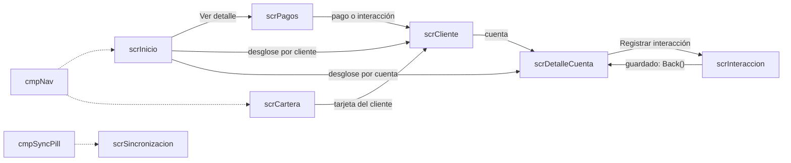

# App del localizador

Este documento describe la *canvas app* (app de Power Apps que se diseña pantalla por pantalla y se programa con fórmulas Power Fx) que usa el localizador en el teléfono: sus pantallas, qué baja al teléfono, cómo se sincroniza y qué pasa con lo que se registra sin señal. Está pensado para quien tiene que modificarla o diagnosticar un problema en campo. La arquitectura general está en [Arquitectura](01-arquitectura.md), la seguridad por fila que decide qué ve cada localizador en [Seguridad](03-seguridad.md) y las reglas del servidor en [Plugins y Custom APIs](04-plugins-y-custom-apis.md).

En el código histórico el localizador aparece como «cobrador» (por ejemplo, el *plugin* —código C# que corre en el servidor de Dataverse ante cada operación— `InteraccionDelCobrador` o el perfil *offline* «Cobranza Movil - Cobrador»).

## Cómo funciona

### Propósito

El localizador ve su cartera (las asignaciones activas que la seguridad por fila le deja leer), visita a los clientes y registra cada visita como una **interacción**, con pagos y actualización de datos del cliente opcionales. Todo funciona **sin señal**: la app trabaja contra una base local del teléfono y la sincroniza con Dataverse cuando hay conexión.

La app es de tipo teléfono (640 × 1136, vertical). Su nombre interno es `sanic_appcobranzamovil_c4e67`.

### Pantallas

| Pantalla | Qué hace |
|---|---|
| [`scrInicio`](../../apps/localizador-canvas/Src/scrInicio.pa.yaml) | Pantalla de arranque. Cobrado hoy (C$ y US$), cantidad de pagos, interacciones, cuentas y clientes visitados; desglose de las interacciones del día por cliente o por cuenta. Si el agente está desactivado muestra un bloqueo |
| [`scrCartera`](../../apps/localizador-canvas/Src/scrCartera.pa.yaml) | La cartera agrupada por cliente: saldo vencido total, filtros por tipo (Todos, Diaria, Incobrable, Especial), búsqueda por nombre o últimos 4, aviso de si la carga diaria del teléfono es la de hoy, y orden manual (▲▼) que se guarda en la asignación. Tiene armada una segunda vista, «▤ Cuenta» (`galCartera_cuenta`: una fila por asignación con cliente, últimos 4, tipo, saldo vencido y días de mora, que abre `scrDetalleCuenta`), pero el selector Cliente/Cuenta está oculto (`Visible: =false`), así que hoy solo se ve la vista por cliente |
| [`scrCliente`](../../apps/localizador-canvas/Src/scrCliente.pa.yaml) | Ficha del cliente con dos pestañas: **Cuentas** (teléfonos con llamada directa, direcciones con enlace a mapas, cuentas a cobrar) e **Interacciones** de todas sus cuentas |
| [`scrDetalleCuenta`](../../apps/localizador-canvas/Src/scrDetalleCuenta.pa.yaml) | Detalle de una cuenta: saldos, pago mínimo, mora, fechas, fiador, datos de la Especial (tipo, retiro pedido, nota), botón «Ver número» y las interacciones de la cuenta. El botón «＋ Registrar interacción» abre `scrInteraccion` |
| [`scrInteraccion`](../../apps/localizador-canvas/Src/scrInteraccion.pa.yaml) | Registrar visita: comentario con mensajes rápidos (con un aviso, que no bloquea, si parece contener un número de tarjeta), productos del cliente a los que aplica, pagos (monto, moneda, recibo), actualización de datos y ubicación GPS |
| [`scrPagos`](../../apps/localizador-canvas/Src/scrPagos.pa.yaml) | Pagos e interacciones de un día elegido (hoy por defecto, hasta 89 días atrás) con calendario y búsqueda |
| [`scrSincronizacion`](../../apps/localizador-canvas/Src/scrSincronizacion.pa.yaml) | Estado de la sincronización, capturas pendientes de subir, capturas de hoy con su estado y la versión desplegada de la app |

| Componente | Qué hace |
|---|---|
| [`cmpNav`](../../apps/localizador-canvas/Src/Components/cmpNav.pa.yaml) | Barra de navegación con Inicio y Cartera |
| [`cmpHeaderBack`](../../apps/localizador-canvas/Src/Components/cmpHeaderBack.pa.yaml) | Encabezado con título, subtítulo y botón volver (`Back()`) |
| [`cmpSyncPill`](../../apps/localizador-canvas/Src/Components/cmpSyncPill.pa.yaml) | Indicador del estado de sincronización (`gblSync`); al tocarlo abre `scrSincronizacion` |
| [`cmpSheet`](../../apps/localizador-canvas/Src/Components/cmpSheet.pa.yaml) | Hoja de ajustes «Aa»: tema día/noche y cuatro tamaños de letra. Se guarda en el teléfono con `SaveData` (clave `cmPrefs`) |

[`App.pa.yaml`](../../apps/localizador-canvas/Src/App.pa.yaml) define:

- **Fórmulas con nombre** (*named formulas*: se recalculan solas cuando cambian sus datos y no bloquean el arranque): `gblAgente` (el agente del usuario), `gblAgenteInactivo`, `gblSync` (estado de sincronización) y `nfVersion` (sello de versión).
- **Funciones de usuario**: `Moneda()` (texto bimoneda), `PanMasc()` (`•••• 1234`), `EspTipo()` y `EspNota()` (separan tipo y nota de la Especial en el texto `Tipo — nota`).
- **`OnStart`**: preferencias guardadas, los temas `gblDay` / `gblNight` (tokens de color en `gblC`) y los tamaños de letra `gblT`, que escalan con `gblScale`.

La app no llama ninguna *Custom API*: todo lo que escribe va con `Patch()` / `UpdateIf()` sobre las tablas (lo que funciona *offline*), y las reglas las aplican los *plugins* al subir.

El agente se identifica con `LookUp('CM | TBL | Agentes', 'Email Usuario' = Lower(User().Email))`. El correo del agente (`sanic_cm_ag_emailusuario`) lo deriva el servidor del UPN del usuario vinculado, en minúsculas ([`EmailDesdeUsuario.cs`](../../plugins/Sanic.CobranzaMovil.Plugins/EmailDesdeUsuario.cs)); la app compara en minúsculas porque offline la comparación la hace la base local.

### Navegación



La app pasa el contexto entre pantallas con variables globales: `varCliente` (CIF del cliente), `varCuenta` (registro de la cuenta), `varAsig` (asignación), `varCliTab`, `varDetTab` y `varDetSrc` (pestaña y pantalla de origen).

### Perfil *offline*: qué baja al teléfono

Un *offline profile* (perfil sin conexión) define qué tablas y filas de Dataverse se copian a la base local del teléfono. La app usa un perfil **personalizado**, «Cobranza Movil - Cobrador», y no el autogenerado. Por qué:

- El autogenerado lo rearma el servicio en cada publicación de la app y puede quedar trabado al publicarse; en ese caso la app no abre en el teléfono.
- El autogenerado no soporta ALM (llevar los cambios de un ambiente a otro) y no viaja en la *solution* (el paquete con el que se traslada la personalización entre ambientes); un ambiente de producción necesita uno propio.

El perfil viaja en la *solution* `cm_core_cobranzamovil` y la app lo tiene seleccionado (Studio → **Settings** → **General** → **Can be used offline**; su id queda en `ManualOfflineProfileId` del `.msapr`). Se revisa después de importar en el admin center → ambiente → **Settings** → **Users + permissions** → **Mobile configuration** ([Instalación, paso 3](09-instalacion-y-despliegue.md#3-revisar-lo-importado)).

| Tabla | Fuente en la app | Qué filas bajan |
|---|---|---|
| `sanic_cm_tbl_asignacion` | `CM \| TBL \| Asignacions` | Solo activas (`sanic_cm_as_estado = 1`) |
| `sanic_cm_tbl_interaccion` | `CM \| TBL \| Interaccions` | Modificadas en los últimos 90 días |
| `sanic_cm_tbl_pago` | `CM \| TBL \| Pagos` | Modificados en los últimos 90 días |
| `sanic_cm_tbl_actualizaciondatos` | `CM \| TBL \| Actualizacion de datos` | Modificadas en los últimos 90 días |
| `sanic_cm_tbl_cuenta` | `CM \| TBL \| Cuentas` | Todas las que el usuario puede leer |
| `sanic_cm_tbl_cliente` | `CM \| TBL \| Clientes` | Todas las que el usuario puede leer |
| `sanic_cm_tbl_direccion` | `CM \| TBL \| Direccions` | Todas las que el usuario puede leer |
| `sanic_cm_tbl_telefono` | `CM \| TBL \| Telefonos` | Todas las que el usuario puede leer |
| `sanic_cm_tbl_cuentapan` | `CM \| TBL \| PAN de cuentas` | Todas las que el usuario puede leer (bóveda del PAN) |
| `sanic_cm_tbl_agente` | `CM \| TBL \| Agentes` | Todas las que el usuario puede leer |
| `sanic_cm_tbl_opcionlista` | `CM \| TBL \| Opciones de lista` | Todas (tabla chica de la organización) |

«Todas las que el usuario puede leer» es la regla *All records* del perfil. Lo que recorta de verdad es la seguridad por fila: el localizador es dueño de sus asignaciones y recibe en lectura, por compartido y *cascade*, la cuenta, el cliente, el fiador, las direcciones, los teléfonos y la bóveda ([Seguridad](03-seguridad.md)). El filtro de 90 días acota el historial que ocupa el teléfono; lo más viejo solo se ve con señal. Por eso [`scrPagos`](../../apps/localizador-canvas/Src/scrPagos.pa.yaml) no deja elegir días anteriores a 89 días.

### Cómo se sincroniza

Power Fx no tiene ninguna función que baje datos del servidor: la sincronización la hace el reproductor de Power Apps.

| Momento | Qué pasa |
|---|---|
| Al abrir la app | El reproductor sincroniza en segundo plano |
| Cada ~5 minutos con señal | Sube lo pendiente y baja los cambios del servidor |
| «Actualizar todo desde el servidor» ([`scrSincronizacion`](../../apps/localizador-canvas/Src/scrSincronizacion.pa.yaml)) | Abre el estado del dispositivo con `ShowHostInfo(HostInfo.OfflineSync)`; ahí el localizador pide la sincronización completa |
| «↻ Recargar la lista» | Solo `Refresh()` de la base **local**: rearma las pantallas con lo que ya llegó. Funciona sin señal y no baja nada |

`gblSync` traduce `Connection.Sync` a `ok`, `sync`, `pend`, `warn`, `error` u `off`. En el navegador no hay sincronización (`Connection.Sync` vacío) y solo distingue con o sin conexión.

La cartera es una copia en colecciones (`colAsig`, `colClientes`). El temporizador `tmrSync_Cart` de [`scrCartera`](../../apps/localizador-canvas/Src/scrCartera.pa.yaml) revisa `gblSync` cada 5 s (con `AutoPause = false`, sigue andando en otras pantallas). Cuando una sincronización termina, rearma la cartera si el localizador está en la Cartera y no tiene cambios de orden sin guardar; si no, la marca (`varRecargarCartera`) para rearmarla al volver, así no se pierde el orden. Al entrar, `scrCartera` también la rearma si la cantidad de asignaciones de la base local cambió.

### La cartera se trae por tramos

Cada copia de Dataverse a una colección se corta en el límite de filas de la app (500 o 2.000, ver [Límites de filas](#límites-de-filas)). Para no cortar la cartera, el *plugin* [`TramoCartera.cs`](../../plugins/Sanic.CobranzaMovil.Plugins/TramoCartera.cs) le pone a cada cuenta, asignación y pago un **tramo** de 0 a 19 (hash FNV-1a del id de la cuenta; el pago usa el de su interacción). El botón oculto `btnCargarCartera` trae asignaciones y cuentas tramo por tramo (20 vueltas) y después una consulta más para lo que todavía no tiene tramo (por ejemplo, una cuenta recién creada):

```
ForAll(Sequence(20, 0) As T,
    Collect(colAsigRaw, Filter('CM | TBL | Asignacions', '[AS] Tramo' = T.Value && '[AS] Estado' = true && …));
    Collect(colCuentas, Filter('CM | TBL | Cuentas', '[CT] Tramo' = T.Value)));
```

Asignación y cuenta caen en el mismo tramo porque las dos usan el id de la cuenta. Si algún tramo (o la consulta de lo que no tiene tramo) llega a 500 filas, `varCarteraIncompleta` muestra un error («Tu cartera es más grande de lo que la app puede mostrar…»): sincronizar no lo arregla. El umbral es 500 a propósito: la consulta pudo cortarse con cualquiera de los dos límites posibles. `TramoCartera` calcula el tramo solo al crear el registro: los registros que ya existían antes de instalar el *plugin* no lo tienen y entran por la consulta de lo que no tiene tramo.

Las Especiales solo aparecen aprobadas: toda consulta de asignaciones del localizador lleva `'[AS] Tipo' <> Especial || '[AS] Estado de aprobacion' = Aprobado`.

### Qué pasa con lo que se registra sin señal

El botón Guardar de [`scrInteraccion`](../../apps/localizador-canvas/Src/scrInteraccion.pa.yaml) escribe con `Patch()` en la base local; el reproductor lo sube en orden en la próxima sincronización. La app avisa «Guardado en el teléfono. Se sube cuando vuelva la señal».

| Captura | Qué escribe la app | Qué completa o decide el servidor al subir |
|---|---|---|
| Interacción | Cuenta, agente, nombre del agente, comentario, marcas de pago y datos, latitud y longitud, `Fecha de captura` (`Now()` del teléfono) | [`InteraccionDelCobrador.cs`](../../plugins/Sanic.CobranzaMovil.Plugins/InteraccionDelCobrador.cs) pone el agente del usuario, deja la interacción pendiente de grabar (descarta estado y datos de grabación que vengan del teléfono) y exige que la cuenta sea de su cartera, con tolerancia por fecha de captura (no más de 5 min adelantada, hasta 48 h atrás) si se la reasignaron mientras estaba sin señal (lo comprueba con la auditoría de la asignación). [`IdentidadEnInteraccion.cs`](../../plugins/Sanic.CobranzaMovil.Plugins/IdentidadEnInteraccion.cs) copia últimos 4, CIF y clave HMAC de la cuenta. El número `IN-xxxx` lo asigna el servidor |
| Pago | Interacción (lookup), cuenta, monto, moneda, recibo, `Fecha del pago` | [`CuentaDesdeInteraccion.cs`](../../plugins/Sanic.CobranzaMovil.Plugins/CuentaDesdeInteraccion.cs) completa la cuenta y el número de interacción. [`ReciboRepetido.cs`](../../plugins/Sanic.CobranzaMovil.Plugins/ReciboRepetido.cs) **marca** `sanic_cm_pg_reciborepetido` si el recibo ya existe en cualquier cartera. `TramoCartera` pone el tramo |
| Actualización de datos | Interacción (lookup), cuenta (`sanic_cm_ad_cuentaid`), la misma fecha de captura (`sanic_cm_ad_fechacaptura`), teléfonos, direcciones y correo | Offline el lookup a la interacción recién creada llega vacío. [`ActualizacionConInteraccion.cs`](../../plugins/Sanic.CobranzaMovil.Plugins/ActualizacionConInteraccion.cs) la vincula por localizador, cuenta y fecha de captura; si no la encuentra, la acepta **marcada** con `sanic_cm_ad_sinvincular`. [`VincularActualizacionPendiente.cs`](../../plugins/Sanic.CobranzaMovil.Plugins/VincularActualizacionPendiente.cs) la cuelga cuando llega la interacción |
| Orden de la cartera | `'[AS] Orden'` de cada asignación, solo del tramo de clientes movidos, al salir de la Cartera o al tocar ↻ | [`ColumnasAsignacion.cs`](../../plugins/Sanic.CobranzaMovil.Plugins/ColumnasAsignacion.cs) solo deja al localizador escribir esa columna |

**Por qué se marca en lugar de rechazar:** el reproductor *offline* descarta en silencio lo que el servidor rechaza y no lo reintenta. Un recibo repetido o una actualización sin interacción se aceptan marcados y el BackOffice los ve al transcribir ([App de la oficina](06-app-backoffice.md)). Las columnas de marca (`sanic_cm_pg_reciborepetido`, `sanic_cm_ad_sinvincular`) viajan en la *solution*.

El guardado es **reintentable sin duplicar**: el rol del localizador no puede borrar, así que la pantalla recuerda qué ya se guardó (`locIntCreada`, `colPagosGuardados`, `locADGuardada`, `colIntGuardadas`) y al tocar Guardar de nuevo solo escribe lo que falta.

Con varios productos tildados y sin pago ni datos, la app crea una interacción por cuenta. Con pago o datos, la interacción es de una sola cuenta.

`scrSincronizacion` muestra cada captura de hoy como «pendiente de subir» (sin número de interacción), «subida» o «⚠ incompleta» (marcada con pago o datos, pero el pago o la actualización no están en el teléfono).

### Validaciones: app y servidor

| Regla | En la app | En el servidor |
|---|---|---|
| Comentario obligatorio | Botón deshabilitado y «Falta: …» | — |
| Número de tarjeta en el comentario | Aviso `lblAvisoTarjeta` si hay 13 o más dígitos seguidos (con espacios o guiones); **no** bloquea | [`PanEnTextoLibre`](../../plugins/Sanic.CobranzaMovil.Plugins/PanEnTextoLibre.cs) lo guarda como `•••• ` y los últimos 4 si pasa Luhn; también en las direcciones de la actualización de datos. Nunca rechaza |
| Pago: monto mayor que 0 y recibo en cada línea; recibo de hasta 30 caracteres; recibos sin repetir en la visita | Botón deshabilitado | — |
| Recibo ya registrado | Bloquea si lo encuentra en el teléfono (solo ve sus pagos de 90 días) | `ReciboRepetido` busca en toda la cartera y marca |
| Pago mayor que el saldo vencido | Pide confirmar con un segundo toque | — |
| Sin ubicación GPS | Pide confirmar con un segundo toque («Guardar sin ubicación») | — |
| Datos: al menos uno; teléfonos `^[0-9 +()-]{7,20}$`; correo válido | Botón deshabilitado | — |
| Agente desactivado | Bloquea la pantalla de inicio y el guardado (`gblAgenteInactivo`) | `InteraccionDelCobrador` rechaza |
| Cuenta de su cartera, agente correcto, usuario vinculado a un solo agente | — | `InteraccionDelCobrador` rechaza |

La app valida para dar respuesta inmediata sin señal; el servidor valida porque es la única fuente confiable. Los rechazos del servidor sobre capturas *offline* son la excepción deliberada a «marcar en lugar de rechazar»: ver [Trampas](#trampas-y-errores-conocidos).

### Mensajes rápidos

Los botones que agregan texto al comentario salen de la lista administrable `sanic_cm_tbl_opcionlista` («CM | TBL | Opciones de lista»), lista «Mensaje rápido», activas y ordenadas por `[OL] Orden`. El Admin la edita en la pantalla Listas de la [App de la oficina](06-app-backoffice.md) y llega al teléfono en la próxima sincronización.

- La pantalla muestra los 6 primeros; «Ver los N mensajes rápidos» abre una hoja con buscador.
- Si la tabla está vacía en el teléfono (todavía no sincronizó), se usan seis valores de respaldo escritos en el `OnVisible`.
- El texto elegido se guarda dentro del comentario: renombrar o desactivar una opción no cambia el historial.

La tabla viaja en la *solution*; las opciones iniciales se crean a mano después de instalar ([Instalación, paso 10](09-instalacion-y-despliegue.md#10-opciones-iniciales-de-las-listas)).

### Número de tarjeta (PAN)

La app muestra siempre `•••• 1234`. «Ver número» en [`scrDetalleCuenta`](../../apps/localizador-canvas/Src/scrDetalleCuenta.pa.yaml) y [`scrInteraccion`](../../apps/localizador-canvas/Src/scrInteraccion.pa.yaml) lee la bóveda con un solo nivel de lookup, guarda el PAN **solo** en una variable de contexto (`locPan`) y un temporizador lo oculta a los 30 s. Nunca va a colecciones, `SaveData` ni variables globales. Las reglas de la bóveda están en [Seguridad](03-seguridad.md).

Si el localizador escribe un número de tarjeta en el comentario, la etiqueta `lblAvisoTarjeta` le advierte que se va a guardar oculto; el guardado sigue habilitado. El servidor ([`PanEnTextoLibre`](../../plugins/Sanic.CobranzaMovil.Plugins/PanEnTextoLibre.cs)) lo enmascara al subir. **Por qué no se bloquea:** el aviso es una ayuda y no una garantía (no valida Luhn); la protección real está en el servidor, que no puede rechazar lo que llega *offline*.

### Ícono y nombre

| Pieza | Dónde |
|---|---|
| Ícono (fuente vectorial) | [`icono/icono.svg`](../../apps/localizador-canvas/icono/icono.svg) |
| Ícono que se despliega | [`icono/icono.png`](../../apps/localizador-canvas/icono/icono.png) |
| Color de fondo del ícono | `RGBA(15,107,107,1)`, en Studio → **Settings** → **General** |
| Nombre de la app | `App - Cobranza Movil` (`Name` de `msapp/Properties.json` dentro del `.msapr`) |

La lista de apps de Power Apps toma el ícono y el color de la app publicada en la *solution*, así que viajan con ella.

## Piezas y archivos

| Pieza | Archivo |
|---|---|
| Fuentes de la app (pantallas, componentes, `App`) | [`apps/localizador-canvas/Src/`](../../apps/localizador-canvas/Src/) |
| Fuentes de datos, perfil *offline* vinculado y recursos | [`sanic_appcobranzamovil_c4e67_DocumentUri.msapr`](../../apps/localizador-canvas/sanic_appcobranzamovil_c4e67_DocumentUri.msapr) |
| Resumen de la carpeta de la app | [`apps/localizador-canvas/README.md`](../../apps/localizador-canvas/README.md) |
| Perfil *offline* | Viaja en la *solution*; se ve en el admin center → **Mobile configuration** ([Instalación, paso 3](09-instalacion-y-despliegue.md#3-revisar-lo-importado)) |
| Despliegue | Importar la *solution* ([Instalación y despliegue](09-instalacion-y-despliegue.md#actualizar-a-una-versión-nueva)) |
| Ícono | [`apps/localizador-canvas/icono/`](../../apps/localizador-canvas/icono/) |
| Pruebas de punta a punta | [`tests/localizador-canvas/`](../../tests/localizador-canvas/) ([Pruebas](10-pruebas.md)) |
| *Plugins* que reciben lo que sube el teléfono | [`InteraccionDelCobrador.cs`](../../plugins/Sanic.CobranzaMovil.Plugins/InteraccionDelCobrador.cs), [`IdentidadEnInteraccion.cs`](../../plugins/Sanic.CobranzaMovil.Plugins/IdentidadEnInteraccion.cs), [`CuentaDesdeInteraccion.cs`](../../plugins/Sanic.CobranzaMovil.Plugins/CuentaDesdeInteraccion.cs), [`ReciboRepetido.cs`](../../plugins/Sanic.CobranzaMovil.Plugins/ReciboRepetido.cs), [`ActualizacionConInteraccion.cs`](../../plugins/Sanic.CobranzaMovil.Plugins/ActualizacionConInteraccion.cs), [`VincularActualizacionPendiente.cs`](../../plugins/Sanic.CobranzaMovil.Plugins/VincularActualizacionPendiente.cs), [`TramoCartera.cs`](../../plugins/Sanic.CobranzaMovil.Plugins/TramoCartera.cs), [`ColumnasAsignacion.cs`](../../plugins/Sanic.CobranzaMovil.Plugins/ColumnasAsignacion.cs) |

## Cómo se modifica

### Cómo modificar la app

La app se modifica en **Power Apps Studio**, siempre **dentro de la *solution*** `cm_core_cobranzamovil` del ambiente de desarrollo, y llega a los demás ambientes con una versión nueva de la *solution*: se exporta e importa como explica [Instalación y despliegue](09-instalacion-y-despliegue.md#actualizar-a-una-versión-nueva). En producción la *solution* es administrada y la app no se edita.

1. En `make.powerapps.com`, ambiente de desarrollo → **Solutions** → `cm_core_cobranzamovil` → **Apps** → seleccionar «App - Cobranza Movil» → **Edit** (Editar). Se abre Studio.
2. Hacer el cambio. Respetar: nombres de control únicos en toda la app, `Radius*` solo en `GroupContainer` (no en `Label` ni `Classic/Icon`) y `AccessibleLabel` nunca en `Classic/Button`. Una fórmula con error aparece marcada en rojo en Studio: no publicar con errores pendientes.
3. Actualizar `nfVersion` en `App.Formulas` (por ejemplo, con el número de versión que va a llevar la *solution*), para poder comprobar después qué versión sirve el reproductor.
4. **Save** (Guardar) y **Publish** (Publicar) → **Publish this version** (Publicar esta versión).
5. Probar en el ambiente de desarrollo: en la pantalla Sincronización, «Versión de la app» tiene que mostrar el valor nuevo ([Pruebas](10-pruebas.md), PRE-07).
6. Exportar la *solution* e importarla en el ambiente de destino ([Instalación, pasos 1 y 2](09-instalacion-y-despliegue.md#1-conseguir-el-paquete-de-la-solution) y [Actualizar a una versión nueva](09-instalacion-y-despliegue.md#actualizar-a-una-versión-nueva)).

Las fuentes de la carpeta [`apps/localizador-canvas/Src/`](../../apps/localizador-canvas/Src/) (`*.pa.yaml`, formato de código de Power Apps) son una copia legible de pantallas, controles y fórmulas, útil para revisar y buscar. El `.msapr` guarda las fuentes de datos, el id del perfil *offline* y los recursos. Studio muestra el mismo YAML de cada control con **View code** (Ver código). ⚠️ A confirmar cómo se mantiene esa copia al día con lo publicado (por ejemplo, con la integración de Git de las *solutions* de Power Platform): un cambio hecho en Studio no actualiza el repositorio solo.

Si se pega YAML en Studio, una fórmula que contiene `: ` (dos puntos y espacio) va en bloque `|-`:

```yaml
# Rompe: YAML interpreta ": " como otro par clave-valor
Text: ="Estado: " & gblSync
# Correcto
Text: |-
  ="Estado: " & gblSync
```

### Agregar una columna a una pantalla

1. Crear la columna en Dataverse, dentro de la *solution* (ver [Modelo de datos](02-modelo-de-datos.md#agregar-una-columna)).
2. En Studio, panel **Data** (Datos) → la tabla → **⋯** → **Refresh** (Actualizar). La app guarda una copia del esquema de cada tabla: sin este paso, una fórmula que nombra la columna nueva no la encuentra.
3. Usar la columna por su nombre visible (`'[CT] Dias Mora'`), guardar y publicar.
4. Si la columna tiene que estar en el teléfono, revisar que el perfil *offline* la incluya (ver el punto siguiente).

### Agregar una tabla nueva a la app

1. En Studio, **Data** → **Add data** (Agregar datos) → la tabla.
2. Agregarla al perfil *offline* con un filtro: en Studio, **Settings** (Configuración) → **General** → con **Can be used offline** encendido, en el perfil seleccionado **⋯** → **Edit selected profile** (Editar perfil seleccionado); o en el admin center → ambiente → **Settings** → **Users + permissions** → **Mobile configuration** → «Cobranza Movil - Cobrador». Con perfil personalizado el servicio **no** la agrega solo: sin este paso, la tabla está vacía en el teléfono. Publicar el perfil y **volver a publicar la app**, que usa la versión publicada del perfil.
3. Comprobar que la tabla y el perfil estén en la *solution* (en la *solution*, seleccionar la app → **Advanced** → **Add required objects**, Agregar objetos requeridos).
4. Si la tabla hereda la visibilidad por compartido desde la cuenta, revisar que la relación tenga la *cascade* de Share que corresponde ([Seguridad](03-seguridad.md)). Los registros que ya existían no se comparten solos con el localizador: para un agente concreto, quitar y volver a poner su usuario en **Agentes y usuarios** de la app de la oficina re-reparte sus asignaciones ([Instalación, trampas](09-instalacion-y-despliegue.md#trampas-y-errores-conocidos)). ⚠️ A confirmar si ese re-reparto alcanza a la tabla nueva y si hace falta un procedimiento para todos los localizadores a la vez.

### Cambiar los mensajes rápidos

No requiere publicar la app: el Admin los edita en la pantalla Listas de la app de la oficina. Solo hay que cambiar la app para modificar los valores de respaldo o cuántos se muestran sin abrir la hoja (`FirstN(colMsjInt, 6)`).

### Cambiar el ícono

En Studio, **Settings** → **General**: ícono de la app y color de fondo (`RGBA(15,107,107,1)`). La imagen de referencia está en [`icono/icono.png`](../../apps/localizador-canvas/icono/icono.png) (fuente vectorial [`icono.svg`](../../apps/localizador-canvas/icono/icono.svg)). Se aplica al publicar y viaja con la *solution*.

## Trampas y errores conocidos

### Offline

- ⚠️ **Lo que el servidor rechaza se pierde en silencio.** El reproductor *offline* descarta la fila rechazada y no la reintenta; el localizador vio «Guardado». Por eso los *plugins* marcan en lugar de rechazar. Las excepciones deliberadas son las de `InteraccionDelCobrador` (cuenta fuera de su cartera pasada la tolerancia, agente desactivado, usuario sin agente o con dos). La app bloquea el caso del agente desactivado antes de guardar; los demás solo se ven en el servidor. Antes de agregar un rechazo nuevo en un *plugin* que recibe datos del teléfono, evaluar si corresponde marcar.
- **Un solo nivel de *lookup*** (columna que apunta a un registro de otra tabla). Offline, filtrar o leer a través de dos lookups (pago → interacción → cuenta) no funciona. Por eso el pago tiene su propio lookup a la cuenta y la bóveda se consulta por `Cuenta.'CM | TBL | Cuenta'`.
- **LookUp anidado devuelve vacío.** Leer un campo a través de un lookup dentro de otra expresión devuelve vacío sin error. Patrón usado: primero el id (`cta`), después el registro **una vez** (`ctaRec = LookUp('CM | TBL | Cuentas', … = cta)`) y de ahí cada campo ([`scrInicio`](../../apps/localizador-canvas/Src/scrInicio.pa.yaml), [`scrPagos`](../../apps/localizador-canvas/Src/scrPagos.pa.yaml)).
- **Otras fórmulas que fallan en silencio en el teléfono:** un `ClearCollect` con `AddColumns` que mete el registro de la cuenta queda vacío; un `LookUp` a Cuentas dentro del cuerpo de un `ForAll` no se ejecuta. Por eso las colecciones van sin columnas calculadas y los datos de la cuenta se agregan en el `Items` de la galería.
- **El lookup a un registro recién creado offline llega vacío.** La actualización de datos manda además la cuenta y la fecha de captura para que el servidor la vincule.
- **Campos que pone el servidor no existen offline:** el número de interacción está vacío hasta sincronizar (los pagos se buscan por la relación, no por número) y `Created On` lo pone el servidor al subir. Para fechas de captura se usa `Fecha de captura`, que pone el teléfono.
- **Fecha de captura del teléfono:** el servidor la acota (5 min adelantada, 48 h atrás) para la tolerancia de reasignación. Un teléfono con la hora mal puede hacer que una visita legítima se rechace.

### Fechas

- **DateOnly** (`'Última carga'`, `'[CT] Último pago'`, `'Fecha asignada'`): llegan como fecha sin zona horaria. Se comparan día contra día (`d = Today()`) y se ordenan con `Sort`, no con `Max` (que es numérico).
- `'[CT] Fecha Pago'` es texto (`aaaa-mm-dd` o `dd/mm/aaaa`). Se formatea a mano porque `DateValue` depende del idioma del teléfono.

### Límites de filas

- ⚠️ A confirmar: cuál es el límite que rige. El `.msapr` declara `MaxGetRowsCount` 500 por fuente en `References/DataSources.json` y 2.000 a nivel app en `Properties.json`. Los tramos están pensados para 2.000, pero el aviso de cartera incompleta salta a las 500 filas por tramo, así que avisa con cualquiera de los dos límites.
- Cada copia a una colección se corta en el límite de filas: la cartera se trae por tramos. Si la cartera de un localizador crece tanto que un tramo llega al límite, la app avisa y hay que subir la cantidad de tramos: la constante `TramosCartera` de [`Esquema.cs`](../../plugins/Sanic.CobranzaMovil.Plugins/Esquema.cs), y el `Sequence(20, 0)` de esta app y de las pantallas de la oficina que usan tramos. Después hay que recalcular el tramo de las cuentas, asignaciones y pagos existentes, porque `TramoCartera` solo lo calcula al crear. ⚠️ A confirmar: no hay una pantalla ni un procedimiento gráfico para ese recálculo (el tramo es un hash del id de la cuenta y no se puede calcular a mano).
- Las demás pantallas no copian tablas enteras: leen cada dirección, teléfono o cuenta de la base local cuando la muestran.

### Controles Modern y clásicos

- Los controles clásicos (`Classic/Button`, `Classic/TextInput`) toman el tamaño de letra de la app (`gblT`) y escalan con «Aa». Los modernos traen su propio tamaño y no escalan: en formularios de captura se usan clásicos.
- `Classic/Button` se anuncia por su `Text` y no admite `AccessibleLabel`. Un botón cuyo texto es solo un símbolo («Aa», «↻», «✕») usa `ModernButton` con `AccessibleLabel`. Un `Classic/Icon` que actúa como botón necesita `TabIndex: =0`.
- En `ModernButton` el *padding* son píxeles reales: en botones chicos de un símbolo, *padding* 0.

### Diseño

- Dentro de un contenedor con diseño automático, `.Width` de un hijo (también `Parent.Width` o `Parent.TemplateWidth` en una galería) devuelve píxeles dibujados, no unidades de diseño. Se calcula desde la app o la pantalla: `Width: =App.Width - 60`.

### Despliegue

- ⚠️ **Editar solo en el ambiente de desarrollo y dentro de la *solution*.** Una app creada o editada fuera de `cm_core_cobranzamovil` no viaja al exportar. En producción la *solution* es administrada: no se edita ahí.
- ⚠️ **Perfil *offline* y app van juntos.** Si se edita y publica el perfil, hay que volver a publicar la app. Al exportar, el perfil tiene que estar en la *solution* (dependencia de la app; **Add required objects** lo agrega).
- ⚠️ **Versión vieja en el reproductor.** Después de publicar o importar, el teléfono puede servir la versión anterior unos minutos. El síntoma es que «Versión de la app» no cambia; si `nfVersion` no se actualizó al publicar, no hay forma de distinguir las versiones.
- **App abierta en Studio.** Abrirla puede dejarla como «modificada» (Studio actualiza los controles modernos) y la bloquea mientras está en edición: una importación en ese ambiente falla hasta que se cierra ([Instalación, trampas](09-instalacion-y-despliegue.md#trampas-y-errores-conocidos)).
- **La importación y los pasos de *plugin*.** Al importar, dejar marcada **Enable plug-in steps and flows included in the solution** y revisar después los pasos ([Instalación, paso 3](09-instalacion-y-despliegue.md#3-revisar-lo-importado)).
