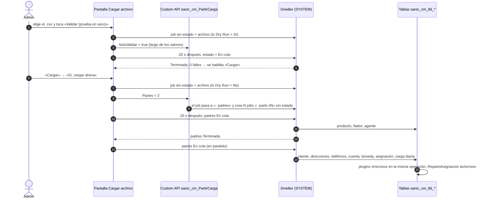

# Carga diaria

Cómo entra el archivo diario del banco a Dataverse: formato del archivo, la pantalla **Cargar archivo**, las validaciones, la partición en partes paralelas, la configuración de Smelter y lo que hacen los *plugins* sobre cada fila. Está pensado para quien tiene que operar, diagnosticar o cambiar la carga en otro ambiente. Smelter es una herramienta de importación de terceros que corre dentro del ambiente: aquí se documenta solo su **configuración** (plantillas, mapeos, cómo se dispara), nunca su código.

## Cómo funciona

El Admin sube el CSV desde la app de la oficina. La pantalla crea un *Import Job* de Smelter (un registro de la tabla `sanic_tbl_smlt_importjob` con el archivo adjunto) y lo pone **En cola**; el orquestador de Smelter lo procesa por lotes y hace *upsert* (crear o actualizar según una *alternate key*, la clave alternativa de negocio de cada tabla) en las tablas de Cobranza Móvil. Smelter escribe como **SYSTEM**, así que los *plugins* que corren sobre esas escrituras no ven roles de CM.

Toda carga real pasa antes por una **prueba en seco** (*dry run*: Smelter procesa el archivo sin escribir nada). La carga real se **parte**: un job de **padres** (producto, fiador y agente) corre primero y solo; si termina bien, las **partes** (todo lo demás, repartido por cliente) corren en paralelo.

### Formato del archivo del banco

| Aspecto | Regla | Dónde se impone |
|---|---|---|
| Tipo | Un solo archivo `.csv`, de hasta 50 MB: la pantalla lo anuncia y no acepta uno mayor, el mismo tope que aplica `sanic_cm_PartirCarga`, que lo lee tanto para partir como para validar el largo (ver Trampas) | [`scrCargaArchivo.pa.yaml`](../../apps/backoffice-canvas/Src/scrCargaArchivo.pa.yaml), [`PartirCarga.cs`](../../plugins/Sanic.CobranzaMovil.Plugins/PartirCarga.cs) |
| Codificación | UTF-8, con o sin BOM. Un archivo con BOM de UTF-16 o UTF-32 se rechaza | [`ArchivoCsv.cs`](../../plugins/Sanic.CobranzaMovil.Plugins/ArchivoCsv.cs) |
| Separador | El delimitador de la plantilla principal (coma en la configuración de referencia; vacío se toma como coma). Tiene que ser un solo carácter ASCII distinto de comillas y saltos de línea | `PartirCarga.LeerArchivo`, `ArchivoCsv.Leer` |
| Comillas | RFC 4180, como lo lee Smelter (CsvHelper): un valor con separador, comillas o salto de línea va entre comillas dobles y la comilla interna se duplica | [`FilaDeCarga.cs`](../../plugins/Sanic.CobranzaMovil.Plugins/FilaDeCarga.cs), `ArchivoCsv` |
| Fin de línea | CRLF, LF o CR. Las líneas vacías se ignoran | `ArchivoCsv` |
| Encabezado | Obligatorio. Los nombres de columna se comparan sin distinguir mayúsculas | `ArchivoCsv.Indice` |
| Espacios | Los espacios y tabuladores de los extremos de cada valor se recortan al leer | `ArchivoCsv.Campo` |
| Fechas | `aaaa-mm-dd` en los archivos de ejemplo | [`test-data/`](../../test-data/) |

Las 33 columnas, en este orden (`FilaDeCarga.Encabezado`):

| # | Columna | Destino principal |
|---|---|---|
| 1–2 | `Cliente`, `CIF` | Cliente (`CIF` es su clave) |
| 3–5 | `DireccionCasa`, `DireccionEC`, `DireccionTrabajo` | Tres filas de dirección por CIF y tipo |
| 6 | `Departamento` | Cliente |
| 7–8 | `NumeroCelular`, `NumeroCasa` | Dos filas de teléfono por CIF y tipo |
| 9 | `NumeroCuenta` | Número de tarjeta **completo**. Solo llega entero a la bóveda; en el resto se guarda su HMAC y `****1234` |
| 10–16 | `SaldoVencidoNIO`, `SaldoVencidoUSD`, `TotalSaldoVencido`, `ContagiadoUSD`, `PagoMinimoNIO`, `PagoMinimoUSD`, `DiasMora` | Cuenta y carga diaria |
| 17–20 | `NivelMora`, `FechaUltimoPago`, `FechaPago`, `Ciclo` | Cuenta y carga diaria |
| 21–22 | `CodigoProducto`, `TipoProducto` | Producto (clave: código) |
| 23–24 | `NombreFianza`, `DireccionFianza` | Fiador (clave: nombre) |
| 25–26 | `RetiroNIO`, `RetiroUSD` | Cuenta y carga diaria |
| 27–28 | `TipoEspecial`, `Nota` | Cuenta; `EspecialDesdeCuenta` los copia a la Especial |
| 29–30 | `Distrito`, `Trabajo` | Cliente |
| 31 | `TipoAsignacion` | `Diaria`, `Incobrable` o `Especial` |
| 32 | `Agente` | Agente (clave: nombre) |
| 33 | `FechaCarga` | Día de la carga: carga diaria, «Última carga» y «Fecha asignada» de la asignación |

⚠️ El archivo trae el número de tarjeta completo. Cómo se protege (HMAC, bóveda, enmascarado, `PanGuard`) está en [Seguridad](03-seguridad.md).

### La pantalla Cargar archivo

[`scrCargaArchivo.pa.yaml`](../../apps/backoffice-canvas/Src/scrCargaArchivo.pa.yaml), solo para el rol Admin. Pasos y por qué:

1. **Elegir el archivo.** Un adjunto, extensión `.csv`.
2. **Validar (prueba en seco).** Crea un job con `[IJ] Is Dry Run` = Sí. «Cargar» se habilita solo si esa prueba termina **Terminada con 0 fallos** y el archivo elegido es el mismo que se validó.
3. **Cargar.** Pide confirmación y repite el camino con `Is Dry Run` = No.

Las dos acciones usan el mismo camino (`btnEnviarCar`), en este orden obligatorio:

| Paso | Qué hace | Por qué |
|---|---|---|
| 1 | `Patch` del job **sin estado**, con nombre, plantilla y marca de prueba | Un job sin estado no dispara nada en Smelter |
| 2 | Sube el archivo a `[IJ] Source File` | — |
| 3 | Valida (`SoloValidar`) o parte (`Partes`) con `sanic_cm_PartirCarga` | Ver Validaciones y Partición |
| 4 | 20 s después, el temporizador `tmrAvanceCar` pone el estado **En cola** | El disparador de Smelter evalúa «estado = En cola» sobre el registro tal como está cuando arranca la corrida. Con los tres `Patch` seguidos, el Create y el Update del archivo también verían En cola y el job se procesaría tres veces en paralelo |
| 5 | Sondea el job cada 3 s los primeros 20 min y cada 30 s después, hasta ~1 h 30 min | Una carga grande sigue en Smelter aunque la pantalla deje de mirar |

El temporizador tiene `AutoPause = false`: sigue andando si el Admin cambia de pantalla, pero **no** si cierra o recarga la app. Cada `Patch` y cada llamada guarda su error en una variable y se lee aparte, porque en una cadena con `;` `IfError` solo ve el último paso.

**Mis últimas cargas** muestra los 20 jobs más recientes creados por el usuario (por `Created By`, no por dueño: el job queda a nombre del equipo de carga). Ofrece tres acciones de recuperación:

| Acción | Cuándo aparece | Qué hace |
|---|---|---|
| ▶ Relanzar partes | El job de padres terminó bien y quedaron partes sin estado (se cerró la app antes de tiempo) | Pone esas partes En cola |
| ✕ Descartar partes | Los padres fallaron, terminaron con errores o nunca se pusieron en cola (más de 10 min sin estado) | Marca las partes (y los padres sin estado) como Falló |
| ✕ Descartar carga | Un job de la plantilla principal lleva más de 10 min sin estado | Lo marca Falló |

Marcar Falló no procesa nada (el orquestador solo arranca con En cola) y libera **Reconciliación**, que se bloquea mientras haya jobs reales (no pruebas en seco) de las tres plantillas en cola o procesando, o sin estado y creados en las últimas 12 h.

### Validaciones

| Validación | Dónde | Comportamiento |
|---|---|---|
| Extensión `.csv`, un solo archivo | Pantalla | Botones deshabilitados |
| Plantilla visible | Pantalla | Si el usuario no ve «Cobranza movil», no está en el equipo de carga: mensaje y botones deshabilitados |
| Estructura del CSV | `ArchivoCsv.Leer`, `PartirCarga.LeerArchivo` | Rechaza archivo vacío o sin filas de datos, BOM de UTF-16/32, comillas sin cerrar y filas con **más** columnas que el encabezado (señal de una comilla suelta que juntó dos filas). También exige que la plantilla principal tenga fila de encabezado |
| **Largo de los valores** | `PartirCarga.ExigirLargos` | Mide cada valor contra el `MaxLength` de su columna de texto en la metadata. Solo columnas con fuente en el archivo y sin transformación. Un valor más largo hace fallar la fila en Smelter y su prueba en seco **no** lo detecta. El error cita fila, columna y largos (hasta 5 casos), nunca el valor |
| **Solo validar** | `sanic_cm_PartirCarga` con `SoloValidar = true` | Corre en la prueba en seco y en la carga en serie (con `nfValidarLargo = true`). Lee el archivo (mismo tope de 50 MB), mide largos y no escribe nada. Si falla, la pantalla marca el job Falló y no lo pone en cola |
| Errores por fila | Smelter | Se cuentan en el job (`[IJ] Fail Count`). El detalle por fila (Import Job Log) es de SYSTEM: lo ve soporte en Smelter, no la pantalla |
| Número largo en un mensaje | Pantalla | Si un error trae 13 dígitos seguidos, no se muestra («el detalle traía un número largo») |

Los interruptores están en [`App.pa.yaml`](../../apps/backoffice-canvas/Src/App.pa.yaml):

| Fórmula con nombre | Valor | Efecto |
|---|---|---|
| `nfCargaParalela` | `true` | La carga real se parte. `false` = un solo job, en serie |
| `nfPartesCarga` | `3` | Partes pedidas. La API acepta de 1 a 4 |
| `nfValidarLargo` | `true` | Llama a `SoloValidar` antes de poner en cola la prueba en seco y la carga en serie |

Hay dos umbrales de advertencia que suelen confundirse con validaciones de la carga y no lo son: `nfUmbralCarga = 500` marca en rojo a un localizador con más de 500 asignaciones activas en *Cartera por localizador*, y el 30 % de Diarias desaparecidas en Reconciliación (ver [Ciclo de vida](08-ciclo-de-vida.md)). Ninguno frena la carga.

### Partición en partes paralelas

En un solo job, Smelter procesa las filas en serie, en lotes que rozan el límite de 120 s por operación. La Custom API `sanic_cm_PartirCarga` ([`PartirCarga.cs`](../../plugins/Sanic.CobranzaMovil.Plugins/PartirCarga.cs), lógica pura en [`ParticionCarga.cs`](../../plugins/Sanic.CobranzaMovil.Plugins/ParticionCarga.cs)) convierte el job recibido en el de padres y crea las partes.

| Archivo | Plantilla | Filas | Corre |
|---|---|---|---|
| `<nombre> · padres` (el job original, con el archivo reemplazado) | «Cobranza movil · padres» | La **última** aparición de cada producto, fiador y agente (clave exacta), en orden original. El resultado es el mismo que en serie: gana la última fila | Primero y solo |
| `<nombre> · parte i/N` | «Cobranza movil · partes» | **Todas** las filas, repartidas por grupos | En paralelo, solo si los padres terminan **Terminada** |

Reglas de la partición:

- **Por qué padres primero.** Las partes resuelven los *lookups* a producto, fiador y agente por clave alternativa: tienen que existir y estar al día antes.
- **Grupos.** Las filas que escriben el mismo registro de cualquier tabla (misma clave de dedup: CIF, CIF + tipo, HMAC del número, HMAC + tipo, HMAC + fecha) van a la misma parte, con *union-find*. Así dos partes nunca escriben el mismo registro a la vez.
- **Normalización de más.** Para agrupar, las claves se comparan sin acentos, en mayúsculas y solo letras y dígitos. Juntar de más solo desbalancea; juntar de menos rompería la carga.
- **Transformaciones.** En una clave de partes solo se aceptan `HMAC`, `TRIM`, `UPPER` y `LOWER` sobre la propia columna fuente, porque respetan la igualdad. Con otra, la API se niega a partir.
- **Reparto.** Determinista: los grupos más grandes primero, a la parte con menos filas. Dentro de cada parte se conserva el orden original.
- **Mínimos y máximos.** Con menos de 300 filas, una sola parte. Entre 1 y 4 partes. Archivo de hasta 50 MB (vive en la memoria del *sandbox*).
- **Atomicidad.** Primero crea las partes, después reemplaza el archivo del job original y al final cambia su nombre y plantilla. Si algo falla, borra las partes con el servicio del sistema y restaura el archivo original. La pantalla marca el job Falló y no se carga nada.
- **Permisos.** Solo Admin, Servicio o un usuario sin roles de CM. Los jobs se crean con los permisos del llamador: el rol de Smelter llega por el equipo y «Creado por» es la persona.
- **PCI.** El archivo solo vive en memoria. Las trazas y los errores citan columnas y conteos, nunca valores.

Antes de partir, la API exige que la plantilla principal deduplique el cliente por `sanic_cm_cl_cif` desde una columna del archivo, y que las plantillas derivadas estén activas y sean **copia exacta** de su parte de la principal (configuración y firma de cada mapeo). Si no coinciden, falla sin tocar nada y nombra la plantilla que no coincide. La corrección es regenerar las derivadas exportando la principal desde Smelter e importándola como «· padres» y «· partes» ([Instalación, paso 8.2](09-instalacion-y-despliegue.md#82-plantillas-derivadas)). ⚠️ El texto del error, en [`PartirCarga.cs`](../../plugins/Sanic.CobranzaMovil.Plugins/PartirCarga.cs), pide regenerar las plantillas con una herramienta del repositorio que no forma parte de la instalación: ignorar esa indicación y corregir a mano.

### Plantillas de Smelter

Tres plantillas (`sanic_tbl_smlt_importtemplate`). Las tres son del equipo de carga (nombre libre; se crea en [Instalación, paso 6](09-instalacion-y-despliegue.md#6-equipo-de-carga)), que tiene el rol **Smelter Operador** y cuyos miembros son los Admin: alcanza para ver las plantillas y correr jobs, no para editarlas. Editar mapeos requiere el rol **Smelter Configurador** (un administrador).

| Plantilla | Se edita | Contenido |
|---|---|---|
| «Cobranza movil» (principal) | **A mano, solo esta** | Todos los *Table Mappings*. La usan la prueba en seco, la carga en serie y el alta de cuenta del Admin (`AltaCuenta` arma un CSV de una fila con `FilaDeCarga`) |
| «Cobranza movil · padres» | No: se regenera exportando la principal e importándola con este nombre | Solo los mapeos de `sanic_cm_tbl_producto`, `sanic_cm_tbl_fiador` y `sanic_cm_tbl_agente` |
| «Cobranza movil · partes» | No: se regenera exportando la principal e importándola con este nombre | Todos los demás mapeos |

Cada cambio en la principal se lleva a las derivadas a mano, en las pantallas de Smelter: se **exporta** la principal, se **importa** como «· padres» y como «· partes» (renombrando antes la derivada vieja para que no haya dos con el mismo nombre), y en cada una se borran los *Table Mappings* que no le tocan. Así delimitador, encabezado, tamaño de lote, origen y cada *Table Mapping* y *Column Mapping* quedan con los mismos valores. Después se asigna el dueño y se repasa la lista de chequeo de [Instalación, paso 8.2](09-instalacion-y-despliegue.md#82-plantillas-derivadas). La principal no puede tener *Relationship Mappings* ni mapeos repetidos.

Modelo de configuración de Smelter que usa la plantilla:

| Registro | Qué define |
|---|---|
| *Import Template* | Delimitador, si hay encabezado, tamaño de lote, origen (CSV), estado |
| *Table Mapping* | Tabla destino, orden de procesamiento, columnas de dedup, si crea y si actualiza |
| *Column Mapping* | Columna del archivo → columna destino, tipo, requerida, valor por defecto, *lookup* (tabla y columna de búsqueda), mapeo de opciones y transformación (`HMAC`, `TRIM`, `RIGHT`, `CONCAT`…) |

Tablas que escribe la plantilla y su clave de dedup (detalle de las claves alternativas en [Modelo de datos](02-modelo-de-datos.md)):

| Tabla | Dedup | Notas de configuración |
|---|---|---|
| `sanic_cm_tbl_producto` | código | Padres |
| `sanic_cm_tbl_fiador` | nombre | Padres. `NombreFianza` tiene valor por defecto `(sin fiador)` ([Instalación, paso 8.1](09-instalacion-y-despliegue.md#81-plantilla-principal)): las filas sin fiador comparten un solo registro en vez de crear uno vacío por fila. El *lookup* de la cuenta no lleva ese valor: con el nombre vacío la cuenta queda sin fiador |
| `sanic_cm_tbl_agente` | nombre | Padres. `UpdateIfExists = false` ([Instalación, paso 8.1](09-instalacion-y-despliegue.md#81-plantilla-principal)): el agente existente no se reescribe (su única columna es la clave) y aparece como «omitida» en los contadores |
| `sanic_cm_tbl_cliente` | `sanic_cm_cl_cif` | Partes |
| `sanic_cm_tbl_direccion` (×3), `sanic_cm_tbl_telefono` (×2) | CIF + tipo | Un *Table Mapping* por columna del archivo, diferenciados por el valor por defecto del tipo |
| `sanic_cm_tbl_cuenta` | `sanic_cm_ct_clavepan` = `HMAC(NumeroCuenta, "cm-pan")` | Número guardado como `CONCAT("****", RIGHT(TRIM(NumeroCuenta), 4))` |
| `sanic_cm_tbl_cuentapan` (bóveda) | `sanic_cm_cp_clavepan` | Único lugar con el número completo |
| `sanic_cm_tbl_asignacion` | HMAC + tipo | Una asignación por cuenta y tipo |
| `sanic_cm_tbl_cargadiaria` | HMAC + `FechaCarga` | Una foto por cuenta y día |

Cómo se crean las tres plantillas en un ambiente nuevo: [Instalación, paso 8](09-instalacion-y-despliegue.md#8-plantillas-de-smelter).

### Qué hacen los plugins sobre la carga

Todos los registros están en [Plugins y Custom APIs](04-plugins-y-custom-apis.md). Aquí, solo lo que cambia el resultado de la carga:

| Plugin | Tabla y etapa | Efecto sobre la carga |
|---|---|---|
| [`CargaSobreAsignacion`](../../plugins/Sanic.CobranzaMovil.Plugins/CargaSobreAsignacion.cs) | Asignación, PreOperation, Update con «Última carga» | Reabre una Diaria o Incobrable que cerró el sistema (motivo «fuera de cartera» o «Reclasificada a …»), porque la plantilla no mapea el estado. No reabre cierres de personas ni Especiales. No pisa «Fecha asignada» si ya tenía valor |
| [`Reclasificacion`](../../plugins/Sanic.CobranzaMovil.Plugins/Reclasificacion.cs) | Asignación, PostOperation **síncrono** | Una sola activa entre Diaria e Incobrable por cuenta: si llega el otro tipo, cierra la anterior con «Reclasificada a {tipo}». Las Especiales conviven |
| [`TipoDesdeProducto`](../../plugins/Sanic.CobranzaMovil.Plugins/TipoDesdeProducto.cs) | Cuenta, PreOperation | Copia el tipo del producto a `ct_tipoproducto`, porque la carga solo llena el *lookup*. No relee si el producto no cambió |
| [`EspecialDesdeCuenta`](../../plugins/Sanic.CobranzaMovil.Plugins/EspecialDesdeCuenta.cs) | Asignación, PreOperation | Copia tipo especial, nota y retiro de la cuenta a la Especial sin solicitante, solo si están vacíos |
| [`ClaveDesdeCuenta`](../../plugins/Sanic.CobranzaMovil.Plugins/ClaveDesdeCuenta.cs) | Asignación, PreOperation | Mantiene la clave HMAC de la asignación igual a la de su cuenta |
| [`AprobacionEspecial`](../../plugins/Sanic.CobranzaMovil.Plugins/AprobacionEspecial.cs) | Asignación, PreOperation | Las Diarias e Incobrables nacen en **Borrador**; una Especial del CSV nace **Pendiente** y entra en la cola del Supervisor. Solo la carga (SYSTEM) puede crear Diarias e Incobrables |
| [`ColumnasAsignacion`](../../plugins/Sanic.CobranzaMovil.Plugins/ColumnasAsignacion.cs) | Asignación, PreOperation | No frena a SYSTEM: la carga escribe cualquier columna. Por eso «Última carga» solo la escribe la carga |
| [`TramoCartera`](../../plugins/Sanic.CobranzaMovil.Plugins/TramoCartera.cs) | Asignación (Pre), cuenta (Post asíncrono) | Pone el tramo 0–19 que usan las apps para leer la cartera por partes |
| [`PanGuard`](../../plugins/Sanic.CobranzaMovil.Plugins/PanGuard.cs) | Cuenta, carga diaria y bóveda; PreOperation, Create y Update | Rechaza la fila si el número visible (`sanic_cm_ct_numerodecuenta`, `sanic_cm_cd_numerocuenta`, `sanic_cm_cp_name`) trae 5 o más dígitos seguidos (aunque estén separados por espacios o guiones): si la plantilla dejara de enmascarar, la carga falla en vez de guardar el número completo |
| [`RepartoAsignacion`](../../plugins/Sanic.CobranzaMovil.Plugins/RepartoAsignacion.cs) | Asignación, PostOperation **asíncrono** | Pasa el dueño al localizador y comparte cuenta, cliente y fiador. Es asíncrono a propósito: dentro del lote de Smelter sumaría tiempo al límite de 2 minutos y, si se pasa, se deshace el lote entero |
| [`PurgaArchivoCarga`](../../plugins/Sanic.CobranzaMovil.Plugins/PurgaArchivoCarga.cs) | Trabajo de importación de Smelter, PostOperation **asíncrono**, Update del estado | Cuando un trabajo de las tres plantillas de CM termina (*Completed*, *CompletedWithErrors* o *Failed*) borra su CSV, que trae los números completos, y barre hasta 50 trabajos de más de 7 días que todavía tengan archivo. No cambia el resultado de la carga: el trabajo y sus registros quedan (ver [Ciclo de vida](08-ciclo-de-vida.md#archivo-de-carga-de-smelter)) |

Productos, fiadores y agentes que se actualizan:

- **Producto.** El job de padres lo actualiza con la última fila. Cambiar el tipo de un producto **no** se propaga a sus cuentas existentes (`TipoDesdeProducto` solo copia al crear la cuenta o cambiar su producto); para rellenarlas hay que corregir `ct_tipoproducto` en las cuentas existentes de ese producto. ⚠️ A confirmar el procedimiento gráfico (por ejemplo, editar las filas de «CM | TBL | Cuenta» desde **Tables** en `make.powerapps.com`, o **Export data** / **Import data from Excel** de esa tabla filtrada por producto).
- **Fiador.** Se actualiza su dirección con la última fila.
- **Agente.** Solo se crea si no existe. Vincularle un usuario es tarea del Admin (ver [Seguridad](03-seguridad.md)).

### Monitoreo de carga

[`scrMonitoreo.pa.yaml`](../../apps/backoffice-canvas/Src/scrMonitoreo.pa.yaml) responde «¿llegó el archivo de hoy y cuadra el volumen?». Muestra si `nfUltimaCarga` (la `FechaCarga` más nueva de la carga diaria) es de hoy y tres conteos exactos con `CountIf` (delega hasta 50.000): filas de carga diaria de hoy, cuentas y clientes totales.

`[CD] FechaCarga` es *DateOnly* (solo fecha, sin zona horaria). Comparar contra `Today()` viajaría como la medianoche local convertida a UTC (por ejemplo, `ge <hoy>T06:00Z` en UTC−6) y contaría 0 el día de la carga; por eso la pantalla compara contra `DateAdd(Today(), -TimeZoneOffset(Today()), TimeUnit.Minutes)`, que es medianoche UTC y sigue siendo delegable.

## Piezas y archivos

| Pieza | Archivo |
|---|---|
| Pantalla Cargar archivo | [`scrCargaArchivo.pa.yaml`](../../apps/backoffice-canvas/Src/scrCargaArchivo.pa.yaml) |
| Pantalla Monitoreo de carga | [`scrMonitoreo.pa.yaml`](../../apps/backoffice-canvas/Src/scrMonitoreo.pa.yaml) |
| Interruptores y `nfUltimaCarga` | [`App.pa.yaml`](../../apps/backoffice-canvas/Src/App.pa.yaml) |
| Custom API de partición y validación | [`PartirCarga.cs`](../../plugins/Sanic.CobranzaMovil.Plugins/PartirCarga.cs), [`ParticionCarga.cs`](../../plugins/Sanic.CobranzaMovil.Plugins/ParticionCarga.cs), [`ArchivoCsv.cs`](../../plugins/Sanic.CobranzaMovil.Plugins/ArchivoCsv.cs) |
| Formato de una fila (alta de cuenta) | [`FilaDeCarga.cs`](../../plugins/Sanic.CobranzaMovil.Plugins/FilaDeCarga.cs), [`AltaCuenta.cs`](../../plugins/Sanic.CobranzaMovil.Plugins/AltaCuenta.cs) |
| Registro de las Custom APIs | Viajan en la *solution* ([Instalación, paso 3](09-instalacion-y-despliegue.md#3-revisar-lo-importado)) |
| Plantillas (principal y derivadas) | Registros de Smelter; se crean a mano ([Instalación, paso 8](09-instalacion-y-despliegue.md#8-plantillas-de-smelter)) |
| Purga del archivo del trabajo | [`PurgaArchivoCarga.cs`](../../plugins/Sanic.CobranzaMovil.Plugins/PurgaArchivoCarga.cs) |
| Pruebas unitarias | [`PurgaArchivoCargaTests.cs`](../../plugins/Sanic.CobranzaMovil.Plugins.Tests/PurgaArchivoCargaTests.cs), [`PartirCargaTests.cs`](../../plugins/Sanic.CobranzaMovil.Plugins.Tests/PartirCargaTests.cs), [`ParticionCargaTests.cs`](../../plugins/Sanic.CobranzaMovil.Plugins.Tests/ParticionCargaTests.cs), [`ArchivoCsvTests.cs`](../../plugins/Sanic.CobranzaMovil.Plugins.Tests/ArchivoCsvTests.cs), [`CargaSobreAsignacionTests.cs`](../../plugins/Sanic.CobranzaMovil.Plugins.Tests/CargaSobreAsignacionTests.cs), [`CargaComoSistemaTests.cs`](../../plugins/Sanic.CobranzaMovil.Plugins.Tests/CargaComoSistemaTests.cs) |
| Archivos de ejemplo | [`test-data/`](../../test-data/README.md) y el archivo sintético de [Pruebas](10-pruebas.md#datos-de-prueba-el-archivo-de-carga-sintético) |

## Cómo se modifica

### Agregar o cambiar una columna del archivo

1. Crear la columna en Dataverse (ver [Modelo de datos](02-modelo-de-datos.md)).
2. Agregar el *Column Mapping* en la plantilla **principal** «Cobranza movil», nunca en las derivadas.
3. Regenerar las derivadas: exportar la principal desde Smelter e importarla como «· padres» (se dejan producto, fiador y agente) y como «· partes» (el resto), como explica [Instalación, paso 8.2](09-instalacion-y-despliegue.md#82-plantillas-derivadas). Sin esto, `PartirCarga` se niega a partir.
4. Si la columna es nueva en el CSV, agregarla a `FilaDeCarga.Encabezado` para que el alta de cuenta del Admin la siga mandando, y a los archivos de prueba ([Pruebas](10-pruebas.md#datos-de-prueba-el-archivo-de-carga-sintético)).
5. Probar con una prueba en seco de un archivo de ejemplo.

### Cambiar la cantidad de partes

Editar `nfPartesCarga` en `App.pa.yaml`. No conviene pasar de 3: Dataverse limita el tiempo de ejecución a 1.200 s cada 5 min por usuario (*service protection*) y cada parte consume unos 100 s por lote; con 4 queda al borde.

### Volver a la carga en serie

`nfCargaParalela = false`. La carga real va en un job con la plantilla principal. Útil si las plantillas derivadas quedaron desincronizadas y no se pueden corregir antes de la carga. Como el interruptor está en la app, cambiarlo es publicar una versión nueva ([App de la oficina](06-app-backoffice.md#cómo-modificar-la-app)).

### Qué hacer si la carga falla

| Síntoma | Causa probable | Qué hacer |
|---|---|---|
| «No se ve la plantilla» | El usuario no está en el equipo de carga | Agregarlo al equipo (ver [Seguridad](03-seguridad.md)) |
| La revisión rechaza el archivo por largo | Un valor no entra en su columna | Corregir el archivo en las filas citadas, o ampliar la columna en Dataverse |
| «No coincide con Cobranza movil» | Se editó la principal sin re-sincronizar | Re-sincronizar la derivada a mano ([Instalación, paso 8.2](09-instalacion-y-despliegue.md#82-plantillas-derivadas)) |
| Prueba en seco con fallos | Errores por fila en Smelter | Revisar el Import Job Log en Smelter (rol Configurador o soporte) |
| Padres con errores o fallidos | Producto, fiador o agente inválido | Las partes no se lanzan y no se carga ninguna cuenta. Corregir y volver a cargar el archivo entero |
| Partes «Sin lanzar» | Se cerró la app antes de tiempo | «▶ Relanzar partes» en *Mis últimas cargas* |
| Alguna parte con errores | Filas con datos inválidos | Corregir y volver a cargar el archivo **entero**: todo es *upsert*, nada se duplica |
| La pantalla dejó de consultar (1 h 30 min) | Carga muy grande | Mirar el estado en *Mis últimas cargas* al volver a entrar |

Volver a cargar el mismo archivo es seguro: cada tabla se deduplica por su clave y la carga diaria por cuenta y fecha.

## Trampas y errores conocidos

- ⚠️ **Tope de 50 MB.** La pantalla (`MaxAttachmentSize`) y `sanic_cm_PartirCarga` aceptan hasta 50 MB; la Custom API los baja enteros a la memoria del *sandbox*, tanto al partir como en `SoloValidar`. Subir el tope de la pantalla sin cambiar la Custom API hace que un archivo mayor falle en la prueba en seco. Un CSV de 6.000 filas pesa unos 3 MB.
- ⚠️ **El archivo del job conserva el número completo hasta que el job termina.** Queda en `sanic_smlt_ij_sourcefile` de cada job (también en los de padres y partes) y lo borra `PurgaArchivoCarga` al llegar a un estado terminal. Una parte sin estado que nadie relanza ni descarta, o una carga sin estado que nadie cierra, conserva su archivo: resolverlas desde *Mis últimas cargas* (ver [Ciclo de vida](08-ciclo-de-vida.md#archivo-de-carga-de-smelter)).
- **Prueba en seco incompleta.** No detecta valores más largos que su columna; por eso existe `SoloValidar`.
- **Fórmulas inertes.** `btnPartirCar` y `btnRevisarLargoCar` llaman a la Custom API a través de la fuente `Environment`. Si la foto de esa fuente en la app no conoce la API o el parámetro, la fórmula queda inerte sin error. Después de instalar o cambiar una Custom API, refrescar `Environment` en Studio antes de activar los interruptores.
- **Las plantillas se buscan por nombre.** `PartirCarga`, la pantalla y Reconciliación buscan «Cobranza movil», «Cobranza movil · padres» y «Cobranza movil · partes» por nombre exacto (constantes en [`Esquema.cs`](../../plugins/Sanic.CobranzaMovil.Plugins/Esquema.cs)). Renombrar una rompe la carga; dos con el mismo nombre también.
- **Relationship Mappings.** La plantilla principal no tiene. No agregarlos: un mapeo de relación con el padre en otra plantilla deja el *lookup* vacío en silencio.
- **2 minutos por operación.** Los *plugins* síncronos corren dentro de cada lote de Smelter. Un *plugin* síncrono lento nuevo sobre cuenta o asignación puede hacer que el lote supere el límite y se deshaga entero.
- **SYSTEM no tiene roles.** Los *plugins* que frenan a personas (por rol) no frenan la carga. Un cambio de reglas que deba aplicarse también a la carga tiene que contemplar al usuario SYSTEM ([`UsuarioSistema.cs`](../../plugins/Sanic.CobranzaMovil.Plugins/UsuarioSistema.cs)).
- **Lo que edita el Admin en un cliente lo pisa la carga siguiente**, porque la plantilla actualiza el cliente por CIF.
