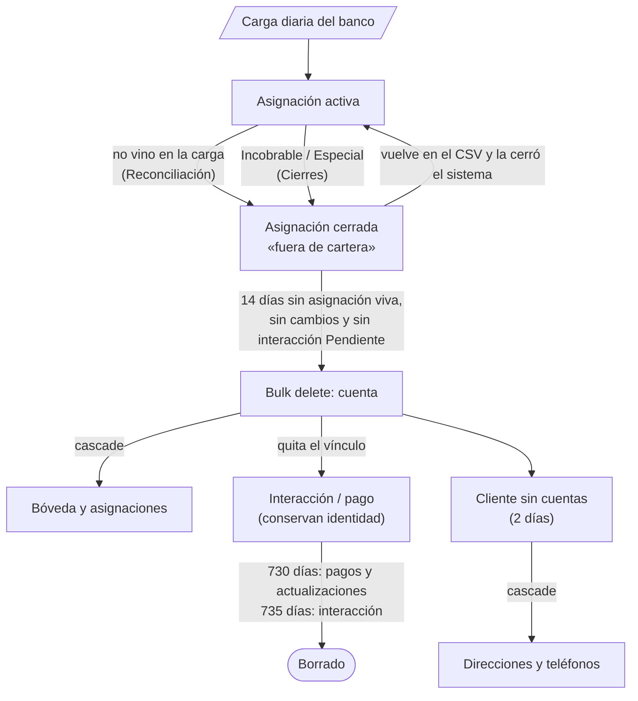

# Ciclo de vida de los datos

Cuánto vive cada dato de Cobranza Móvil, qué lo cierra o lo borra y por qué. Cubre los siete trabajos de borrado programado, las *cascades* y *Restrict* que deciden qué arrastra cada borrado, lo que conserva la interacción cuando su cuenta desaparece, y los cierres de asignaciones (Reconciliación y Cierres). Está escrito para quien mantiene la solución y tiene que cambiar un plazo o diagnosticar por qué algo se borró (o no).

## Cómo funciona

La política tiene dos reglas:

- **Los datos del banco viven mientras la cuenta esté en cartera, más 14 días de gracia** (7 de la carga diaria + 7). Así una cuenta que el banco deja de mandar un par de días no pierde su historia.
- **Lo que crea la app (interacciones, pagos, actualizaciones de datos) vive 2 años.** Para que la interacción siga identificable en el core cuando su cuenta ya no existe, guarda los últimos 4 dígitos, el CIF y la clave HMAC de la cuenta.

Nada se borra desde las apps. Las asignaciones se **cierran** (estado inactivo, motivo y fecha de cierre) y el borrado lo hacen trabajos de *bulk delete* (trabajos nativos de Dataverse que borran en masa las filas que cumplen una consulta), recurrentes, uno por día.

### Los siete trabajos de borrado

Los define [`paso10_borrado_programado.py`](../../scripts/seguridad/paso10_borrado_programado.py). Cada uno es una consulta (*QueryExpression*) con recurrencia `FREQ=DAILY;INTERVAL=1`, que arranca un minuto después de aplicar el script y desde entonces una vez por día a esa hora.

| # | Nombre del trabajo | Tabla | Borra | Constante |
|---|---|---|---|---|
| 1 | `CM - Carga diaria de mas de 7 dias` | `sanic_cm_tbl_cargadiaria` («CM \| TBL \| Carga diaria») | `sanic_cm_cd_fechacarga` con más de 7 días | `CARGA_DIAS = 7` |
| 2 | `CM - Cuentas fuera de cartera hace mas de 14 dias` | `sanic_cm_tbl_cuenta` («CM \| TBL \| Cuenta») | `modifiedon` con más de 14 días **y** sin asignación viva **y** sin interacción Pendiente (ver abajo) | `GRACIA_DIAS = 14` |
| 3 | `CM - Clientes sin cuentas` | `sanic_cm_tbl_cliente` («CM \| TBL \| Cliente») | Sin ninguna cuenta y `modifiedon` con más de 2 días | `RECIEN_DIAS = 2` |
| 4 | `CM - Fiadores sin cuentas` | `sanic_cm_tbl_fiador` («CM \| TBL \| Fiador») | Sin ninguna cuenta y `modifiedon` con más de 2 días | `RECIEN_DIAS = 2` |
| 5 | `CM - Pagos de mas de 2 anos` | `sanic_cm_tbl_pago` («CM \| TBL \| Pago») | `createdon` con más de 730 días | `APP_DIAS = 730` |
| 6 | `CM - Actualizaciones de datos de mas de 2 anos` | `sanic_cm_tbl_actualizaciondatos` («CM \| TBL \| Actualización de datos») | `createdon` con más de 730 días | `APP_DIAS = 730` |
| 7 | `CM - Interacciones de mas de 2 anos` | `sanic_cm_tbl_interaccion` («CM \| TBL \| Interacción») | `createdon` con más de 735 días | `INTERACCION_DIAS = 735` |

**Asignación viva** (trabajo 2): una asignación de la cuenta con `sanic_cm_as_estado` = activa, **o** con `sanic_cm_as_ultimacarga` en los últimos 14 días, **o** con `sanic_cm_as_fechacierre` en los últimos 14 días. **Interacción Pendiente**: `sanic_cm_in_estadograbacion` = 1 (todavía no transcrita al core). El `modifiedon` de la cuenta cuenta porque cada carga la reescribe.

Los «sin registros relacionados» se expresan como uniones externas (*LeftOuter*) con la condición `Null` sobre el id de la tabla unida; Dataverse las respeta en el *bulk delete*. El script arma la misma consulta en FetchXML para contar cuántas filas cumplen hoy, sin borrar nada.

Agente, producto y opciones de lista no se borran nunca: se desactivan.

### Cascades y Restrict

Al borrar un registro padre, cada relación decide qué pasa con los hijos: **Cascade** los borra, **Restrict** impide borrar el padre mientras tenga hijos y **RemoveLink** deja los hijos con el *lookup* vacío. La configuración completa de las relaciones está en [Modelo de datos](02-modelo-de-datos.md); estas son las que mueven el ciclo de vida.

| Padre → hijo | Al borrar el padre | Efecto en el ciclo de vida |
|---|---|---|
| Cuenta → bóveda (`sanic_cm_tbl_cuentapan`) | Cascade | El número completo desaparece con la cuenta |
| Cuenta → asignación | Cascade | Las asignaciones se van con la cuenta |
| Cuenta → interacción, pago | RemoveLink | Quedan sin cuenta, con su identidad guardada |
| Cuenta → carga diaria | RemoveLink | La foto queda sin vínculo hasta que su propio trabajo la borra |
| Cliente → dirección, teléfono | Cascade | Se van con el cliente |
| Cliente → cuenta | Cascade | Ver Trampas: el trabajo 3 solo borra clientes sin cuentas |
| Cliente → carga diaria | **Restrict** | Un cliente con carga diaria (≤ 7 días) no se puede borrar |
| Interacción → pago, actualización de datos | **Restrict** | La interacción no se borra mientras tenga pagos o actualizaciones |
| Fiador → cuenta | **Restrict** | Un fiador con cuentas no se borra |
| Agente → asignación, interacción, cuenta, carga diaria | **Restrict** | El agente no se borra; se desactiva |

Las Restrict de cliente → carga diaria e interacción → pago/actualización las aplica [`paso1_cascadas_auditoria.py`](../../scripts/seguridad/paso1_cascadas_auditoria.py).

**Por qué el orden importa.** Los siete trabajos son independientes y Dataverse no garantiza en qué orden corren dentro del día. Los plazos están escalonados para que el resultado no dependa de ese orden:

- **Interacción 5 días después que sus pagos.** Con Restrict, una interacción de 731 días con pagos no se puede borrar. Si los trabajos 5 y 6 borran los pagos y actualizaciones a los 730 días, el 7 la encuentra libre a los 735.
- **Cliente después que su carga diaria.** La carga diaria se borra a los 7 días; la cuenta, como mínimo 14 días después de su última carga. Cuando el cliente se queda sin cuentas, ya no tiene carga diaria que lo frene. Si igual la tiene (por ejemplo, una cuenta borrada a mano), el borrado del cliente falla por Restrict ese día y vuelve a intentarse al siguiente.
- **Cliente y fiador 2 días después de su último cambio.** Evita borrar uno que una carga en curso acaba de crear y todavía no tiene la cuenta escrita.

Un registro que hoy no se puede borrar no es un error: queda para la próxima corrida. Los fallos se ven en el detalle del trabajo (ver Cómo se modifica).

### Qué conserva la interacción

El *plugin* [`IdentidadEnInteraccion`](../../plugins/Sanic.CobranzaMovil.Plugins/IdentidadEnInteraccion.cs) (PreOperation síncrono, solo Create de la interacción) copia de la cuenta:

| Columna de la interacción | Origen en la cuenta | Para qué |
|---|---|---|
| `sanic_cm_in_ultimos4` («[IN] Últimos 4») | `sanic_cm_ct_ultimos4` | Mostrar `•••• 1234` cuando la cuenta ya no existe |
| `sanic_cm_in_cifcliente` («[IN] CIF cliente») | CIF del cliente en la cuenta | Encontrar al cliente en el core |
| `sanic_cm_in_clavepan` («[IN] Clave PAN») | `sanic_cm_ct_clavepan` (HMAC) | La misma clave que calcula la carga para ese número: permite reconocer la cuenta si el banco la vuelve a mandar. Nunca el número completo |

Solo completa lo vacío y **nunca rechaza**: el teléfono descarta lo que el servidor rechaza, y perder una visita es peor que guardarla sin identidad. El nombre del cliente no se guarda, a propósito.

Cómo lo muestran las apps:

| Pantalla | Con la cuenta borrada |
|---|---|
| Transcripción ([`scrTranscripcion.pa.yaml`](../../apps/backoffice-canvas/Src/scrTranscripcion.pa.yaml)) | Cliente «(cuenta fuera de cartera)»; CIF y últimos 4 de la interacción. Sin cuenta no consulta la bóveda, así que no hay número completo |
| Transcritas ([`scrTranscritas.pa.yaml`](../../apps/backoffice-canvas/Src/scrTranscritas.pa.yaml)) | CIF y últimos 4 de la interacción |
| Sincronización del localizador ([`scrSincronizacion.pa.yaml`](../../apps/localizador-canvas/Src/scrSincronizacion.pa.yaml)) | «(cuenta ya no asignada) · •••• 1234» |
| Pagos del localizador ([`scrPagos.pa.yaml`](../../apps/localizador-canvas/Src/scrPagos.pa.yaml)) | Últimos 4 de la interacción |

### Cierres de asignaciones

Antes de borrarse, una cuenta tiene que quedar sin asignación viva. Las asignaciones se cierran por cuatro caminos:

| Camino | Qué cierra | Motivo | Se reabre sola |
|---|---|---|---|
| **Reconciliación** ([`scrReconciliacion.pa.yaml`](../../apps/backoffice-canvas/Src/scrReconciliacion.pa.yaml) + [`CerrarFueraDeCartera.cs`](../../plugins/Sanic.CobranzaMovil.Plugins/CerrarFueraDeCartera.cs)) | Diarias activas cuya «Última carga» es anterior al día de la última carga | `fuera de cartera` | Sí, si vuelve en el CSV (`CargaSobreAsignacion`) |
| **Reclasificación** (plugin `Reclasificacion`, durante la carga) | La Diaria o Incobrable anterior cuando llega el otro tipo | `Reclasificada a {tipo}` | Sí, si vuelve con el tipo anterior |
| **Cierres** ([`scrCierres.pa.yaml`](../../apps/backoffice-canvas/Src/scrCierres.pa.yaml)) | Incobrables activas y Especiales aprobadas activas, una por una | Lista «Motivo de cierre Incobrable» o «Motivo de cierre Especial» de Opciones de lista, más un detalle opcional | No (cierre de una persona) |
| **Rechazo** de una Especial (Aprobaciones) | La Especial rechazada | Rechazada | No |

Al cerrarse, `RepartoAsignacion` le revoca al localizador la cuenta, el cliente y el fiador si ninguna otra asignación activa suya los justifica. Detalle en [Plugins y Custom APIs](04-plugins-y-custom-apis.md).

**Reconciliación**, paso a paso:

1. **Corte.** El día de la última carga (`nfUltimaCarga`, la `FechaCarga` más nueva). «Última carga» es *DateOnly*: se compara día contra día, sin zona.
2. **Frenos de la pantalla.** No deja cerrar si no hay carga de hoy, ni si hay una carga **en curso**: un *Import Job* real (no prueba en seco) de cualquiera de las tres plantillas en cola, procesando, o sin estado y creado en las últimas 12 h. Mientras corren las partes, las Diarias que faltan se verían como «fuera de cartera». Si no puede leer los jobs, también bloquea (falla cerrado).
3. **Umbral de cordura.** Si las desaparecidas superan el 30 % de las Diarias activas, muestra una alerta roja y exige escribir la cantidad para confirmar. Es una alerta, no un bloqueo: el banco puede haber sacado media cartera.
4. **Cierre en el servidor.** Con `nfCierreServidor = true`, un temporizador llama a `sanic_cm_CerrarFueraDeCartera` en lotes de 250 (máximo 500) hasta que `Restantes` sea 0. La Custom API se niega a cerrar si la última carga cambió desde que se abrió la pantalla (`Corte`) o si hay más desaparecidas que las confirmadas (`Esperadas`). Cierra con los permisos del Admin para que la auditoría lo muestre a él. `SoloContar` devuelve el conteo sin escribir.

Con `nfCierreServidor = false` la pantalla hace un `Patch` masivo desde la app, limitado a las 2.000 filas que puede tener una colección.

## Piezas y archivos

| Pieza | Archivo |
|---|---|
| Trabajos de borrado programado | [`paso10_borrado_programado.py`](../../scripts/seguridad/paso10_borrado_programado.py) |
| Restrict y cascades de la auditoría | [`paso1_cascadas_auditoria.py`](../../scripts/seguridad/paso1_cascadas_auditoria.py) |
| Borrado del archivo de los jobs de Smelter | [`paso10_purgar_archivos.py`](../../scripts/pan/paso10_purgar_archivos.py) |
| Identidad en la interacción | [`IdentidadEnInteraccion.cs`](../../plugins/Sanic.CobranzaMovil.Plugins/IdentidadEnInteraccion.cs), [`IdentidadEnInteraccionTests.cs`](../../plugins/Sanic.CobranzaMovil.Plugins.Tests/IdentidadEnInteraccionTests.cs) |
| Reapertura y reclasificación | [`CargaSobreAsignacion.cs`](../../plugins/Sanic.CobranzaMovil.Plugins/CargaSobreAsignacion.cs), [`Reclasificacion.cs`](../../plugins/Sanic.CobranzaMovil.Plugins/Reclasificacion.cs) |
| Cierre en lote | [`CerrarFueraDeCartera.cs`](../../plugins/Sanic.CobranzaMovil.Plugins/CerrarFueraDeCartera.cs), [`CerrarFueraDeCarteraTests.cs`](../../plugins/Sanic.CobranzaMovil.Plugins.Tests/CerrarFueraDeCarteraTests.cs) |
| Pantallas | [`scrReconciliacion.pa.yaml`](../../apps/backoffice-canvas/Src/scrReconciliacion.pa.yaml), [`scrCierres.pa.yaml`](../../apps/backoffice-canvas/Src/scrCierres.pa.yaml) |
| Interruptor del cierre en servidor | `nfCierreServidor` en [`App.pa.yaml`](../../apps/backoffice-canvas/Src/App.pa.yaml) |

## Cómo se modifica

### Ver, pausar o cancelar los trabajos

En el Power Platform admin center: **Entornos** → el ambiente → **Configuración** → **Administración de datos** → **Eliminación masiva** (*Bulk deletion*). Cada trabajo `CM - …` aparece como un trabajo del sistema recurrente.

| Para | Hacer |
|---|---|
| Ver si corrió y cuánto borró | Abrir el trabajo; el estado está en *Status Reason* |
| Ver qué no pudo borrar (por ejemplo, por Restrict) | Abrir el trabajo → **Related** → **Failures** |
| Ver la consulta | Abrir el trabajo → **Information** → **Properties** |
| Pausar, posponer, reanudar o cancelar | Menú **Actions** del trabajo |

También desde la CLI: `pac data bulk-delete pause --id <id-del-trabajo>` y `pac data bulk-delete resume --id <id-del-trabajo>`.

⚠️ Antes de una migración o de una carga masiva de prueba, pausar los trabajos 2 a 4: una carga que no toca ciertas cuentas durante 14 días las deja elegibles.

### Cambiar un plazo

Un trabajo de *bulk delete* no se edita: se cancela y se crea otro. El script los identifica **por nombre** y no toca uno que ya exista.

1. Cambiar la constante en `paso10_borrado_programado.py` (`CARGA_DIAS`, `GRACIA_DIAS`, `RECIEN_DIAS`, `APP_DIAS`, `INTERACCION_DIAS`).
2. Si el nombre del trabajo incluye el plazo (trabajos 1 y 2), agregar el nombre viejo a `RETIRADOS` para que el script lo cancele. Si no lo incluye (trabajos 3 a 7), cancelar el trabajo actual a mano desde el admin center; si no, el script dice «ya programado» y conserva el plazo viejo.
3. Correr el script sin `--aplicar`: muestra el plan y cuántas filas cumplen hoy.
4. Correrlo con `--aplicar`. La primera corrida es un minuto después.
5. Mantener el escalonamiento: `INTERACCION_DIAS` mayor que `APP_DIAS`, y `GRACIA_DIAS` mayor que `CARGA_DIAS`.

### Agregar una tabla nueva al ciclo de vida

Agregar una tupla a `TRABAJOS` con nombre, tabla, condiciones y uniones (`c(...)` y `union(...)`). Revisar antes las relaciones de la tabla: una Restrict con un hijo que vive más hace que el borrado falle todos los días.

### Operadores que no valen con *DateOnly*

`sanic_cm_cd_fechacarga` y `sanic_cm_as_ultimacarga` son *DateOnly*. Con esas columnas Dataverse rechaza los operadores de horas y minutos (error `0x80048415`):

| Vale | No vale |
|---|---|
| `olderthan-x-days` (`OlderThanXDays`), `last-x-days` (`LastXDays`), `on`, `lt`, `ge`… | `olderthan-x-hours`, `olderthan-x-minutes`, `last-x-hours`, `next-x-hours` |

Para probar el borrado con plazos cortos, usar días o columnas que no sean *DateOnly* (`createdon`, `modifiedon`).

## Trampas y errores conocidos

- ⚠️ **Los archivos de los jobs de Smelter no tienen borrado programado.** Cada CSV del banco queda en `sanic_smlt_ij_sourcefile` con los números de tarjeta completos. [`paso10_purgar_archivos.py`](../../scripts/pan/paso10_purgar_archivos.py) los borra a mano y **solo de la plantilla principal**: los jobs `· padres` y `· parte i/N` de la carga paralela usan las plantillas derivadas y no los toca. Los jobs y sus logs tampoco se borran.
- ⚠️ **Borrar un cliente a mano borra sus cuentas** (Cascade), con su bóveda y sus asignaciones. El trabajo 3 solo elige clientes sin cuentas, pero un Admin con la API no tiene ese freno.
- **Una cuenta borrada vuelve como nueva.** Si el banco la manda otra vez, la carga crea una cuenta nueva con la misma clave HMAC; las interacciones viejas siguen sin vínculo (conservan su `Clave PAN`).
- **La interacción creada sin cuenta no guarda identidad.** `IdentidadEnInteraccion` solo actúa en el Create y solo si la cuenta existe.
- **«Fuera de cartera» en Cierres.** `CargaSobreAsignacion` reconoce un cierre del sistema por el motivo exacto `fuera de cartera` (sin distinguir mayúsculas). Una Incobrable cerrada a mano con ese motivo y **sin** detalle se reabre si el banco la vuelve a mandar; con detalle («Fuera de cartera — …») no.
- **El teléfono pierde lo cerrado recién al sincronizar.** El cierre y la revocación son inmediatos en el servidor; el dispositivo los ve en la próxima sincronización (ver [App del localizador](05-app-localizador.md)).
- **Reconciliación con una carga en serie colgada.** Un job sin estado de menos de 12 h bloquea Reconciliación. Se libera con «✕ Descartar carga» en Cargar archivo (ver [Carga diaria](07-carga-diaria.md)).
- **`solutions/unpacked` puede estar atrasada.** En el repositorio, las relaciones cliente → carga diaria e interacción → pago figuran todavía como Cascade. Lo que vale en el ambiente es lo que deja `paso1_cascadas_auditoria.py`.
