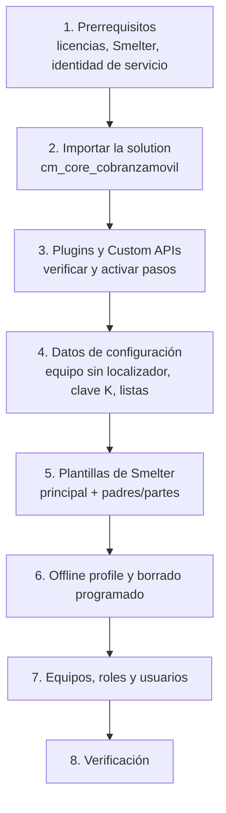

# Instalación y despliegue

Este documento explica cómo instalar Cobranza Móvil en un ambiente de Dataverse nuevo, en cualquier *tenant*, y cómo publicar cambios una vez instalada. Está pensado para el administrador de Power Platform o el desarrollador que recibe la solución sin contexto. Es una receta: indica qué correr y en qué orden. Las razones de diseño están en [Arquitectura](01-arquitectura.md) y [Decisiones de diseño](12-decisiones.md).

## Cómo funciona

La instalación tiene dos mitades. Lo que es **metadato** (tablas, columnas, claves alternativas, relaciones y cascadas, roles con sus privilegios, el ensamblado de *plugins* y sus pasos, las *Custom APIs*, las dos *canvas apps* y el *offline profile*) viaja dentro de la *solution* `cm_core_cobranzamovil`. Una *solution* es el paquete de Dataverse que agrupa componentes para moverlos entre ambientes. Lo que es **dato o configuración del ambiente** no viaja en la *solution* y lo crean los scripts de [`scripts/`](../../scripts/): equipos, la clave K, las plantillas de Smelter, las opciones iniciales de las listas y los trabajos de *bulk delete* (borrado masivo programado de Dataverse).



**Por qué hay scripts y no solo una *solution*.** Dataverse no transporta en una *solution* los equipos, los registros de tablas de terceros (las plantillas y la clave de Smelter), ni los trabajos de *bulk delete*. Los scripts son idempotentes: por defecto **solo muestran el plan** (hacen únicamente lecturas) y cambian algo solo con `--aplicar`. Se pueden volver a correr sin duplicar nada.

## Prerrequisitos

### Plataforma

| Requisito | Para qué | Notas |
|---|---|---|
| Ambiente de Power Platform con Dataverse | Base de datos, *plugins*, apps | Uno para desarrollo y otro para producción (ver [Publicar cambios](#publicar-cambios)) |
| Licencias de Power Apps para todos los usuarios | Las dos apps son *canvas apps* sobre Dataverse, que es un conector *premium* | ⚠️ A confirmar el plan concreto (por usuario o por app) según el licenciamiento del cliente |
| Auditoría encendida a nivel del ambiente | La auditoría de tablas de la *solution* solo registra si el ambiente la tiene activa | Centro de administración de Power Platform → ambiente → Configuración → Auditoría y registros |
| Smelter instalado en el ambiente | Herramienta de importación de terceros que procesa el archivo diario (*solution* `smlt_core_smelter`) | Tiene que soportar la transformación `HMAC()` y respetar los indicadores `CreateIfNotExists` y `UpdateIfExists` de los *table mappings*. ⚠️ A confirmar la versión mínima con el proveedor de Smelter. Ver [Carga diaria](07-carga-diaria.md) |
| Aplicación Power Apps en los teléfonos | La app del localizador funciona sin señal solo dentro de la app móvil de Power Apps | Ver [App del localizador](05-app-localizador.md) |

### Identidad de servicio

Los scripts y la integración continua (CI) se conectan como una **app registration** de Microsoft Entra ID con secreto de cliente (*service principal*).

1. Registrar una aplicación en Entra ID del *tenant* (`<id-de-la-app>`) y crearle un secreto de cliente.
2. En el ambiente, agregarla como **usuario de aplicación** (Centro de administración de Power Platform → ambiente → Configuración → Usuarios y permisos → Usuarios de aplicación) con el rol **System Administrator**.

**Por qué System Administrator.** Los scripts crean metadatos, registran *plugins*, programan *bulk delete* y escriben la clave K en la tabla protegida de Smelter, a la que después de [`paso6_clave_k.py`](../../scripts/pan/paso6_clave_k.py) solo tiene acceso ese rol.

### Puesto de trabajo

| Herramienta | Uso |
|---|---|
| Git | Clonar el repositorio. Todos los scripts se corren **desde la raíz del repositorio** (algunos escriben en `local/` con ruta relativa) |
| Python 3 con PyYAML | Los scripts usan solo la biblioteca estándar, salvo [`paso7_desplegar.py`](../../scripts/pan/paso7_desplegar.py), que necesita `yaml` (`pip install pyyaml`). ⚠️ A confirmar la versión mínima de Python (los scripts usan f-strings y `dict` ordenado: 3.8 o superior debería alcanzar) |
| .NET SDK 8 | Compilar los *plugins* (apuntan a .NET Framework 4.6.2, el *runtime* del *sandbox* de Dataverse) |
| Power Platform CLI (`pac`) | Exportar e importar la *solution* y empaquetar las apps. Instalar como herramienta global de .NET: `dotnet tool install --global Microsoft.PowerApps.CLI.Tool`. `paso7_desplegar.py` lo busca en `~/.dotnet/tools/pac` |
| Clave de nombre seguro (`.snk`) de los *plugins* | Dataverse rechaza actualizar un ensamblado firmado con otra clave. Ver [Trampas](#trampas-y-errores-conocidos) |

## Configuración que leen los scripts

Ningún script guarda credenciales. Las leen así:

| Variable | Qué es | Quién la lee |
|---|---|---|
| `DATAVERSE_URL` | `<url-del-ambiente>` | Todos |
| `PP_CLIENT_ID` | `<id-de-la-app>` | Todos |
| `PP_CLIENT_SECRET` | Secreto de la *app registration* | Todos |
| `PP_TENANT_ID` | `<id-del-tenant>` | Todos |
| `PP_SECRETS` | Ruta a un archivo `CLAVE=valor` con las cuatro anteriores. Por defecto, `pp_secrets.env` en la raíz del repositorio (está en `.gitignore`) | Todos |
| `PAN_HMAC_KEY_FILE` | Ruta al archivo con la clave K (64 caracteres hexadecimales = 32 bytes). Tiene un valor por defecto en el código | [`paso6_clave_k.py`](../../scripts/pan/paso6_clave_k.py) y las pruebas que calculan HMAC |

⚠️ Hay dos formas de lectura. [`paso5_plugins.py`](../../scripts/pan/paso5_plugins.py) y [`paso12_custom_api.py`](../../scripts/pan/paso12_custom_api.py) leen primero las **variables de entorno** y completan lo que falte desde el archivo. El resto usa [`dvlib.py`](../../scripts/seguridad/dvlib.py), que lee **solo el archivo** (`PP_SECRETS` o `pp_secrets.env`) e ignora las variables de entorno.

`paso7_desplegar.py` además usa el **perfil activo de `pac`**:

```bash
pac auth create --applicationId <id-de-la-app> --clientSecret <secreto> \
  --tenant <id-del-tenant> --environment <url-del-ambiente>
pac auth list   # el perfil con * es el que se usa
```

Para la CI, los mismos cuatro valores van como *secrets* del repositorio de GitHub (`DATAVERSE_URL`, `PP_CLIENT_ID`, `PP_CLIENT_SECRET`, `PP_TENANT_ID`), más `PLUGIN_SNK_BASE64` (el `.snk` en base64) para registrar *plugins*.

## Instalación paso a paso

Cada script se corre primero sin `--aplicar` para leer el plan y después con `--aplicar`.

### 1. Conseguir la *solution*

Se instala desde un export de `cm_core_cobranzamovil` del ambiente de origen. El *workflow* [`solution-release.yml`](../../.github/workflows/solution-release.yml) lo produce: fija la versión, exporta la *solution* **no administrada** (*unmanaged*, editable) y **administrada** (*managed*, sellada) y las publica como *assets* de un GitHub Release `sol-vX.Y.Z.B`.

- Para un ambiente de **desarrollo**, importar la no administrada: los scripts de despliegue exportan y reimportan la *solution*, y una administrada no se puede exportar.
- Para **producción**, importar la administrada.

⚠️ La carpeta [`solutions/unpacked/`](../../solutions/unpacked/) está atrasada (no tiene la bóveda `sanic_cm_tbl_cuentapan` ni las opciones de lista `sanic_cm_tbl_opcionlista`). No se instala desde ahí. Antes de instalar, comprobar que el export contiene las 14 tablas `sanic_cm_tbl_*`, los seis roles `SR | CM | *` más `SR | CM | Cartera sin cobrador`, el ensamblado `Sanic.CobranzaMovil.Plugins`, las cuatro *Custom APIs* y el *offline profile* «Cobranza Movil - Cobrador».

### 2. Importar la *solution*

```bash
pac solution import --path cm_core_cobranzamovil_unmanaged.zip --publish-changes
```

El editor (*publisher*) de la *solution* usa el prefijo `sanic`. No hace falta crearlo: viene con la *solution*.

### 3. *Plugins* y *Custom APIs*

La *solution* trae el ensamblado y sus pasos, pero la importación puede dejar pasos desactivados. [`paso5_plugins.py`](../../scripts/pan/paso5_plugins.py) deja todos los pasos como deben estar: los de `PanGuard` según el parámetro y el resto siempre activos. Requiere la dll firmada con **la misma** `.snk` que el ensamblado importado.

```bash
# Compilar firmado (o bajar el artefacto plugin-dll del workflow pan-plugin-cm)
dotnet build plugins/Sanic.CobranzaMovil.Plugins/Sanic.CobranzaMovil.Plugins.csproj \
  -c Release -p:AssemblyOriginatorKeyFile=<ruta-al-snk> -o out/dll

python3 scripts/pan/paso5_plugins.py --dll out/dll/Sanic.CobranzaMovil.Plugins.dll \
  --version <AssemblyVersion> --public-key-token <16-hex> --activar-panguard          # plan
python3 scripts/pan/paso5_plugins.py ... --activar-panguard --aplicar                 # aplica

python3 scripts/pan/paso12_custom_api.py            # plan; verifica las 4 Custom APIs
python3 scripts/pan/paso12_custom_api.py --aplicar  # solo si el plan muestra faltantes
```

**Por qué `--activar-panguard`.** `PanGuard` rechaza números de tarjeta en las columnas de identificación. En una instalación nueva la plantilla de carga ya enmascara el número, así que tiene que quedar activo desde el primer día. La versión del ensamblado está en [`Sanic.CobranzaMovil.Plugins.csproj`](../../plugins/Sanic.CobranzaMovil.Plugins/Sanic.CobranzaMovil.Plugins.csproj); el detalle de cada paso, en [Plugins y Custom APIs](04-plugins-y-custom-apis.md).

### 4. Datos de configuración

```bash
# Equipo dueño de las asignaciones sin localizador. <ENV> es el sufijo del ambiente (DEV, PRD...).
python3 scripts/seguridad/paso5_cartera_sin_cobrador.py --entorno <ENV> --aplicar

# Clave K en la tabla protegida de Smelter (y quita privilegios automáticos a System Customizer)
python3 scripts/pan/paso6_clave_k.py --aplicar

# Privilegios y opciones iniciales de las listas editables
python3 scripts/pan/paso23_listas.py --aplicar
```

- [`paso5_cartera_sin_cobrador.py`](../../scripts/seguridad/paso5_cartera_sin_cobrador.py) crea el equipo «CM · Cartera sin cobrador · `<ENV>`» y su rol mínimo. **Tiene que existir antes de la primera carga**: sin él, `RepartoAsignacion` y `RepartoPorAgente` fallan al buscar un único equipo con ese prefijo ([`CarteraSinCobrador.cs`](../../plugins/Sanic.CobranzaMovil.Plugins/CarteraSinCobrador.cs)).
- [`paso6_clave_k.py`](../../scripts/pan/paso6_clave_k.py) carga K bajo el nombre `cm-pan`. Generar una K nueva para cada instalación (`python3 -c "import secrets; print(secrets.token_hex(32))"`), guardarla en el gestor de secretos del equipo y nunca reutilizar la de otro ambiente. Por qué K existe y cómo se protege: [Seguridad](03-seguridad.md#la-clave-k).
- [`paso23_listas.py`](../../scripts/pan/paso23_listas.py) crea la tabla si falta, sus privilegios y las opciones iniciales (tipos de Especial, motivos de cierre, mensajes rápidos).

### 5. Plantillas de Smelter

La carga usa tres plantillas: «Cobranza movil» (la principal, la única que se edita a mano) y dos derivadas para la carga paralela, «Cobranza movil · padres» y «Cobranza movil · partes». Los nombres están fijos en [`Esquema.cs`](../../plugins/Sanic.CobranzaMovil.Plugins/Esquema.cs).

1. Crear la plantilla principal «Cobranza movil» con sus *table mappings* y *column mappings*, según [Carga diaria](07-carga-diaria.md). ⚠️ A confirmar el mecanismo: Smelter expone `sanic_capi_smelter_exporttemplate` para exportarla del ambiente de origen, pero el repositorio no tiene un script ni un archivo para importarla. Sin ese mecanismo, se arma a mano.
2. Asegurar dos ajustes de la principal (idempotentes; si ya están, el plan no muestra cambios):

   ```bash
   python3 scripts/pan/paso13_fiador_sin_nombre.py --aplicar   # fiador vacío → "(sin fiador)"
   python3 scripts/pan/paso19_agente_sin_update.py --aplicar   # la carga no reescribe agentes existentes
   ```

3. Asignar la plantilla principal al equipo «CM · Admin y Carga · `<ENV>`» (ver paso 7). Las derivadas heredan ese dueño, y Smelter le da a cada trabajo de importación el dueño de su plantilla.
4. Generar las derivadas: `python3 scripts/pan/paso20_plantillas_paralelas.py --aplicar` ([`paso20_plantillas_paralelas.py`](../../scripts/pan/paso20_plantillas_paralelas.py)).

### 6. *Offline profile* y borrado programado

```bash
python3 scripts/pan/paso7_perfil_offline.py --aplicar
python3 scripts/seguridad/paso10_borrado_programado.py --aplicar
```

- [`paso7_perfil_offline.py`](../../scripts/pan/paso7_perfil_offline.py) verifica las tablas del *offline profile* (la definición de qué tablas y filas baja el teléfono), lo publica y comprueba que se regeneren sus consultas de sincronización. Si el perfil llegó con la *solution*, conserva su id y el `.msapr` del repositorio no cambia. Si lo tiene que crear, escribe el id nuevo en [`sanic_appcobranzamovil_c4e67_DocumentUri.msapr`](../../apps/localizador-canvas/sanic_appcobranzamovil_c4e67_DocumentUri.msapr) y después hay que desplegar la app (ver [Publicar cambios](#publicar-cambios)).
- [`paso10_borrado_programado.py`](../../scripts/seguridad/paso10_borrado_programado.py) programa los siete trabajos diarios de *bulk delete*. Plazos y motivos: [Ciclo de vida de los datos](08-ciclo-de-vida.md).

### 7. Equipos, roles y usuarios

Los roles se asignan por equipo. La app de la oficina deduce el perfil de cada persona del **nombre del equipo** ([`App.pa.yaml`](../../apps/backoffice-canvas/Src/App.pa.yaml), fórmula `gblRol`): toma el segmento del medio de «CM · `<perfil>` · `<ENV>`».

| Equipo | Rol de Dataverse | Además |
|---|---|---|
| CM · Localizadores · `<ENV>` | `SR \| CM \| Localizador` | |
| CM · Backoffice · `<ENV>` | `SR \| CM \| BackOffice` | |
| CM · Solicitantes · `<ENV>` | `SR \| CM \| Solicitante` | |
| CM · Supervisores · `<ENV>` | `SR \| CM \| Supervisor` | |
| CM · Admin y Carga · `<ENV>` | `SR \| CM \| Admin` | Rol «Smelter Operador» de Smelter: lo necesita para cargar el archivo |
| CM · Cartera sin cobrador · `<ENV>` | `SR \| CM \| Cartera sin cobrador` | Lo crea el paso 4. **Sin miembros** |

1. Crear los equipos en la unidad de negocio raíz. Pueden ser equipos de tipo *Microsoft Entra ID security group* (sus miembros salen de un grupo de Entra ID). En el rol `SR | CM | Localizador`, **Member's privilege inheritance** tiene que ser *Direct User (Basic) access level and Team privileges* (motivo en [Seguridad](03-seguridad.md#roles-heredados-por-equipos-de-entra-id)).
2. ⚠️ A confirmar a qué identidad se asigna `SR | CM | Servicio - Cobranza` en el ambiente de origen. Los *plugins* lo tratan como un rol con permisos de escritura de servicio ([`RolesCm.cs`](../../plugins/Sanic.CobranzaMovil.Plugins/RolesCm.cs)).
3. Compartir cada app con los grupos que la usan: la del localizador solo con los localizadores (con lectura Global, un teléfono bajaría toda la cartera).
4. Vincular cada localizador con su agente: app de la oficina → **Agentes** ([`scrAgentes.pa.yaml`](../../apps/backoffice-canvas/Src/scrAgentes.pa.yaml)). Los agentes los crea la primera carga a partir del archivo, o el Admin desde la misma pantalla.

### 8. Configuración del ambiente que no hace ningún script

- **Nivel de trazas de *plugins***: en *Exception* (configuración del sistema del ambiente; columna `plugintracelogsetting` de la tabla `organization`, valor 1). Para diagnosticar se sube un rato a *All* (ver [Mantenimiento](11-mantenimiento.md)).
- **Auditoría** del ambiente encendida (ver prerrequisitos).
- ⚠️ A confirmar: políticas de prevención de pérdida de datos (DLP), grupo de seguridad del ambiente y controles del dispositivo (Intune) dependen del *tenant* y no forman parte de la *solution*.

## Verificación

| Qué comprobar | Cómo | Resultado esperado |
|---|---|---|
| Pasos de *plugin* | `paso5_plugins.py` sin `--aplicar` | Todos los pasos «sin cambios» y activos, PanGuard incluido |
| *Custom APIs* | `paso12_custom_api.py` sin `--aplicar` | Las cuatro existen y coinciden |
| Roles, cascadas y auditoría | Correr **sin `--aplicar`** [`paso1_cascadas_auditoria.py`](../../scripts/seguridad/paso1_cascadas_auditoria.py), [`paso4_rol_basic.py`](../../scripts/seguridad/paso4_rol_basic.py), [`paso6_cobrador_solo_crea.py`](../../scripts/seguridad/paso6_cobrador_solo_crea.py), [`paso7_sin_flows.py`](../../scripts/seguridad/paso7_sin_flows.py), [`paso8_sin_trazas.py`](../../scripts/seguridad/paso8_sin_trazas.py) y [`paso4_roles.py`](../../scripts/pan/paso4_roles.py) | Ningún cambio pendiente: la *solution* trajo la configuración |
| Clave K | `paso6_clave_k.py` sin `--aplicar` | «ya cargada y coincide con el archivo» |
| Plantillas | `paso20_plantillas_paralelas.py` sin `--aplicar` | Sin diferencias entre la principal y las derivadas |
| *Flow* retirado | Power Automate → *solution* → *flows* | «Cambio de Owner en Asignaciones», si viene en la *solution*, tiene que quedar **apagado**: lo reemplaza el *plugin* `RepartoAsignacion` |
| Carga de punta a punta | En el ambiente de desarrollo, cargar [`cobranza-mock-1000.csv`](../../test-data/cobranza-mock-1000.csv) desde **Cargar archivo** y revisar **Monitoreo** | Trabajo completo, 0 filas fallidas, asignaciones repartidas en pocos minutos |
| Prueba integral | [`tests/integral/`](../../tests/integral/README.md), solo en desarrollo | Todos los checks en verde (ver [Pruebas](10-pruebas.md)) |
| Teléfono | Un localizador abre la app, sincroniza y ve solo su cartera | La cartera coincide con sus asignaciones activas |

⚠️ Nunca cargar archivos de prueba en producción. Los archivos de [`test-data/`](../../test-data/) usan números de tarjeta ficticios.

## Publicar cambios

### Apps (canal habitual)

[`paso7_desplegar.py`](../../scripts/pan/paso7_desplegar.py) despliega las dos apps desde `apps/*/Src` en una sola importación:

```bash
python3 scripts/pan/paso7_desplegar.py             # empaqueta y arma el zip; no importa
python3 scripts/pan/paso7_desplegar.py --aplicar   # importa y publica
python3 scripts/seguridad/paso3_reconciliar.py --aplicar
```

Qué hace y por qué no alcanza con importar el `.msapp`:

1. Revisa los `.pa.yaml`: YAML válido y sin propiedades que Studio rechaza. `pac canvas pack` empaqueta igual un archivo inválido y la app publicada después no abre en Studio.
2. Empaqueta cada app y sella la versión: reemplaza `nfVersion = "dev";` de `App.pa.yaml` por el *commit* y la hora, en una copia (el repositorio no cambia).
3. Revisa con [`paso7_esquema.py`](../../scripts/pan/paso7_esquema.py) que la copia del esquema guardada en la app conozca cada columna que usan las fórmulas. Si falta una, la fórmula queda inerte sin aviso.
4. Exporta la *solution* del ambiente, reemplaza los `.msapp` y actualiza `DatabaseReferences` y `CdsDependencies` de `customizations.xml`. Sin eso, la app publicada no consulta una tabla nueva.
5. Importa con `--publish-changes` y **restaura el estado de los pasos de *plugin* y de los *flows***, que la importación altera.

Después hay que correr [`paso3_reconciliar.py`](../../scripts/seguridad/paso3_reconciliar.py): mientras dura la importación los pasos están apagados y los cambios de asignaciones de ese intervalo no se reparten.

**Despliegue rápido con `cm_parche`.** [`paso22_parche.py`](../../scripts/pan/paso22_parche.py) mantiene una *solution* no administrada chica, del mismo editor, con solo los componentes que se están cambiando. Es más rápida y no toca *plugins*, *flows* ni roles.

```bash
python3 scripts/pan/paso22_parche.py --app cobrador --aplicar     # "cobrador" = app del localizador (nombre histórico)
python3 scripts/pan/paso22_parche.py --tabla sanic_cm_tbl_pago --aplicar
python3 scripts/pan/paso7_desplegar.py --parche --aplicar
```

### *Plugins*

Workflow [`pan-plugin-cm.yml`](../../.github/workflows/pan-plugin-cm.yml): compila, corre las pruebas en `net462` (en Windows) y, con `registrar = true`, firma y llama a `paso5_plugins.py`. Sin `registrar`, no toca Dataverse. Para correrlo a mano, ejecutar `paso5_plugins.py` como en el paso 3 de la instalación. Una *Custom API* nueva se agrega a [`paso12_custom_api.py`](../../scripts/pan/paso12_custom_api.py) y se registra después del ensamblado.

⚠️ `workflow_dispatch` solo aparece para los *workflows* que están en la rama por defecto, y `pan-plugin-cm.yml` todavía no está en `main`: hoy solo se dispara con un *push* a su rama y deja la dll firmada como artefacto.

### Otros componentes

Tablas, columnas, vistas y roles se cambian en el ambiente de desarrollo **dentro de la *solution*** `cm_core_cobranzamovil` (en el portal, abriendo la *solution*; por API, con el encabezado `MSCRM.SolutionUniqueName`). Los cambios a las plantillas de Smelter se hacen en la principal y se propagan con `paso20_plantillas_paralelas.py`. Ver [Mantenimiento](11-mantenimiento.md#cómo-hacer-los-cambios-más-comunes).

### Llevar a producción

1. Correr [`solution-release.yml`](../../.github/workflows/solution-release.yml) con la versión nueva: deja los zips en el Release `sol-vX.Y.Z.B` y encadena [`solution-sync.yml`](../../.github/workflows/solution-sync.yml), que desempaqueta la no administrada en `solutions/unpacked/` (sin `CanvasApps/`) para tener el historial de cambios.
2. Importar el zip administrado en producción con `pac solution import --publish-changes`.
3. Repetir en producción los pasos de la instalación que correspondan al cambio: plantillas de Smelter (son datos), trabajos de borrado, *offline profile*.
4. Correr `paso3_reconciliar.py --aplicar` en producción.

⚠️ A confirmar: no hay un *workflow* de importación a producción. Los cuatro *secrets* apuntan a un solo ambiente, el de desarrollo.

### Estado de los *workflows* de CI

| Workflow | Estado | Uso |
|---|---|---|
| [`pan-plugin-cm.yml`](../../.github/workflows/pan-plugin-cm.yml) | Vigente | Compila, prueba y (opcional) registra los *plugins* |
| [`solution-release.yml`](../../.github/workflows/solution-release.yml) | Vigente | Versiona, exporta y publica el Release |
| [`solution-sync.yml`](../../.github/workflows/solution-sync.yml) | Vigente | Desempaqueta el Release en `solutions/unpacked/` |
| [`diag-smelter.yml`](../../.github/workflows/diag-smelter.yml), [`diag-roles-canvas.yml`](../../.github/workflows/diag-roles-canvas.yml), [`diag-metadata.yml`](../../.github/workflows/diag-metadata.yml), [`diag-app-desplegada.yml`](../../.github/workflows/diag-app-desplegada.yml), [`verify-data.yml`](../../.github/workflows/verify-data.yml) | Diagnóstico, solo lectura | Opcionales. Algunos hacen *checkout* de una rama fija: revisar `ref:` antes de usarlos |
| [`import-app.yml`](../../.github/workflows/import-app.yml), [`import-backoffice.yml`](../../.github/workflows/import-backoffice.yml) | **No usar** | Importan con `--activate-plugins`, no actualizan `DatabaseReferences` y no restauran el estado de los pasos. `import-app.yml` además importa un `.msapp` fijo de un Release viejo. Lo reemplaza `paso7_desplegar.py` |
| [`export-app.yml`](../../.github/workflows/export-app.yml), [`export-backoffice-src.yml`](../../.github/workflows/export-backoffice-src.yml) | Obsoletos | Bajaban la app editada en Studio a un Release o a una rama fijos. El código fuente de las apps es el de `apps/*/Src` |

## Versionado

| Qué | Formato | Dónde |
|---|---|---|
| *Solution* | `X.Y.Z.B` | La fija `solution-release.yml` (`pac solution online-version`). El Release se etiqueta `sol-vX.Y.Z.B` y se anota en [`CHANGELOG.md`](../../CHANGELOG.md) |
| Ensamblado de *plugins* | `AssemblyVersion` de 4 partes | [`Sanic.CobranzaMovil.Plugins.csproj`](../../plugins/Sanic.CobranzaMovil.Plugins/Sanic.CobranzaMovil.Plugins.csproj). Subir solo *build* o *revision* |
| Apps | Sello `nfVersion` | Lo pone `paso7_desplegar.py`; queda en `local/version-desplegada.json` y las suites de pruebas lo comparan con la app servida |

**Por qué el ensamblado no cambia *major* ni *minor*.** Si cambia *build* o *revision*, Dataverse lo actualiza en el lugar y los pasos siguen apuntando a él. Si cambia *major* o *minor*, al importar la *solution* lo trata como **otro ensamblado** y los pasos siguen apuntando al viejo ([documentación de Microsoft](https://learn.microsoft.com/power-apps/developer/data-platform/register-plug-in#assembly-versioning)).

## Piezas y archivos

| Pieza | Archivo |
|---|---|
| Mapa de todos los scripts | [`scripts/README.md`](../../scripts/README.md) |
| Cliente de Web API de los scripts | [`dvlib.py`](../../scripts/seguridad/dvlib.py) |
| Registro de *plugins* y pasos | [`paso5_plugins.py`](../../scripts/pan/paso5_plugins.py) |
| Registro de *Custom APIs* | [`paso12_custom_api.py`](../../scripts/pan/paso12_custom_api.py) |
| Despliegue de apps | [`paso7_desplegar.py`](../../scripts/pan/paso7_desplegar.py), [`paso7_esquema.py`](../../scripts/pan/paso7_esquema.py), [`paso7_fuentes.py`](../../scripts/pan/paso7_fuentes.py), [`paso22_parche.py`](../../scripts/pan/paso22_parche.py) |
| *Offline profile* | [`paso7_perfil_offline.py`](../../scripts/pan/paso7_perfil_offline.py) |
| Configuración de datos | [`paso5_cartera_sin_cobrador.py`](../../scripts/seguridad/paso5_cartera_sin_cobrador.py), [`paso6_clave_k.py`](../../scripts/pan/paso6_clave_k.py), [`paso23_listas.py`](../../scripts/pan/paso23_listas.py), [`paso10_borrado_programado.py`](../../scripts/seguridad/paso10_borrado_programado.py) |
| Plantillas de Smelter | [`paso13_fiador_sin_nombre.py`](../../scripts/pan/paso13_fiador_sin_nombre.py), [`paso19_agente_sin_update.py`](../../scripts/pan/paso19_agente_sin_update.py), [`paso20_plantillas_paralelas.py`](../../scripts/pan/paso20_plantillas_paralelas.py) |
| *Solution* desempaquetada | [`solutions/`](../../solutions/README.md) |
| CI | [`.github/workflows/`](../../.github/workflows/) |

## Trampas y errores conocidos

- ⚠️ **La clave `.snk` es irreemplazable.** El ensamblado de la *solution* está firmado con una clave de nombre seguro que no está en el repositorio. Sin esa misma `.snk`, `paso5_plugins.py` se detiene («no coincide con la registrada») y no se pueden publicar cambios de *plugins* sin desregistrar el ensamblado y volver a registrar todos los pasos. Pedirla al equipo de origen y guardarla en el gestor de secretos.
- ⚠️ **Una K nueva no reconoce los datos viejos.** Las claves `*_clavepan` son HMAC con K. Si se migran datos desde otro ambiente, hay que usar su misma K; si no, la carga no encuentra las cuentas existentes y las duplica.
- **El orden importa.** El equipo «Cartera sin cobrador», la clave K y las plantillas tienen que estar antes de la primera carga. Si K falta, la carga falla con `TransformError`. Si faltan las derivadas, `PartirCarga` se niega a partir la carga.
- **La importación apaga pasos de *plugin*.** Con `--activate-plugins` enciende PanGuard; sin él puede apagar otros. Por eso se despliega con `paso7_desplegar.py` (restaura los estados) y nunca con `import-app.yml` o `import-backoffice.yml`.
- **Despliegue interrumpido.** Si `paso7_desplegar.py` se corta durante la importación, guarda el estado previo de los pasos en `local/deploy-estado-previo.json` y el despliegue siguiente restaura **ese** estado. No borrar el archivo a mano.
- **App tomada en Studio.** Si alguien tiene la app abierta en modo edición, la importación falla con `AppLeaseConflict`; el script reintenta cada 60 segundos.
- **La carpeta es `Src`, con mayúscula.** En Linux, con otro nombre, `pac canvas pack` empaqueta una app sin fórmulas y no avisa. `paso7_desplegar.py` lo detecta contando los `.pa.yaml`.
- **Los scripts se corren desde la raíz del repositorio.** Algunos escriben respaldos en `local/_backups/` con ruta relativa.

## Puntos a confirmar

- ⚠️ Mecanismo para crear la plantilla «Cobranza movil» en un ambiente nuevo (exportar/importar con Smelter o armarla a mano).
- ⚠️ Versión mínima de Smelter (con `HMAC()` y con los indicadores `CreateIfNotExists`/`UpdateIfExists`).
- ⚠️ Plan de licencias de Power Apps.
- ⚠️ Identidad que recibe `SR | CM | Servicio - Cobranza`.
- ⚠️ Si el último export de la *solution* sigue trayendo el *flow* «Cambio de Owner en Asignaciones» y la *Custom API* de bajo código «PlugIn - CM - Marcar interaccion como grabada en CORE», que ninguna app usa.
- ⚠️ Proceso de promoción a producción (no hay *workflow*) y dónde vive K en producción. [`paso6_clave_k.py`](../../scripts/pan/paso6_clave_k.py) dice que en producción K iría en Azure Key Vault, pero Smelter la lee de su tabla y no hay código que la lea de Key Vault.
- ⚠️ Versión mínima de Python.
