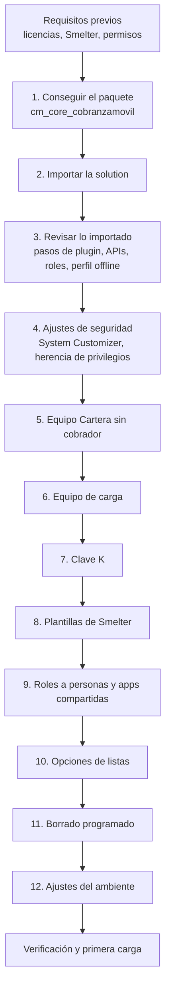

# Instalación y despliegue

Este documento explica cómo instalar Cobranza Móvil (CM) en un ambiente de Dataverse nuevo, en cualquier *tenant*, y cómo actualizarla a una versión nueva. Todo se hace **a mano, desde interfaces gráficas**: el portal de Power Apps (`make.powerapps.com`), el centro de administración de Power Platform (*Power Platform admin center*, `admin.powerplatform.microsoft.com`), el centro de administración de Microsoft Entra, la configuración clásica del ambiente y las pantallas de Smelter. No hace falta instalar nada en el puesto de trabajo ni registrar aplicaciones en Entra ID. Está pensado para el administrador de Power Platform que recibe la solución sin contexto. Las razones de diseño están en [Arquitectura](01-arquitectura.md), [Seguridad](03-seguridad.md) y [Decisiones de diseño](12-decisiones.md).

Los nombres de menús y botones se escriben como aparecen en la interfaz en inglés, con su traducción la primera vez. Si el portal está en español, la etiqueta es la traducción.

## Cómo funciona

La instalación tiene dos mitades:

- **Lo que viaja en la *solution*.** Una *solution* es el paquete de Dataverse que agrupa componentes (tablas, roles, código, apps) para moverlos entre ambientes. La de CM se llama `cm_core_cobranzamovil` y su editor (*publisher*) usa el prefijo `sanic`. Al importarla se instalan solos las tablas, columnas, claves alternativas, relaciones, roles, el ensamblado de *plugins* con sus pasos, las *Custom APIs*, las dos *canvas apps* y el *offline profile*.
- **Lo que no viaja.** Datos y configuración propios del ambiente: equipos, la clave K, las plantillas de Smelter, las opciones iniciales de las listas, los trabajos de borrado programado, algunos ajustes de seguridad sobre roles del sistema y la asignación de roles a personas. Eso se crea a mano después de importar, en el orden de este documento.

## Qué viaja en la solution y qué no

| Componente | ¿Viaja en la *solution*? | Dónde se ve o se configura | Paso |
|---|---|---|---|
| 14 tablas `sanic_cm_tbl_*` (incluidas la bóveda `sanic_cm_tbl_cuentapan` y las opciones de lista `sanic_cm_tbl_opcionlista`), columnas, claves alternativas, relaciones y comportamiento de *cascade* | Sí | Portal de Power Apps → **Solutions** | 3 |
| Auditoría por tabla y por columna | Sí | Viaja con cada tabla; solo registra si el ambiente tiene la auditoría encendida | 12 |
| Roles `SR \| CM \| Localizador`, `BackOffice`, `Solicitante`, `Supervisor`, `Admin`, `Servicio - Cobranza` y `Cartera sin cobrador`, con sus privilegios | Sí | Admin center → **Security roles** | 3 y 4 |
| Propiedad **Member's privilege inheritance** de cada rol | ⚠️ A confirmar | Admin center → rol → **Settings** | 4 |
| Privilegios automáticos de *System Customizer* sobre la bóveda y sobre la tabla de la clave K | No (la plataforma los agrega al crear la tabla) | Admin center → rol *System Customizer* | 4 |
| Ensamblado `Sanic.CobranzaMovil.Plugins` y todos sus pasos | Sí | **Solutions** → **Plug-in steps** | 3 |
| Estado activo o inactivo de cada paso | Depende de la opción de importación | **Solutions** → **Plug-in steps** | 2 y 3 |
| Cinco *Custom APIs* (`sanic_cm_SolicitarEspecial`, `sanic_cm_AltaCuenta`, `sanic_cm_PartirCarga`, `sanic_cm_CerrarFueraDeCartera`, `sanic_cm_MisRoles`) | Sí | **Solutions** → objetos de tipo *Custom API* | 3 |
| *Canvas apps* de la oficina y del localizador | Sí | Portal de Power Apps → **Apps** | 3 |
| *Offline profile* «Cobranza Movil - Cobrador» | Sí | Admin center → **Mobile configuration** | 3 |
| Equipo «CM · Cartera sin cobrador · …» | No | Admin center → **Teams** | 5 |
| Equipo de carga (dueño de las plantillas) y demás equipos | No | Admin center → **Teams** | 6 y 9 |
| Clave K (fila `cm-pan` de la tabla de Smelter `sanic_tbl_smlt_hmackey`) | No | Portal de Power Apps → **Tables**, o pantalla de Smelter | 7 |
| Plantillas de Smelter «Cobranza movil», «Cobranza movil · padres» y «Cobranza movil · partes» | No (son registros de Smelter) | Pantallas de Smelter | 8 |
| Asignación de roles a personas y equipos; permisos de uso de las apps | No | Admin center → **Users**, **Teams**; portal → **Apps** → **Share** | 9 |
| Opciones iniciales de las listas | No (son registros) | App de la oficina → **Listas** | 10 |
| Siete trabajos de *bulk delete* | No | Admin center → **Bulk deletion** | 11 |
| Nivel de trazas de *plugins*, auditoría del ambiente, DLP | No | Admin center y configuración clásica | 12 |
| Vínculo entre cada localizador y su agente | No (es un dato) | App de la oficina → **Agentes y usuarios** | Después de la primera carga |

## Requisitos previos

### Plataforma y licencias

| Requisito | Para qué | Notas |
|---|---|---|
| Ambiente de Power Platform con base de datos Dataverse | Datos, *plugins* y apps | Lo habitual es uno de desarrollo y otro de producción |
| Licencias de Power Apps para todas las personas que usan las apps | Las dos apps son *canvas apps* sobre Dataverse, que es un conector *premium* | ⚠️ A confirmar el plan concreto (por usuario o por app) según el licenciamiento del cliente |
| Smelter instalado en el ambiente **antes** de importar CM | Herramienta de importación de terceros que procesa el archivo diario (su *solution* es `smlt_core_smelter`). CM registra un paso de *plugin* sobre una tabla de Smelter (`sanic_tbl_smlt_importjob`), así que la importación necesita esa tabla | Tiene que soportar la transformación `HMAC()` y respetar los indicadores *CreateIfNotExists* y *UpdateIfExists* de los *table mappings*. ⚠️ A confirmar con el proveedor la versión mínima (el proyecto registra que *UpdateIfExists* se respeta desde la 1.3.0.0; no hay registro de la versión que trae `HMAC()`). Ver [Carga diaria](07-carga-diaria.md) |
| Aplicación Power Apps instalada en los teléfonos de los localizadores | La app del localizador funciona sin señal solo dentro de la app móvil de Power Apps | Ver [App del localizador](05-app-localizador.md) |

### Permisos de quien instala

| Permiso | Para qué |
|---|---|
| Rol **System Administrator** en el ambiente | Importar un ensamblado de *plugins* (*System Customizer* no tiene el privilegio de crear *Plug-In Assembly*), editar roles del sistema, crear trabajos de *bulk delete* y escribir en la tabla protegida de la clave K |
| Rol de Smelter que permite editar plantillas | Crear y modificar las plantillas. En CM se lo llama **Smelter Configurador**; ⚠️ A confirmar el nombre exacto del rol en la versión instalada de Smelter |
| Permiso para crear grupos de seguridad en Microsoft Entra ID (o alguien que lo tenga) | Solo si los roles se van a dar por equipos de grupo de Entra ID (paso 9) |

## 1. Conseguir el paquete de la solution

El paquete es un archivo `.zip` exportado del ambiente de desarrollo donde se mantiene CM. Lo entrega el equipo de desarrollo, o lo exporta quien tenga acceso a ese ambiente:

1. En `make.powerapps.com`, elegir el ambiente de desarrollo y abrir **Solutions** (Soluciones) en el panel izquierdo.
2. Seleccionar `cm_core_cobranzamovil` y, en la barra de comandos, **Export** (Exportar).
3. En el panel **Before you export** (Antes de exportar), elegir **Publish all changes** (Publicar todos los cambios): una *solution* no administrada solo exporta lo publicado. **Next** (Siguiente).
4. En **Export this solution** (Exportar esta solución), revisar el **Version number** (Número de versión) y elegir **Export as** (Exportar como):
   - **Unmanaged** (No administrada, editable) para un ambiente de **desarrollo**.
   - **Managed** (Administrada, sellada) para **producción** y cualquier ambiente donde no se vaya a modificar.
5. **Export**. El `.zip` queda en la carpeta de descargas del navegador.

⚠️ La carpeta [`solutions/unpacked/`](../../solutions/unpacked/) del repositorio está atrasada respecto del ambiente (por ejemplo, no tiene la bóveda ni las opciones de lista). No se instala desde ahí: se instala siempre desde un `.zip` exportado.

## 2. Importar la solution

1. En `make.powerapps.com`, elegir el ambiente **de destino** (selector de ambiente arriba a la derecha) y abrir **Solutions**.
2. En la barra de comandos, **Import solution** (Importar solución).
3. En **Import a solution**, elegir **This device** (Este dispositivo) → **Browse** (Examinar), seleccionar el `.zip` y **Next**.
4. En **Advanced settings** (Configuración avanzada), dejar marcada **Enable Plugin steps and flows included in the solution** (Habilitar los pasos de *plugin* y los flujos incluidos en la solución). Si se desmarca, los pasos que vienen inactivos quedan inactivos.
5. Si aparece una lista de **dependencias faltantes**, cancelar: lo más probable es que falte Smelter o que su versión sea anterior. Instalar o actualizar Smelter y volver a empezar.
6. **Import** (Importar). La importación corre en segundo plano y puede tardar varios minutos. Si falla, la página de soluciones muestra una notificación con **Download Log File** (Descargar archivo de registro), un XML que se abre con Excel.
7. **Solo si se importó la no administrada:** los cambios quedan en borrador. Abrir la *solution* y elegir **Publish all customizations** (Publicar todas las personalizaciones). Una administrada se importa ya publicada.

## 3. Revisar lo importado

Abrir la *solution* `cm_core_cobranzamovil` en **Solutions** y revisar el panel **Objects** (Objetos):

| Qué | Dónde | Resultado esperado |
|---|---|---|
| Tablas | **Tables** (Tablas) | 14 tablas que empiezan con `sanic_cm_tbl_` |
| Pasos de *plugin* | **Plug-in steps** (Pasos de complemento) | Todos con estado **On** (Activado), incluidos los seis de `PanGuard` (Create y Update sobre cuenta, carga diaria y bóveda). Si alguno está **Off**, seleccionarlo y elegir **Turn on** (Activar) |
| *Custom APIs* | Objetos de tipo *Custom API* | Las cinco de la tabla anterior |
| Roles | **Security roles** (Roles de seguridad) | Los siete `SR \| CM \| …` |
| Apps | **Apps** | La app de la oficina y la del localizador |
| *Offline profile* | Admin center → ambiente → **Settings** (Configuración) → **Users + permissions** (Usuarios y permisos) → **Mobile configuration** (Configuración móvil) | «Cobranza Movil - Cobrador», con las tablas cliente, actualización de datos, agente, asignación, cuenta, pago, dirección, interacción, teléfono, bóveda y opciones de lista |

**Por qué `PanGuard` tiene que estar activo.** Rechaza números de tarjeta en claro en las columnas de identificación ([`PanGuard.cs`](../../plugins/Sanic.CobranzaMovil.Plugins/PanGuard.cs)). En una instalación nueva la plantilla de carga ya enmascara el número, así que tiene que quedar activo desde el primer día. El detalle de cada paso está en [Plugins y Custom APIs](04-plugins-y-custom-apis.md).

**Si un paso o una *Custom API* no llegó.** La única alternativa gráfica para registrar pasos fuera de la *solution* es **Plug-in Registration Tool**, la herramienta de escritorio de Microsoft para Windows. Es preferible no usarla: pedir al equipo de desarrollo un paquete nuevo que incluya el componente. Un paso registrado a mano en un ambiente de producción queda fuera de la *solution* y una actualización posterior no lo reemplaza.

**Filtros del *offline profile*.** El *offline profile* define qué tablas y filas baja el teléfono para trabajar sin señal; en su nombre, «Cobrador» es el nombre histórico del localizador. Las asignaciones bajan solo si están activas; las interacciones, los pagos y las actualizaciones de datos, solo si se modificaron en los últimos 90 días. El resto de las tablas baja todas las filas que el usuario puede leer: la seguridad por fila es la que recorta. Si el perfil aparece sin publicar, abrirlo y publicarlo (**Publish**). Detalle en [App del localizador](05-app-localizador.md).

## 4. Ajustes de seguridad posteriores a la importación

Todos se hacen en el admin center: **Manage** (Administrar) → **Environments** (Entornos) → ambiente → **Settings** → **Users + permissions** → **Security roles**.

### 4.1. Quitar privilegios a System Customizer

Dataverse le da al rol del sistema *System Customizer* privilegios sobre toda tabla nueva. Lo tienen identidades de servicio y personas de desarrollo, que no deben leer el número de tarjeta ni la clave K.

1. Abrir el rol **System Customizer**.
2. Buscar la tabla de la bóveda («CM | TBL | PAN de cuenta», `sanic_cm_tbl_cuentapan`) y dejar todos sus privilegios en **None selected** (Ninguno).
3. Buscar la tabla de claves de Smelter (`sanic_tbl_smlt_hmackey`) y hacer lo mismo. ⚠️ A confirmar su nombre visible en la versión instalada de Smelter; el nombre lógico es el de arriba.
4. **Save + close** (Guardar y cerrar).

Quedan con acceso *System Administrator* y roles internos de Microsoft que la plataforma no deja modificar (por ejemplo, *Support User*).

### 4.2. Revisar los privilegios de la bóveda

En el mismo editor, comprobar que la lectura de `sanic_cm_tbl_cuentapan` quedó así (viaja con los roles; se revisa porque es la pieza más sensible):

| Rol | Read de la bóveda |
|---|---|
| `SR \| CM \| Localizador` | **User** (Basic): solo las cuentas de su cartera, por el compartido en cascada desde la cuenta |
| `SR \| CM \| BackOffice` | **Organization** (Global): transcribe al *core* |
| `SR \| CM \| Admin`, `Solicitante`, `Supervisor` | Ninguno |

Nadie tiene Create, Write ni Delete sobre la bóveda: la escribe solo la carga. Motivos en [Seguridad](03-seguridad.md#protección-del-número-de-tarjeta-pan).

### 4.3. Herencia de privilegios para roles dados por equipo

Si un rol de CM se va a dar **a través de un equipo** (paso 9), su propiedad **Member's privilege inheritance** (Herencia de privilegios de miembros) tiene que estar en **Direct User (Basic) access level and Team privileges** (Nivel de acceso de usuario directo y privilegios de equipo). Con *Team privileges only*, la persona solo podría usar los privilegios de nivel User sobre registros cuyo dueño es el equipo, y un localizador no vería las asignaciones de las que es dueño.

1. Seleccionar el rol y, en la barra de comandos, **Settings**.
2. Revisar **Member's privilege inheritance** y guardar.

⚠️ A confirmar si esta propiedad viaja con el rol en la *solution*: revisarla siempre después de importar. Ver [Seguridad](03-seguridad.md#roles-heredados-por-equipos-de-entra-id).

## 5. Equipo «Cartera sin cobrador»

Los *plugins* `RepartoAsignacion` y `RepartoPorAgente` le pasan a este equipo las asignaciones activas cuyo agente no tiene usuario: así nadie las ve en el teléfono y el localizador anterior las pierde. Lo buscan **por nombre**: tiene que existir **exactamente un** equipo de tipo *Owner* cuyo nombre empiece con `CM · Cartera sin cobrador` ([`CarteraSinCobrador.cs`](../../plugins/Sanic.CobranzaMovil.Plugins/CarteraSinCobrador.cs), constante `PrefijoEquipoSinCobrador` de [`Esquema.cs`](../../plugins/Sanic.CobranzaMovil.Plugins/Esquema.cs)). Es el único equipo de CM con nombre obligatorio. Sin él, la primera carga reparte con error.

1. Admin center → ambiente → **Settings** → **Users + permissions** → **Teams** (Equipos) → **+ Create team** (Crear equipo).
2. Completar:
   - **Team name** (Nombre del equipo): `CM · Cartera sin cobrador · <sufijo-del-ambiente>`, por ejemplo con `PRD`. El separador es el **punto medio** `·` (U+00B7) con un espacio a cada lado, no un punto ni un guion: con otro carácter el *plugin* no lo encuentra.
   - **Business unit** (Unidad de negocio): la unidad raíz.
   - **Team type** (Tipo de equipo): **Owner** (Propietario).
   - **Description**: «Dueño de las asignaciones cuyo agente no tiene usuario o que no tienen agente. SIN miembros.»
3. Guardar. En el equipo, menú **⋮** → **Manage security roles** (Administrar roles de seguridad) → marcar **solo** `SR | CM | Cartera sin cobrador` → **Save**.
4. **No agregarle miembros.** El rol solo da lectura de asignaciones a nivel User: alcanza para que el equipo sea dueño y no le da acceso a ninguna persona.

## 6. Equipo de carga

Smelter le da a cada trabajo de importación el dueño de su plantilla, y quien pone un trabajo en cola tiene que poder leer la plantilla. Por eso las tres plantillas de CM tienen como dueño un equipo, y las personas que cargan el archivo (el Admin) son miembros de ese equipo. Las *Custom APIs* `sanic_cm_PartirCarga` y `sanic_cm_AltaCuenta` crean trabajos con los permisos de quien las llama ([`PartirCarga.cs`](../../plugins/Sanic.CobranzaMovil.Plugins/PartirCarga.cs), [`AltaCuenta.cs`](../../plugins/Sanic.CobranzaMovil.Plugins/AltaCuenta.cs)).

1. **Teams** → **+ Create team**, en la unidad raíz. El nombre es libre; se sugiere uno descriptivo («Carga Cobranza Móvil»). Tipo:
   - **Owner**, si los miembros se agregan a mano; o
   - **Microsoft Entra ID Security group** (Grupo de seguridad de Microsoft Entra ID), si los miembros salen de un grupo de Entra ID. En ese caso se elige el grupo en **Group name** y el tipo de pertenencia en **Membership type**.
2. **Manage security roles**: el rol de Smelter que permite ver plantillas y correr trabajos (en CM se lo llama **Smelter Operador**; ⚠️ A confirmar el nombre en la versión instalada). Si los Admin van a recibir su rol de CM por este mismo equipo, agregar también `SR | CM | Admin`.
3. Si es de tipo *Owner*: **⋮** → **Manage team members** (Administrar miembros) → agregar a los Admin.

Este equipo tiene que existir antes de crear las plantillas (paso 8), que lo toman como dueño.

## 7. Clave K

K es la clave secreta con la que Smelter calcula el HMAC del número de tarjeta: las tablas se unen por ese valor en lugar del número. Vive en la tabla protegida de Smelter `sanic_tbl_smlt_hmackey`, en una fila activa con nombre `cm-pan`, en **todos** los ambientes, producción incluida. No se usa Azure Key Vault: Smelter lee la clave de su propia tabla. Por qué existe y cómo se protege: [Seguridad](03-seguridad.md#la-clave-k).

1. **Generar K**: 64 caracteres hexadecimales en minúscula (`0-9`, `a-f`), que son 32 bytes. Usar el generador de secretos del gestor de contraseñas de la organización, configurado para ese alfabeto y ese largo. Guardarla en ese gestor. Una K por ambiente; nunca reutilizar la de otro. ⚠️ A confirmar qué herramienta de la organización genera el valor.
2. **Cargarla.** Con la pantalla de claves de Smelter, si la versión instalada la tiene (⚠️ A confirmar). Si no, desde el portal de Power Apps:
   1. **Tables** → filtro **All** (Todas) → buscar `sanic_tbl_smlt_hmackey` y abrirla.
   2. En el área de columnas y datos de la tabla, agregar una fila con `sanic_smlt_hk_name` = `cm-pan` y `sanic_smlt_hk_value` = K.
   3. Guardar.
3. **Comprobar** que haya **una sola** fila activa con nombre `cm-pan`. Con dos, Smelter falla.

Sin K, la carga falla con `TransformError`.

## 8. Plantillas de Smelter

La carga usa tres plantillas (*Import Template* de Smelter). Los nombres están fijos en [`Esquema.cs`](../../plugins/Sanic.CobranzaMovil.Plugins/Esquema.cs) y no se pueden cambiar; los dos últimos llevan el punto medio `·`:

| Plantilla | Uso | Se edita |
|---|---|---|
| «Cobranza movil» | Principal: la prueba en seco, la carga en serie y el alta de cuenta | Sí, es la única que se edita |
| «Cobranza movil · padres» | Carga paralela: producto, fiador y agente | Nunca a mano: es copia de su parte de la principal |
| «Cobranza movil · partes» | Carga paralela: todo lo demás | Nunca a mano: es copia de su parte de la principal |

El modelo de configuración (plantilla, *Table Mapping*, *Column Mapping*), las tablas que escribe cada mapeo y sus claves de *dedup* están en [Carga diaria](07-carga-diaria.md#plantillas-de-smelter).

### 8.1. Plantilla principal

Se crea en las pantallas de Smelter con el rol que permite editar plantillas. ⚠️ A confirmar el mecanismo con el proveedor: si la versión instalada permite exportar una plantilla de un ambiente e importarla en otro, es la vía recomendada (Smelter expone la *Custom API* `sanic_capi_smelter_exporttemplate` para exportar; no hay registro de una importación). Si no:

- **A mano**, copiando cada *Table Mapping* y *Column Mapping* de la plantilla del ambiente de origen, con la tabla de [Carga diaria](07-carga-diaria.md#plantillas-de-smelter) como guía.
- **Por Excel** (⚠️ A confirmar que los *lookups* se resuelven bien): en el ambiente de origen, `make.powerapps.com` → **Tables** → **Export** → **Export data** de las tablas de plantillas, *table mappings* y *column mappings* de Smelter; en el destino, **Tables** → **Import** → **Import data from Excel**, en ese orden (cada *lookup* apunta a la tabla anterior). La columna de dueño no se importa: se asigna después.

Dos ajustes que la plantilla principal tiene que tener:

| Mapeo | Valor | Por qué |
|---|---|---|
| *Column Mapping* `NombreFianza` → `sanic_cm_fi_nombre`, en el *Table Mapping* de `sanic_cm_tbl_fiador` | Valor por defecto (*default value*) = `(sin fiador)` | Las filas sin fiador comparten un solo fiador «(sin fiador)» en vez de crear uno vacío por fila. El *Column Mapping* de la cuenta que busca el fiador **no** lleva ese valor: con el nombre vacío, la cuenta queda sin fiador |
| *Table Mapping* de `sanic_cm_tbl_agente` | *UpdateIfExists* = No; *CreateIfNotExists* = Sí | El agente tiene una sola columna mapeada, su nombre, que es la clave: actualizarlo no cambia nada y Smelter lo reescribiría en cada fila. Antes de apagarlo, comprobar que ese *Table Mapping* no mapee otras columnas: dejarían de actualizarse |

Además, `PartirCarga` exige que el cliente se deduplique por `sanic_cm_cl_cif` desde una columna del archivo. La principal no puede tener *Relationship Mappings*: un mapeo de relación con el padre en otra plantilla deja el *lookup* vacío sin aviso.

### 8.2. Plantillas derivadas

`PartirCarga` compara las tres plantillas antes de partir la carga y se niega si no coinciden. Las derivadas tienen que ser **copia exacta** de su parte de la principal:

1. Crear «Cobranza movil · padres» y «Cobranza movil · partes» con los mismos valores de la principal en: delimitador, encabezado, tamaño de lote, tipo de origen y estado (**Activo**).
2. En «· padres», crear **solo** los *Table Mappings* de `sanic_cm_tbl_producto`, `sanic_cm_tbl_fiador` y `sanic_cm_tbl_agente`; en «· partes», **todos los demás**. Cada uno con los mismos valores que en la principal: nombre, tabla destino, columnas de *dedup*, orden de procesamiento, *CreateIfNotExists*, *UpdateIfExists* y si es tabla intermedia.
3. Bajo cada *Table Mapping*, los mismos *Column Mappings* que en la principal: nombre, columna destino, columna de origen, tipo de dato, requerido, valor por defecto, tabla y columna de *lookup*, mapeo de opciones y expresión de transformación.

Cada vez que se cambia la principal, hay que repetir el cambio en la derivada que corresponde (y borrar en ella lo que ya no esté en la principal).

### 8.3. Dueño de las tres plantillas

Asignar las tres plantillas al **equipo de carga** del paso 6: abrir cada una en Smelter y usar **Assign** (Asignar). Smelter le da a cada trabajo de importación el dueño de su plantilla.

## 9. Asignar roles a las personas y compartir las apps

Cada persona recibe **un solo** rol operativo de CM (`SR | CM | <perfil>`). Se le puede dar de cualquiera de estas tres formas, sin requisitos sobre el nombre del equipo:

| Forma | Dónde | Cuándo conviene |
|---|---|---|
| **Directo a la persona** | Admin center → ambiente → **Settings** → **Users + permissions** → **Users** (Usuarios) → seleccionar la persona → **Manage security roles** → marcar el rol → **Save** | Pocas personas |
| **Equipo de Dataverse de tipo *Owner*** | **Teams** → crear el equipo → **Manage security roles** → **Manage team members** | Grupos que se administran desde Dataverse |
| **Equipo de grupo de Entra ID** | Crear el grupo de seguridad en el centro de administración de Microsoft Entra; en **Teams**, crear un equipo de tipo **Microsoft Entra ID Security group** vinculado a ese grupo y darle el rol | Cuando las altas y bajas se administran en Entra ID. Los miembros los administra un administrador de Entra; Dataverse los sincroniza cuando la persona entra al ambiente |

La app de la oficina y los *plugins* leen los roles **efectivos** de la persona: los directos y los heredados de cualquier equipo ([`RolesCm.cs`](../../plugins/Sanic.CobranzaMovil.Plugins/RolesCm.cs)). La app los pide al abrir con la *Custom API* `sanic_cm_MisRoles` ([`MisRoles.cs`](../../plugins/Sanic.CobranzaMovil.Plugins/MisRoles.cs), llamada desde [`scrCarga.pa.yaml`](../../apps/backoffice-canvas/Src/scrCarga.pa.yaml)). Si el rol llega por un equipo, revisar antes el ajuste de herencia del paso 4.3.

| Perfil | Rol de CM | Además |
|---|---|---|
| Localizador | `SR \| CM \| Localizador` | |
| Oficina que transcribe | `SR \| CM \| BackOffice` | |
| Solicitante de Especiales | `SR \| CM \| Solicitante` | |
| Supervisor | `SR \| CM \| Supervisor` | |
| Administrador funcional | `SR \| CM \| Admin` | Miembro del equipo de carga (paso 6) |

Reglas (motivos en [Seguridad](03-seguridad.md#qué-no-hacer)):

- No dar Localizador junto con BackOffice: la misma persona podría registrar y transcribir su propia visita.
- No dar a ninguna persona `SR | CM | Cartera sin cobrador`.
- ⚠️ A confirmar a qué identidad se asigna `SR | CM | Servicio - Cobranza`. Los *plugins* la tratan como al Admin y además le permiten crear Diarias e Incobrables ([`AprobacionEspecial.cs`](../../plugins/Sanic.CobranzaMovil.Plugins/AprobacionEspecial.cs)). La operación normal no la necesita.

**Compartir las apps.** En `make.powerapps.com` → **Apps**, seleccionar cada app → **Share** (Compartir) → agregar personas o grupos de Entra ID. La app del localizador **solo** con los localizadores: con un rol de lectura amplia, el teléfono bajaría una copia sin conexión de toda la cartera. La de la oficina, con los demás perfiles. Compartir la app no da permisos sobre los datos: los da el rol.

## 10. Opciones iniciales de las listas

Las listas que el Admin edita (tipo de Especial, motivos de cierre, mensajes rápidos del localizador) viven en `sanic_cm_tbl_opcionlista`. La tabla viaja en la *solution*; las opciones no. Con un usuario que tenga `SR | CM | Admin`, abrir la app de la oficina → **Listas** ([`scrListas.pa.yaml`](../../apps/backoffice-canvas/Src/scrListas.pa.yaml)) y crear las opciones. Las que usaba la instalación original:

| Lista | Opciones |
|---|---|
| Tipo de Especial | Retiro urgente, Cobro especial, Verificación |
| Motivo de cierre Incobrable | Recuperada, Baja / castigada, Fuera de cartera |
| Motivo de cierre Especial | Gestión completada, Ya no aplica, Solicitud errónea |
| Mensaje rápido | Promesa de pago, No localizado, Cliente pagó, No tiene dinero hoy, Negocio cerrado, Pidió arreglo |

La primera opción activa de cada lista es la que aparece por defecto. Las opciones no se borran: se desactivan. Detalle en [App de la oficina](06-app-backoffice.md#listas-administrables).

## 11. Borrado programado

Siete trabajos diarios de *bulk delete* (borrado masivo programado de Dataverse) aplican los plazos de retención. Plazos y motivos: [Ciclo de vida de los datos](08-ciclo-de-vida.md#los-siete-trabajos-de-borrado).

Para cada trabajo:

1. Admin center → ambiente → **Settings** → **Data management** (Administración de datos) → **Bulk deletion** (Eliminación masiva) → **New** (Nuevo). Se abre **Bulk Deletion Wizard** (Asistente para eliminación masiva) → **Next**.
2. En **Define Search Criteria** (Definir criterios de búsqueda), elegir la tabla en **Look for** (Buscar) y armar las condiciones de la tabla siguiente. **Preview Records** (Vista previa de registros) muestra qué se borraría hoy. **Next**.
3. En **Select Options** (Seleccionar opciones): **Name** (Nombre) exactamente como en la tabla; hora de inicio fuera del horario de carga; marcar **Run this job after every** (Ejecutar este trabajo cada) **1** día; sin correo de aviso. **Next**.
4. **Submit** (Enviar).

| Nombre del trabajo | **Look for** | Condiciones |
|---|---|---|
| `CM - Carga diaria de mas de 7 dias` | Carga diaria (`sanic_cm_tbl_cargadiaria`) | Fecha de carga (`sanic_cm_cd_fechacarga`) **Older Than X Days** (Anterior a X días) 7 |
| `CM - Cuentas fuera de cartera hace mas de 14 dias` | Cuenta (`sanic_cm_tbl_cuenta`) | Modificado el **Older Than X Days** 14; **y** sin asignación viva; **y** sin interacción pendiente (ver nota) |
| `CM - Clientes sin cuentas` | Cliente (`sanic_cm_tbl_cliente`) | Modificado el **Older Than X Days** 2; **y** relacionada Cuenta (por el cliente) **Does Not Contain Data** (No contiene datos) |
| `CM - Fiadores sin cuentas` | Fiador (`sanic_cm_tbl_fiador`) | Modificado el **Older Than X Days** 2; **y** relacionada Cuenta (por el fiador) **Does Not Contain Data** |
| `CM - Pagos de mas de 2 anos` | Pago (`sanic_cm_tbl_pago`) | Creado el **Older Than X Days** 730 |
| `CM - Actualizaciones de datos de mas de 2 anos` | Actualización de datos (`sanic_cm_tbl_actualizaciondatos`) | Creado el **Older Than X Days** 730 |
| `CM - Interacciones de mas de 2 anos` | Interacción (`sanic_cm_tbl_interaccion`) | Creado el **Older Than X Days** 735 |

**Nota sobre el trabajo de cuentas.** «Asignación viva» es una asignación de la cuenta activa, **o** con «Última carga» en los últimos 14 días, **o** con fecha de cierre en los últimos 14 días. «Interacción pendiente» es una interacción de la cuenta con estado de grabación = Pendiente (todavía no transcrita). La condición es que **no exista** ninguna fila relacionada que cumpla esos filtros. ⚠️ A confirmar que el asistente permita poner condiciones dentro de un **Does Not Contain Data**; si no lo permite, este trabajo no tiene equivalente gráfico (ver [Puntos a confirmar](#puntos-a-confirmar)).

Las columnas de fecha de carga y de «Última carga» son *DateOnly* (solo fecha): con ellas, usar operadores de días, nunca de horas o minutos ([Ciclo de vida](08-ciclo-de-vida.md#operadores-que-no-valen-con-dateonly)).

**Alternativa a futuro.** Los trabajos de *bulk delete* hoy pueden viajar en una *solution* (componente **Data Life Cycle Config**). Si el equipo de desarrollo los agrega a `cm_core_cobranzamovil`, este paso desaparece. Un trabajo importado corre apenas se importa.

## 12. Ajustes del ambiente

| Ajuste | Dónde | Valor |
|---|---|---|
| Auditoría del ambiente | Admin center → ambiente → **Settings** → **Audit and logs** (Auditoría y registros) → **Audit settings** (Configuración de auditoría) → **Start Auditing** (Iniciar auditoría) → **Save** | Encendida. La auditoría por tabla y por columna viaja en la *solution*, pero no registra nada si el ambiente la tiene apagada |
| Nivel de trazas de *plugins* | Admin center → ambiente → **Settings** → **Resources** (Recursos) → **All legacy settings** (Toda la configuración heredada) → **Settings** → **Administration** (Administración) → **System Settings** (Configuración del sistema) → pestaña **Customization** (Personalización) → **Enable logging to plug-in trace log** (Habilitar registro en el registro de seguimiento de complementos) | **Exception**. Para diagnosticar se sube un rato a **All** (ver [Mantenimiento](11-mantenimiento.md)). Si el ambiente redirige la configuración heredada a la app *Power Platform Environment Settings*, la opción está en **Administration** dentro de esa app |
| Políticas de prevención de pérdida de datos (DLP), grupo de seguridad del ambiente, controles del dispositivo (Intune) | Admin center y Microsoft Intune | ⚠️ A confirmar: dependen del *tenant* y no forman parte de la *solution* |

## Verificación final

| Qué comprobar | Cómo | Resultado esperado |
|---|---|---|
| Pasos de *plugin* | **Solutions** → `cm_core_cobranzamovil` → **Plug-in steps** | Todos **On**, `PanGuard` incluido |
| *Custom APIs* | Objetos de la *solution* | Las cinco presentes |
| System Customizer | Editor del rol, tablas de la bóveda y de claves de Smelter | Ningún privilegio |
| Herencia de privilegios | **Settings** de cada rol dado por equipo | *Direct User (Basic) access level and Team privileges* |
| Equipo «Cartera sin cobrador» | **Teams** | Uno solo, tipo *Owner*, rol `SR \| CM \| Cartera sin cobrador`, sin miembros |
| Equipo de carga | **Teams** | Rol de Smelter para correr trabajos; los Admin como miembros |
| Clave K | Tabla `sanic_tbl_smlt_hmackey` | Una sola fila activa `cm-pan` |
| Plantillas | Pantallas de Smelter | Tres plantillas activas, dueño = equipo de carga, derivadas iguales a su parte de la principal |
| Roles de cada persona | Admin center → **Users** → persona → roles; o **Run diagnostics** (Ejecutar diagnóstico) | Un rol operativo de CM, directo o por un equipo |
| Opciones de lista | App de la oficina → **Listas** | Las cuatro listas con opciones activas |
| Borrado programado | **Bulk deletion** → vista de trabajos recurrentes | Los siete trabajos, diarios |
| Auditoría y trazas | Ajustes del paso 12 | Auditoría encendida; trazas en *Exception* |
| Carga de punta a punta | **Solo en el ambiente de desarrollo**: app de la oficina → **Cargar archivo** con [`cobranza-mock-1000.csv`](../../test-data/cobranza-mock-1000.csv); después **Monitoreo** ([`scrMonitoreo.pa.yaml`](../../apps/backoffice-canvas/Src/scrMonitoreo.pa.yaml)) | Trabajo completo, 0 filas fallidas, asignaciones repartidas en pocos minutos. Unos minutos después, los trabajos ya no tienen archivo: lo borra [`PurgaArchivoCarga`](../../plugins/Sanic.CobranzaMovil.Plugins/PurgaArchivoCarga.cs) |
| Agentes | Después de la primera carga, app de la oficina → **Agentes y usuarios** ([`scrAgentes.pa.yaml`](../../apps/backoffice-canvas/Src/scrAgentes.pa.yaml)) | Cada localizador vinculado a su agente, con el correo de su usuario (lo completa [`EmailDesdeUsuario.cs`](../../plugins/Sanic.CobranzaMovil.Plugins/EmailDesdeUsuario.cs)) |
| Teléfono | Un localizador abre la app en Power Apps móvil y sincroniza | Ve solo su cartera, que coincide con sus asignaciones activas |

⚠️ Nunca cargar archivos de prueba en producción. Los de [`test-data/`](../../test-data/) usan números de tarjeta generados al azar.

## Actualizar a una versión nueva

Una versión nueva llega como un `.zip` con número de versión mayor (formato `X.Y.Z.B`; los cambios se anotan en [`CHANGELOG.md`](../../CHANGELOG.md)).

1. **Elegir el momento**: sin cargas en curso y fuera del horario de los localizadores. Mientras dura la importación, los pasos de *plugin* pueden quedar apagados, y un cambio de asignaciones de ese intervalo puede no repartirse (ver [Trampas](#trampas-y-errores-conocidos)).
2. **Avisar a los makers** que cierren las apps en Power Apps Studio: si alguien tiene una app abierta en edición, la importación falla.
3. `make.powerapps.com` → **Solutions** → **Import solution** → **Browse** → **Next**. Aparece el aviso **This solution package contains an update for a solution that is already installed** (Este paquete contiene una actualización de una solución ya instalada).
4. En **Advanced settings**, elegir la acción:
   - **Upgrade** (Actualizar; recomendada para la administrada): deja la versión nueva y **borra** los componentes que ya no están en ella.
   - **Stage for Upgrade** (Preparar para actualizar): instala la nueva junto a la vieja; se completa después con **Apply Solution Upgrade** (Aplicar actualización). Solo si hace falta migrar datos entre las dos.
   - **Update** (no recomendada): reemplaza sin borrar lo que se quitó; el ambiente puede quedar distinto del de origen.
5. Dejar marcada **Enable plug-in steps and flows included in the solution** → **Import**.
6. Si es la no administrada: **Publish all customizations**.
7. Repetir la revisión del paso 3 (pasos **On**, *Custom APIs*, *offline profile*) y del paso 4.1 si la versión agrega tablas nuevas (System Customizer vuelve a recibir privilegios sobre ellas).
8. Aplicar a mano lo que no viaja, **solo si la versión lo cambió** (lo indica el `CHANGELOG.md`): plantillas de Smelter (principal y derivadas), trabajos de borrado, opciones de lista nuevas.

La importación no toca los datos: equipos, K, plantillas, trabajos de borrado, opciones y asignaciones de roles quedan como estaban.

## Piezas y archivos

| Pieza | Archivo |
|---|---|
| Nombres fijos que el código busca (equipo «Cartera sin cobrador», plantillas, prefijo de roles) | [`Esquema.cs`](../../plugins/Sanic.CobranzaMovil.Plugins/Esquema.cs) |
| Búsqueda del equipo «Cartera sin cobrador» | [`CarteraSinCobrador.cs`](../../plugins/Sanic.CobranzaMovil.Plugins/CarteraSinCobrador.cs) |
| Roles efectivos (directos y por equipo) en los *plugins* | [`RolesCm.cs`](../../plugins/Sanic.CobranzaMovil.Plugins/RolesCm.cs) |
| Perfil de la persona en la app de la oficina | [`scrCarga.pa.yaml`](../../apps/backoffice-canvas/Src/scrCarga.pa.yaml) (variable `gblRol`) y [`MisRoles.cs`](../../plugins/Sanic.CobranzaMovil.Plugins/MisRoles.cs) |
| Partición de la carga y control de las plantillas derivadas | [`PartirCarga.cs`](../../plugins/Sanic.CobranzaMovil.Plugins/PartirCarga.cs) |
| Borrado del archivo de carga | [`PurgaArchivoCarga.cs`](../../plugins/Sanic.CobranzaMovil.Plugins/PurgaArchivoCarga.cs) |
| Pantallas de la instalación | [`scrListas.pa.yaml`](../../apps/backoffice-canvas/Src/scrListas.pa.yaml), [`scrAgentes.pa.yaml`](../../apps/backoffice-canvas/Src/scrAgentes.pa.yaml), [`scrCargaArchivo.pa.yaml`](../../apps/backoffice-canvas/Src/scrCargaArchivo.pa.yaml), [`scrMonitoreo.pa.yaml`](../../apps/backoffice-canvas/Src/scrMonitoreo.pa.yaml) |
| Versión del ensamblado de *plugins* | [`Sanic.CobranzaMovil.Plugins.csproj`](../../plugins/Sanic.CobranzaMovil.Plugins/Sanic.CobranzaMovil.Plugins.csproj) |

## Trampas y errores conocidos

- **Smelter primero.** Sin Smelter instalado, la importación de CM informa una dependencia faltante: el paso de `PurgaArchivoCarga` está registrado sobre la tabla de trabajos de importación de Smelter.
- **El punto medio.** El equipo «CM · Cartera sin cobrador · …» y las plantillas «Cobranza movil · padres» y «· partes» usan `·` (U+00B7), no `.` ni `-`. Escrito con otro carácter, el código no los encuentra: el reparto falla o `PartirCarga` se niega a partir la carga. Conviene copiar el nombre desde este documento.
- **El orden importa.** El equipo de carga antes de las plantillas (que toman su dueño). El equipo «Cartera sin cobrador», la clave K y las tres plantillas antes de la primera carga. Si falta K, la carga falla con `TransformError`; si faltan las derivadas o no coinciden con la principal, `PartirCarga` se niega a partir.
- **Una K nueva no reconoce los datos viejos.** Las claves `*_clavepan` son HMAC con K. Si se migran datos desde otro ambiente, hay que usar su misma K; si no, la carga no encuentra las cuentas existentes y las duplica.
- **La importación puede apagar pasos.** Sin **Enable plug-in steps and flows included in the solution**, los pasos que llegan inactivos quedan inactivos. Revisar **Plug-in steps** después de cada importación.
- **Cambios durante la importación.** Mientras se importa, los pasos asíncronos de reparto pueden no correr. Un cambio de asignaciones en ese intervalo puede quedar sin dueño correcto o sin compartir. Para un agente concreto, quitar y volver a poner su usuario en **Agentes y usuarios** dispara `RepartoPorAgente`, que re-reparte sus asignaciones. No hay una pantalla que reconcilie todo de una vez.
- **App abierta en Studio.** Si alguien tiene una app abierta en modo edición, la importación falla. Reintentar cuando la cierre.
- **El ensamblado no cambia *major* ni *minor*.** Si cambia *build* o *revision*, Dataverse lo actualiza en el lugar y los pasos siguen apuntando a él. Si cambia *major* o *minor*, al importar lo trata como **otro ensamblado** y los pasos siguen apuntando al viejo ([documentación de Microsoft](https://learn.microsoft.com/power-apps/developer/data-platform/register-plug-in#assembly-versioning)). Es una regla para quien genera la versión; quien instala solo nota el síntoma.
- **Una *solution* administrada no se exporta.** Si un ambiente se va a usar para modificar CM, importar ahí la no administrada.
- **Equipo de grupo de Entra ID.** Sus miembros se sincronizan cuando la persona entra al ambiente; hasta entonces, no hereda el rol. Las altas y bajas de miembros se hacen en Entra ID, no en Dataverse.

## Puntos a confirmar

- ⚠️ Mecanismo para crear la plantilla «Cobranza movil» en un ambiente nuevo: exportar e importar con Smelter, importar por Excel o armarla a mano.
- ⚠️ Versión mínima de Smelter con `HMAC()` (*UpdateIfExists* se respeta desde la 1.3.0.0, según lo registrado en el proyecto).
- ⚠️ Nombre exacto de los roles de Smelter (Operador y Configurador) y si Smelter tiene pantalla propia para la clave K.
- ⚠️ Plan de licencias de Power Apps.
- ⚠️ Identidad que recibe `SR | CM | Servicio - Cobranza`, o si hace falta.
- ⚠️ Si **Member's privilege inheritance** viaja con los roles en la *solution*.
- ⚠️ Si el asistente de *bulk delete* permite el trabajo de cuentas (condiciones dentro de **Does Not Contain Data**).
- ⚠️ Herramienta de la organización para generar K y procedimiento de rotación: cambiar K obliga a recalcular todas las claves `*_clavepan` existentes, y no hay un procedimiento gráfico para eso.
- ⚠️ DLP, grupo de seguridad del ambiente e Intune.
