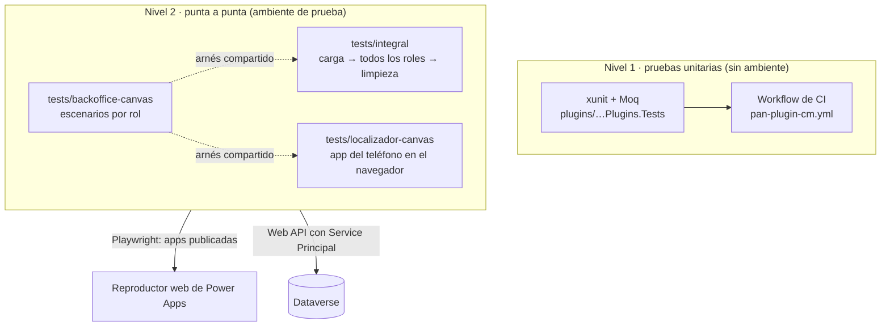

# Pruebas

Este documento explica cómo se prueba Cobranza Móvil: las pruebas unitarias de los *plugins* y las suites de punta a punta que recorren las dos apps con usuarios reales de cada rol. Está pensado para quien tiene que correrlas, adaptarlas a un ambiente nuevo o agregar casos.

> ⚠️ **Las suites de punta a punta crean, modifican y borran datos en Dataverse**, cambian membresías de equipos y disparan *plugins* reales. Se corren **solo en un ambiente de prueba**, nunca en el ambiente de producción. Las pruebas unitarias de *plugins* no tocan ningún ambiente.

## Cómo funciona

Hay dos niveles. Las pruebas unitarias verifican la lógica de cada *plugin* en memoria, sin Dataverse. Las suites de punta a punta abren las apps publicadas en el navegador (Playwright sobre el reproductor web de Power Apps) y comparan lo que muestra cada pantalla contra la Web API de Dataverse.



Las tres suites comparten el arnés de [`tests/backoffice-canvas/lib/`](../../tests/backoffice-canvas/lib/): cliente de la Web API, apertura del reproductor, captura de red y configuración. Por eso las otras dos se corren con `NODE_PATH` apuntando a las dependencias de esa carpeta.

## Piezas y archivos

| Pieza | Archivo | Qué hace |
|---|---|---|
| Proyecto de pruebas de *plugins* | [`Sanic.CobranzaMovil.Plugins.Tests.csproj`](../../plugins/Sanic.CobranzaMovil.Plugins.Tests/Sanic.CobranzaMovil.Plugins.Tests.csproj) | xunit + Moq, `net462` |
| Arnés de *plugins* | [`Harness.cs`](../../plugins/Sanic.CobranzaMovil.Plugins.Tests/Harness.cs) | Arma el contexto de ejecución, las imágenes y el servicio de organización con dobles de Moq |
| CI de *plugins* | [`pan-plugin-cm.yml`](../../.github/workflows/pan-plugin-cm.yml) | Compila, corre las pruebas y, a pedido, registra el ensamblado |
| Configuración común E2E | [`config.js`](../../tests/backoffice-canvas/lib/config.js) | URL de la app, usuarios por rol, equipos, rutas de sesiones y secretos |
| Cliente Web API | [`dataverse.js`](../../tests/backoffice-canvas/lib/dataverse.js) | Token del Service Principal, GET/POST/PATCH/DELETE, suplantación |
| Reproductor | [`player.js`](../../tests/backoffice-canvas/lib/player.js) | Abre la app, ubica controles por nombre, captura la red, saca capturas |
| Versión servida | [`version.js`](../../tests/backoffice-canvas/lib/version.js) | Espera a que el ambiente sirva la versión recién desplegada |
| Suite de la app de la oficina | [`tests/backoffice-canvas/run.js`](../../tests/backoffice-canvas/run.js) | Fases A–H y X |
| Suite integral | [`tests/integral/run.js`](../../tests/integral/run.js) | Fases F0–F11 de punta a punta |
| Matriz de roles | [`seguridad/matriz.js`](../../tests/integral/seguridad/matriz.js) · [`esperado.js`](../../tests/integral/seguridad/esperado.js) | Rol × tabla × operación contra el servidor |
| Pruebas de Custom APIs y reglas del servidor | [`tests/integral/apis/`](../../tests/integral/apis/) | Un script por regla, sin navegador |
| Suite de la app del localizador | [`humo.js`](../../tests/localizador-canvas/humo.js) · [`grupo2.js`](../../tests/localizador-canvas/grupo2.js) | Apertura y pantallas en el navegador |

## Nivel 1: pruebas unitarias de *plugins*

### Qué cubren

Cada *plugin* tiene su clase de pruebas en [`plugins/Sanic.CobranzaMovil.Plugins.Tests/`](../../plugins/Sanic.CobranzaMovil.Plugins.Tests/) (665 pruebas: cada `[Fact]` y cada caso de un `[Theory]`, con xUnit y Moq). Verifican rechazos y sus mensajes, que ningún mensaje ni traza contenga un número de tarjeta, casos vacíos y nulos, y **qué columnas y cuántas veces** consulta cada *plugin*. El detalle de cada *plugin* está en [Plugins y Custom APIs](04-plugins-y-custom-apis.md).

**Por qué Moq y no FakeXrmEasy:** FakeXrmEasy v3 exige licencia comercial y una clave en la CI, y aquí hace falta afirmar exactamente qué columnas pide cada consulta, algo que Moq permite directo (ver el comentario de [`Harness.cs`](../../plugins/Sanic.CobranzaMovil.Plugins.Tests/Harness.cs)).

### Cómo se corren

```powershell
dotnet test plugins/Sanic.CobranzaMovil.Plugins.Tests/Sanic.CobranzaMovil.Plugins.Tests.csproj -c Release
```

- Requieren **Windows**: compilan para `net462`, el mismo runtime del *sandbox* de Dataverse.
- En la CI corren en [`pan-plugin-cm.yml`](../../.github/workflows/pan-plugin-cm.yml), job `construir-y-probar` (`windows-latest`). El resultado `.trx` queda como artefacto `resultados-pruebas`.
- El workflow se dispara a mano (*Run workflow*, con `registrar` en `false` solo prueba) o con un *push* a la rama configurada en `on.push.branches` que toque `plugins/**` o el propio workflow. *Run workflow* solo aparece si el archivo está en la rama por defecto del repositorio. Al adoptar la solución conviene llevarlo a esa rama y cambiar `on.push.branches` por la rama de trabajo del equipo.

### Cómo se agrega una prueba

1. Crear `<Plugin>Tests.cs` en el proyecto de pruebas.
2. Armar el contexto con `Harness`: mensaje, tabla, *Target*, imagen previa y las lecturas esperadas.
3. Ejecutar el *plugin* y afirmar sobre el *Target* y sobre las consultas.

```csharp
var target = new Entity("sanic_cm_tbl_pago", Guid.NewGuid());
target["sanic_cm_pg_interaccion"] = new EntityReference("sanic_cm_tbl_interaccion", interaccionId);
var h = new Harness("Create", "sanic_cm_tbl_pago").ConTarget(target)
    .RetrieveDevuelve(interaccion, "sanic_cm_in_cuentaid", "sanic_cm_in_numerointeraccion");

h.Ejecutar(new CuentaDesdeInteraccion());

Assert.Equal(1, h.RetrievesAlServicio()); // una sola lectura, solo de las columnas que faltan
```

`RetrieveDevuelve` solo responde si la consulta pide **exactamente** esas columnas: si el *plugin* pide otras, la lectura devuelve `null` y la prueba falla. Ejemplo completo en [`CuentaDesdeInteraccionTests.cs`](../../plugins/Sanic.CobranzaMovil.Plugins.Tests/CuentaDesdeInteraccionTests.cs).

## Nivel 2: suites de punta a punta

### Requisitos

- Node.js 18 o superior (el arnés usa `fetch` nativo).
- Playwright con Chromium, instalado una sola vez en la suite de la oficina:

  ```bash
  cd tests/backoffice-canvas
  npm install
  npx playwright install chromium
  ```

- Un **Service Principal** (aplicación registrada en Entra ID usada como identidad técnica) con rol de administrador del sistema **en el ambiente de prueba**. Lo necesita porque siembra y borra datos, cambia membresías de equipos y suplanta usuarios con la cabecera `MSCRMCallerID` (ejecuta una llamada con los privilegios de otro usuario). Su configuración está en [Instalación y despliegue](09-instalacion-y-despliegue.md).
- Las apps publicadas en ese ambiente y **un usuario de prueba por rol** (ver más abajo).

### Variables de entorno

| Variable | Valor por defecto | Para qué |
|---|---|---|
| `BO_SECRETS_FILE` | `pp_secrets.env` en la raíz del repo (ignorado por git) | Archivo con `DATAVERSE_URL`, `PP_CLIENT_ID`, `PP_TENANT_ID`, `PP_CLIENT_SECRET`. Nunca se imprimen |
| `BO_SESIONES_DIR` | `local/` en la raíz del repo (ignorada por git) | Carpeta con las sesiones `sesion-<clave>.json` |
| `BO_PLAYER_URL` | La URL fija de `config.js` | URL de reproducción de la app de la oficina (`<url-de-reproduccion-de-la-app>`) |
| `BO_RESULTADOS_DIR` | `tests/backoffice-canvas/resultados/` | Resultados de la suite de la oficina (las otras dos suites escriben en su propia `resultados/`) |
| `BO_HEADED` | vacío | `1` muestra el navegador |
| `BO_T_CARGA_MS` · `BO_T_ONVISIBLE_MS` | `60000` · `25000` | Esperas de la carga en frío y del `OnVisible` de cada pantalla |
| `CM_SIN_VERSION` | vacío | `1` no verifica que la versión servida sea la desplegada |
| `PAN_HMAC_KEY_FILE` | ruta de `lib/csv.js` | Opcional: llave HMAC del ambiente; con ella la suite integral verifica la clave sustituta del número de tarjeta |

Las variables `BO_*` las lee [`config.js`](../../tests/backoffice-canvas/lib/config.js) y valen para las tres suites, porque todas usan ese archivo.

### Usuarios de prueba

Hace falta **un usuario de prueba por rol**, con licencia, y cada suite abre la app con la sesión guardada de ese usuario. Cada sesión se identifica por una **clave** que asocia el usuario con su rol en el código:

| Rol del usuario de prueba | Dónde se define su clave | Lo usan |
|---|---|---|
| BackOffice | `cfg.usuarios` de [`config.js`](../../tests/backoffice-canvas/lib/config.js) | oficina, integral |
| Solicitante | `cfg.usuarios` de `config.js` | oficina, integral |
| Supervisor | `cfg.usuarios` de `config.js` | oficina, integral |
| Admin (en el equipo de carga, con el rol de Smelter que habilita la carga) | `cfg.usuarios` de `config.js` | oficina, integral |
| Localizador, con su **agente** vinculado | `usuario` por defecto de `abrirUnaVez` en [`localizador-canvas/lib/app.js`](../../tests/localizador-canvas/lib/app.js), y su id en [`integral/lib/ctx.js`](../../tests/integral/lib/ctx.js) | integral, localizador |

Los escenarios y las fases abren la app pasando esa clave; si se cambian las claves de `cfg.usuarios`, hay que cambiarlas también en las llamadas a `abrir(...)` y `abrirBackoffice(...)` de los escenarios y de las fases.

- Cada usuario tiene que estar **solo** en el equipo (*owner team*) de su rol y con licencia. La suite de la oficina toma una foto de las membresías al empezar, la compara con lo esperado y la restaura al final.
- La sesión de un administrador del sistema está **prohibida**: [`config.js`](../../tests/backoffice-canvas/lib/config.js) rechaza cualquier clave que contenga `admin`. Un administrador ve todo y la prueba de roles no probaría nada.
- La sesión es un `storageState` de Playwright (cookies y almacenamiento del navegador). Se genera iniciando sesión a mano una vez por usuario:

  ```bash
  cd tests/backoffice-canvas
  npx playwright codegen --save-storage=sesion-<clave>.json "<url-de-reproduccion-de-la-app>"
  # iniciar sesión con el usuario de ese rol, esperar a que cargue la app, cerrar el navegador
  mv sesion-<clave>.json ../../local/ && chmod 600 ../../local/sesion-<clave>.json
  ```

- Las sesiones vencen. Si una suite falla al abrir la app con una pantalla de inicio de sesión, hay que regenerar esa sesión.

### Suite de la app de la oficina (`tests/backoffice-canvas/`)

**Qué cubre.** Cada rol en su app con su usuario real, verificando números y escrituras contra la Web API:

| Fase | Rol | Qué verifica |
|---|---|---|
| A | Admin | Navegación del rol, KPIs de Inicio en la primera carga, Monitoreo, Reconciliación, Agentes (abre y cancela, nunca desvincula), búsquedas delegadas, Datos maestros (alta de un cliente QA y aviso de duplicado) |
| B | Solicitante | Nueva solicitud, aviso de duplicado, error controlado de escritura, reactivación de una Especial cerrada, que no consulte tablas ajenas |
| C | Supervisor | Aprobar eligiendo localizador, cambio de dueño por el *plugin* de reparto (hasta 3 minutos), rechazar |
| D | BackOffice | Transcribir con el rol BackOffice solo |
| E | BackOffice + Admin | Usuario con dos roles: se lo agrega al equipo Admin, se prueba y se lo quita |
| F | Admin | Cierre de una Especial y carga de hoy en Reconciliación (el cierre en lote nunca se pulsa) |
| G | Solicitante | Seguimiento y nueva solicitud tras el ciclo completo |
| H | Todos los de oficina | Protección del número de tarjeta: entre los roles de la oficina solo BackOffice lee la bóveda (por API, suplantando a cada rol) y la muestra en Transcritas; ninguna otra pantalla muestra 13 o más dígitos ni consulta la bóveda |
| X | Admin | Diseño adaptable a 800×900 |
| — | Todas | Análisis de toda la red capturada: consultas sin filtro a tablas grandes, N+1 y errores de lectura |

B, C, F y G dependen entre sí; H depende de la siembra y de D. Correr subconjuntos respetando ese orden.

**Cómo se corre.**

```bash
cd tests/backoffice-canvas
node run.js                     # todas las fases
node run.js --fases A,X         # algunas fases
node run.js --solo-limpieza     # borra restos QA de corridas anteriores
BO_RESULTADOS_DIR=$PWD/resultados/corrida-N node run.js   # cada corrida en su carpeta
```

**Datos que crea y cómo limpia.** Todo lleva el prefijo **`QA-E2E`**: un cliente, cuatro cuentas con su fila de bóveda (el «número» es un texto `QA-E2E-CTA-…`, nunca dígitos de tarjeta), un teléfono, dos interacciones, un pago y una actualización de datos ([`datosqa.js`](../../tests/backoffice-canvas/lib/datosqa.js)). Al final, pase o falle (también con Ctrl+C), borra por API en orden de dependencias, verifica que no quede nada, restaura las membresías de equipos y restaura los agentes reales si la pantalla Agentes los cambió.

**Resultados.** En `BO_RESULTADOS_DIR`: `resumen.md`, `resultados.json`, `capturas/`, `registro-qa.json` (ids creados) y `membresias-inicio.json`. La fase H no saca capturas.

### Suite integral (`tests/integral/`)

**Qué cubre.** El ciclo completo con todos los roles y las dos apps, empezando por una carga real por Smelter (herramienta de importación de terceros que corre en el ambiente; ver [Carga diaria](07-carga-diaria.md)):

| Fase | Quién | Qué verifica |
|---|---|---|
| F0 | — | Genera un CSV con un cliente y tres cuentas (Diaria, Incobrable, Especial) con números de tarjeta ficticios |
| F1 | API de Smelter | La carga crea cliente, cuentas enmascaradas, bóveda y asignaciones; volver a importar el mismo archivo no duplica |
| F2 | *Plugin* de reparto | Diaria e Incobrable pasan al localizador; la Especial pendiente no |
| F3 | Admin | Inicio, Monitoreo y Reconciliación coinciden con la API; Agentes muestra el vínculo |
| F4 | Solicitante | Nueva solicitud y aviso de duplicado |
| F5–F6 | Supervisor | Aprueba y rechaza; el reparto entrega lo aprobado |
| F7 | Localizador | Cartera y cobro con pago en la app del localizador |
| F8 | BackOffice | Transcribe la interacción |
| F9 | Admin | Cierres; el localizador pierde acceso a lo cerrado |
| F10 | Solicitante | Seguimiento de sus solicitudes |
| F11 | API | Limpieza y verificación (siempre) |

Lo que exige el teléfono (modo avión, GPS, sincronización) no está cubierto.

**Cómo se corre.**

```bash
cd tests/integral
NODE_PATH=../backoffice-canvas/node_modules node run.js
```

| Opción | Qué hace |
|---|---|
| `--hasta F5` | Corre hasta esa fase y limpia igual. `--hasta F0` solo genera el CSV y lo deja en `resultados/` |
| `--solo-limpieza` | Borra todo lo que lleve el prefijo de la suite y verifica que no quede nada |
| `--carga-ui` | F1 se hace desde la pantalla Cargar archivo (Admin) en lugar de la API de Smelter |
| `--conservar` | No limpia al final y guarda `resultados/estado.json` (depuración) |
| `--desde F7` | Reanuda una corrida conservada desde esa fase |

Además se pueden correr sueltos, sin navegador salvo el último:

```bash
NODE_PATH=../backoffice-canvas/node_modules node seguridad/matriz.js [--sin-informe]
NODE_PATH=../backoffice-canvas/node_modules node apis/alta-cuenta.js          # y el resto de apis/*.js
NODE_PATH=../backoffice-canvas/node_modules node pantallas/alta-cuenta.js
```

- [`seguridad/matriz.js`](../../tests/integral/seguridad/matriz.js) se hace pasar por cada rol y en cada tabla intenta crear, leer, editar, borrar, reasignarse y compartir. Compara con [`esperado.js`](../../tests/integral/seguridad/esperado.js) (lo que el rol debería poder hacer según sus pantallas, con el porqué) y clasifica cada diferencia como hueco, demasiado cerrado o dudosa. El modelo de seguridad está en [Seguridad](03-seguridad.md).
- [`apis/`](../../tests/integral/apis/) prueba en vivo las Custom APIs y reglas del servidor: alta de cuenta, solicitud de Especial, compartidos al reactivar, visita *offline* de una cuenta reasignada, actualización de datos que llega sin su interacción y filas sin fiador.

**Datos que crea y cómo limpia.** Todo lleva el prefijo **`QA-E2E-INT`** más un identificador de corrida: cliente, cuentas, asignaciones, filas de carga diaria, producto, fiador, interacción, pago y los *jobs* de importación de Smelter con su archivo. La limpieza ([`datos.js`](../../tests/integral/lib/datos.js)) corre en un `finally`, borra solo por ese prefijo o por lo que cuelga del cliente QA, y lee los `registro.json` de corridas anteriores para rescatar restos de corridas caídas. El CSV temporal con números ficticios se borra apenas se importa.

**Resultados.** `resultados/corrida-<fecha>/` con `resumen.md`, `resultados.json`, `registro.json` (ids, nunca números de tarjeta) y `capturas/`. Las pantallas que pueden mostrar un número completo no se capturan. El proceso termina con código distinto de 0 si algún chequeo falla.

### Suite de la app del localizador (`tests/localizador-canvas/`)

**Qué cubre.** Lo que se puede probar de la app del teléfono en el navegador: KPIs y formato numérico de Inicio, Cliente, Cartera sin Especiales sin aprobar, formulario de interacción, accesibilidad y que el agente se resuelva al guardar. El reproductor web corre la app **en línea**, sin base local ni sincronización: lo *offline* se prueba en el teléfono (ver [App del localizador](05-app-localizador.md)).

**Cómo se corre.**

```bash
cd tests/localizador-canvas
NODE_PATH=../backoffice-canvas/node_modules node humo.js     # abre la app y saca una captura
NODE_PATH=../backoffice-canvas/node_modules node grupo2.js   # pantallas y formularios
```

**Datos que crea y cómo limpia.** `grupo2.js` crea tres interacciones del localizador sobre su cartera QA y las borra al final por id. Necesita las carteras QA del localizador, que crea [`fixture_telefonos.py`](../../scripts/pan/fixture_telefonos.py) (`--aplicar` para crear, `--borrar` para quitar).

**Resultados.** `resultados/` de la suite: capturas `.png` y `grupo2.json`.

## Cómo se adapta a otro ambiente

Las suites se construyeron contra un ambiente concreto y tienen valores fijos en el código. Antes de correrlas en otro hay que cambiar lo siguiente:

| Archivo | Qué tiene fijo | Qué hacer |
|---|---|---|
| [`backoffice-canvas/lib/config.js`](../../tests/backoffice-canvas/lib/config.js) | URL de reproducción y id de la app; por cada clave de usuario, su UPN e id de usuario; ids de los cuatro equipos de rol; un usuario ajeno que ya estaba en el equipo Admin | Cargar los del ambiente nuevo (la URL también por `BO_PLAYER_URL`). Si `cfg.ajenos` no aplica, vaciarlo |
| [`localizador-canvas/lib/app.js`](../../tests/localizador-canvas/lib/app.js) | Id y URL de la app del localizador (sin variable de entorno) | Reemplazarlos |
| [`integral/lib/ctx.js`](../../tests/integral/lib/ctx.js) · [`integral/run.js`](../../tests/integral/run.js) | Id de usuario del localizador; nombre del agente vinculado a él (`AGENTE` en `ctx.js` y el filtro `SEL_AG` de `run.js`) | Reemplazar el id y crear ese agente (o cambiar el nombre en los dos archivos) vinculado al usuario localizador |
| [`integral/run.js`](../../tests/integral/run.js) | `intocables()`: números de asignación, interacción y recibo de datos QA del ambiente original que el chequeo F11-05 exige que existan | Apuntar a registros del ambiente nuevo o quitar ese chequeo; si no, F11-05 falla siempre |
| [`localizador-canvas/grupo2.js`](../../tests/localizador-canvas/grupo2.js) | Id del localizador; clientes, CIF, números de asignación y últimos 4 dígitos de su cartera QA; un pago y una Especial en borrador concretos | Crear las carteras con `fixture_telefonos.py` y reemplazar esos valores por los generados |
| [`scripts/pan/fixture_telefonos.py`](../../scripts/pan/fixture_telefonos.py) | Busca a los usuarios localizadores por el comienzo de su correo | Ajustar el filtro a los usuarios del ambiente nuevo |
| [`backoffice-canvas/lib/datosqa.js`](../../tests/backoffice-canvas/lib/datosqa.js) | Código de producto que tiene que existir; usa un agente activo con usuario vinculado | Cargar al menos un archivo diario (crea productos) y tener un agente activo vinculado |
| [`integral/lib/smelter.js`](../../tests/integral/lib/smelter.js) · [`seguridad/matriz.js`](../../tests/integral/seguridad/matriz.js) | Nombre de la plantilla de Smelter («Cobranza movil») | Nada: los *plugins* exigen ese nombre exacto ([`Esquema.cs`](../../plugins/Sanic.CobranzaMovil.Plugins/Esquema.cs)), así que la plantilla se instala con él |
| [`backoffice-canvas/lib/verdad.js`](../../tests/backoffice-canvas/lib/verdad.js) · [`player.js`](../../tests/backoffice-canvas/lib/player.js) · [`localizador-canvas/lib/app.js`](../../tests/localizador-canvas/lib/app.js) · [`grupo2.js`](../../tests/localizador-canvas/grupo2.js) | Zona horaria del negocio (`America/Managua`; `grupo2.js` resta 6 horas a mano) | Cambiarla si el banco opera en otra zona: «hoy» en las apps depende de ella |
| [`seguridad/matriz.js`](../../tests/integral/seguridad/matriz.js) | Escribe su informe en `docs/auditoria/matriz-roles.md`, una carpeta que ya no existe en el repositorio: sin `--sin-informe`, la escritura falla al final | Correrla con `--sin-informe` o cambiar la ruta de `INFORME` |

## Cómo se extiende

**Agregar un escenario a la suite de la oficina.**

1. Crear `escenarios/<Letra>-<nombre>.js` que exporte `async function (suite)`. Abrir la app con `c.abrir(suite, '<clave>', '<fase>', '<rol>')` de [`comun.js`](../../tests/backoffice-canvas/escenarios/comun.js) y cerrarla en un `finally`.
2. Registrar la letra en `FASES` de [`run.js`](../../tests/backoffice-canvas/run.js) y en la lista por defecto.
3. Ubicar controles por su nombre de Studio: el reproductor expone cada control como `[data-control-name="<nombre>"]` dentro del iframe de la app.
4. Todo dato nuevo con el prefijo `QA-E2E`, creado con `crear()` de `datosqa.js` para que quede en el registro y se limpie.
5. Comparar contra la Web API con la misma condición que usa la app ([`verdad.js`](../../tests/backoffice-canvas/lib/verdad.js)), no contra un número fijo.

**Agregar una fase a la suite integral.** Agregar la fila en `FASES` de [`run.js`](../../tests/integral/run.js) (id, título, módulo de `fases/`, función) y escribir la función con `ctx.chk(id, condición, detalle)`. Toda salida pasa por `sinPAN()` de [`ctx.js`](../../tests/integral/lib/ctx.js), que enmascara cualquier secuencia de 13 a 19 dígitos.

**Un caso nuevo de la matriz de roles.** Cambiar la celda en [`esperado.js`](../../tests/integral/seguridad/esperado.js) con su justificación (qué pantalla lo usa) y volver a correr la matriz.

## Trampas y errores conocidos

- **Una sola suite a la vez y un solo navegador a la vez.** No hay ningún bloqueo entre suites. La limpieza de la suite de la oficina borra todo lo que empiece con `QA-E2E` (salvo las carteras del localizador), **incluidos los datos `QA-E2E-INT` de una corrida integral en curso**. Además, cada fase de la suite integral abre un Chromium y lo cierra antes de la siguiente; dos aperturas en frío simultáneas se estorban.
- **El código de salida de la suite de la oficina no indica fallas.** `run.js` termina en 0 aunque haya escenarios fallidos; el resultado está en `resumen.md`. La integral y `grupo2.js` sí terminan con código distinto de 0.
- **Espera de publicación.** Después de publicar, el reproductor puede seguir sirviendo la versión anterior un rato. [`version.js`](../../tests/backoffice-canvas/lib/version.js) compara el sello de versión que muestra la app con el que deja el despliegue en `local/version-desplegada.json` ([`paso7_desplegar.py`](../../scripts/pan/paso7_desplegar.py)) y reabre cada 30 segundos hasta 10 minutos. Sin ese archivo, o con `CM_SIN_VERSION=1`, no verifica.
- **Caché de la app en la sesión.** El reproductor guarda la app en el almacenamiento del navegador y arranca con esa copia. [`player.js`](../../tests/backoffice-canvas/lib/player.js) descarta esas claves al abrir; si se escribe otro arnés, hay que hacer lo mismo o se prueba una versión vieja.
- **Cortes de red y aperturas que no terminan.** La app del localizador se reintenta abrir una vez ([`integral/lib/ui.js`](../../tests/integral/lib/ui.js)); una versión distinta de la desplegada no se reintenta. Las llamadas a la Web API no se reintentan: un corte deja el chequeo en falla y hay que volver a correr (la limpieza previa de la corrida siguiente recoge los restos).
- **Esperas del servidor.** El reparto es asíncrono: las suites esperan hasta 3 minutos a que cambie el dueño de una asignación. Los cambios de membresía de equipos esperan 30 segundos a que se propaguen los privilegios.
- **ComboBox clásico.** Volver a pulsar una opción ya elegida la **deselecciona**; `elegirCombo` de [`comun.js`](../../tests/backoffice-canvas/escenarios/comun.js) no la pulsa si ya está elegida. Las opciones se abren en un panel flotante fuera del control y se eligen por `[role="option"]`.
- **DropDown y DatePicker clásicos.** El valor de un DropDown se lee del `value` de su `<input>`, no del texto visible ([`grupo2.js`](../../tests/localizador-canvas/grupo2.js)). Ninguna suite escribe en un DatePicker clásico (filtros de fecha de Aprobaciones, Mis solicitudes y Transcritas); un caso nuevo tiene que tratarlo como de solo lectura y elegir la fecha en el calendario.
- **Botones clásicos.** Su texto vive en `.appmagic-button-label` y no admiten `AccessibleLabel`. En las tarjetas, un botón transparente tapa el texto: el clic por texto va con `force: true`.
- **Tab no es Enter.** Power Apps no distingue Enter de Tab en un campo de texto; la suite usa Tab cuando solo quiere mover el foco.
- **Red legible solo con `route`.** Las consultas de la app van en `POST …/$batch`; el cuerpo solo se puede leer interceptando con `context.route()`, no con el evento `request`.
- **Efecto visible en Reconciliación.** Mientras existan filas QA de carga con fecha de hoy, Reconciliación cuenta como «desaparecidas» las asignaciones de cargas anteriores y puede bloquear el cierre en lote. Se normaliza al limpiar.
- **Consecutivos.** Los números de interacción, pago y asignación avanzan aunque se borren los registros QA.
- **Restos sin prefijo.** Las interacciones de `grupo2.js` no llevan prefijo QA en el comentario: si el proceso se mata sin limpiar, hay que borrarlas a mano.
