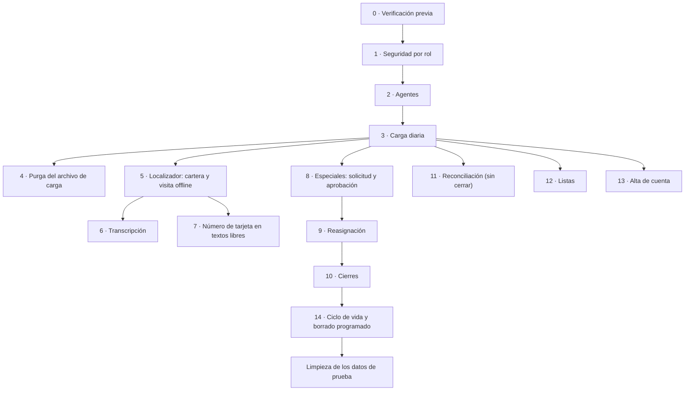

# Pruebas

Este documento es la guía de **pruebas manuales** de Cobranza Móvil (CM): qué probar después de instalar o actualizar la solución en un ambiente, con qué perfil, qué pasos seguir en cada app y dónde mirar el resultado. Todo se hace por interfaz gráfica: la app del localizador en el teléfono, la app de la oficina en el navegador, [make.powerapps.com](https://make.powerapps.com), el centro de administración de Power Platform y las pantallas de Smelter (herramienta de importación de terceros que corre dentro del ambiente). No hace falta instalar herramientas, escribir código ni registrar aplicaciones en Entra ID.

Está pensado para quien recibe la solución en otro tenant y tiene que confirmar que funciona de punta a punta antes de entregarla a la operación, y para quien repite un subconjunto de casos después de un cambio.

> ⚠️ Las pruebas crean, modifican y cierran datos. Se hacen **en un ambiente de prueba**, nunca en el ambiente de producción. La única excepción razonable es la [verificación previa](#0-verificación-previa-pre), que solo mira configuración.

## Cómo funciona

### Orden de las pruebas

Los casos están agrupados por área y numerados (`CAR-03`, `LOC-07`…). Varias áreas usan los datos que deja la anterior, así que conviene seguir este orden la primera vez:



Después de un cambio puntual alcanza con repetir el área afectada y la de seguridad. La tabla [Qué repetir después de un cambio](#qué-repetir-después-de-un-cambio) lo resume.

### Perfiles de prueba

Hace falta **una persona por perfil**, cada una con licencia de Power Apps y con la app que le corresponde compartida. Los nombres de abajo son los que usa este documento; en el ambiente se crean usuarios propios (por ejemplo, cuentas de prueba del tenant).

| Perfil | Rol de seguridad de CM | App | Notas |
|---|---|---|---|
| **P-ADM** | `SR \| CM \| Admin` | Oficina | Además, el rol de Smelter que habilita correr importaciones, normalmente heredado del equipo de carga (ver [Carga diaria](07-carga-diaria.md#plantillas-de-smelter)) |
| **P-SUP** | `SR \| CM \| Supervisor` | Oficina | |
| **P-SOL** | `SR \| CM \| Solicitante` | Oficina | |
| **P-BO** | `SR \| CM \| BackOffice` | Oficina | |
| **P-LOC1** | `SR \| CM \| Localizador` | Localizador (teléfono) | Vinculado al agente «Agente Prueba Uno» en el área [Agentes](#2-agentes-age) |
| **P-LOC2** | `SR \| CM \| Localizador` | Localizador (teléfono) | Vinculado al agente «Agente Prueba Dos». Hace falta para probar aislamiento y reasignación |
| **P-MULTI** | `SR \| CM \| BackOffice` y `SR \| CM \| Admin` | Oficina | Para el caso de dos roles a la vez. Nunca combinar Localizador con BackOffice (ver [Seguridad](03-seguridad.md#qué-no-hacer)) |
| **P-SINROL** | Ninguno de CM | Oficina | Con licencia y la app compartida, pero sin rol de CM ni equipo de CM |
| **Verificador** | *System Administrator* del ambiente | Ninguna | Solo para mirar tablas en make.powerapps.com y el centro de administración. **Nunca** se usa para probar las apps: un administrador del sistema ve todo y no prueba ninguna restricción |

Los roles se asignan en el centro de administración de Power Platform: **Entornos** → el ambiente → **Configuración** → **Usuarios y permisos** → **Usuarios** → el usuario → **Administrar roles de seguridad**. Para los casos de rol por equipo se usa **Equipos** en la misma sección (ver [SEG-05](#1-seguridad-por-rol-seg) y [SEG-06](#1-seguridad-por-rol-seg)).

Los localizadores necesitan la app **Power Apps** para teléfono, iniciar sesión con su usuario y abrir la app del localizador al menos una vez con señal antes de las pruebas *offline* (la primera apertura baja la base local).

### Datos de prueba: el archivo de carga sintético

Las pruebas parten de un archivo de carga **sintético**, armado a mano. Nunca se usan datos reales del banco.

**Opción A (recomendada): un archivo chico a medida.** Cinco filas alcanzan para recorrer todos los flujos. El formato es el del archivo del banco ([Carga diaria](07-carga-diaria.md#formato-del-archivo-del-banco)): UTF-8, coma como separador, encabezado en la primera fila con las 33 columnas en el orden de abajo, fechas `aaaa-mm-dd` y decimales con punto.

Archivo `prueba-ayer.csv` (una sola fila; sirve para el caso de Reconciliación). Reemplazar `<ayer>` por la fecha de ayer:

```csv
Cliente,CIF,DireccionCasa,DireccionEC,DireccionTrabajo,Departamento,NumeroCelular,NumeroCasa,NumeroCuenta,SaldoVencidoNIO,SaldoVencidoUSD,TotalSaldoVencido,ContagiadoUSD,PagoMinimoNIO,PagoMinimoUSD,DiasMora,NivelMora,FechaUltimoPago,FechaPago,Ciclo,CodigoProducto,TipoProducto,NombreFianza,DireccionFianza,RetiroNIO,RetiroUSD,TipoEspecial,Nota,Distrito,Trabajo,TipoAsignacion,Agente,FechaCarga
Cliente Prueba Tres,999-030303-0003C,Casa prueba 3,EC prueba 3,Trabajo prueba 3,Departamento A,80000003,20000003,9999000000000053,800.00,0.00,800.00,0.00,160.00,0.00,20,1,2026-01-10,2026-01-15,15,PRB01,Tarjeta Prueba,,,0.00,0.00,,,Distrito 1,Empresa Prueba,Diaria,Agente Prueba Uno,<ayer>
```

Archivo `prueba-hoy.csv` (cuatro filas). Reemplazar `<hoy>` por la fecha de hoy:

```csv
Cliente,CIF,DireccionCasa,DireccionEC,DireccionTrabajo,Departamento,NumeroCelular,NumeroCasa,NumeroCuenta,SaldoVencidoNIO,SaldoVencidoUSD,TotalSaldoVencido,ContagiadoUSD,PagoMinimoNIO,PagoMinimoUSD,DiasMora,NivelMora,FechaUltimoPago,FechaPago,Ciclo,CodigoProducto,TipoProducto,NombreFianza,DireccionFianza,RetiroNIO,RetiroUSD,TipoEspecial,Nota,Distrito,Trabajo,TipoAsignacion,Agente,FechaCarga
Cliente Prueba Uno,999-010101-0001A,Casa prueba 1,EC prueba 1,Trabajo prueba 1,Departamento A,80000001,20000001,9999000000000012,1500.00,0.00,1500.00,0.00,300.00,0.00,35,2,2026-01-10,2026-01-15,15,PRB01,Tarjeta Prueba,Fiador Prueba,Dirección fiador prueba,0.00,0.00,,,Distrito 1,Empresa Prueba,Diaria,Agente Prueba Uno,<hoy>
Cliente Prueba Uno,999-010101-0001A,Casa prueba 1,EC prueba 1,Trabajo prueba 1,Departamento A,80000001,20000001,9999000000000020,0.00,250.00,250.00,0.00,0.00,50.00,190,6,2025-07-01,2026-01-15,15,PRB01,Tarjeta Prueba,,,0.00,0.00,,,Distrito 1,Empresa Prueba,Incobrable,Agente Prueba Uno,<hoy>
Cliente Prueba Uno,999-010101-0001A,Casa prueba 1,EC prueba 1,Trabajo prueba 1,Departamento A,80000001,20000001,9999000000000038,4500.00,0.00,4500.00,0.00,900.00,0.00,60,3,2025-12-01,2026-01-15,15,PRB01,Tarjeta Prueba,,,450.00,0.00,VIP,Nota de prueba,Distrito 1,Empresa Prueba,Especial,Agente Prueba Uno,<hoy>
Cliente Prueba Dos,999-020202-0002B,Casa prueba 2,EC prueba 2,Trabajo prueba 2,Departamento B,80000002,20000002,9999000000000046,900.00,0.00,900.00,0.00,180.00,0.00,15,1,2026-01-05,2026-01-15,15,PRB01,Tarjeta Prueba,,,0.00,0.00,,,Distrito 2,Empresa Prueba,Diaria,Agente Prueba Dos,<hoy>
```

Qué deja cada fila y para qué se usa:

| Cuenta (últimos 4) | Cliente | Tipo | Agente | Se usa en |
|---|---|---|---|---|
| `0053` | Prueba Tres | Diaria, cargada **ayer** | Uno | Reconciliación: no viene en la carga de hoy, así que queda «fuera de cartera» |
| `0012` | Prueba Uno | Diaria | Uno | Visita, pago, transcripción, nueva solicitud de Especial, reasignación |
| `0020` | Prueba Uno | Incobrable | Uno | Reasignación con captura *offline*, cierre de Incobrable |
| `0038` | Prueba Uno | Especial (del archivo) | Uno | Aprobación, cierre de Especial, revocación de acceso |
| `0046` | Prueba Dos | Diaria | Dos | Aislamiento entre localizadores, recibo repetido, rechazo de Especial |

Reglas para armar un archivo propio:

- **Números de tarjeta ficticios que pasen el dígito verificador Luhn** (el control de los números de tarjeta). Los de arriba empiezan con `9999`, un prefijo que no emite ningún banco, y son válidos para Luhn. Para el alta de cuenta se usa `9999000000000061` (válido) y `9999000000000062` (inválido a propósito). Nunca usar un número real.
- **`FechaCarga` tiene que ser la fecha de hoy** en la zona horaria del negocio. Con otra fecha, Monitoreo y Reconciliación dicen que no llegó la carga de hoy.
- **`Agente`** es el nombre exacto del agente. Si no existe, la carga lo crea sin usuario vinculado (sus asignaciones quedan en el equipo «Cartera sin cobrador» hasta que se vincule).
- Los CIF y nombres son inventados. `NombreFianza` vacío deja la cuenta sin fiador (es un caso válido).
- ⚠️ **Editar el CSV con un editor de texto, no con Excel.** Excel convierte los números largos a notación científica (`9,999E+15`), cambia las fechas al formato regional y puede guardar con otra codificación o separador. Cualquiera de esas cosas rompe la carga o, peor, carga números de cuenta mal.

**Opción B: los archivos de ejemplo del repositorio.** [`cobranza-mock-1000.csv`](../../test-data/cobranza-mock-1000.csv) y [`cobranza-mock-1000-dia2.csv`](../../test-data/cobranza-mock-1000-dia2.csv) traen 1.000 cuentas sintéticas cada uno (día 1 y día 2), con 18 agentes, Diarias, Incobrables y Especiales. Sirven para una prueba de **volumen** y de idempotencia, no para los flujos de este documento: sus agentes no están vinculados a los perfiles de prueba y su `FechaCarga` es fija, así que para que cuenten como carga de hoy hay que reemplazar esa columna en todas las filas (con un editor de texto, por la misma razón de arriba). Qué ejercita cada uno está en [`test-data/README.md`](../../test-data/README.md).

### Dónde se mira el resultado

| Lugar | Cómo se llega | Para qué |
|---|---|---|
| La app misma | Teléfono (localizador) o navegador (oficina) | Lo que ve cada perfil: menú, colas, avisos, indicadores |
| Filas de una tabla | make.powerapps.com → el ambiente → **Tablas** → buscar la tabla (por ejemplo «CM \| TBL \| Asignacion») → abrirla y ver sus filas. Agregar columnas a la vista con **Editar columnas** si hace falta (Propietario, Estado de aprobación, Motivo…) | Confirmar lo que se escribió en Dataverse. Siempre con el perfil **Verificador** |
| Trabajos del sistema | Centro de administración de Power Platform → **Entornos** → el ambiente → **Configuración** → **Auditoría y registros** → **Trabajos del sistema** (*System jobs*) | Ver si un *plugin* asíncrono (código del servidor que corre en segundo plano, como el reparto o la purga) terminó bien o falló, y su mensaje de error |
| Eliminación masiva | Centro de administración → el ambiente → **Configuración** → **Administración de datos** → **Eliminación masiva** (*Bulk deletion*) | Los siete trabajos de borrado programado: estado, última corrida, fallos |
| Roles y equipos | Centro de administración → el ambiente → **Configuración** → **Usuarios y permisos** → **Roles de seguridad** / **Equipos** | Privilegios de cada rol, miembros y roles de cada equipo |
| Pasos de *plugin* | make.powerapps.com → **Soluciones** → la *solution* de CM → **Pasos de complemento SDK** (*SDK message processing steps*) | Que cada paso exista, esté activo y tenga el modo (síncrono o asíncrono) esperado |
| Smelter | La app de Smelter del ambiente, o la tabla de trabajos de importación («TBL \| SMLT \| Import Job», `sanic_tbl_smlt_importjob`) en make.powerapps.com | Estado, contadores, registros por fila y archivo de cada trabajo de importación |

### Cómo se registra el resultado

Conviene copiar las tablas de casos a una planilla y anotar, por cada caso: fecha, perfil usado, «OK» o «Falla», y una observación (mensaje exacto, captura de pantalla sin números de tarjeta completos). Un caso que falla se repite una vez antes de reportarlo: el reparto y la sincronización son asíncronos y pueden tardar.

## Piezas y archivos

Lo que cada área ejercita, para ir al código cuando un caso falla:

| Área | Pantallas | Lógica del servidor |
|---|---|---|
| Seguridad por rol | [`scrCarga.pa.yaml`](../../apps/backoffice-canvas/Src/scrCarga.pa.yaml) (rol), [`cmpNavLateral.pa.yaml`](../../apps/backoffice-canvas/Src/Components/cmpNavLateral.pa.yaml) (menú), [`scrCarga.pa.yaml`](../../apps/backoffice-canvas/Src/scrCarga.pa.yaml), [`scrInicio.pa.yaml`](../../apps/backoffice-canvas/Src/scrInicio.pa.yaml) | [`MisRoles.cs`](../../plugins/Sanic.CobranzaMovil.Plugins/MisRoles.cs), [`RolesCm.cs`](../../plugins/Sanic.CobranzaMovil.Plugins/RolesCm.cs), [`RepartoAsignacion.cs`](../../plugins/Sanic.CobranzaMovil.Plugins/RepartoAsignacion.cs) |
| Agentes | [`scrAgentes.pa.yaml`](../../apps/backoffice-canvas/Src/scrAgentes.pa.yaml) | [`EmailDesdeUsuario.cs`](../../plugins/Sanic.CobranzaMovil.Plugins/EmailDesdeUsuario.cs), [`RepartoPorAgente.cs`](../../plugins/Sanic.CobranzaMovil.Plugins/RepartoPorAgente.cs), [`CarteraSinCobrador.cs`](../../plugins/Sanic.CobranzaMovil.Plugins/CarteraSinCobrador.cs) |
| Carga diaria | [`scrCargaArchivo.pa.yaml`](../../apps/backoffice-canvas/Src/scrCargaArchivo.pa.yaml), [`scrMonitoreo.pa.yaml`](../../apps/backoffice-canvas/Src/scrMonitoreo.pa.yaml) | [`PartirCarga.cs`](../../plugins/Sanic.CobranzaMovil.Plugins/PartirCarga.cs), [`ArchivoCsv.cs`](../../plugins/Sanic.CobranzaMovil.Plugins/ArchivoCsv.cs), [`AprobacionEspecial.cs`](../../plugins/Sanic.CobranzaMovil.Plugins/AprobacionEspecial.cs), [`Reclasificacion.cs`](../../plugins/Sanic.CobranzaMovil.Plugins/Reclasificacion.cs), [`PanGuard.cs`](../../plugins/Sanic.CobranzaMovil.Plugins/PanGuard.cs) |
| Purga del archivo | Mis últimas cargas en [`scrCargaArchivo.pa.yaml`](../../apps/backoffice-canvas/Src/scrCargaArchivo.pa.yaml) | [`PurgaArchivoCarga.cs`](../../plugins/Sanic.CobranzaMovil.Plugins/PurgaArchivoCarga.cs) |
| Localizador | [`scrInicio`](../../apps/localizador-canvas/Src/scrInicio.pa.yaml), [`scrCartera`](../../apps/localizador-canvas/Src/scrCartera.pa.yaml), [`scrCliente`](../../apps/localizador-canvas/Src/scrCliente.pa.yaml), [`scrDetalleCuenta`](../../apps/localizador-canvas/Src/scrDetalleCuenta.pa.yaml), [`scrInteraccion`](../../apps/localizador-canvas/Src/scrInteraccion.pa.yaml), [`scrPagos`](../../apps/localizador-canvas/Src/scrPagos.pa.yaml), [`scrSincronizacion`](../../apps/localizador-canvas/Src/scrSincronizacion.pa.yaml) | [`InteraccionDelCobrador.cs`](../../plugins/Sanic.CobranzaMovil.Plugins/InteraccionDelCobrador.cs), [`IdentidadEnInteraccion.cs`](../../plugins/Sanic.CobranzaMovil.Plugins/IdentidadEnInteraccion.cs), [`CuentaDesdeInteraccion.cs`](../../plugins/Sanic.CobranzaMovil.Plugins/CuentaDesdeInteraccion.cs), [`ReciboRepetido.cs`](../../plugins/Sanic.CobranzaMovil.Plugins/ReciboRepetido.cs), [`ActualizacionConInteraccion.cs`](../../plugins/Sanic.CobranzaMovil.Plugins/ActualizacionConInteraccion.cs), [`VincularActualizacionPendiente.cs`](../../plugins/Sanic.CobranzaMovil.Plugins/VincularActualizacionPendiente.cs), [`ColumnasAsignacion.cs`](../../plugins/Sanic.CobranzaMovil.Plugins/ColumnasAsignacion.cs) |
| Transcripción | [`scrTranscripcion.pa.yaml`](../../apps/backoffice-canvas/Src/scrTranscripcion.pa.yaml), [`scrTranscritas.pa.yaml`](../../apps/backoffice-canvas/Src/scrTranscritas.pa.yaml) | [`GrabacionInteraccion.cs`](../../plugins/Sanic.CobranzaMovil.Plugins/GrabacionInteraccion.cs) |
| Número de tarjeta en textos libres | [`scrInteraccion.pa.yaml`](../../apps/localizador-canvas/Src/scrInteraccion.pa.yaml) (aviso) | [`PanEnTextoLibre.cs`](../../plugins/Sanic.CobranzaMovil.Plugins/PanEnTextoLibre.cs), [`PanDetector.cs`](../../plugins/Sanic.CobranzaMovil.Plugins/PanDetector.cs) |
| Especiales | [`scrNuevaSolicitud`](../../apps/backoffice-canvas/Src/scrNuevaSolicitud.pa.yaml), [`scrMisSolicitudes`](../../apps/backoffice-canvas/Src/scrMisSolicitudes.pa.yaml), [`scrAprobaciones`](../../apps/backoffice-canvas/Src/scrAprobaciones.pa.yaml), [`scrHistorialEspeciales`](../../apps/backoffice-canvas/Src/scrHistorialEspeciales.pa.yaml) | [`SolicitarEspecial.cs`](../../plugins/Sanic.CobranzaMovil.Plugins/SolicitarEspecial.cs), [`AprobacionEspecial.cs`](../../plugins/Sanic.CobranzaMovil.Plugins/AprobacionEspecial.cs), [`SolicitadoPor.cs`](../../plugins/Sanic.CobranzaMovil.Plugins/SolicitadoPor.cs) |
| Reasignación | [`scrReasignar.pa.yaml`](../../apps/backoffice-canvas/Src/scrReasignar.pa.yaml), [`scrCarteraLocalizador.pa.yaml`](../../apps/backoffice-canvas/Src/scrCarteraLocalizador.pa.yaml) | [`ColumnasAsignacion.cs`](../../plugins/Sanic.CobranzaMovil.Plugins/ColumnasAsignacion.cs), [`RepartoAsignacion.cs`](../../plugins/Sanic.CobranzaMovil.Plugins/RepartoAsignacion.cs), [`InteraccionDelCobrador.cs`](../../plugins/Sanic.CobranzaMovil.Plugins/InteraccionDelCobrador.cs) |
| Cierres | [`scrCierres.pa.yaml`](../../apps/backoffice-canvas/Src/scrCierres.pa.yaml) | [`RepartoAsignacion.cs`](../../plugins/Sanic.CobranzaMovil.Plugins/RepartoAsignacion.cs) |
| Reconciliación | [`scrReconciliacion.pa.yaml`](../../apps/backoffice-canvas/Src/scrReconciliacion.pa.yaml) | [`CerrarFueraDeCartera.cs`](../../plugins/Sanic.CobranzaMovil.Plugins/CerrarFueraDeCartera.cs), [`CargaSobreAsignacion.cs`](../../plugins/Sanic.CobranzaMovil.Plugins/CargaSobreAsignacion.cs) |
| Listas | [`scrListas.pa.yaml`](../../apps/backoffice-canvas/Src/scrListas.pa.yaml) | — |
| Alta de cuenta | [`scrAltaCuenta.pa.yaml`](../../apps/backoffice-canvas/Src/scrAltaCuenta.pa.yaml) | [`AltaCuenta.cs`](../../plugins/Sanic.CobranzaMovil.Plugins/AltaCuenta.cs), [`FilaDeCarga.cs`](../../plugins/Sanic.CobranzaMovil.Plugins/FilaDeCarga.cs) |
| Ciclo de vida | [`scrTranscripcion.pa.yaml`](../../apps/backoffice-canvas/Src/scrTranscripcion.pa.yaml), [`scrPagos.pa.yaml`](../../apps/localizador-canvas/Src/scrPagos.pa.yaml) (cuenta borrada) | Trabajos de *bulk delete* (ver [Ciclo de vida](08-ciclo-de-vida.md)), [`IdentidadEnInteraccion.cs`](../../plugins/Sanic.CobranzaMovil.Plugins/IdentidadEnInteraccion.cs) |

## Casos de prueba

Convenciones de las tablas: «make» es make.powerapps.com con el perfil Verificador; «(min)» indica que el resultado depende de un *plugin* asíncrono y puede tardar unos minutos; «sincronizar» en el teléfono es abrir la app con señal y esperar a que el indicador de sincronización quede en verde, o tocar el indicador → **Actualizar todo desde el servidor** cuando el caso pide una sincronización completa.

### 0. Verificación previa (PRE)

Configuración que tiene que estar antes de probar flujos. La mira el Verificador.

| Caso | Rol | Pasos | Resultado esperado |
|---|---|---|---|
| PRE-01 Roles | Verificador | Centro de administración → **Roles de seguridad**, filtrar por `SR \| CM` | Existen los siete roles de [Seguridad](03-seguridad.md#roles). Abrir cada uno y comparar sus privilegios con la [matriz de privilegios](03-seguridad.md#matriz-de-privilegios-por-tabla): por ejemplo, Localizador con lectura de nivel usuario (Basic) en Cuenta y sin Write en Interacción; ningún rol, salvo BackOffice y Localizador, con lectura en «CM \| TBL \| PAN de cuenta» |
| PRE-02 Herencia del rol Localizador | Verificador | Abrir el rol `SR \| CM \| Localizador` → propiedades del rol | **Member's privilege inheritance** en *Direct User (Basic) access level and Team privileges*. Con *Team privileges only*, un localizador que recibe el rol por equipo ve la cartera vacía |
| PRE-03 Equipo «Cartera sin cobrador» | Verificador | **Equipos** → buscar «Cartera sin cobrador» | Existe **uno solo**, sin miembros, con el rol `SR \| CM \| Cartera sin cobrador` |
| PRE-04 Pasos de *plugin* | Verificador | make → Soluciones → la *solution* de CM → pasos de complemento | Todos activos. `RepartoAsignacion`, `RepartoPorAgente` y `PurgaArchivoCarga` en modo **asíncrono**; los seis pasos de `PanGuard` activos |
| PRE-05 Plantillas de Smelter | Verificador | Smelter → plantillas de importación | Existen «Cobranza movil», «Cobranza movil · padres» y «Cobranza movil · partes», activas, con esos nombres exactos y una sola de cada una |
| PRE-06 Borrado programado | Verificador | Centro de administración → **Eliminación masiva** | Los siete trabajos `CM - …` de [Ciclo de vida](08-ciclo-de-vida.md#los-siete-trabajos-de-borrado) existen, recurrentes diarios, en espera. Se revisan en detalle en [CIC](#14-ciclo-de-vida-y-borrado-programado-cic) |
| PRE-07 Versión publicada | P-ADM, P-LOC1 | Abrir la app de la oficina (pie del menú, «Versión») y la del localizador con conexión (indicador de sincronización → «Versión de la app») | Las dos muestran el **Version** de la *solution* `cm_core_cobranzamovil` recién importada (make.powerapps.com → **Solutions**); sale de la propiedad `Version` de `sanic_cm_MisRoles`, no de la app. Si muestran otra, el reproductor sigue sirviendo la anterior o el teléfono no se conectó desde la importación: esperar unos minutos, reabrir con conexión y repetir. «—» indica que nunca pudo obtenerla del servidor: falla del caso |

### 1. Seguridad por rol (SEG)

La app de la oficina decide el menú con los **roles de seguridad efectivos** de la persona: los asignados directamente y los que hereda de un equipo, incluido un equipo vinculado a un grupo de Entra ID. Lo que protege los datos son los privilegios de cada rol y los *plugins*; el menú solo decide qué se ve ([App de la oficina](06-app-backoffice.md#menú-por-rol)).

| Caso | Rol | Pasos | Resultado esperado |
|---|---|---|---|
| SEG-01 Admin, rol directo | P-ADM | Abrir la app de la oficina | «Cargando…» y después Inicio. Menú: Inicio, Reasignar, Monitoreo de carga, Cargar archivo, Alta de cuenta, Reconciliación, Cierres, Agentes y usuarios, Datos maestros, Listas. Indicadores: carga de hoy, Diarias fuera de cartera, agentes activos sin usuario |
| SEG-02 BackOffice | P-BO | Abrir la app | Menú: Inicio, Por transcribir, Transcritas. Indicadores: en cola, con pago, transcritas hoy |
| SEG-03 Solicitante | P-SOL | Abrir la app | Menú: Inicio, Nueva solicitud, Mis solicitudes. Indicadores de sus Especiales (pendientes, aprobadas, rechazadas), sin cobrado de hoy (el rol no lee pagos) y sin errores en pantalla |
| SEG-04 Supervisor | P-SUP | Abrir la app | Menú: Inicio, Aprobaciones, Reasignar, Cartera por localizador, Historial de Especiales. Indicador de Especiales pendientes de aprobación |
| SEG-05 Rol por equipo | Verificador, después P-SUP | Quitarle a P-SUP el rol directo. Crear un equipo de tipo **propietario** (*owner team*) con cualquier nombre, asignarle el rol `SR \| CM \| Supervisor` y agregar a P-SUP como miembro. P-SUP cierra y vuelve a abrir la app | El mismo menú que SEG-04 |
| SEG-06 Rol por equipo de grupo de Entra ID | Verificador, después P-BO | Quitarle a P-BO el rol directo. Crear un equipo de Dataverse de tipo **grupo de seguridad de Microsoft Entra ID** vinculado a un grupo de prueba, asignarle `SR \| CM \| BackOffice` y agregar a P-BO al grupo (centro de administración de Entra ID). P-BO cierra sesión, vuelve a entrar y abre la app | El mismo menú que SEG-02. Si no aparece, ver la trampa de [primer ingreso](#trampas-y-errores-conocidos) |
| SEG-07 Dos roles a la vez | P-MULTI | Abrir la app (BackOffice directo y Admin directo, o uno directo y otro por equipo) | El menú une los dos perfiles: las opciones de BackOffice y las de Admin, sin repetir Inicio. En Por transcribir ve el número de tarjeta completo (lo habilita el rol BackOffice) |
| SEG-08 Sin rol de CM | P-SINROL | Abrir la app | Después de unos segundos de «Cargando…», Inicio muestra «Sin acceso» («Tu usuario no tiene un rol de Cobranza Móvil…») y el menú no ofrece ninguna pantalla |
| SEG-09 Quitar el rol | Verificador, después P-SOL | Quitarle a P-SOL su rol (o sacarlo del equipo). P-SOL cierra y vuelve a abrir la app | «Sin acceso». Devolverle el rol al terminar |
| SEG-10 Localizador con rol heredado | Verificador, después P-LOC2 | Darle el rol Localizador a P-LOC2 solo por un equipo (propietario o de Entra ID). P-LOC2 abre la app con señal después de [CAR-06](#3-carga-diaria-car) | Ve su cartera (cuenta `0046`). Cartera vacía con asignaciones que sí son suyas en make → revisar PRE-02 |
| SEG-11 Cada localizador ve solo lo suyo | P-LOC1, P-LOC2 | Después de [CAR-06](#3-carga-diaria-car) y de sincronizar, buscar en la Cartera los últimos 4 de la cartera del otro | P-LOC1 ve Prueba Uno y Prueba Tres, nunca Prueba Dos; P-LOC2 ve solo Prueba Dos. En make, la asignación `0046` tiene de propietario a P-LOC2 |
| SEG-12 La Especial sin aprobar no baja al teléfono | P-LOC1 | Después de [CAR-06](#3-carga-diaria-car), Cartera → filtro Especial | La Especial `0038`, todavía Pendiente, no aparece |
| SEG-13 Número de tarjeta completo solo para BackOffice | P-ADM, P-SUP, P-SOL, P-BO | Recorrer las pantallas de cada perfil que muestran cuentas | Todas muestran `•••• 1234`. Solo P-BO (y P-MULTI) ve el número completo, y solo en Por transcribir y en el detalle de Transcritas |
| SEG-14 Lectura auditada del número completo | Verificador | Con la auditoría del ambiente encendida, después de que P-BO vea un número en Por transcribir: centro de administración → **Auditoría y registros** → resumen de auditoría, filtrar por la tabla «CM \| TBL \| PAN de cuenta» | Queda registrada la lectura de P-BO. ⚠️ A confirmar en el ambiente: requiere la auditoría encendida a nivel ambiente y de tabla ([Seguridad](03-seguridad.md#auditoría)) |

### 2. Agentes (AGE)

Se hacen antes de la carga para que los agentes del archivo ya tengan usuario. Si se hacen después, valen igual: el reparto mueve las asignaciones al vincular.

| Caso | Rol | Pasos | Resultado esperado |
|---|---|---|---|
| AGE-01 Crear agente | P-ADM | Agentes y usuarios → «＋ Nuevo agente» → escribir «Agente Prueba Uno» → «Crear agente». Repetir con «Agente Prueba Dos» | «✓ Agente … creado». El botón «Crear agente» está deshabilitado con el nombre vacío. Repetir el mismo nombre avisa «Ya existe un agente llamado…» y no crea otro |
| AGE-02 Vincular usuario | P-ADM | En la fila de «Agente Prueba Uno» → «Vincular» → buscar a P-LOC1 → «Vincular a …». Lo mismo con «Agente Prueba Dos» y P-LOC2 | «✓ … vinculado a <correo>». La fila muestra el correo en minúsculas (lo completa el servidor). Un usuario sin correo principal se rechaza con aviso |
| AGE-03 Solo mirar no escribe | P-ADM | Abrir Agentes y usuarios, recorrer la lista y salir sin tocar botones | En make, ningún agente cambió (fecha de modificación igual) |
| AGE-04 Desvincular | P-ADM, P-LOC2 | Después de [CAR-06](#3-carga-diaria-car): «Desvincular» en «Agente Prueba Dos». Revisar en make el propietario de la asignación `0046`. P-LOC2 sincroniza por completo | «Vínculo quitado — …». (min) La asignación pasa al equipo «Cartera sin cobrador». En Inicio del Admin, «agentes activos sin usuario» sube en 1. Después de la sincronización completa, P-LOC2 ya no ve la cuenta. Volver a vincular al terminar: (min) la asignación vuelve a P-LOC2 |
| AGE-05 Desactivar | P-ADM, P-LOC1 | «Desactivar» en «Agente Prueba Uno». P-LOC1 sincroniza y abre Inicio; intenta registrar una visita | Inicio muestra «⛔ Tu localizador está desactivado.» y Guardar avisa que no puede registrar visitas. «Activar» al terminar y verificar que vuelve a dejar registrar |
| AGE-06 Usuario sin rol Localizador | P-ADM, Verificador | Crear un agente de prueba, darle una asignación (por ejemplo, reasignarle una Especial aprobada) y vincularle a P-SINROL | (min) El reparto falla: en **Trabajos del sistema** aparece un error de `RepartoAsignacion` porque Dataverse no deja hacer dueño a un usuario sin lectura sobre la tabla. Desvincular y desactivar ese agente al terminar |

### 3. Carga diaria (CAR)

Todo lo hace P-ADM en **Cargar archivo**. Detalle del proceso en [Carga diaria](07-carga-diaria.md).

| Caso | Rol | Pasos | Resultado esperado |
|---|---|---|---|
| CAR-01 Sin equipo de carga | P-ADM sin el rol de Smelter | Quitar temporalmente a P-ADM del equipo de carga (o del rol de Smelter) y abrir Cargar archivo | Mensaje de que no se ve la plantilla «Cobranza movil» y botones deshabilitados. Devolverlo al equipo al terminar |
| CAR-02 Archivo que no es CSV | P-ADM | Adjuntar un `.txt` o `.xlsx` | «Validar (prueba en seco)» y «Cargar» deshabilitados |
| CAR-03 Prueba en seco | P-ADM | Adjuntar `prueba-ayer.csv` → «Validar (prueba en seco)» | El botón se deshabilita mientras corre. Termina en «Terminada» con 0 fallos y el aviso «✓ Prueba en seco limpia…». «Cargar» queda habilitado. En Monitoreo y en make no aparece ningún cliente ni cuenta nuevos |
| CAR-04 Carga real (archivo de ayer) | P-ADM | «Cargar» → «Sí, cargar ahora». Esperar sin cerrar la app | Termina en «Terminada» con 0 fallos y aparece «📡 Ir a Monitoreo de carga». En Mis últimas cargas figuran la prueba en seco y la carga (con sus trabajos de padres y partes si el archivo se partió) |
| CAR-05 Carga de hoy | P-ADM | Repetir CAR-03 y CAR-04 con `prueba-hoy.csv` | Igual que CAR-04. Monitoreo de carga: tarjeta verde de carga de hoy, «filas de carga hoy» = 4 más las que ya hubiera de hoy, cuentas y clientes totales sumados |
| CAR-06 Qué quedó en las tablas | Verificador | make: tablas Cliente, Cuenta, Asignacion, Carga diaria, Direccion, Telefono, Producto, Fiador, PAN de cuenta | Clientes Prueba Uno, Dos y Tres. Cada cuenta con número `****0012` (nunca el número completo) y sus últimos 4. Una fila por cuenta en «PAN de cuenta» (el único lugar con el número completo). Asignaciones: Diarias e Incobrable en estado de aprobación **Borrador**, la Especial `0038` **Pendiente** con tipo «VIP», nota y retiro 450. Tres direcciones y dos teléfonos por cliente. Un producto `PRB01`. La cuenta `0012` con fiador «Fiador Prueba»; las demás sin fiador |
| CAR-07 Reparto al localizador | Verificador | make → Asignacion, columna Propietario. Si no cambió, **Trabajos del sistema** → `RepartoAsignacion` | (min) Las asignaciones de «Agente Prueba Uno» (salvo la Especial pendiente) tienen de propietario a P-LOC1; la de «Agente Prueba Dos», a P-LOC2. La Especial `0038` conserva el propietario de la carga. Ningún trabajo del sistema de reparto en error |
| CAR-08 Volver a cargar el mismo archivo | P-ADM | Validar y cargar otra vez `prueba-hoy.csv` | Termina bien. En make no hay clientes, cuentas, asignaciones ni filas de carga diaria duplicadas: los conteos y los ids son los mismos |
| CAR-09 Valor más largo que su columna | P-ADM | Copiar `prueba-hoy.csv`, poner en `Cliente` de una fila un texto más largo que el máximo de la columna Nombre del cliente (el máximo se ve en make → tabla Cliente → columna) y validar | La validación falla citando fila, columna y largos (nunca el valor). El trabajo queda «Falló» y no se pone en cola |
| CAR-10 Fila con columnas de más | P-ADM | Copiar el archivo y agregar `,"texto` (una comilla sin cerrar) en medio de una fila; validar | Rechazo por estructura del CSV (comillas sin cerrar o más columnas que el encabezado). No se carga nada |
| CAR-11 Archivo de más de 50 MB | P-ADM | Adjuntar un CSV mayor a 50 MB (por ejemplo, el ejemplo de 1.000 filas repetido muchas veces) | La pantalla no lo acepta |
| CAR-12 Partes sin lanzar | P-ADM | Con un archivo de más de 300 filas (por ejemplo el de [`test-data/`](../../test-data/README.md) con la fecha cambiada), cargar y cerrar la app apenas terminan los padres. Volver a abrir Cargar archivo | En Mis últimas cargas aparece «▶ Relanzar partes (N)». Al tocarlo, las partes se ponen en cola y terminan. Alternativa: «✕ Descartar partes» las marca «Falló» y no carga nada más |
| CAR-13 Reclasificación (opcional, al final) | P-ADM, Verificador | Cargar una copia de `prueba-hoy.csv` donde la cuenta `0046` llega como `Incobrable` | En make, la Diaria `0046` queda cerrada con motivo «Reclasificada a Incobrable» y hay una Incobrable activa para esa cuenta. Volver a cargar el archivo original la reabre como Diaria y cierra la Incobrable |

### 4. Purga del archivo de carga (PUR)

El archivo de cada trabajo de importación trae los números completos. El *plugin* `PurgaArchivoCarga` lo borra cuando el trabajo termina ([Ciclo de vida](08-ciclo-de-vida.md#archivo-de-carga-de-smelter)).

| Caso | Rol | Pasos | Resultado esperado |
|---|---|---|---|
| PUR-01 Prueba en seco terminada | Verificador | Después de CAR-03, abrir ese trabajo en Smelter (o en la tabla «TBL \| SMLT \| Import Job») | (min) La columna del archivo de origen (*Source File*) está vacía. El trabajo sigue existiendo con su estado y sus contadores |
| PUR-02 Carga real terminada | Verificador | Después de CAR-05, abrir el trabajo de padres y cada parte | (min) Todos sin archivo |
| PUR-03 Carga descartada | P-ADM, Verificador | Después de CAR-12 con «✕ Descartar partes», o de un «✕ Descartar carga», abrir esos trabajos | Estado «Falló» y (min) sin archivo |
| PUR-04 El *plugin* corrió bien | Verificador | **Trabajos del sistema**, filtrar por `PurgaArchivoCarga` | Una ejecución por cada cambio de estado de trabajo, todas terminadas sin error |
| PUR-05 Trabajo sin estado reciente | Verificador | Mientras una carga está a medias (partes sin lanzar, menos de 10 minutos), abrir esas partes | Conservan su archivo: todavía se pueden relanzar. Se purgan recién al terminar o al descartarse |

### 5. Localizador: cartera y visita *offline* (LOC)

Requiere CAR-05 y CAR-07. Todo en el teléfono de P-LOC1 salvo que se indique otra cosa.

| Caso | Rol | Pasos | Resultado esperado |
|---|---|---|---|
| LOC-01 Primer arranque | P-LOC1 | Con señal, abrir la app y esperar a que sincronice | Inicio con los indicadores del día en cero. Cartera: clientes Prueba Uno y Prueba Tres, aviso «✓ Carga diaria de hoy · dd/mm/aaaa» |
| LOC-02 Filtros y búsqueda | P-LOC1 | Cartera → filtros Todos, Diaria, Incobrable, Especial; buscar «0020» y «Prueba Uno» | Diaria: `0012` y `0053`. Incobrable: `0020`. Especial: vacío (la del archivo sigue pendiente). La búsqueda encuentra por últimos 4 y por nombre |
| LOC-03 Ficha del cliente | P-LOC1 | Tocar Prueba Uno | Pestaña Cuentas con teléfonos (llamada directa), direcciones (enlace a mapas) y las cuentas a cobrar; pestaña Interacciones vacía |
| LOC-04 Ver número | P-LOC1 | Detalle de la cuenta `0012` → «Ver número» | Muestra el número completo y a los 30 segundos vuelve a `•••• 0012` («Ocultar» lo oculta antes) |
| LOC-05 Orden manual | P-LOC1 | En la Cartera, mover Prueba Tres arriba con ▲, ir a Inicio y volver | El orden se conserva. Después de sincronizar, en make cambió la columna Orden de esas asignaciones |
| LOC-06 Visita sin señal | P-LOC1 | Activar el modo avión. Cuenta `0012` → «＋ Registrar interacción» → elegir un mensaje rápido y completar el comentario → Guardar (con el GPS apagado pide un segundo toque «Guardar sin ubicación») | «✓ Guardado en el teléfono. Se sube cuando vuelva la señal». Sincronización muestra la captura como pendiente de subir, sin número de interacción |
| LOC-07 Subida al volver la señal | P-LOC1, Verificador | Quitar el modo avión y esperar la sincronización | Sincronización muestra la captura como subida. En make, una interacción nueva con número `IN-…`, agente «Agente Prueba Uno», estado de grabación Pendiente, fecha de captura del teléfono, y últimos 4 y CIF copiados de la cuenta |
| LOC-08 Pago | P-LOC1, Verificador | Nueva interacción en `0012` → activar «El cliente pagó algo en esta visita» → monto 25, moneda C$, recibo «R-PRUEBA-1» → «Guardar interacción + pago» | En make (después de sincronizar), un pago con la cuenta y el número de interacción completados por el servidor, sin marca de recibo repetido. En Inicio, cobrado hoy C$ 25 y un pago; en Pagos del día aparece |
| LOC-09 Validaciones del pago | P-LOC1 | Intentar guardar un pago con monto 0, sin recibo o con el mismo recibo en dos líneas; después, un monto mayor que el saldo vencido | Botón deshabilitado con «Falta: …» en los tres primeros. Con monto mayor que el saldo, pide confirmar con un segundo toque |
| LOC-10 Recibo repetido en el teléfono | P-LOC1 | Otra visita en `0012` con recibo «R-PRUEBA-1» | La app lo bloquea porque lo encuentra entre sus pagos |
| LOC-11 Recibo repetido en otra cartera | P-LOC2, P-BO | P-LOC2 registra en `0046` un pago con recibo «R-PRUEBA-1» y sincroniza. P-BO abre esa interacción en Por transcribir | El pago entra igual (no se rechaza) y en Por transcribir muestra «⚠ REPETIDO». En make, el pago tiene la marca de recibo repetido |
| LOC-12 Actualización de datos sin señal | P-LOC1, P-BO | Modo avión. Visita en `0012` → «✏️ Actualizar datos del cliente» → nuevo teléfono celular y nueva dirección de casa → Guardar. Quitar el modo avión y sincronizar. P-BO abre la interacción | En Por transcribir se ve el «antes» y el «nuevo» de cada dato. No aparece el aviso de que los datos no llegaron. En make, la actualización de datos está vinculada a su interacción y sin la marca «sin vincular» |
| LOC-13 Validaciones de datos | P-LOC1 | Activar actualizar datos y escribir un teléfono con letras o un correo sin `@`; o no escribir ningún dato | Botón deshabilitado |
| LOC-14 Varios productos sin pago | P-LOC1 | Visita en Prueba Uno tildando dos productos (`0012` y `0020`), sin pago ni datos | El botón dice «Guardar en 2 productos». Después de sincronizar, en make hay una interacción por cuenta |
| LOC-15 Con pago, una sola cuenta | P-LOC1 | Con dos productos tildados, activar el pago | Aviso «🔒 Con pago o datos, solo aplica a esta cuenta.» |
| LOC-16 Recargar sin señal | P-LOC1 | Modo avión → Sincronización → «↻ Recargar la lista» | Rearma las pantallas con lo que hay en el teléfono, sin error y sin bajar nada |

### 6. Transcripción (TRX)

Requiere las interacciones de LOC. Todo con P-BO.

| Caso | Rol | Pasos | Resultado esperado |
|---|---|---|---|
| TRX-01 Indicadores | P-BO | Inicio | «En cola» y «con pago» coinciden con las interacciones pendientes de LOC (en make: interacciones con estado de grabación Pendiente) |
| TRX-02 Cola | P-BO | Por transcribir | Las interacciones pendientes, la más antigua primero. Filtro por localizador con la cantidad de pendientes de cada uno. La cola muestra la cuenta enmascarada |
| TRX-03 Detalle | P-BO | Tocar «Transcribir interacción de Cliente Prueba Uno» | Cliente, CIF, producto, localizador, comentario, ubicación, pagos con monto y recibo, y el número de tarjeta **completo**; tocarlo lo copia al portapapeles |
| TRX-04 Grabar sin código | P-BO | Con el código vacío | «✓ y siguiente» deshabilitado |
| TRX-05 Grabar | P-BO, Verificador | Escribir un código en minúsculas (por ejemplo `pag01`) → «✓ y siguiente» | «✓ IN-… grabada — siguiente: …». La interacción sale de la cola sin recargar. En make: estado Grabado, código en mayúsculas, fecha y usuario de grabación |
| TRX-06 Saltar | P-BO | «Saltar →» | Pasa a la siguiente sin grabar; la saltada sigue en la cola |
| TRX-07 Transcritas | P-BO | Transcritas, día de hoy | La interacción grabada con su código («Grabada · PAG01»), los pagos del día sumados en el indicador y, en el detalle, el número completo |
| TRX-08 Grabar dos veces | P-BO, P-MULTI | Abrir la misma interacción pendiente en dos sesiones (dos perfiles con rol BackOffice). Grabar en la primera y después en la segunda | La segunda recibe el error de que la interacción ya fue grabada por otra persona y no cambia nada |

### 7. Número de tarjeta en textos libres (PAN)

Requiere LOC. El servidor enmascara los números de tarjeta que llegan del teléfono y **nunca rechaza** ([Seguridad](03-seguridad.md#protección-del-número-de-tarjeta-pan)).

| Caso | Rol | Pasos | Resultado esperado |
|---|---|---|---|
| PAN-01 Comentario con un número válido | P-LOC1, P-BO | Visita en `0012` con el comentario «cliente dicta 9999 0000 0000 0012» → Guardar → sincronizar | En el teléfono, antes de guardar, aparece «⚠ No escribas números de tarjeta en el comentario…» y Guardar sigue habilitado. En Por transcribir y en make, el comentario dice «cliente dicta •••• 0012» |
| PAN-02 Número que no pasa Luhn | P-LOC1, Verificador | Comentario con «9999 0000 0000 0013» | La app muestra el mismo aviso (no valida Luhn). El servidor lo guarda tal cual: no es un número de tarjeta válido |
| PAN-03 Teléfonos y montos | P-LOC1, Verificador | Comentario «pagará C$ 1500 el 15, llamar al 8000 0001» | Sin aviso y sin cambios en el texto guardado |
| PAN-04 Dirección en la actualización de datos | P-LOC1, P-BO | Actualizar datos con dirección de casa «Casa 9999000000000038» | En Por transcribir y en make, la dirección nueva dice «Casa •••• 0038» |
| PAN-05 Notas de la oficina | P-SOL, P-ADM | Motivo de una nueva solicitud ([ESP-03](#8-especiales-solicitud-y-aprobación-esp)) o nota del alta de cuenta ([ALT-04](#13-alta-de-cuenta-alt)) con 13 o más dígitos seguidos | Rechazo con mensaje que no repite el número. En la oficina sí se rechaza porque la persona puede corregir en el momento |

### 8. Especiales: solicitud y aprobación (ESP)

Requiere CAR-05 y CAR-07.

| Caso | Rol | Pasos | Resultado esperado |
|---|---|---|---|
| ESP-01 Nueva solicitud | P-SOL, Verificador | Nueva solicitud → buscar «0012» → «Elegir cuenta •••• 0012 · …» → tipo de Especial, retiro C$ 350, motivo «Retiro urgente» → «✨ Enviar solicitud» | Aviso de solicitud enviada. En Mis solicitudes aparece Pendiente. Inicio: pendientes sube en 1. En make, una asignación Especial Pendiente, activa, sin agente, con «Solicitado por» = P-SOL |
| ESP-02 Solicitud duplicada | P-SOL | Repetir ESP-01 sobre la misma cuenta | Aviso «Ya existe una Especial ACTIVA…» con quién la pidió. En make sigue habiendo una sola |
| ESP-03 Motivo con número de tarjeta | P-SOL | Motivo con «9999000000000012» | Rechazo; no se crea nada |
| ESP-04 Segunda solicitud | P-SOL | Nueva solicitud sobre `0046` | Pendiente, como ESP-01 |
| ESP-05 Cola de aprobación | P-SUP | Inicio y Aprobaciones | «Por aprobar» incluye la Especial del archivo (`0038`) y las de ESP-01 y ESP-04 |
| ESP-06 Aprobar | P-SUP, Verificador, P-LOC1 | «Revisar solicitud de Cliente Prueba Uno» (la `0012`) → «✓ Aprobar y asignar» deshabilitado → «Asignar a Agente Prueba Uno» → «✓ Aprobar y asignar». Repetir con la `0038` | «✓ Aprobada — asignada a …». Salen de la cola. En make: estado Aprobado, agente y resolutor; (min) propietario P-LOC1. Después de sincronizar, P-LOC1 ve las dos Especiales en el filtro Especial y su tipo, retiro y nota en el detalle |
| ESP-07 Rechazar | P-SUP, Verificador | Abrir la de `0046` → «Rechazar» deshabilitado sin motivo → escribir motivo → «Rechazar» | «Solicitud rechazada». En make: estado Rechazada, motivo, resolutor, y la asignación **cerrada**. No llega a ningún teléfono |
| ESP-08 Seguimiento | P-SOL | Mis solicitudes | `0012` Aprobada con el localizador asignado; `0046` Rechazada con el motivo en el panel. Inicio: aprobadas y rechazadas coinciden |
| ESP-09 Pedir de nuevo una cerrada | P-SOL | Nueva solicitud sobre `0046` otra vez | Aviso de que se reactivó la Especial existente (no crea otra). Vuelve a la cola del Supervisor como Pendiente |
| ESP-10 Historial | P-SUP | Historial de Especiales, filtros Aprobadas / Rechazadas | Las de ESP-06 y ESP-07 con su estado, localizador y solicitante |

### 9. Reasignación (REA)

Requiere ESP-06.

| Caso | Rol | Pasos | Resultado esperado |
|---|---|---|---|
| REA-01 Qué se puede reasignar | P-SUP, P-ADM | Abrir Reasignar con cada uno | P-SUP ve solo Especiales activas y aprobadas; P-ADM ve además la pestaña Incobrables. Ninguno ve Diarias (las define el archivo) |
| REA-02 Reasignar una Especial | P-SUP, Verificador, P-LOC1, P-LOC2 | «Reasignar asignación de Cliente Prueba Uno» (la Especial `0012`) → elegir «Agente Prueba Uno» (el actual) → el botón sigue deshabilitado → elegir «Agente Prueba Dos» → «🔁 Reasignar» | «🔁 Reasignada a Agente Prueba Dos». En make, (min) propietario P-LOC2. P-LOC2 la ve después de sincronizar. P-LOC1 la deja de ver **después de una sincronización completa** (con la incremental puede seguir viéndola) |
| REA-03 Captura sin señal anterior a la reasignación | P-LOC1, P-ADM, Verificador | P-LOC1 en modo avión registra una visita en la Incobrable `0020`. Con el teléfono todavía sin señal, P-ADM reasigna esa Incobrable a «Agente Prueba Dos». P-LOC1 quita el modo avión y sincroniza | La interacción se acepta: el servidor tolera hasta 48 horas una captura hecha cuando la cuenta todavía era de ese localizador. En make: propietario P-LOC1, estado Pendiente. Devolver la Incobrable a «Agente Prueba Uno» al terminar |
| REA-04 Captura sin señal posterior a la reasignación | P-LOC1, P-ADM, Verificador | Reasignar `0020` a «Agente Prueba Dos» mientras P-LOC1 tiene señal pero **sin** sincronización completa; P-LOC1 activa el modo avión y registra una visita en `0020` (todavía la ve); después sincroniza | El servidor rechaza la interacción («esa cuenta no está en tu cartera…») y el teléfono la descarta: en make no aparece. Es una limitación conocida del *runtime offline* ([App del localizador](05-app-localizador.md#offline)). ⚠️ A confirmar qué muestra la pantalla Sincronización en ese caso |
| REA-05 Cartera por localizador | P-SUP | Cartera por localizador → tocar «Agente Prueba Uno»; activar «Incluir inactivos» | Conteos por tipo iguales a make. Su cartera activa se lista completa. Con un agente desactivado que todavía tiene cartera, aparece solo con «Incluir inactivos» |

### 10. Cierres (CIE)

Requiere REA (con la `0020` devuelta a «Agente Prueba Uno»).

| Caso | Rol | Pasos | Resultado esperado |
|---|---|---|---|
| CIE-01 Motivo obligatorio | P-ADM | Cierres → pestaña Incobrables → «Cerrar asignación de Cliente Prueba Uno» | «🔒 Cerrar asignación» deshabilitado hasta elegir un motivo de la lista |
| CIE-02 Cerrar una Incobrable | P-ADM, Verificador | Elegir motivo, escribir un detalle opcional → «🔒 Cerrar asignación» | «🔒 Asignación cerrada — <motivo>». Sale de la lista. En make: inactiva, motivo y fecha de cierre |
| CIE-03 Cerrar una Especial | P-ADM | Pestaña Especiales → la `0038` → motivo → cerrar | Igual que CIE-02 |
| CIE-04 El localizador pierde acceso | Verificador, P-LOC1 | Esperar unos minutos. P-LOC1 hace una sincronización completa | (min) En **Trabajos del sistema**, el reparto de esas asignaciones terminó bien. P-LOC1 deja de ver `0020` y `0038` (no tiene otra asignación activa en esas cuentas) y sigue viendo `0012` (su Diaria sigue activa) |
| CIE-05 Lo cerrado no vuelve solo | P-ADM | Volver a cargar `prueba-hoy.csv` | La Incobrable `0020` y la Especial `0038` siguen cerradas: la carga solo reabre lo que cerró el sistema («fuera de cartera» o reclasificación) |

### 11. Reconciliación (REC)

> ⚠️ **En estas pruebas nunca se marca la casilla de confirmación ni se toca el botón de cierre en lote.** El cierre en lote cierra todas las Diarias fuera de cartera del ambiente de una vez y no tiene deshacer. Los casos solo verifican lo que la pantalla muestra y cuándo bloquea. La lógica del cierre está cubierta por las pruebas unitarias de `CerrarFueraDeCartera` ([Pruebas automatizadas](#pruebas-automatizadas-del-repositorio-para-desarrolladores)).

| Caso | Rol | Pasos | Resultado esperado |
|---|---|---|---|
| REC-01 Sin carga de hoy | P-ADM | Después de CAR-04 y antes de CAR-05, abrir Reconciliación | «⛔ Todavía no llegó la carga de HOY — la reconciliación se corre DESPUÉS del import.» La casilla de confirmación está deshabilitada |
| REC-02 Carga en curso | P-ADM | Mientras corre una carga real (CAR-05 o CAR-12), abrir Reconciliación en otra pestaña | «⛔ Hay una carga del banco en curso…» y el cierre deshabilitado. Lo mismo mientras haya partes sin lanzar de las últimas 12 horas |
| REC-03 Fuera de cartera | P-ADM, Verificador | Después de CAR-05, abrir Reconciliación e Inicio | La lista de Diarias fuera de cartera incluye la `0053` (cargada ayer, no vino hoy). El total coincide con el indicador «Diarias fuera de cartera» de Inicio y con make (Diarias activas con «Última carga» anterior a hoy) |
| REC-04 Umbral del 30 % | P-ADM | Con los datos de prueba solamente, 1 de 3 Diarias desapareció (33 %) | Alerta roja de umbral superado y un campo que pide escribir la cantidad. **No** escribirla ni marcar nada. En un ambiente con más Diarias activas el porcentaje puede quedar debajo del 30 % y la alerta no aparece; es correcto |
| REC-05 El alta no altera la reconciliación | P-ADM | Anotar el total de REC-03, hacer [ALT-07](#13-alta-de-cuenta-alt) y volver a Reconciliación | El total no cambió: el alta entra con la fecha de la última carga |

### 12. Listas (LST)

| Caso | Rol | Pasos | Resultado esperado |
|---|---|---|---|
| LST-01 Solo Admin | P-SUP, P-BO, P-SOL | Mirar el menú | Ninguno tiene Listas |
| LST-02 Agregar | P-ADM, P-LOC1 | Listas → «Mensaje rápido» → escribir «Mensaje de prueba» → «＋ Agregar». P-LOC1 sincroniza y abre Registrar interacción | «Agregada «Mensaje de prueba»», al final de la lista. En el teléfono aparece en «💬 Ver los N mensajes rápidos». Agregar el mismo texto otra vez avisa que ya existe |
| LST-03 Ordenar | P-ADM, P-LOC1 | «↑ Subir» hasta dejarlo primero; P-LOC1 sincroniza | En el teléfono, el mensaje está entre los seis que se ven sin abrir la hoja |
| LST-04 Desactivar | P-ADM, P-LOC1 | «✓ Activa» → queda «Inactiva»; P-LOC1 sincroniza | Ya no se ofrece en el teléfono. Los comentarios que lo usaron no cambian |
| LST-05 No dejar una lista vacía | P-ADM | En «Motivo de cierre Especial», intentar desactivar todas | Al llegar a la última: «Tiene que quedar al menos una opción activa en la lista.» |
| LST-06 Listas en uso | P-SOL, P-ADM | Nueva solicitud (tipo de Especial) y Cierres (motivos) | Muestran las opciones activas en el orden de Listas |

### 13. Alta de cuenta (ALT)

La pantalla exige pasar por «Validar (prueba en seco)» antes de habilitar «Cargar de verdad»; ese paso es parte del flujo y no se prueba por separado aquí (la prueba en seco de Smelter ya se cubre en [CAR-03](#3-carga-diaria-car)).

| Caso | Rol | Pasos | Resultado esperado |
|---|---|---|---|
| ALT-01 Solo Admin | P-SOL, P-SUP, P-BO | Mirar el menú | Ninguno tiene Alta de cuenta |
| ALT-02 Número protegido | P-ADM | Alta de cuenta → escribir el número | Se escribe oculto, como contraseña; «Mostrar» lo descubre y «Ocultar» lo vuelve a tapar |
| ALT-03 Dígito verificador | P-ADM | Número `9999000000000062` | La app marca el número como inválido y no habilita validar |
| ALT-04 Nota con número de tarjeta | P-ADM | Nota «tarjeta 9999000000000061» | Rechazo; no se crea ningún trabajo de importación |
| ALT-05 Alta de una Especial, cliente nuevo | P-ADM, P-SUP, Verificador | CIF `999-040404-0004D`, nombre «Cliente Prueba Cuatro», número `9999000000000061`, producto `PRB01`, localizador «Agente Prueba Uno», tipo Especial, saldos y mora → validar → «Cargar de verdad» → «Sí, dar de alta» | «Alta hecha: Especial… Pendiente de aprobación». El formulario queda limpio (número vacío). En make: cuenta `****0061`, fila en «PAN de cuenta», cliente con sus datos, asignación Especial Pendiente. Aparece en Aprobaciones de P-SUP |
| ALT-06 Misma cuenta, mismo cliente | P-ADM | Repetir ALT-05 con los mismos datos | Rechazo «ese cliente ya tiene una cuenta ••••0061…» |
| ALT-07 Diaria de un cliente existente | P-ADM, Verificador | CIF de Prueba Uno, número nuevo válido (por ejemplo `9999000000000079`), tipo Diaria | Avisos: el cliente ya existe y se usaron sus datos; la fila entra con la fecha de la última carga del banco. En make, la cuenta nueva colgada de Prueba Uno y su Diaria |
| ALT-08 Especial ya activa | P-ADM | Alta sobre una cuenta que ya tiene una Especial activa | Aviso «Ya existe una Especial ACTIVA… pedida por…»; no crea otra |
| ALT-09 Purga | Verificador | Abrir en Smelter los trabajos del alta | (min) Sin archivo, como en PUR-01 |

### 14. Ciclo de vida y borrado programado (CIC)

Los trabajos de borrado corren una vez por día y sus plazos son de días o años: estas pruebas verifican su **configuración** y su ejecución, no esperan a que borren los datos de prueba. Detalle en [Ciclo de vida](08-ciclo-de-vida.md).

| Caso | Rol | Pasos | Resultado esperado |
|---|---|---|---|
| CIC-01 Trabajos presentes | Verificador | Centro de administración → **Eliminación masiva** | Los siete trabajos `CM - …` (carga diaria de más de 7 días, cuentas fuera de cartera hace más de 14 días, clientes sin cuentas, fiadores sin cuentas, pagos, actualizaciones e interacciones de más de 2 años), recurrentes diarios. Sin trabajos `CM - …` duplicados ni con plazos viejos |
| CIC-02 Consulta de cada trabajo | Verificador | Abrir cada trabajo → **Information** → **Properties** | Tabla y condición de la [tabla de trabajos](08-ciclo-de-vida.md#los-siete-trabajos-de-borrado): por ejemplo, el de cuentas exige más de 14 días sin modificar, sin asignación viva y sin interacción Pendiente |
| CIC-03 Corrida diaria | Verificador | Al día siguiente de instalar, abrir cada trabajo | Corrió (estado y fecha de la última corrida). Los fallos en **Related** → **Failures** por relaciones *Restrict* (borrado bloqueado por hijos) son esperables y se reintentan al día siguiente |
| CIC-04 Interacción de una cuenta borrada | Verificador, P-BO, P-LOC2 | Con una interacción pendiente sobre `0046`, borrar a mano en make la **cuenta** `0046` (solo en el ambiente de prueba) | La bóveda y las asignaciones de esa cuenta desaparecen con ella. La interacción queda: en Por transcribir figura «(cuenta fuera de cartera)» con CIF y últimos 4, y **sin** número completo. En el teléfono de P-LOC2, Pagos y Sincronización muestran «(cuenta ya no asignada)» |
| CIC-05 Nada se borra desde las apps | Todos | Recorrer las pantallas | Ninguna pantalla ofrece borrar registros: las asignaciones se cierran y las opciones de lista y los agentes se desactivan |

## Cómo se modifica

### Qué repetir después de un cambio

| Cambio | Áreas a repetir |
|---|---|
| Nueva versión de la app de la oficina | PRE-07, SEG, y el área de la pantalla tocada |
| Nueva versión de la app del localizador | PRE-07, LOC, PAN-01, SEG-11, SEG-12 |
| Cambio en un rol, en un equipo o en un grupo de Entra ID | PRE-01, PRE-02, SEG completa |
| Cambio en un *plugin* | El área que lo ejercita (tabla de [Piezas y archivos](#piezas-y-archivos)) y PRE-04 |
| Cambio en la plantilla de Smelter o en el formato del archivo | CAR completa, PUR, ALT-05 |
| Cambio en un trabajo de borrado | CIC-01 a CIC-03 |
| Importación de la *solution* | PRE completa: la importación cambia el estado de los pasos de *plugin* ([Instalación y despliegue](09-instalacion-y-despliegue.md)) |

### Agregar un caso

1. Ubicar el área y tomar el número siguiente (`LOC-17`).
2. Escribir los pasos con los textos exactos de los botones, tal como aparecen en el `.pa.yaml` de la pantalla.
3. Escribir un resultado esperado observable: un aviso, un valor en una pantalla o una columna en make. Si depende de un *plugin* asíncrono, marcarlo con «(min)» e indicar dónde se ve el error en Trabajos del sistema.
4. Si el caso necesita datos nuevos, agregarlos al archivo sintético y a la tabla de qué deja cada fila.

### Limpieza de los datos de prueba

Los datos de prueba se borran a mano en make, con el Verificador, **en este orden** (las relaciones *Restrict* impiden otro):

1. Pagos y actualizaciones de datos de las interacciones de prueba.
2. Interacciones de prueba (filtrar por cuenta o por CIF de los clientes de prueba).
3. Filas de «CM | TBL | Carga diaria» de los clientes de prueba.
4. Clientes Prueba Uno a Cuatro: el borrado arrastra (*cascade*) sus cuentas, la bóveda, las asignaciones, direcciones y teléfonos.
5. Fiador «Fiador Prueba» y producto `PRB01`, si ninguna otra cuenta los usa.
6. Agentes de prueba: desvincular y **desactivar** (no se borran).
7. Opciones de lista de prueba: desactivar.
8. Equipos y grupos creados para SEG-05, SEG-06 y SEG-10: quitar el rol y los miembros, y devolver los roles directos.

Los trabajos de importación de Smelter quedan (ya sin archivo). Los números de interacción, pago y asignación siguen avanzando aunque se borren los registros.

## Pruebas automatizadas del repositorio (para desarrolladores)

Además de esta guía, el repositorio tiene pruebas automatizadas que **no** hacen falta para verificar un ambiente:

- **Pruebas unitarias de los *plugins*** en [`plugins/Sanic.CobranzaMovil.Plugins.Tests/`](../../plugins/Sanic.CobranzaMovil.Plugins.Tests/): verifican en memoria, sin ambiente, las reglas de cada *plugin* (rechazos, enmascarado del número de tarjeta, columnas que consulta). Corren en la integración continua ([`pan-plugin-cm.yml`](../../.github/workflows/pan-plugin-cm.yml)). El proyecto de *plugins* está descrito en su [README](../../plugins/Sanic.CobranzaMovil.Plugins/README.md).
- **Suites de punta a punta** en [`tests/`](../../tests/): recorren las dos apps en el navegador con un usuario por rol. Describen como código muchos de los casos de esta guía. Ver los README de [`tests/backoffice-canvas/`](../../tests/backoffice-canvas/README.md), [`tests/integral/`](../../tests/integral/README.md) y [`tests/localizador-canvas/`](../../tests/localizador-canvas/README.md). No cubren lo que exige un teléfono real (modo avión, GPS, sincronización), que solo se prueba con esta guía.

## Trampas y errores conocidos

- ⚠️ **El reparto es asíncrono.** Después de una carga, una aprobación, una reasignación, un cierre o un cambio de vínculo de agente, el propietario y los compartidos cambian en segundos o minutos. Un resultado «(min)» se mira de nuevo antes de darlo por fallido; si sigue igual, el error está en **Trabajos del sistema**.
- ⚠️ **El teléfono conserva lo que ya bajó.** Quitar acceso a una cuenta (reasignación, cierre, desvínculo) no la borra del teléfono con la sincronización incremental. Para verificar que el localizador ya no la ve hace falta la sincronización completa («Actualizar todo desde el servidor») o reinstalar la app.
- ⚠️ **Lo que el servidor rechaza del teléfono se pierde en silencio.** El *runtime offline* descarta la fila rechazada y no la reintenta; el localizador vio «Guardado». Es el comportamiento esperado en REA-04 y en un agente desactivado que no sincronizó el bloqueo.
- **Primer ingreso con rol por grupo de Entra ID.** Dataverse incorpora a la persona al equipo del grupo la primera vez que entra al ambiente. Hasta entonces no tiene el rol: la app muestra «Sin acceso». Cerrar sesión, volver a entrar y reabrir la app.
- **«Hoy» depende de la zona horaria del negocio.** `FechaCarga` tiene que ser la fecha de hoy en esa zona. Una prueba hecha cerca de la medianoche puede ver la carga como de ayer.
- **El Verificador no prueba las apps.** Un *System Administrator* ve todas las filas y no tiene ningún rol de CM: los *plugins* no lo frenan y la app de la oficina le muestra «Sin acceso». Los resultados de rol se verifican siempre con los perfiles P-.
- **Reconciliación y datos de prueba.** Mientras existan filas de carga de hoy de los datos de prueba, Reconciliación cuenta como fuera de cartera las Diarias de cargas anteriores que no estén en el archivo de prueba. En un ambiente compartido, avisar a quien opere Reconciliación ese día, y limpiar al terminar.
- **Versión vieja en el reproductor.** Después de publicar, el reproductor puede servir la versión anterior durante unos minutos. Antes de reportar una falla, confirmar la versión (PRE-07).
- **Excel y los CSV.** Ver [Datos de prueba](#datos-de-prueba-el-archivo-de-carga-sintético): nunca abrir y guardar el archivo de carga con Excel.
- **Capturas de pantalla.** Las de Por transcribir, Transcritas, «Ver número» y Alta de cuenta con «Mostrar» pueden tener un número completo. Aunque los números de prueba sean ficticios, no se adjuntan a reportes: es la misma regla que con datos reales.
