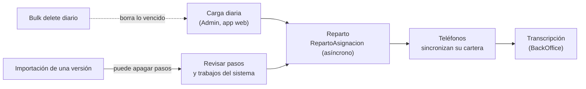

# Mantenimiento

Este documento cubre la operación técnica de Cobranza Móvil ya instalada: las tareas recurrentes, el diagnóstico de los problemas más comunes y los pasos para los cambios que más se piden. Está pensado para el administrador de Power Platform y el desarrollador de guardia. Todas las tareas se hacen **por interfaz gráfica**: la app de la oficina, [make.powerapps.com](https://make.powerapps.com), el centro de administración de Power Platform (*Power Platform admin center*), la configuración clásica del ambiente, Power Apps Studio y las pantallas de Smelter. La instalación y la actualización a una versión nueva están en [Instalación y despliegue](09-instalacion-y-despliegue.md). Las tareas que el Admin hace desde la app están en la [guía de administración diaria](../usuarios/05-admin.md).

En este documento, «admin center» es el centro de administración de Power Platform y «ambiente» se abre con **Manage** (Administrar) → **Environments** (Entornos) → el ambiente.

## Cómo funciona

Casi toda la operación diaria corre sola: la carga del archivo la dispara el Admin desde la app, los *plugins* reparten las asignaciones y los trabajos de *bulk delete* (borrado masivo programado de Dataverse) limpian los datos vencidos. El mantenimiento técnico consiste en vigilar esas tres cosas, revisar el ambiente después de cada importación de la *solution* y aplicar a mano lo que no viaja en ella.

## Dónde se mira cada cosa

| Qué | Dónde |
|---|---|
| Trabajos del sistema (*plugins* asíncronos: reparto, tramos, purga) | Admin center → ambiente → **Settings** (Configuración) → **Audit and logs** (Auditoría y registros) → **System jobs** (Trabajos del sistema) |
| Trabajos de *bulk delete* | Admin center → ambiente → **Settings** → **Data management** (Administración de datos) → **Bulk deletion** (Eliminación masiva) |
| Roles, equipos y usuarios | Admin center → ambiente → **Settings** → **Users + permissions** (Usuarios y permisos) → **Security roles**, **Teams** o **Users** |
| Pasos de *plugin* | make.powerapps.com → **Solutions** → `cm_core_cobranzamovil` → **Plug-in steps** |
| Filas de una tabla | make.powerapps.com → **Tables** → la tabla → sus filas (con el filtro **All** para ver tablas del sistema o de Smelter) |
| *Offline profile* | Admin center → ambiente → **Settings** → **Users + permissions** → **Mobile configuration** (Configuración móvil) |
| Trabajos de importación de Smelter | Pantallas de Smelter, o la tabla `sanic_tbl_smlt_importjob` en make.powerapps.com |

## Tareas recurrentes

| Tarea | Frecuencia | Cómo |
|---|---|---|
| Revisar la carga del día | Diaria | App de la oficina → **Monitoreo** ([`scrMonitoreo.pa.yaml`](../../apps/backoffice-canvas/Src/scrMonitoreo.pa.yaml)) y **Reconciliación** ([`scrReconciliacion.pa.yaml`](../../apps/backoffice-canvas/Src/scrReconciliacion.pa.yaml)). Detalle técnico de un trabajo: sus registros de error en las pantallas de Smelter o en la tabla `sanic_tbl_smlt_importjob` |
| Revisar cargas sin terminar | Diaria | En **Cargar archivo** → *Mis últimas cargas*, relanzar o descartar las partes y cargas que quedaron sin estado. Mientras no terminan conservan su CSV con los números de tarjeta completos; al terminar, [`PurgaArchivoCarga`](../../plugins/Sanic.CobranzaMovil.Plugins/PurgaArchivoCarga.cs) lo borra solo. Ver la advertencia de abajo |
| Revisar los trabajos de borrado | Semanal | **Bulk deletion** → vista de trabajos recurrentes. Los trabajos se llaman `CM - …`; cada uno muestra estado, última corrida y fallos. Para ver cuántos registros cumple hoy un trabajo, abrir el asistente de *bulk delete* con los mismos criterios ([Instalación, paso 11](09-instalacion-y-despliegue.md#11-borrado-programado)) y usar **Preview Records** (Vista previa de registros) **sin** enviarlo. Ver [Ciclo de vida](08-ciclo-de-vida.md#ver-pausar-o-cancelar-los-trabajos) |
| Revisar trabajos asíncronos fallidos | Semanal y después de cada importación | **System jobs**, filtrar por estado fallido y por nombre `Sanic.CobranzaMovil.Plugins.` (`RepartoAsignacion`, `RepartoPorAgente`, `TramoCartera`, `PurgaArchivoCarga`). Los asíncronos que terminan bien se borran solos, así que lo que queda merece revisión. El error y la traza están en el detalle del trabajo |
| Revisar el ambiente después de importar una versión | Después de cada importación | Pasos de *plugin* activos (incluidos los de `PanGuard`), *Custom APIs*, *offline profile* y privilegios de *System Customizer*: [Instalación, paso 3](09-instalacion-y-despliegue.md#3-revisar-lo-importado) y [paso 4.1](09-instalacion-y-despliegue.md#41-quitar-privilegios-a-system-customizer). Después, la [verificación previa](10-pruebas.md#0-verificación-previa-pre) de Pruebas |
| Reconciliar compartidos | Si un localizador no ve una cuenta suya o ve una ajena | Ver [Reconciliar compartidos](#reconciliar-compartidos) |
| Alta y baja de localizadores | A demanda | Ver [Alta y baja de un localizador](#alta-y-baja-de-un-localizador) |
| Alta y baja de personal de oficina | A demanda | Dar o quitar el rol `SR \| CM \| <perfil>` directo a la persona o por un equipo cualquiera (de tipo *Owner* o de grupo de Entra ID): [Instalación, paso 9](09-instalacion-y-despliegue.md#9-asignar-roles-a-las-personas-y-compartir-las-apps). La app de la oficina toma los roles efectivos con la *Custom API* `sanic_cm_MisRoles` ([`MisRoles.cs`](../../plugins/Sanic.CobranzaMovil.Plugins/MisRoles.cs)), sin importar el nombre del equipo. Ver [Seguridad](03-seguridad.md#dar-acceso-a-una-persona-nueva) |
| Listas editables | A demanda | El Admin las edita en **Listas** ([`scrListas.pa.yaml`](../../apps/backoffice-canvas/Src/scrListas.pa.yaml)). No requiere desplegar nada |
| Revisar trazas de *plugins* | Ante un error | Ver [Trazas de *plugins*](#trazas-de-plugins) |
| Corregir una descripción de metadatos | Cuando una descripción quedó mal | Las descripciones de tablas, columnas y *Custom APIs* viajan en la *solution*: se corrigen en el ambiente de desarrollo (make.powerapps.com → **Tables** → la tabla o la columna → **Properties** / **Edit** → **Description**) y llegan con la versión siguiente. La del equipo «Cartera sin cobrador» no viaja: se edita en el admin center → **Teams** → el equipo → **Edit team** |
| Respaldo de la clave `.snk` y de K | Al rotar personal | Que ambas estén en el gestor de secretos del equipo. Sin la `.snk` no se pueden actualizar los *plugins*; sin K, la carga no reconoce las cuentas existentes |

⚠️ El archivo de carga lo borra `PurgaArchivoCarga` cuando el trabajo de cualquiera de las tres plantillas de CM («Cobranza movil», «· padres», «· partes») llega a un estado terminal, y cada corrida barre hasta 50 trabajos de más de 7 días que todavía tengan archivo (ver [Ciclo de vida](08-ciclo-de-vida.md#archivo-de-carga-de-smelter)). No borra el de una parte sin estado que nadie relanza ni descarta, ni el de una carga sin estado que nadie cierra: por eso hay que resolverlas. Si el paso del *plugin* estuvo apagado, el barrido de la próxima carga terminada limpia lo atrasado de a 50 trabajos. Para vaciar a mano el archivo de un trabajo **terminado** (completo, con errores o fallido), abrir ese trabajo en Smelter o en la tabla `sanic_tbl_smlt_importjob` y quitar el archivo de la columna *Source File*. ⚠️ A confirmar que el formulario del trabajo en la versión instalada de Smelter permita quitar el archivo. Nunca vaciar el de un trabajo sin estado, en cola o procesando: lo pueden leer `PartirCarga`, Smelter o «Relanzar partes».

### Alta y baja de un localizador

1. **Alta.** Darle a la persona el rol `SR | CM | Localizador` (directo o por un equipo; si es por equipo, revisar la herencia de privilegios de [Instalación, paso 4.3](09-instalacion-y-despliegue.md#43-herencia-de-privilegios-para-roles-dados-por-equipo)) y compartirle la app del localizador ([paso 9](09-instalacion-y-despliegue.md#9-asignar-roles-a-las-personas-y-compartir-las-apps)). En la app de la oficina → **Agentes y usuarios** ([`scrAgentes.pa.yaml`](../../apps/backoffice-canvas/Src/scrAgentes.pa.yaml)), vincular su usuario al agente. `EmailDesdeUsuario` copia el correo al agente y `RepartoPorAgente` le pasa sus asignaciones activas. Tarda unos minutos porque el reparto es asíncrono.
2. **Baja.** En **Agentes y usuarios**, desvincular el usuario. Sus asignaciones pasan al equipo «Cartera sin cobrador» y dejan de bajar a su teléfono. Después quitarle el rol (o sacarlo del equipo o del grupo de Entra ID que se lo da) y dejar de compartirle la app.
3. **Cambio de localizador de una cartera.** Vincular el agente al usuario nuevo: `RepartoPorAgente` reparte y revoca al anterior.

⚠️ El teléfono del localizador anterior conserva lo que ya bajó hasta la próxima sincronización completa (**Actualizar todo desde el servidor** en la pantalla de sincronización, [`scrSincronizacion.pa.yaml`](../../apps/localizador-canvas/Src/scrSincronizacion.pa.yaml)), o hasta que se borren los datos de la app. Quitar un permiso no modifica el registro, y la sincronización incremental solo baja registros modificados.

### Reconciliar compartidos

`RepartoAsignacion` comparte en lectura cuenta, cliente y fiador con el usuario del agente, y se los revoca al anterior. Si un trabajo del reparto falló, pueden quedar compartidos de menos (el localizador no ve una cuenta suya) o de más (sigue viendo una que ya no es suya).

1. **System jobs**: buscar el trabajo fallido de `RepartoAsignacion` o `RepartoPorAgente` y leer su error. Corregir la causa (por ejemplo, un usuario sin rol Localizador o un equipo «Cartera sin cobrador» faltante o duplicado).
2. En la app de la oficina → **Agentes y usuarios**, **desvincular** el usuario del agente afectado y **volver a vincularlo**. Al desvincular, sus asignaciones pasan al equipo «Cartera sin cobrador» y se revocan los compartidos; al vincular, `RepartoPorAgente` vuelve a escribir el agente en todas y `RepartoAsignacion` vuelve a compartir. Mientras tanto el localizador no ve su cartera: hacerlo fuera de su horario.
3. Esperar unos minutos y comprobar en **System jobs** que los trabajos terminaron sin error.

No hay una pantalla que reconcilie todos los agentes de una vez: se repite por agente. Hacerlo con la carga quieta, porque el reparto de una carga en curso puede cambiar los compartidos a la vez.

### Trazas de *plugins*

1. Subir el nivel de trazas a **All**: admin center → ambiente → **Settings** → **Resources** (Recursos) → **All legacy settings** (Toda la configuración heredada) → **Settings** → **Administration** → **System Settings** → pestaña **Customization** → **Enable logging to plug-in trace log** (ver [Instalación, paso 12](09-instalacion-y-despliegue.md#12-ajustes-del-ambiente)). Afecta a todo el ambiente.
2. Reproducir el problema.
3. Leer las trazas: en la configuración clásica, **Settings** → **Customization** (Personalización) → **Plug-In Trace Log** (Registro de seguimiento de complementos); o en make.powerapps.com → **Tables** → filtro **All** → «Plug-in Trace Log» (`plugintracelog`). Filtrar por **Type Name** que empiece con `Sanic.CobranzaMovil.Plugins.`. El texto de la traza está en **Message Block**.
4. **Volver a *Exception***.

Los *plugins* de CM trazan solo nombres de tablas, columnas, pasos y cantidades, nunca valores ([`PluginBase.cs`](../../plugins/Sanic.CobranzaMovil.Plugins/PluginBase.cs)). Los roles operativos (Localizador, Solicitante, Supervisor, BackOffice) no tienen lectura sobre «Plug-in Trace Log»; Admin y Servicio sí. Para un *plugin* asíncrono que falló, la traza también aparece en el detalle de su trabajo en **System jobs**, sin subir el nivel.

### Rotación de la clave K

No hay un procedimiento gráfico de rotación. Rotar K obliga a recalcular todas las claves HMAC con la carga detenida, y las interacciones cuya cuenta ya se borró no se pueden recalcular. El procedimiento y sus límites están en [Seguridad](03-seguridad.md#la-clave-k). ⚠️ A confirmar: un procedimiento probado antes de rotarla en producción.

## Diagnóstico de problemas comunes

### El teléfono no sincroniza o no abre

| Causa probable | Cómo se ve | Qué hacer |
|---|---|---|
| El *offline profile* no está publicado o le falta una tabla | La app no abre o falla al sincronizar una tabla | **Mobile configuration** → «Cobranza Movil - Cobrador»: comparar sus tablas y filtros con [Instalación, paso 3](09-instalacion-y-despliegue.md#3-revisar-lo-importado). Si aparece sin publicar, **Publish** |
| La app usa una tabla que no está en el perfil | Una pantalla vacía sin señal | Agregar la tabla al perfil en el ambiente de desarrollo (ver [Agregar una columna y mostrarla en una app](#agregar-una-columna-y-mostrarla-en-una-app), paso 7) y llevarla con la versión siguiente |
| El servidor rechazó un registro | Un pago o una interacción no llega y el teléfono no avisa | El *runtime* *offline* descarta en silencio lo que el servidor rechaza. Revisar las trazas del momento. Por eso, donde se puede, los *plugins* marcan en vez de rechazar (`ReciboRepetido`, `VincularActualizacionPendiente`); `InteraccionDelCobrador` sí rechaza una visita a una cuenta que no es de la cartera del localizador (ver [Plugins y Custom APIs](04-plugins-y-custom-apis.md)) |
| Sin licencia o sin la app compartida | No aparece la app | Revisar la licencia y que la app esté compartida con la persona o con su grupo (make.powerapps.com → **Apps** → la app → **Share**) |
| La versión publicada no es la esperada | La app se abre con una versión vieja | Comparar el sello de versión que muestra la app (caso [PRE-07](10-pruebas.md#0-verificación-previa-pre)) con la versión de la app en make.powerapps.com → **Apps** → la app → **Details** (Detalles). Después de publicar, el reproductor puede servir la anterior unos minutos |

Detalles del *offline profile* y la sincronización: [App del localizador](05-app-localizador.md).

### La carga falló o quedó a medias

1. Abrir **Monitoreo** y **Cargar archivo** ([`scrCargaArchivo.pa.yaml`](../../apps/backoffice-canvas/Src/scrCargaArchivo.pa.yaml)) con un usuario Admin miembro del equipo de carga.
2. Identificar el caso:

| Síntoma | Causa | Qué hacer |
|---|---|---|
| El Admin no ve la plantilla | No es miembro del equipo de carga, o el equipo no tiene el rol de Smelter que permite correr trabajos | Revisar miembros y roles del equipo: [Instalación, paso 6](09-instalacion-y-despliegue.md#6-equipo-de-carga) |
| `TransformError` en todas las filas | Falta K o hay más de una fila activa `cm-pan` | Revisar la tabla `sanic_tbl_smlt_hmackey`: tiene que haber **una sola** fila activa `cm-pan` ([Instalación, paso 7](09-instalacion-y-despliegue.md#7-clave-k)) |
| `PartirCarga` se niega a partir | Las plantillas derivadas no coinciden con la principal, o hay dos plantillas con el mismo nombre | Comparar en Smelter cada *Table Mapping* y *Column Mapping* de «· padres» y «· partes» con su parte de la principal y corregir la diferencia; dejar una sola plantilla de cada nombre ([Instalación, paso 8.2](09-instalacion-y-despliegue.md#82-plantillas-derivadas)) |
| Partes sin lanzar | El usuario salió de la pantalla antes de que terminaran los padres; las partes quedaron sin estado | En **Cargar archivo**, el historial ofrece «relanzar» (si los padres terminaron bien) o «descartar» |
| Reconciliación bloqueada | Hay trabajos de las plantillas de Cobranza en cola, procesando o sin estado de las últimas 12 horas | Terminar o descartar esos trabajos |
| Filas fallidas | Datos del archivo (largo, formato, *lookup* sin resolver) | Leer los registros de error del trabajo en Smelter. Formato del archivo: [Carga diaria](07-carga-diaria.md) |
| Asignaciones sin repartir | El reparto es asíncrono y todavía no corrió, o falló | Revisar en **System jobs** los trabajos fallidos de `RepartoAsignacion`. Para un agente concreto, [reconciliar compartidos](#reconciliar-compartidos) |

Volver a cargar el mismo archivo es seguro: la carga deduplica por claves alternativas y no crea filas repetidas. Después de una carga, resolver las cargas sin terminar para que su archivo se purgue (ver tareas recurrentes).

### Una interacción no aparece para transcribir

La cola de **Transcripción** ([`scrTranscripcion.pa.yaml`](../../apps/backoffice-canvas/Src/scrTranscripcion.pa.yaml)) trae las interacciones con estado de grabación «Pendiente», de la más vieja a la más nueva.

| Causa | Cómo comprobarlo |
|---|---|
| El teléfono todavía no sincronizó | El localizador ve la interacción en su teléfono pero no está en Dataverse. Pedirle que sincronice con señal |
| El servidor la rechazó al sincronizar | No está en Dataverse y el teléfono ya no la tiene. Revisar trazas de `InteraccionDelCobrador` del momento ([`InteraccionDelCobrador.cs`](../../plugins/Sanic.CobranzaMovil.Plugins/InteraccionDelCobrador.cs)): rechaza interacciones de cuentas que no son de la cartera del localizador |
| Ya está grabada | Aparece en **Transcritas** ([`scrTranscritas.pa.yaml`](../../apps/backoffice-canvas/Src/scrTranscritas.pa.yaml)) |
| La cola pasa de 2.000 filas | Solo entran las 2.000 más viejas (límite de filas de la app). Al transcribir, entran las siguientes |
| La persona no tiene rol BackOffice | Sin lectura Global de interacciones la cola sale vacía o parcial. Revisar sus roles directos y los de sus equipos (admin center → **Users** → la persona → **Manage security roles**, o **Run diagnostics**) |

Una actualización de datos que llega «sin vincular» la cuelga después `VincularActualizacionPendiente`; un pago con recibo repetido entra marcado por `ReciboRepetido`. Ninguno se pierde.

### Alguien no ve su cartera

| Causa | Qué hacer |
|---|---|
| Su usuario no está vinculado al agente, o está vinculado a otro | **Agentes y usuarios** en la app de la oficina |
| El agente no tiene correo o no coincide con el del usuario | Lo completa `EmailDesdeUsuario` al vincular ([`EmailDesdeUsuario.cs`](../../plugins/Sanic.CobranzaMovil.Plugins/EmailDesdeUsuario.cs)). Desvincular y volver a vincular |
| No tiene el rol Localizador, o lo hereda de un equipo sin *Direct User (Basic) access level and Team privileges* | Ver [Instalación, paso 4.3](09-instalacion-y-despliegue.md#43-herencia-de-privilegios-para-roles-dados-por-equipo) y [Seguridad](03-seguridad.md#roles-heredados-por-equipos-de-entra-id) |
| El reparto no corrió (asignaciones con dueño SYSTEM o del equipo «Cartera sin cobrador») | Revisar trabajos asíncronos fallidos. Volver a vincular el agente dispara `RepartoPorAgente` |
| Faltan compartidos de cuenta, cliente o fiador | [Reconciliar compartidos](#reconciliar-compartidos) |
| Es una Especial sin aprobar | Correcto: no se reparte hasta que la apruebe un Supervisor |
| El teléfono tiene datos viejos | Sincronización completa (**Actualizar todo desde el servidor**) |
| La cartera supera el límite de filas | La app la trae por tramos (`TramoCartera`). Si una cuenta no tiene tramo, revisar trabajos asíncronos fallidos de `TramoCartera` |

## Cómo hacer los cambios más comunes

Todos los cambios se hacen primero en el ambiente de desarrollo, **dentro de la *solution*** `cm_core_cobranzamovil` (make.powerapps.com → **Solutions** → la *solution* → **+ New** o **Add existing**), y se llevan a los demás ambientes exportando e importando una versión nueva: [Instalación, paso 1](09-instalacion-y-despliegue.md#1-conseguir-el-paquete-de-la-solution) y [Actualizar a una versión nueva](09-instalacion-y-despliegue.md#actualizar-a-una-versión-nueva). Lo que no viaja en la *solution* (plantillas de Smelter, trabajos de borrado, opciones de lista, equipos) se repite a mano en cada ambiente y se anota en el [`CHANGELOG.md`](../../CHANGELOG.md).

### Agregar una columna y mostrarla en una app

1. Crear la columna en la tabla, desde la *solution* `cm_core_cobranzamovil` (**Tables** → la tabla → **Columns** → **+ New column**). Si la escribe el teléfono, que sea opcional: una columna obligatoria hace fallar el `Patch` también sin señal.
2. **Si viene en el archivo diario:** agregar el *Column Mapping* en la plantilla principal «Cobranza movil» y **el mismo** en la derivada que corresponda («· padres» o «· partes»), en cada ambiente ([Instalación, paso 8.2](09-instalacion-y-despliegue.md#82-plantillas-derivadas)). Si las derivadas no coinciden, `PartirCarga` se niega a partir la carga. El formato del archivo cambia también en [`FilaDeCarga.cs`](../../plugins/Sanic.CobranzaMovil.Plugins/FilaDeCarga.cs): ver [Carga diaria](07-carga-diaria.md#agregar-o-cambiar-una-columna-del-archivo).
3. **Si la escribe una persona desde la app de la oficina en la asignación o la interacción:** agregarla a `Permitidas` de [`ColumnasAsignacion.cs`](../../plugins/Sanic.CobranzaMovil.Plugins/ColumnasAsignacion.cs) o a `ColumnasGrabacion` de [`GrabacionInteraccion.cs`](../../plugins/Sanic.CobranzaMovil.Plugins/GrabacionInteraccion.cs), con sus pruebas, y generar una versión nueva del ensamblado ([Plugins y Custom APIs](04-plugins-y-custom-apis.md#cómo-agregar-o-cambiar-un-plugin)). Si no, el *plugin* rechaza el cambio (falla cerrado).
4. Abrir la app en Power Apps Studio desde la *solution* (**Apps** → la app → **Edit**) y refrescar la fuente de datos: panel **Data** (Datos) → la tabla → **⋯** → **Refresh** (Actualizar). Las fórmulas usan una copia del esquema guardada en la app: sin refrescar, no conocen la columna nueva.
5. Usar la columna en las fórmulas de la pantalla, con el nombre visible entre comillas simples. Studio marca en rojo una fórmula que usa una columna desconocida.
6. **Save** (Guardar) y **Publish** (Publicar). Actualizar la copia de las fuentes en `Src/` del repositorio con el código de la pantalla tocada (ver [App del localizador](05-app-localizador.md#cómo-modificar-la-app)). ⚠️ A confirmar el procedimiento para mantener `Src/` sincronizada con la app editada en Studio.
7. Si es una **tabla** nueva que usa el teléfono: agregarla al *offline profile* antes de publicar la app. **Mobile configuration** → «Cobranza Movil - Cobrador» → **Edit** → **+ Add table**, con el filtro de filas que corresponda (asignaciones activas, últimos 90 días para el historial, o todas las filas que el usuario puede leer) → **Save** y **Publish**. Ver [App del localizador](05-app-localizador.md#perfil-offline-qué-baja-al-teléfono).
8. Exportar la versión nueva y llevarla a los demás ambientes.

### Agregar un valor a una lista

Hay dos tipos de lista:

| Tipo | Ejemplos | Cómo se agrega un valor |
|---|---|---|
| **Editable** (tabla `sanic_cm_tbl_opcionlista`) | Tipo de Especial, motivos de cierre, mensajes rápidos | El Admin, en **Listas**. Sin desplegar nada. Un valor no se borra: se desactiva. La asignación o la interacción guardan el texto, así que renombrar no cambia el historial |
| **Choice** (lista fija de la *solution*, con valor numérico) | Tipo de asignación, moneda, estado de aprobación, estado de grabación | En el ambiente de desarrollo, agregar la opción al *choice* desde la *solution* (**Tables** → la tabla → la columna → **Edit** → opciones); refrescar en Studio las tablas que lo usan en cada app; buscar en `plugins/` y en `apps/*/Src` los valores numéricos del *choice* (los *plugins* comparan números); publicar y llevar la versión nueva |

Para agregar una **lista editable** nueva: en el ambiente de desarrollo, agregar la opción al *choice* local `sanic_cm_ol_lista` de la tabla «Opción de lista»; refrescar esa tabla en Studio y usar el valor nuevo en la app; llevar la versión nueva. Después, en cada ambiente, el Admin crea las opciones iniciales en **Listas**, y se suman a la tabla de opciones iniciales de [Instalación, paso 10](09-instalacion-y-despliegue.md#10-opciones-iniciales-de-las-listas) para las instalaciones siguientes.

### Cambiar un plazo de borrado

Un trabajo de *bulk delete* no se edita: se cancela y se crea otro.

1. **Bulk deletion** → seleccionar el trabajo `CM - …` → **Cancel** (Cancelar). ⚠️ A confirmar el nombre exacto del comando en la versión del admin center.
2. Crear el trabajo nuevo con el asistente, con el plazo nuevo, como en [Instalación, paso 11](09-instalacion-y-despliegue.md#11-borrado-programado). Si el nombre incluye el plazo («`CM - Carga diaria de mas de 7 dias`»), usar el nombre nuevo; si no lo incluye («`CM - Pagos de mas de 2 anos`»), se puede repetir el nombre. Antes de enviarlo, **Preview Records** muestra cuántos registros cumple hoy.
3. Comprobar que quedó un solo trabajo activo por cada concepto.
4. Mantener el plazo de interacciones unos días mayor que el de pagos y actualizaciones de datos (hoy 735 y 730): una interacción no se puede borrar mientras tenga pagos o actualizaciones (*Restrict*).
5. Actualizar la tabla de [Instalación, paso 11](09-instalacion-y-despliegue.md#11-borrado-programado) y [Ciclo de vida](08-ciclo-de-vida.md#cambiar-un-plazo), y repetir el cambio en cada ambiente.

El plazo de 90 días del *offline profile* no es un borrado: es el filtro de filas del perfil que limita qué historial baja al teléfono (se cambia en **Mobile configuration**, como en el paso 7 de [Agregar una columna](#agregar-una-columna-y-mostrarla-en-una-app)). Plazos y motivos: [Ciclo de vida de los datos](08-ciclo-de-vida.md).

### Agregar un rol

Los pasos del lado de Dataverse y de los *plugins* están en [Seguridad](03-seguridad.md#agregar-un-rol-nuevo). Además:

1. Asignar el rol nuevo `SR | CM | <perfil>` directo o por un equipo (el nombre del equipo no importa).
2. Decidir qué pantallas ve: sumar `<perfil>` a `Roles` en el menú ([`cmpNavLateral.pa.yaml`](../../apps/backoffice-canvas/Src/Components/cmpNavLateral.pa.yaml)). La app lo recibe sola de `sanic_cm_MisRoles`.
3. En el editor del rol (admin center → **Security roles** → el rol), en el ambiente de desarrollo y dentro de la *solution*:
   - si tiene que leer las listas editables, darle **Read** de nivel **Organization** sobre «Opción de lista» (`sanic_cm_tbl_opcionlista`), como los demás roles operativos;
   - si es un rol operativo, dejar **sin** privilegios de creación, escritura, borrado, asignación, *share*, *append* y activación sobre la tabla **Process** (procesos y *flows*), sin el privilegio **Flow** y sin **Read** sobre **Plugin Trace Log**, igual que Localizador, Solicitante, Supervisor y BackOffice. Conservar **Read** y la ejecución de *workflows* (reglas de negocio). ⚠️ A confirmar el nombre visible del privilegio **Flow** en la versión del editor de roles.
4. Publicar la app y correr las pruebas de seguridad por rol (ver [Pruebas](10-pruebas.md#1-seguridad-por-rol-seg)).

## Piezas y archivos

| Pieza | Archivo o lugar |
|---|---|
| Reparto y compartidos | [`RepartoAsignacion.cs`](../../plugins/Sanic.CobranzaMovil.Plugins/RepartoAsignacion.cs), [`RepartoPorAgente.cs`](../../plugins/Sanic.CobranzaMovil.Plugins/RepartoPorAgente.cs) |
| Borrado de archivos fuente | [`PurgaArchivoCarga.cs`](../../plugins/Sanic.CobranzaMovil.Plugins/PurgaArchivoCarga.cs) |
| Roles efectivos para la app de la oficina | [`MisRoles.cs`](../../plugins/Sanic.CobranzaMovil.Plugins/MisRoles.cs) (*Custom API* `sanic_cm_MisRoles`), [`cmpNavLateral.pa.yaml`](../../apps/backoffice-canvas/Src/Components/cmpNavLateral.pa.yaml) |
| Trabajos de borrado programado | Admin center → **Bulk deletion**; criterios en [Instalación, paso 11](09-instalacion-y-despliegue.md#11-borrado-programado) |
| Plantillas de Smelter | Pantallas de Smelter; reglas en [Instalación, paso 8](09-instalacion-y-despliegue.md#8-plantillas-de-smelter) |
| *Offline profile* | Admin center → **Mobile configuration** |
| Listas editables | [`scrListas.pa.yaml`](../../apps/backoffice-canvas/Src/scrListas.pa.yaml) |
| Pantallas de operación | [`scrMonitoreo.pa.yaml`](../../apps/backoffice-canvas/Src/scrMonitoreo.pa.yaml), [`scrReconciliacion.pa.yaml`](../../apps/backoffice-canvas/Src/scrReconciliacion.pa.yaml), [`scrCargaArchivo.pa.yaml`](../../apps/backoffice-canvas/Src/scrCargaArchivo.pa.yaml), [`scrAgentes.pa.yaml`](../../apps/backoffice-canvas/Src/scrAgentes.pa.yaml) |

## Trampas y errores conocidos

- ⚠️ **Nunca borrar datos de negocio en producción para «limpiar».** La limpieza de datos de prueba ([Pruebas](10-pruebas.md#limpieza-de-los-datos-de-prueba)) es solo para el ambiente de prueba.
- **Re-vincular un agente con una carga en curso** puede cruzarse con el reparto de la carga. Hacerlo con la carga quieta y, si algo quedó mal, repetirlo cuando termine.
- **El nivel de trazas es de todo el ambiente.** Dejarlo en *All* llena el registro de trazas con las de otras soluciones y ocupa almacenamiento.
- **No agregar miembros al equipo «Cartera sin cobrador».** Esos miembros verían todas las asignaciones sin localizador. Tiene que haber uno solo con ese prefijo: con dos, el reparto falla.
- **Editar la plantilla principal de Smelter y repetir el cambio en la derivada.** Las derivadas son copia exacta de su parte de la principal; si difieren, `PartirCarga` se niega a partir. No hay herramienta gráfica que las regenere.
- **No volver a mecanismos descartados.** Una *alternate key* sobre recibo, cuenta y moneda en el pago hace perder pagos en silencio sin señal ([Decisiones, 1.2](12-decisiones.md#12-lo-que-viene-del-teléfono-no-se-rechaza-se-marca)); un *flow* de reparto en paralelo con `RepartoAsignacion` repartiría dos veces ([Decisiones, 4.1](12-decisiones.md#41-solo-su-cartera-por-dueño-y-compartidos-en-un-plugin-asíncrono)).
- **Una importación puede apagar pasos.** Revisar **Plug-in steps** después de cada versión, `PanGuard` incluido.
