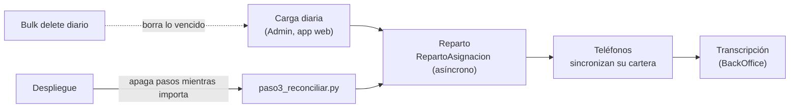

# Mantenimiento

Este documento cubre la operación técnica de Cobranza Móvil ya instalada: las tareas recurrentes, el diagnóstico de los problemas más comunes y los pasos para los cambios que más se piden. Está pensado para el administrador de Power Platform y el desarrollador de guardia. La instalación y la publicación de cambios están en [Instalación y despliegue](09-instalacion-y-despliegue.md). Las tareas que el Admin hace desde la app están en la [guía de administración diaria](../usuarios/05-admin.md).

## Cómo funciona

Casi toda la operación diaria corre sola: la carga del archivo la dispara el Admin desde la app, los *plugins* reparten las asignaciones y los trabajos de *bulk delete* (borrado masivo programado de Dataverse) limpian los datos vencidos. El mantenimiento técnico consiste en vigilar esas tres cosas y en correr algunos scripts de [`scripts/`](../../scripts/README.md) cuando cambia algo.



Los scripts de operación muestran el plan sin cambiar nada y aplican solo con `--aplicar` (los de prueba, como `paso6_prueba.py`, crean datos apenas se corren; ver [`scripts/README.md`](../../scripts/README.md)). Se corren desde la raíz del repositorio, con las credenciales descritas en [Instalación y despliegue](09-instalacion-y-despliegue.md#configuración-que-leen-los-scripts).

## Tareas recurrentes

| Tarea | Frecuencia | Cómo |
|---|---|---|
| Revisar la carga del día | Diaria | App de la oficina → **Monitoreo** ([`scrMonitoreo.pa.yaml`](../../apps/backoffice-canvas/Src/scrMonitoreo.pa.yaml)) y **Reconciliación** ([`scrReconciliacion.pa.yaml`](../../apps/backoffice-canvas/Src/scrReconciliacion.pa.yaml)). Detalle técnico de un trabajo: tablas de Smelter `sanic_tbl_smlt_importjobs` y sus registros de error |
| Revisar cargas sin terminar | Diaria | En **Cargar archivo** → *Mis últimas cargas*, relanzar o descartar las partes y cargas que quedaron sin estado. Mientras no terminan conservan su CSV con los números de tarjeta completos; al terminar, [`PurgaArchivoCarga`](../../plugins/Sanic.CobranzaMovil.Plugins/PurgaArchivoCarga.cs) lo borra solo. Ver la advertencia de abajo |
| Revisar los trabajos de borrado | Semanal | Centro de administración de Power Platform → ambiente → Configuración → Administración de datos → Eliminación de registros en masa. Los trabajos se llaman `CM - …`. Con `paso10_borrado_programado.py` sin `--aplicar` se ven cuántos registros cumple cada uno hoy |
| Reconciliar compartidos | Después de cada despliegue | `python3 scripts/seguridad/paso3_reconciliar.py --aplicar` ([`paso3_reconciliar.py`](../../scripts/seguridad/paso3_reconciliar.py)). Agrega los compartidos que faltan. Con `--revocar` quita los sobrantes |
| Alta y baja de localizadores | A demanda | Ver [Alta y baja de un localizador](#alta-y-baja-de-un-localizador) |
| Alta y baja de personal de oficina | A demanda | Agregar o quitar a la persona del equipo «CM · `<perfil>` · `<ENV>`» (o de su grupo de Entra ID). Ver [Seguridad](03-seguridad.md#dar-acceso-a-una-persona-nueva) |
| Listas editables | A demanda | El Admin las edita en **Listas** ([`scrListas.pa.yaml`](../../apps/backoffice-canvas/Src/scrListas.pa.yaml)). No requiere despliegue |
| Revisar trazas de *plugins* | Ante un error | Ver [Trazas de *plugins*](#trazas-de-plugins) |
| Revisar trabajos asíncronos fallidos | Semanal | Trabajos del sistema (`asyncoperations`) con estado fallido, de los pasos `RepartoAsignacion`, `RepartoPorAgente`, `TramoCartera` y `PurgaArchivoCarga`. Los asíncronos que terminan bien se borran solos, así que lo que queda merece revisión |
| Corregir descripciones de metadatos | Después de cambiar una descripción en un script de creación | `python3 scripts/pan/paso24_descripciones.py` (plan: muestra antes y después) y luego con `--aplicar` ([`paso24_descripciones.py`](../../scripts/pan/paso24_descripciones.py)). Los scripts de creación no tocan lo que ya existe; este sí, pero solo la descripción de tablas, columnas, el equipo «Cartera sin cobrador» y las *Custom APIs* con sus parámetros. También reporta descripciones con códigos de seguimiento |
| Respaldo de la clave `.snk` y de K | Al rotar personal | Que ambas estén en el gestor de secretos del equipo. Sin la `.snk` no se pueden actualizar los *plugins* |

⚠️ El archivo de carga lo borra `PurgaArchivoCarga` cuando el trabajo de cualquiera de las tres plantillas de CM («Cobranza movil», «· padres», «· partes») llega a un estado terminal, y cada corrida barre hasta 50 trabajos de más de 7 días que todavía tengan archivo (ver [Ciclo de vida](08-ciclo-de-vida.md#archivo-de-carga-de-smelter)). No borra el de una parte sin estado que nadie relanza ni descarta, ni el de una carga sin estado que nadie cierra: por eso hay que resolverlas. [`paso10_purgar_archivos.py`](../../scripts/pan/paso10_purgar_archivos.py) aplica la misma regla a mano (sin `--aplicar`, solo muestra el plan): se corre al instalar, para limpiar lo que existía antes del *plugin*, o si el paso del *plugin* estuvo apagado.

### Alta y baja de un localizador

1. **Alta.** Agregar a la persona al equipo «CM · Localizadores · `<ENV>`» y compartirle la app del localizador. En la app de la oficina → **Agentes** ([`scrAgentes.pa.yaml`](../../apps/backoffice-canvas/Src/scrAgentes.pa.yaml)), vincular su usuario al agente. `EmailDesdeUsuario` copia el correo al agente y `RepartoPorAgente` le pasa sus asignaciones activas. Tarda unos minutos porque el reparto es asíncrono.
2. **Baja.** En **Agentes**, desvincular el usuario. Sus asignaciones pasan al equipo «Cartera sin cobrador» y dejan de bajar a su teléfono. Después quitarlo del equipo.
3. **Cambio de localizador de una cartera.** Vincular el agente al usuario nuevo: `RepartoPorAgente` reparte y revoca al anterior.

⚠️ El teléfono del localizador anterior conserva lo que ya bajó hasta la próxima sincronización completa (**Actualizar todo desde el servidor** en la pantalla de sincronización, [`scrSincronizacion.pa.yaml`](../../apps/localizador-canvas/Src/scrSincronizacion.pa.yaml)), o hasta que se borren los datos de la app. Quitar un permiso no modifica el registro, y la sincronización incremental solo baja registros modificados.

### Trazas de *plugins*

1. Subir el nivel de trazas a *All*: columna `plugintracelogsetting` de la tabla `organization`, valor 2. Afecta a todo el ambiente.
2. Reproducir el problema.
3. Leer las trazas en la tabla `plugintracelog`, filtrando por `typename` que empiece con `Sanic.CobranzaMovil.Plugins.`.
4. **Volver a *Exception*** (valor 1).

Los *plugins* de CM trazan solo nombres de tablas, columnas, pasos y cantidades, nunca valores ([`PluginBase.cs`](../../plugins/Sanic.CobranzaMovil.Plugins/PluginBase.cs)). Los roles operativos no pueden leer las trazas; Admin y Servicio sí ([`paso8_sin_trazas.py`](../../scripts/seguridad/paso8_sin_trazas.py)).

### Rotación de la clave K

No hay un script de rotación. Rotar K obliga a recalcular todas las claves HMAC con la carga detenida, y las interacciones cuya cuenta ya se borró no se pueden recalcular. El procedimiento y sus límites están en [Seguridad](03-seguridad.md#la-clave-k). ⚠️ A confirmar: un procedimiento probado antes de rotarla en producción.

## Diagnóstico de problemas comunes

### El teléfono no sincroniza o no abre

| Causa probable | Cómo se ve | Qué hacer |
|---|---|---|
| El *offline profile* no está publicado o le falta una tabla | La app no abre o falla al sincronizar una tabla | `python3 scripts/pan/paso7_perfil_offline.py` sin `--aplicar`: no tiene que listar tablas por agregar o ajustar (el plan no revisa si está publicado). Con `--aplicar` lo vuelve a publicar siempre y comprueba que se regeneren las consultas |
| La app usa una tabla que no está en el perfil | Una pantalla vacía sin señal | Agregar la tabla a `TABLAS` en [`paso7_perfil_offline.py`](../../scripts/pan/paso7_perfil_offline.py), correrlo con `--aplicar` y desplegar |
| El servidor rechazó un registro | Un pago o una interacción no llega y el teléfono no avisa | El *runtime* *offline* descarta en silencio lo que el servidor rechaza. Revisar las trazas del momento. Por eso, donde se puede, los *plugins* marcan en vez de rechazar (`ReciboRepetido`, `VincularActualizacionPendiente`); `InteraccionDelCobrador` sí rechaza una visita a una cuenta que no es de la cartera del localizador (ver [Plugins y Custom APIs](04-plugins-y-custom-apis.md)) |
| Sin licencia o sin la app compartida | No aparece la app | Revisar la licencia y que la app esté compartida con el equipo de localizadores |
| Error en la publicación de la app | La app se abre con una versión vieja | Comparar el sello de versión que muestra la app con `local/version-desplegada.json` del último despliegue |

Detalles del *offline profile* y la sincronización: [App del localizador](05-app-localizador.md).

### La carga falló o quedó a medias

1. Abrir **Monitoreo** y **Cargar archivo** ([`scrCargaArchivo.pa.yaml`](../../apps/backoffice-canvas/Src/scrCargaArchivo.pa.yaml)) con un usuario del equipo «CM · Admin y Carga».
2. Identificar el caso:

| Síntoma | Causa | Qué hacer |
|---|---|---|
| El Admin no ve la plantilla | No está en el equipo «CM · Admin y Carga» o el equipo no tiene el rol «Smelter Operador» | Revisar membresía y roles del equipo |
| `TransformError` en todas las filas | Falta K o hay más de una fila activa `cm-pan` | `python3 scripts/pan/paso6_clave_k.py` sin `--aplicar` |
| `PartirCarga` se niega a partir | Las plantillas derivadas no coinciden con la principal, o hay dos plantillas con el mismo nombre | `python3 scripts/pan/paso20_plantillas_paralelas.py --aplicar` |
| Partes sin lanzar | El usuario salió de la pantalla antes de que terminaran los padres; las partes quedaron sin estado | En **Cargar archivo**, el historial ofrece «relanzar» (si los padres terminaron bien) o «descartar» |
| Reconciliación bloqueada | Hay trabajos de las plantillas de Cobranza en cola, procesando o sin estado de las últimas 12 horas | Terminar o descartar esos trabajos |
| Filas fallidas | Datos del archivo (largo, formato, lookup sin resolver) | Leer los registros de error del trabajo en las tablas de Smelter. Formato del archivo: [Carga diaria](07-carga-diaria.md) |
| Asignaciones sin repartir | El reparto es asíncrono y todavía no corrió, o falló | Revisar trabajos asíncronos fallidos de `RepartoAsignacion`. `paso3_reconciliar.py --aplicar` completa los compartidos |

Volver a cargar el mismo archivo es seguro: la carga deduplica por claves alternativas y no crea filas repetidas. Después de una carga, borrar los archivos fuente (ver tareas recurrentes).

### Una interacción no aparece para transcribir

La cola de **Transcripción** ([`scrTranscripcion.pa.yaml`](../../apps/backoffice-canvas/Src/scrTranscripcion.pa.yaml)) trae las interacciones con estado de grabación «Pendiente», de la más vieja a la más nueva.

| Causa | Cómo comprobarlo |
|---|---|
| El teléfono todavía no sincronizó | El localizador ve la interacción en su teléfono pero no está en Dataverse. Pedirle que sincronice con señal |
| El servidor la rechazó al sincronizar | No está en Dataverse y el teléfono ya no la tiene. Revisar trazas de `InteraccionDelCobrador` del momento ([`InteraccionDelCobrador.cs`](../../plugins/Sanic.CobranzaMovil.Plugins/InteraccionDelCobrador.cs)): rechaza interacciones de cuentas que no son de la cartera del localizador |
| Ya está grabada | Aparece en **Transcritas** ([`scrTranscritas.pa.yaml`](../../apps/backoffice-canvas/Src/scrTranscritas.pa.yaml)) |
| La cola pasa de 2.000 filas | Solo entran las 2.000 más viejas (límite de filas de la app). Al transcribir, entran las siguientes |
| La persona no tiene rol BackOffice | Sin lectura Global de interacciones la cola sale vacía o parcial. Revisar sus equipos |

Una actualización de datos que llega «sin vincular» la cuelga después `VincularActualizacionPendiente`; un pago con recibo repetido entra marcado por `ReciboRepetido`. Ninguno se pierde.

### Alguien no ve su cartera

| Causa | Qué hacer |
|---|---|
| Su usuario no está vinculado al agente, o está vinculado a otro | **Agentes** en la app de la oficina |
| El agente no tiene correo o no coincide con el del usuario | Lo completa `EmailDesdeUsuario` al vincular ([`EmailDesdeUsuario.cs`](../../plugins/Sanic.CobranzaMovil.Plugins/EmailDesdeUsuario.cs)). Desvincular y volver a vincular |
| No tiene el rol Localizador, o lo hereda de un equipo sin *Direct User (Basic) access level and Team privileges* | Ver [Seguridad](03-seguridad.md#roles-heredados-por-equipos-de-entra-id) |
| El reparto no corrió (asignaciones con dueño SYSTEM o del equipo «Cartera sin cobrador») | Revisar trabajos asíncronos fallidos. Volver a vincular el agente dispara `RepartoPorAgente` |
| Faltan compartidos de cuenta, cliente o fiador | `python3 scripts/seguridad/paso3_reconciliar.py --aplicar` |
| Es una Especial sin aprobar | Correcto: no se reparte hasta que la apruebe un Supervisor |
| El teléfono tiene datos viejos | Sincronización completa (**Actualizar todo desde el servidor**) |
| La cartera supera el límite de filas | La app la trae por tramos (`TramoCartera`). Si una cuenta no tiene tramo, revisar trabajos asíncronos fallidos de `TramoCartera` |

## Cómo hacer los cambios más comunes

Todos los cambios se hacen primero en el ambiente de desarrollo, **dentro de la *solution*** `cm_core_cobranzamovil`, y se llevan a producción como indica [Instalación y despliegue](09-instalacion-y-despliegue.md#llevar-a-producción).

### Agregar una columna y mostrarla en una app

1. Crear la columna en la tabla, desde la *solution* `cm_core_cobranzamovil`. Si la escribe el teléfono, que sea opcional: una columna obligatoria hace fallar el `Patch` también sin señal.
2. **Si viene en el archivo diario:** agregar el *column mapping* en la plantilla principal «Cobranza movil» y correr `python3 scripts/pan/paso20_plantillas_paralelas.py --aplicar`. Si no se corre, `PartirCarga` se niega a partir la carga.
3. **Si la escribe una persona desde la app de la oficina en la asignación o la interacción:** agregarla a `Permitidas` de [`ColumnasAsignacion.cs`](../../plugins/Sanic.CobranzaMovil.Plugins/ColumnasAsignacion.cs) o a `ColumnasGrabacion` de [`GrabacionInteraccion.cs`](../../plugins/Sanic.CobranzaMovil.Plugins/GrabacionInteraccion.cs), con sus pruebas. Si no, el *plugin* rechaza el cambio (falla cerrado).
4. Refrescar la fuente de datos en la app, porque las fórmulas usan una copia del esquema guardada en el `.msapr`:

   ```bash
   python3 scripts/pan/paso7_fuentes.py apps/localizador-canvas/sanic_appcobranzamovil_c4e67_DocumentUri.msapr \
     --tablas sanic_cm_tbl_cuenta --aplicar
   ```

   ([`paso7_fuentes.py`](../../scripts/pan/paso7_fuentes.py); para la app de la oficina, su `.msapr` en [`apps/backoffice-canvas/`](../../apps/backoffice-canvas/)).
5. Usar la columna en los `.pa.yaml` de `Src/`, con el nombre visible entre comillas simples.
6. Desplegar: `python3 scripts/pan/paso7_desplegar.py --aplicar`. El chequeo de [`paso7_esquema.py`](../../scripts/pan/paso7_esquema.py) corta el despliegue si una fórmula usa una columna que la copia del esquema no conoce.
7. Si es una **tabla** nueva que usa el teléfono: agregarla a `TABLAS` en [`paso7_perfil_offline.py`](../../scripts/pan/paso7_perfil_offline.py) y correrlo con `--aplicar` antes de desplegar.

### Agregar un valor a una lista

Hay dos tipos de lista:

| Tipo | Ejemplos | Cómo se agrega un valor |
|---|---|---|
| **Editable** (tabla `sanic_cm_tbl_opcionlista`) | Tipo de Especial, motivos de cierre, mensajes rápidos | El Admin, en **Listas**. Sin despliegue. Un valor no se borra: se desactiva. La asignación o la interacción guardan el texto, así que renombrar no cambia el historial |
| **Choice** (lista fija de la *solution*, con valor numérico) | Tipo de asignación, moneda, estado de aprobación, estado de grabación | Agregar la opción al *choice* en la *solution*; refrescar con `paso7_fuentes.py` las tablas que lo usan en cada app; buscar en `plugins/` y en `apps/*/Src` los valores numéricos del *choice* (los *plugins* comparan números); desplegar |

Para agregar una **lista editable** nueva: agregar la opción al *choice* local `sanic_cm_ol_lista` en la *solution* (el script no modifica una columna que ya existe), sumarla a `LISTAS` e `INICIALES` de [`paso23_listas.py`](../../scripts/pan/paso23_listas.py) para que la próxima instalación la cree, correrlo con `--aplicar` (crea las opciones iniciales que falten), refrescar la tabla con `paso7_fuentes.py` y usar el valor nuevo en la app.

### Cambiar un plazo de borrado

1. Cambiar la constante en [`paso10_borrado_programado.py`](../../scripts/seguridad/paso10_borrado_programado.py): `CARGA_DIAS`, `GRACIA_DIAS`, `APP_DIAS`, `INTERACCION_DIAS` o `RECIEN_DIAS`.
2. Retirar el trabajo viejo. El script reconoce los trabajos **por nombre** y no actualiza uno que ya existe:
   - Si el nombre incluye el plazo («`CM - Carga diaria de mas de 7 dias`»), el nombre nuevo es otro: agregar el **nombre viejo** a `RETIRADOS`, y el script lo cancela.
   - Si no lo incluye («`CM - Pagos de mas de 2 anos`»), cancelar el trabajo viejo a mano en el centro de administración. Si no, el script ve el viejo como «ya programado» y no crea el nuevo. (Agregar ese nombre a `RETIRADOS` también funciona: en la misma corrida cancela el viejo y crea el nuevo; hay que sacarlo de `RETIRADOS` enseguida, porque cada corrida posterior volvería a cancelar y recrear el trabajo.)
3. Correr sin `--aplicar` para ver cuántos registros cumple hoy cada trabajo y, después, con `--aplicar`.
4. Mantener `INTERACCION_DIAS` unos días mayor que `APP_DIAS`: una interacción no se puede borrar mientras tenga pagos o actualizaciones (*Restrict*).

El plazo de 90 días del *offline profile* no es un borrado: limita qué historial baja al teléfono (`ULTIMOS_90` en [`paso7_perfil_offline.py`](../../scripts/pan/paso7_perfil_offline.py)). Plazos y motivos: [Ciclo de vida de los datos](08-ciclo-de-vida.md).

### Agregar un rol

Los pasos del lado de Dataverse y de los *plugins* están en [Seguridad](03-seguridad.md#agregar-un-rol-nuevo). Además:

1. Crear el equipo «CM · `<perfil>` · `<ENV>`» con el rol nuevo.
2. Agregar el perfil al `Switch` de la fórmula `gblRol` en [`App.pa.yaml`](../../apps/backoffice-canvas/Src/App.pa.yaml) y decidir qué pantallas ve en la navegación.
3. Si el rol tiene que leer las listas editables, agregarlo a `LEEN` en [`paso23_listas.py`](../../scripts/pan/paso23_listas.py) y correrlo.
4. Si no debe crear *flows* ni leer trazas, agregarlo a `ROLES` de [`paso7_sin_flows.py`](../../scripts/seguridad/paso7_sin_flows.py) y [`paso8_sin_trazas.py`](../../scripts/seguridad/paso8_sin_trazas.py).
5. Desplegar la app y correr la matriz de seguridad (ver [Pruebas](10-pruebas.md)).

## Piezas y archivos

| Pieza | Archivo |
|---|---|
| Mapa de scripts | [`scripts/README.md`](../../scripts/README.md) |
| Reconciliación de compartidos | [`paso3_reconciliar.py`](../../scripts/seguridad/paso3_reconciliar.py) |
| Borrado de archivos fuente | [`PurgaArchivoCarga.cs`](../../plugins/Sanic.CobranzaMovil.Plugins/PurgaArchivoCarga.cs) (automático); [`paso10_purgar_archivos.py`](../../scripts/pan/paso10_purgar_archivos.py) (a mano) |
| Descripciones de metadatos | [`paso24_descripciones.py`](../../scripts/pan/paso24_descripciones.py) |
| Trabajos de borrado programado | [`paso10_borrado_programado.py`](../../scripts/seguridad/paso10_borrado_programado.py) |
| Plantillas derivadas de Smelter | [`paso20_plantillas_paralelas.py`](../../scripts/pan/paso20_plantillas_paralelas.py) |
| Fuentes de datos de las apps | [`paso7_fuentes.py`](../../scripts/pan/paso7_fuentes.py), [`paso7_esquema.py`](../../scripts/pan/paso7_esquema.py) |
| *Offline profile* | [`paso7_perfil_offline.py`](../../scripts/pan/paso7_perfil_offline.py) |
| Listas editables | [`paso23_listas.py`](../../scripts/pan/paso23_listas.py), [`scrListas.pa.yaml`](../../apps/backoffice-canvas/Src/scrListas.pa.yaml) |
| Pantallas de operación | [`scrMonitoreo.pa.yaml`](../../apps/backoffice-canvas/Src/scrMonitoreo.pa.yaml), [`scrReconciliacion.pa.yaml`](../../apps/backoffice-canvas/Src/scrReconciliacion.pa.yaml), [`scrCargaArchivo.pa.yaml`](../../apps/backoffice-canvas/Src/scrCargaArchivo.pa.yaml), [`scrAgentes.pa.yaml`](../../apps/backoffice-canvas/Src/scrAgentes.pa.yaml) |

## Trampas y errores conocidos

- ⚠️ **[`paso14_limpieza_total.py`](../../scripts/seguridad/paso14_limpieza_total.py) borra todos los datos de negocio.** Es solo para preparar una prueba en desarrollo. Nunca en producción.
- **Reconciliar con una carga en curso** puede marcar como sobrante algo que el reparto todavía no compartió. Si pasa, volver a correr `--aplicar` cuando termine la carga, y usar `--revocar` solo con la carga quieta.
- **El nivel de trazas es de todo el ambiente.** Dejarlo en *All* llena el registro de trazas con las de otras soluciones.
- **No agregar miembros al equipo «Cartera sin cobrador».** [`paso5_cartera_sin_cobrador.py`](../../scripts/seguridad/paso5_cartera_sin_cobrador.py) termina con error si lo detecta: esos miembros verían todas las asignaciones sin localizador.
- **Editar solo la plantilla principal de Smelter.** Las derivadas las regenera `paso20_plantillas_paralelas.py`, que borra lo que no coincide con la principal.
- **Los scripts retirados no se corren.** [`clave_recibo_pago.py`](../../scripts/localizador/clave_recibo_pago.py) crearía una clave alternativa que hace perder pagos en silencio sin señal; [`paso2_flow.py`](../../scripts/seguridad/paso2_flow.py) reactivaría un *flow* reemplazado por un *plugin*. Ver [`scripts/README.md`](../../scripts/README.md).
