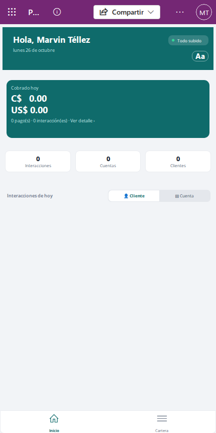
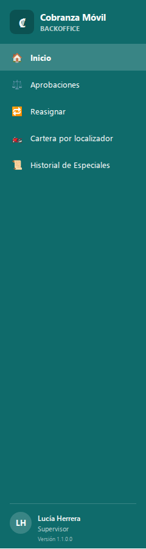
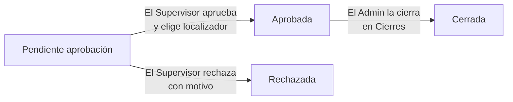
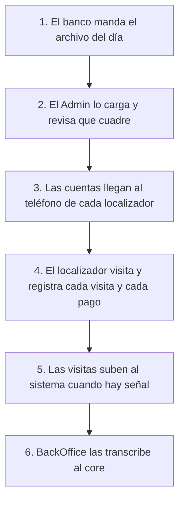

# Conceptos básicos de Cobranza Móvil

Esta guía es para todas las personas que usan Cobranza Móvil, en la calle o en la oficina. Explica las palabras que vas a ver en las pantallas, quién hace qué, cómo es un día de trabajo, qué pasa cuando el teléfono no tiene señal, cómo se cuida el número de tarjeta y cuánto tiempo se guardan los datos. Leela una vez antes de abrir la guía de tu perfil; al final tenés el índice de todas las guías.

## Qué es Cobranza Móvil

Cobranza Móvil sirve para organizar la cobranza de cuentas en mora: a quién hay que visitar, qué pasó en cada visita, cuánto se cobró y qué falta pasar al sistema central del banco (el **core**). Tiene dos apps, y cada persona usa la que corresponde a su trabajo:

| App | Quién la usa | Dónde se abre |
|---|---|---|
| **App del teléfono** | El localizador | En el teléfono, desde la app de Power Apps. En la lista de apps aparece como «App - Cobranza Movil». Funciona aunque no haya señal |
| **App de la oficina** | BackOffice, Solicitante, Supervisor y Admin | En la computadora, desde Power Apps en el navegador. En la lista aparece como «App - CM - Backoffice Canvas». Necesita conexión a internet todo el tiempo |

La app de la oficina es una sola para los cuatro perfiles de oficina. Cada persona ve en el menú de la izquierda solo las opciones de su perfil; abajo del menú aparecen su nombre, su perfil y la versión de la app.

💡 Si la app de la oficina se abre en una pantalla angosta (por ejemplo, en una tablet o en una ventana chica), el menú se esconde. Tocá **☰** arriba a la izquierda para abrirlo.

## Los perfiles y qué hace cada uno

Tu perfil lo decide el permiso que tiene tu usuario. Si no tenés el permiso correcto, pedíselo al Admin.

| Perfil | Qué hace | App | Opciones del menú |
|---|---|---|---|
| **Localizador** | Sale a la calle a visitar clientes con deuda. Registra cada visita y cada pago en el teléfono | Teléfono | **Inicio**, **Cartera** |
| **BackOffice** | Pasa al core lo que registraron los localizadores (transcribe) y revisa lo ya transcrito | Oficina | **Inicio**, **Por transcribir**, **Transcritas** |
| **Solicitante** | Pide asignaciones Especiales para una cuenta y sigue en qué estado están | Oficina | **Inicio**, **Nueva solicitud**, **Mis solicitudes** |
| **Supervisor** | Aprueba o rechaza las Especiales y elige qué localizador las atiende. Reasigna Especiales y mira la cartera de cada localizador | Oficina | **Inicio**, **Aprobaciones**, **Reasignar**, **Cartera por localizador**, **Historial de Especiales** |
| **Admin** | Carga el archivo diario del banco, revisa que la carga cuadre, cierra asignaciones, da de alta cuentas y administra localizadores, datos de clientes y listas | Oficina | **Inicio**, **Reasignar**, **Monitoreo de carga**, **Cargar archivo**, **Alta de cuenta**, **Reconciliación**, **Cierres**, **Localizadores y usuarios**, **Datos maestros**, **Listas** |

Una persona puede tener más de un perfil. En ese caso ve juntas las opciones de todos sus perfiles.

### Si la app de la oficina no te deja entrar

Al abrir la app de la oficina vas a ver **⏳ Cargando tus permisos…** unos segundos. Después puede aparecer:

| Mensaje | Qué significa | Qué hacer |
|---|---|---|
| **Sin acceso** | Tu usuario no tiene ningún perfil de Cobranza Móvil | Pedile al Admin que te asigne el perfil que te corresponde |
| **No se pudo verificar tu acceso** | La app no pudo leer tus permisos en ese momento | Cerrá y volvé a abrir la app. Si sigue igual, avisale al Admin |

### Si el localizador está desactivado

El Admin puede desactivar a un localizador. En ese caso, la app del teléfono muestra **⛔ Tu localizador está desactivado.** y no deja ver la cartera ni registrar visitas o pagos. Lo que tenía asignado no se cierra solo: el Supervisor o el Admin lo pasan a otro localizador con **Reasignar**. Si te pasa, hablá con tu supervisor.

## Palabras clave

### Cliente, cuenta y CIF

- **Cliente**: la persona que tiene la deuda. Se identifica por su **CIF**, el código del cliente en el banco.
- **Cuenta**: una tarjeta o un préstamo en mora de un cliente. Es lo que se cobra. Un cliente puede tener varias cuentas.
- **Saldo vencido**: lo que el cliente debe y ya venció, en córdobas (C$) y en dólares (US$).
- **Mora**: el atraso en los pagos. Se mide en días de mora.

### Cartera

La **cartera** de un localizador son todas las cuentas que tiene asignadas en este momento para cobrar. En el teléfono se ve en **Cartera**, agrupada por cliente. Desde la oficina, el Supervisor la ve en **Cartera por localizador**.

### Asignación y sus tipos

Una **asignación** une una cuenta con un localizador: dice «esta cuenta la cobra esta persona». Cada asignación tiene un tipo:

| Tipo | Qué es | De dónde viene | Cómo se termina |
|---|---|---|---|
| **Diaria** | La cobranza normal de todos los días | Llega en el archivo que manda el banco cada día | Si la cuenta deja de venir en el archivo, aparece en **Reconciliación** y se cierra ahí, solo con indicación del responsable de la operación. Si después vuelve a venir, se abre otra vez sola |
| **Incobrable** | Deuda de difícil cobro | También llega en el archivo del banco | No se cierra sola: la cierra el Admin a mano en **Cierres**, con un motivo |
| **Especial** | Una gestión puntual sobre una cuenta, por ejemplo traer un retiro (un monto a cobrar) | La pide un Solicitante en **Nueva solicitud**, la carga el Admin en **Alta de cuenta** o la manda el banco | La cierra el Admin en **Cierres** cuando la gestión terminó. Si se rechaza, queda cerrada |

Una misma cuenta puede tener al mismo tiempo una Diaria o una Incobrable, y además una Especial.

Las Diarias las reparte el archivo del banco: nadie las reasigna a mano. El Supervisor puede reasignar Especiales aprobadas; el Admin, además, Incobrables.

⚠️ El localizador nunca cierra asignaciones. Si una cuenta ya no se debe cobrar, avisale a tu supervisor.

### Estados de una Especial

Una Especial no llega a ningún localizador hasta que un Supervisor la aprueba. Mientras tanto pasa por estos estados:

| Estado (como se ve en pantalla) | Qué significa | Quién la mueve |
|---|---|---|
| **Pendiente aprobación** | Se pidió y espera que un Supervisor la revise | Nace así cuando el Solicitante la envía |
| **Aprobada** | El Supervisor la aprobó y eligió el localizador. Le aparece en el teléfono en la siguiente sincronización | El Supervisor, en **Aprobaciones** |
| **Rechazada** | El Supervisor no la aprobó y escribió el motivo. Queda cerrada y no llega a ningún localizador | El Supervisor, en **Aprobaciones** |
| **Cerrada** | Ya se terminó la gestión. Desaparece del teléfono en la siguiente sincronización | El Admin, en **Cierres** |

Existe también el estado **Borrador**, que es el punto de partida en el sistema. En el trabajo diario no vas a tener que hacer nada con él.

### Interacción (IN-) y pago (PG-)

- **Interacción**: lo que el localizador registra en cada visita, aunque no haya encontrado al cliente. Lleva un comentario (qué pasó), la ubicación del teléfono, y puede llevar pagos y datos nuevos del cliente. También le decimos **visita**. Cada interacción recibe un número que empieza con **IN-**.
- **Pago**: un cobro registrado dentro de una visita, con monto, moneda y número de recibo. Una visita puede tener varios pagos. Cada pago recibe un número que empieza con **PG-**.
- **Actualización de datos**: si el cliente cambió de teléfono, dirección o correo, el localizador lo anota en la visita. Es un aviso para la oficina: los datos nuevos se pasan al core al transcribir.

💡 Los números IN- y PG- se asignan cuando la visita llega al sistema. Mientras la visita está guardada solo en el teléfono, se ve **pendiente de subir** en vez del número. Es normal.

### Transcribir y grabada

El core del banco no se conecta con Cobranza Móvil: alguien tiene que copiar ahí lo que pasó en cada visita. Eso es **transcribir**, y lo hace BackOffice en **Por transcribir**:

1. BackOffice abre la interacción más vieja de la cola (las primeras en llegar son las primeras en atenderse).
2. La registra en el core, con sus pagos y sus datos nuevos.
3. Escribe en **Código del core** el código que le dio el core y toca **✓ y siguiente**.

Desde ese momento la interacción está **grabada**: se ve en **Transcritas** con **✓ Grabada** y ya no se puede cambiar. Lo que todavía no se transcribió está **pendiente**.

## Un día de trabajo

1. **Llega el archivo del banco.** Todos los días el banco manda un archivo con las cuentas en mora y a qué localizador le toca cada una.
2. **El Admin lo carga.** En **Cargar archivo** primero hace una prueba y, si sale bien, la carga real. En **Monitoreo de carga** confirma que la carga del día terminó, y en **Reconciliación** revisa qué Diarias ya no vinieron en el archivo.
3. **La cartera llega al teléfono.** Cada localizador recibe en el teléfono sus cuentas nuevas y los saldos del día. En **Cartera**, la línea **✓ Carga diaria de hoy** confirma que el teléfono ya tiene la carga de hoy.
4. **El localizador visita.** En cada visita registra una interacción: qué pasó, si el cliente pagó (con el número de recibo) y si cambió algún dato.
5. **Las visitas suben.** Si hay señal, suben solas. Si no hay, quedan guardadas en el teléfono hasta que vuelva la señal (ver la sección siguiente).
6. **La oficina transcribe.** BackOffice toma la cola en **Por transcribir**, la pasa al core y anota el código. Conviene empezar por las que tienen pago. En **Transcritas** se revisa el arqueo del día.

En paralelo, durante el día:

- El **Solicitante** pide Especiales en **Nueva solicitud**.
- El **Supervisor** las aprueba o rechaza en **Aprobaciones**, y reasigna lo que haga falta.
- El **Admin** cierra Incobrables y Especiales terminadas en **Cierres**.

## Qué pasa cuando no hay señal

La app del teléfono está hecha para trabajar en la calle, donde muchas veces no hay señal.

- **Podés trabajar igual.** Sin señal ves tu cartera y registrás visitas y pagos como siempre.
- **Lo que guardás queda en el teléfono.** Al guardar sin señal, la app avisa **✓ Guardado en el teléfono. Se sube cuando vuelva la señal.**
- **Se sube solo.** Cuando el teléfono recupera la señal, la app sube lo pendiente y baja los cambios de la oficina. Con señal, esto pasa solo más o menos cada 5 minutos y también al abrir la app.
- **El estado se ve arriba en el teléfono.** La pastilla de la pantalla de inicio dice cómo está todo. Tocala para abrir **Sincronización**, donde ves el detalle de lo que falta subir.

| La pastilla dice | Qué significa |
|---|---|
| **Todo subido** | No hay nada pendiente en el teléfono |
| **Sincronizando…** | Está subiendo o bajando cambios en este momento |
| **Pendiente de subir** | Hay visitas guardadas en el teléfono que todavía no subieron, con o sin señal |
| **Sincronizado con avisos** | La última sincronización terminó con algo para revisar. Abrí **Sincronización** |
| **Error al sincronizar** | La última sincronización falló. Abrí **Sincronización** y probá de nuevo con señal |
| **Sin conexión** | El teléfono no tiene señal y no tiene nada pendiente de subir |

⚠️ **No borres la app ni sus datos del teléfono si la pastilla no dice Todo subido.** Lo que está pendiente vive solo en el teléfono hasta que sube.

💡 Abrí la app con señal lo antes posible después de las visitas sin conexión. Si una cuenta pasa a otro localizador mientras estás sin señal, tu visita igual se acepta si sube dentro de las 48 horas siguientes. También revisá que la fecha y la hora del teléfono estén bien.

💡 Los cambios de la oficina (una Especial aprobada, una cuenta reasignada o cerrada) llegan al teléfono en la siguiente sincronización, no al instante.

La app de la oficina, en cambio, siempre necesita conexión. Sin internet no funciona.

## Privacidad y número de tarjeta

🔒 Los números de tarjeta y de préstamo son datos protegidos. En todas las pantallas se ven ocultos: cuatro puntos y los últimos 4 dígitos, por ejemplo **•••• 1234**.

- El número completo solo lo pueden ver el localizador que tiene la cuenta asignada (botón **Ver número** en el detalle de la cuenta o al registrar la visita, que lo vuelve a ocultar solo a los 30 segundos) y BackOffice, que lo necesita para transcribir al core.
- Para buscar una cuenta, usá los **últimos 4 dígitos**, el CIF o el nombre del cliente. Dos cuentas distintas pueden terminar en los mismos 4 dígitos: fijate también en el nombre del cliente.

🔒 **No escribas números de tarjeta en los comentarios** ni en las direcciones. Si la app ve algo que parece un número de tarjeta, avisa **⚠ No escribas números de tarjeta en el comentario: se van a guardar ocultos (•••• y los últimos 4).** Te deja guardar igual, pero el sistema lo guarda oculto y el número no le sirve a nadie. Para identificar la cuenta no hace falta: la visita ya queda unida a su cuenta.

🔒 No compartas capturas de pantalla con datos de clientes por fuera de la operación, y no prestes tu usuario: todo lo que se registra queda a tu nombre.

## Cuánto tiempo se guardan los datos

Nada se borra desde las apps. Cuando algo termina, se **cierra**, y el sistema borra solo lo viejo según estos plazos:

| Qué | Cuánto se guarda |
|---|---|
| Visitas (interacciones), pagos y datos nuevos de clientes | **2 años** desde que se registraron |
| Datos que manda el banco (cliente, cuenta, saldos) | Mientras la cuenta siga en la cartera, y unos **14 días más** después de que el banco deja de mandarla. Si vuelve a venir en ese tiempo, conserva su historia |
| Una cuenta con visitas sin transcribir | No se borra hasta que se transcriben |
| La foto de saldos de cada día | **7 días** |
| El archivo que manda el banco | Se borra apenas termina de cargarse |
| Historial en el teléfono del localizador | Los **últimos 90 días**. En **Pagos e interacciones** se pueden ver hasta 89 días atrás |
| Localizadores, productos y opciones de las listas | No se borran: se desactivan |

Una asignación cerrada (por Reconciliación, por Cierres o por un rechazo) no se borra enseguida: queda como historia y desaparece del teléfono en la siguiente sincronización.

Si la cuenta de una visita ya no existe (el banco dejó de mandarla), la visita se sigue viendo con el CIF y los últimos 4 dígitos, y en lugar del cliente aparece **(cuenta fuera de cartera)** en la oficina o **(cuenta ya no asignada)** en el teléfono.

## Guías por perfil

| Guía | Para quién | Qué vas a encontrar |
|---|---|---|
| [Conceptos básicos](00-conceptos.md) | Todos | Esta guía |
| [App del localizador](01-localizador.md) | Localizador | Cartera, ficha del cliente, registrar visitas y pagos, pagos del día, sincronización |
| [Transcripción](02-backoffice.md) | BackOffice | **Por transcribir** y **Transcritas** |
| [Solicitudes de Especiales](03-solicitante.md) | Solicitante | **Nueva solicitud** y **Mis solicitudes** |
| [Supervisión](04-supervisor.md) | Supervisor | **Aprobaciones**, **Reasignar**, **Cartera por localizador**, **Historial de Especiales** |
| [Administración diaria](05-admin.md) | Admin | **Monitoreo de carga**, **Cargar archivo**, **Alta de cuenta**, **Reconciliación**, **Cierres**, **Localizadores y usuarios**, **Datos maestros**, **Listas**, **Reasignar** |
| [Preguntas frecuentes](06-preguntas-frecuentes.md) | Todos | Dudas comunes y qué hacer cuando algo no sale como esperabas |
