# App del localizador

Esta guía es para el **localizador**: la persona que sale a la calle a visitar clientes con deuda. Explica cómo usar la app del teléfono para ver tu cartera, revisar la ficha de cada cliente y cada cuenta, registrar tus visitas (interacciones), los pagos que recibís y los datos nuevos que te da el cliente, y cómo saber si todo eso ya llegó a la oficina. La app funciona también **sin señal**: lo que registrás se guarda en el teléfono y se sube solo cuando vuelve la conexión.

Si todavía no conocés los conceptos de cartera, interacción o tipos de asignación (Diaria, Incobrable, Especial), leé primero [Conceptos básicos](00-conceptos.md).

## Antes de empezar

- **Teléfono**: necesitás la app **Power Apps** instalada en tu teléfono (la bajás de la tienda de aplicaciones de tu teléfono, como cualquier otra app). Dentro de Power Apps vas a encontrar la app de Cobranza Móvil. Usala siempre desde el teléfono: es la única forma de trabajar sin señal.
- **Tu usuario**: tiene que tener el permiso de **Localizador** y estar ligado a tu nombre de localizador. Las dos cosas las hace el Admin; si te falta alguna, pedíselo. Sin ese vínculo la app abre, pero tu cartera aparece vacía.
- **Señal la primera vez**: la primera vez que abrís la app el teléfono baja tu cartera. Hacelo con buena señal (de preferencia wifi) y antes de salir a la calle.

## Cómo instalar y abrir la app por primera vez

Para qué: dejar tu cartera guardada en el teléfono, así podés trabajar aunque no tengas señal.

1. Instalá **Power Apps** desde la tienda de aplicaciones de tu teléfono.
2. Abrila e iniciá sesión con tu usuario y contraseña del trabajo.
3. En la lista de apps, tocá la de Cobranza Móvil (normalmente se llama «App - Cobranza Movil»).
4. Esperá a que termine de bajar la información. La primera vez puede tardar varios minutos si tu cartera es grande; no cierres la app mientras tanto.
5. Se abre la pantalla **Inicio** con el saludo «Hola, …» y tu nombre.
6. Tocá **Cartera** en la barra de abajo. Mientras arma la lista vas a ver «Cargando datos...». Cuando termina, revisá que aparezcan tus clientes y que debajo del saldo diga **«✓ Carga diaria de hoy · …»**.

Qué esperar después: desde ese momento la app trabaja con lo que está guardado en el teléfono. Cada vez que hay señal, el teléfono sube lo que registraste y baja los cambios (más o menos cada 5 minutos), sin que tengas que hacer nada.

Errores comunes:

- La cartera aparece vacía: tu usuario no está ligado a tu nombre de localizador, o todavía no terminó de bajar. Esperá unos minutos con señal; si sigue vacía, avisale al Admin.
- Aparece «⚠ No hay carga diaria en el teléfono. Sincronizá.»: el teléfono no terminó de bajar tu cartera (o no tenés cuentas Diarias asignadas). Ver [Cómo revisar la sincronización](#cómo-revisar-la-sincronización).
- La sincronización da error y el detalle incluye «Tu usuario no está vinculado a ningún localizador; pedile al Admin que lo vincule en Localizadores y usuarios»: el sistema no acepta tus visitas hasta que el Admin vincule tu usuario. Avisale enseguida.

## Cómo moverte por la app

- **Barra de abajo**: **Inicio** (tu resumen del día) y **Cartera** (tus clientes).
- **Flecha ←** arriba a la izquierda: vuelve a la pantalla anterior.
- **Pastilla de estado** arriba a la derecha (en Inicio y en Cartera): un punto de color y un texto que dice cómo va la sincronización: «Todo subido», «Sincronizando…», «Pendiente de subir», «Sincronizado con avisos», «Error al sincronizar» o «Sin conexión». Tocala para abrir la pantalla **Sincronización**.
- **Aa**: cambia el tema (día o noche) y el tamaño de la letra. Está en todas las pantallas.

## Cómo leer tu resumen del día (Inicio)

Para qué: ver de un vistazo cuánto cobraste hoy y a quiénes visitaste.

Lo que ves, de arriba hacia abajo:

- **«Hola, …»** con tu nombre y la fecha de hoy.
- **Cobrado hoy**: la suma de los pagos que registraste hoy, en córdobas (**C$**) y en dólares (**US$**). Debajo, «N pago(s) · N interacción(es) · Ver detalle ›».
- Tres contadores: **Interacciones** (visitas registradas hoy), **Cuentas** (cuántas cuentas distintas visitaste) y **Clientes** (cuántos clientes distintos).
- **Interacciones de hoy**: la lista de lo que registraste hoy, con la cantidad de visitas de cada fila («N interac.»). Si todavía no registraste nada, la lista está vacía.

Pasos:

1. Para ver el detalle de lo cobrado, tocá la tarjeta **Cobrado hoy**. Se abre **Pagos e interacciones** en el día de hoy (ver [Cómo revisar los pagos e interacciones de un día](#cómo-revisar-los-pagos-e-interacciones-de-un-día)).
2. Para cambiar cómo se agrupa la lista, usá el selector a la derecha de «Interacciones de hoy»:
   - **👤 Cliente**: una fila por cliente.
   - **▤ Cuenta**: una fila por cuenta, con el producto y el número oculto (•••• y los últimos 4).

   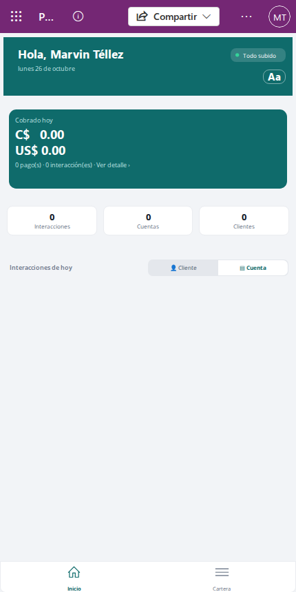

3. Tocá una fila para abrirla: por cliente se abre la ficha del cliente en la pestaña **Interacciones**; por cuenta, el detalle de la cuenta en la pestaña **Interacciones**.

💡 Los números de Inicio se calculan con lo que está guardado en tu teléfono, así que incluyen también lo que todavía no se subió.

Si una fila dice **«(cuenta ya no asignada)»**, esa cuenta salió de tu cartera después de que la visitaste. Al tocarla aparece «Esa cuenta ya no está en tu cartera, su detalle no se puede abrir.». Ver [Si una cuenta ya no está asignada](#si-una-cuenta-ya-no-está-asignada).

## Cómo cambiar el tema y el tamaño de letra («Aa»)

Para qué: leer mejor la pantalla a pleno sol, de noche o si preferís letra más grande.

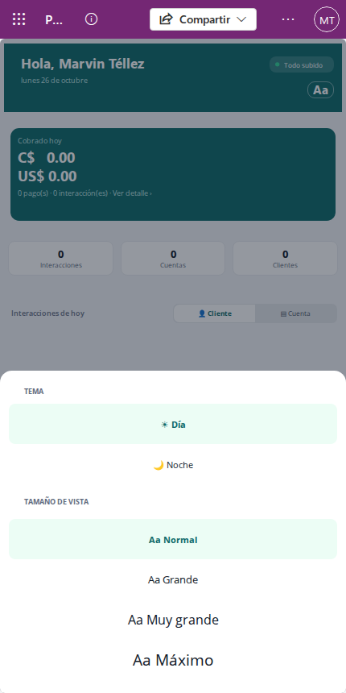

1. Tocá **Aa** en cualquier pantalla.
2. En **TEMA**, elegí **☀ Día** (fondo claro) o **🌙 Noche** (fondo oscuro). El cambio se ve enseguida.
3. En **TAMAÑO DE VISTA**, elegí **Aa Normal**, **Aa Grande**, **Aa Muy grande** o **Aa Máximo**. Al elegir un tamaño, la hoja se cierra sola.
4. Si solo cambiaste el tema, cerrá la hoja tocando la parte oscura de arriba.

Qué esperar después: el teléfono recuerda tu elección; la próxima vez que abras la app se ve igual.

## Cómo revisar tu cartera

Para qué: ver todos los clientes que tenés asignados, cuánto deben y en qué orden vas a visitarlos.

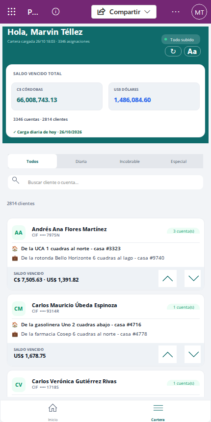

Tocá **Cartera** en la barra de abajo. Vas a ver:

- Arriba, **«Cartera cargada dd/mm hh:mm · N asignaciones»**: cuándo se armó la lista que estás viendo.
- **SALDO VENCIDO TOTAL** de toda tu cartera, separado en **C$ CÓRDOBAS** y **US$ DÓLARES**, y cuántas cuentas y clientes tenés.
- La línea de la **carga diaria**, que te dice si tu teléfono tiene la cartera del día:
  - **«✓ Carga diaria de hoy · …»** (en verde): estás al día.
  - **«⚠ Carga diaria del …: todavía no es la de hoy. Sincronizá.»** (en rojo): tu teléfono tiene la cartera de un día anterior.
  - **«⚠ No hay carga diaria en el teléfono. Sincronizá.»** (en rojo): el teléfono todavía no bajó tu cartera, o no tenés cuentas Diarias.
- Una tarjeta por cliente, con sus iniciales, su nombre, su CIF, cuántas cuentas tiene («N cuenta(s)»), su dirección de casa (🏠) y de trabajo (💼) y su **SALDO VENCIDO**. Si no tiene dirección de casa, dice «🏠 Sin dirección registrada».

⚠️ Si la carga diaria está en rojo, conectate a una señal y seguí los pasos de [Cómo revisar la sincronización](#cómo-revisar-la-sincronización) antes de salir a visitar: podrías estar trabajando con saldos viejos.

### Filtrar por tipo de asignación

1. Tocá una de las pestañas: **Todos**, **Diaria**, **Incobrable** o **Especial**.
2. La lista muestra solo los clientes que tienen al menos una cuenta de ese tipo. Abajo del buscador se actualiza el contador «N clientes».

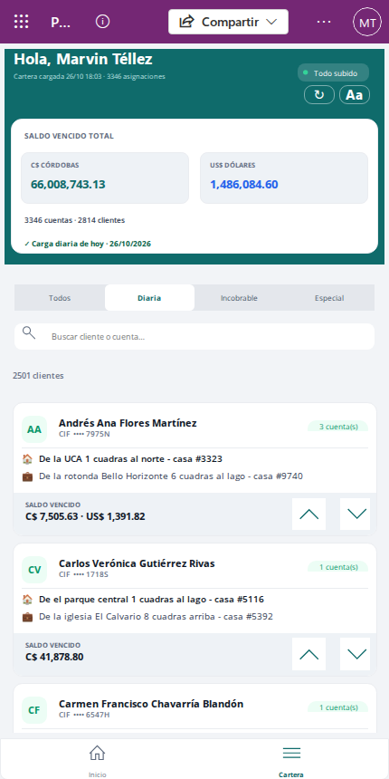

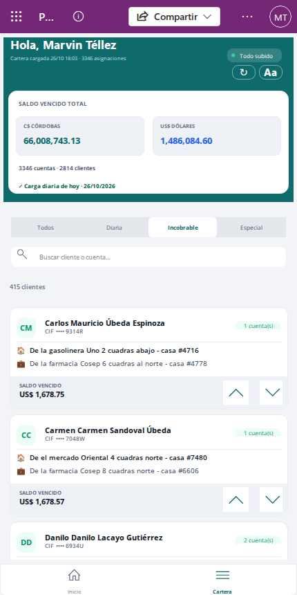

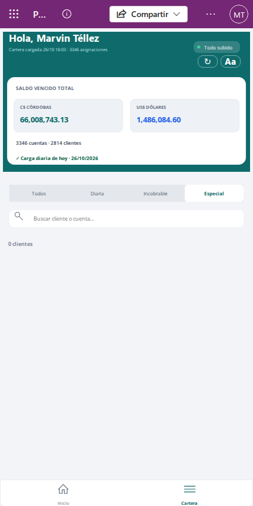

💡 Las Especiales solo aparecen cuando ya fueron aprobadas. Una Especial pendiente o rechazada no llega a tu teléfono.

### Buscar un cliente

1. Tocá el buscador **«Buscar cliente o cuenta…»**.
2. Escribí parte del nombre del cliente (por ejemplo, «Pérez») o los últimos 4 dígitos de la tarjeta o del préstamo (por ejemplo, «1234»).
3. La lista se filtra al terminar de escribir. Para ver todo de nuevo, borrá el texto.

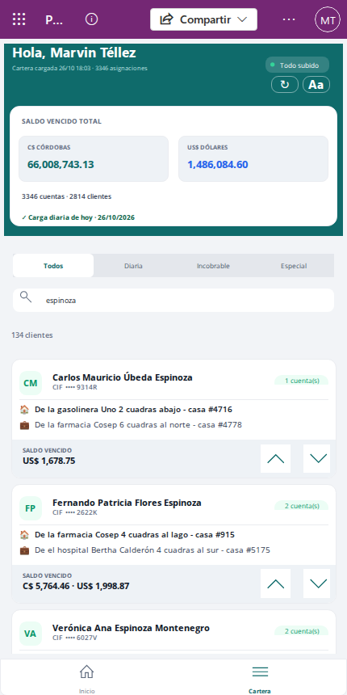

### Ordenar tu ruta con las flechas

Para qué: poner los clientes en el orden en que pensás visitarlos.

1. En la tarjeta de un cliente, tocá la **flecha hacia arriba** para subirlo un lugar o la **flecha hacia abajo** para bajarlo un lugar.
2. Repetí hasta dejarlo donde querés. Si tenés un filtro o una búsqueda activa, el cliente cambia de lugar con el vecino que estás viendo en la lista.
3. El orden se guarda solo cuando salís de la Cartera o cuando tocás **↻**.

Qué esperar después: el orden queda guardado y lo vas a ver igual la próxima vez. Los clientes nuevos que te asignen aparecen al final, en orden alfabético.

Si no se puede guardar el orden aparece «No se pudo guardar el orden de la cartera. Se reintenta al salir de nuevo.». No pasa nada: se vuelve a intentar la próxima vez que salgas de la Cartera.

### Volver a armar la lista (↻)

El botón **↻** de arriba guarda tu orden y vuelve a armar la lista con lo que ya está en el teléfono. No baja nada nuevo: para eso está la sincronización.

- Si el orden no se pudo guardar, la lista no se rearma (para no perderlo) y aparece «No se pudo guardar el orden de la cartera; no se recargó para no perderlo. Reintentá con señal.».
- Si aparece «N asignación(es) sin datos de la cuenta. Sincronizá para completarlas.», al teléfono le falta información de algunas cuentas. Conectate y usá **⟳ Actualizar todo desde el servidor** (ver [Cómo revisar la sincronización](#cómo-revisar-la-sincronización)).

💡 Cuando termina una sincronización, la lista se rearma sola si estás en la Cartera y no tenés cambios de orden sin guardar.

## Cómo ver la ficha de un cliente

Para qué: tener a mano los teléfonos, las direcciones y todas las cuentas del cliente antes de visitarlo.

1. En la **Cartera**, tocá la tarjeta del cliente (en cualquier parte menos en las flechas).
2. Se abre su ficha, en la pestaña **Cuentas (N)**.

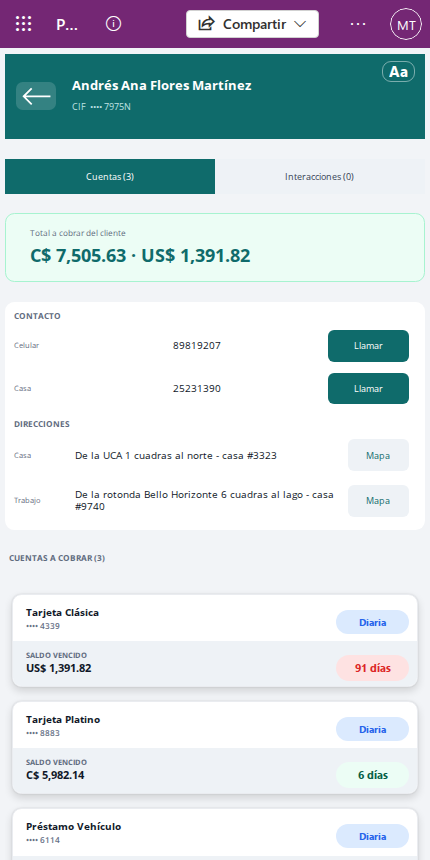

En la pestaña **Cuentas** ves:

- **Total a cobrar del cliente**: la suma del saldo vencido de todas sus cuentas.
- **CONTACTO**: sus teléfonos. Tocá **Llamar** para marcar directo desde tu teléfono. Si no tiene, dice «Sin teléfonos registrados».
- **DIRECCIONES**: la de casa y la del trabajo. Tocá **Mapa** para buscarla en el mapa (necesita señal). Si no tiene, dice «Sin direcciones registradas».
- **CUENTAS A COBRAR (N)**: cada cuenta con su producto, el número oculto (•••• 1234), el tipo (**Diaria**, **Incobrable** o **Especial**), el **SALDO VENCIDO** y los días de mora. El color de los días de mora te ayuda a priorizar: verde hasta 15 días, amarillo hasta 60 y rojo con más de 60. Si una cuenta tiene además una Especial aprobada, junto al número dice «⭐ Especial».

Tocá una cuenta para abrir su detalle.

En la pestaña **Interacciones (N)** ves todas las visitas registradas en cualquiera de las cuentas del cliente, de la más nueva a la más vieja. Cada una muestra la fecha y hora (🕘), el producto, el comentario y, si corresponde, los pagos («💵 C$ … (rec. …)»), la marca «✏️ Datos actualizados» y la ubicación (📍). Si el cliente no tiene visitas, la lista queda vacía.

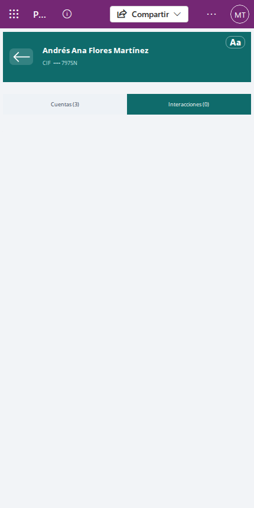

## Cómo ver el detalle de una cuenta

Para qué: saber exactamente cuánto cobrar en esa cuenta y en qué situación está antes de registrar la visita.

1. En la ficha del cliente, tocá la cuenta en **CUENTAS A COBRAR**.
2. Se abre el detalle, en la pestaña **Detalle**.

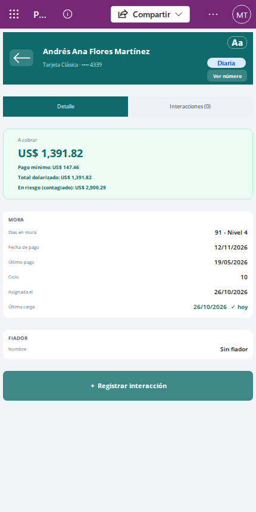

Arriba ves el nombre del cliente, el producto con el número oculto (•••• 1234), el tipo de asignación y el botón **Ver número**. Debajo:

- **A cobrar**: el saldo vencido de la cuenta. También **Pago mínimo**, **Total dolarizado** y **En riesgo (contagiado)**.
- **MORA**: **Días en mora** (con su nivel), **Fecha de pago**, **Último pago**, **Ciclo**, **Asignada el** y **Última carga**. Si la última carga es de hoy dice «✓ hoy» en verde; si no, aparece en rojo con «⚠».
- **FIADOR**: el nombre (o «Sin fiador») y, si la hay, su dirección.
- **PEDIDO ESPECIAL** (solo si la cuenta tiene una Especial aprobada): **Tipo Especial**, **Retiro** (el monto que te piden traer) y **Nota**.

La pestaña **Interacciones (N)** muestra las visitas de esta cuenta, de la más nueva a la más vieja. En las dos pestañas, abajo, está el botón **＋ Registrar interacción**.

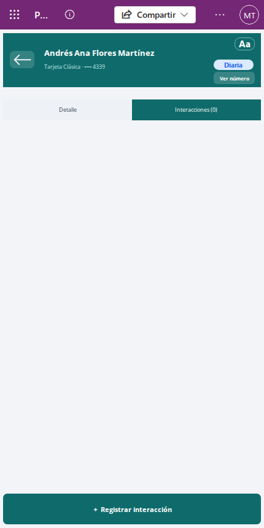

### Ver el número completo de la tarjeta («Ver número»)

Para qué: confirmar el número completo con el cliente cuando hace falta.

1. Tocá **Ver número**.
2. El número completo aparece arriba, en lugar de •••• y los últimos 4. El botón cambia a **Ocultar**.
3. Cuando termines, tocá **Ocultar**.

Qué esperar después: el número se oculta solo a los 30 segundos o cuando salís de la pantalla, aunque no toques **Ocultar**. El botón también está en la pantalla de registrar la interacción.

Si aparece «El número de tarjeta no está disponible en este dispositivo. Sincronizá y volvé a intentar.», el teléfono todavía no tiene ese dato. Conectate a una señal, esperá la sincronización y probá de nuevo.

🔒 **Cuidado con el número completo.** Es un dato protegido del cliente:

- Mostralo solo cuando lo necesités y ocultalo en cuanto termines.
- No dejes que otras personas vean tu pantalla mientras está visible.
- No le saques captura de pantalla ni lo anotes en papel, en mensajes o en el comentario de la visita.

## Cómo registrar una interacción

Para qué: dejar constancia de cada visita (aunque no encuentres al cliente o no te pague) para que la oficina la pase al sistema del banco.

1. Abrí el detalle de la cuenta que visitaste y tocá **＋ Registrar interacción**.
2. Arriba ves el resumen **A cobrar** de la cuenta. Si la cuenta tiene una Especial aprobada, también ves «⭐ Especial · retiro pedido: …».

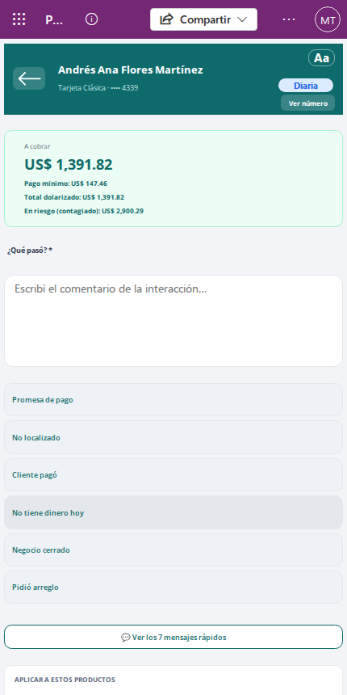

3. En **¿Qué pasó? \***, escribí lo que pasó en la visita. Es obligatorio. Por ejemplo: «Cliente atendió en la puerta. Promete pagar el viernes.».
4. Si querés ahorrar tiempo, tocá uno de los **mensajes rápidos** (por ejemplo, **Promesa de pago** o **No localizado**). El texto se agrega al final de tu comentario, separado por un punto. Podés tocar varios y después corregir el texto a mano.

   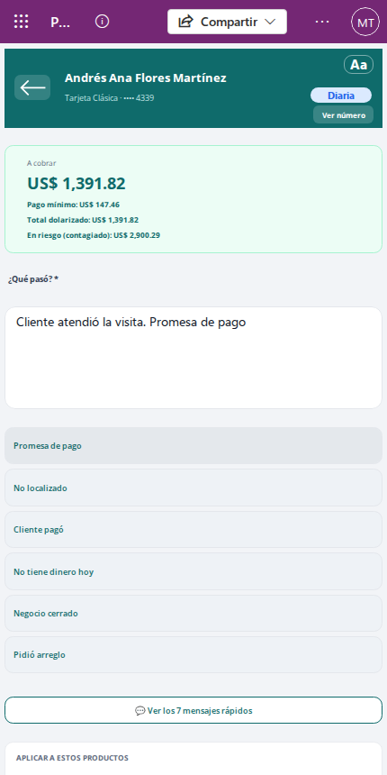

5. Si hay más de seis mensajes, tocá **💬 Ver los N mensajes rápidos** para ver la lista completa. Podés buscar con **🔍 Buscar…**; tocá un mensaje para agregarlo y la hoja se cierra. Para cerrarla sin elegir, tocá **✕**. Si la búsqueda no encuentra nada dice «No hay mensajes con «…».».

   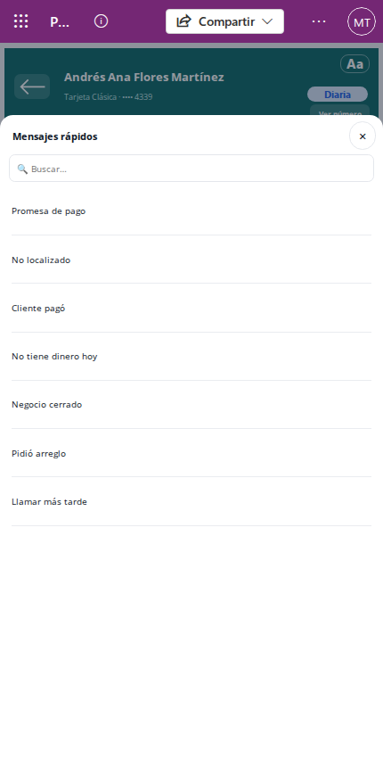

6. Bajá hasta **APLICAR A ESTOS PRODUCTOS**. La cuenta que abriste está marcada con «ACTUAL» y no se puede desmarcar. Si la visita sirve también para otras cuentas del mismo cliente, tocalas para marcarlas (☑). Abajo dice cuántos productos marcaste.

   ⚠️ Con más de un producto marcado no se puede registrar pago ni datos nuevos: los interruptores **Aplica pago** y **Actualizar datos del cliente** quedan apagados y la nota dice «Pago y actualización de datos quedan deshabilitados (son por 1 cuenta).». Para registrar un pago, desmarcá los otros productos.

   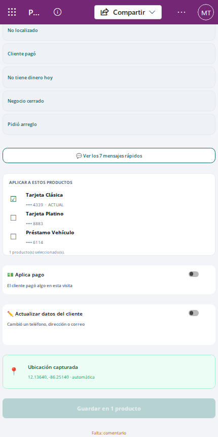

7. Revisá el cuadro de ubicación (📍):
   - **«Ubicación capturada»** con las coordenadas y «automática»: está todo bien.
   - **«Sin ubicación: activá el GPS»** y «Al guardar te va a pedir confirmación»: encendé la ubicación del teléfono y esperá unos segundos.
8. Tocá el botón de guardar. Su texto depende de lo que marcaste: **Guardar en 1 producto**, **Guardar en N productos**, **Guardar interacción + pago**, **Guardar interacción + datos** o **Guardar interacción + pago + datos**. Mientras guarda dice **Guardando…**.

Qué esperar después:

- Aparece «✓ Guardado. Se sube en la próxima sincronización.» (con señal) o «✓ Guardado en el teléfono. Se sube cuando vuelva la señal.» (sin señal), y la app vuelve al detalle de la cuenta.
- Si marcaste varios productos, se guarda una interacción por cada uno, con el mismo comentario.
- La visita aparece enseguida en Inicio y en la pestaña Interacciones. Su número (IN-…) lo pone el sistema cuando se sube; mientras tanto, en **Sincronización** y en **Pagos e interacciones** se ve como pendiente de subir.

### Si el botón de guardar está apagado

Debajo del botón aparece **«Falta: …»** con lo que te falta completar:

| Dice | Qué hacer |
|---|---|
| comentario | Escribí algo en **¿Qué pasó? \*** |
| un producto | Marcá al menos un producto |
| un pago | Encendiste **Aplica pago** pero no agregaste ningún pago: tocá **＋ Agregar pago** o apagá el interruptor |
| monto y recibo en cada pago | Cada pago necesita un monto mayor que cero y su número de recibo |
| recibo de hasta 30 caracteres | Acortá el número de recibo |
| recibos sin repetir | Dos pagos de la misma visita tienen el mismo recibo |
| un dato del cliente | Encendiste **Actualizar datos del cliente** pero no escribiste ningún dato nuevo |
| teléfonos de 7 a 20 dígitos y un correo válido | Corregí el teléfono o el correo que escribiste mal |

### Aviso de número de tarjeta en el comentario

Si escribís en el comentario algo que parece un número de tarjeta (13 dígitos o más seguidos, aunque tengan espacios o guiones), aparece el aviso **«⚠ No escribas números de tarjeta en el comentario: se van a guardar ocultos (•••• y los últimos 4).»**

El aviso no te impide guardar, pero el número no va a quedar completo: el sistema lo guarda oculto. 🔒 Borralo del comentario; si necesitás referirte a la cuenta, alcanza con los últimos 4 dígitos.

### Guardar sin ubicación

Si el GPS no da la ubicación, al tocar guardar aparece «No hay ubicación del GPS. Activalo y esperá unos segundos; si igual querés guardar, tocá «Guardar sin ubicación».». El botón cambia a **Guardar sin ubicación**.

1. Encendé la ubicación del teléfono y esperá unos segundos. Si el cuadro cambia a «Ubicación capturada», tocá guardar normalmente.
2. Si no hay forma de obtenerla, tocá **Guardar sin ubicación** para guardar igual.

## Cómo registrar un pago

Para qué: anotar lo que el cliente te pagó en la visita, con el número del recibo que le entregaste, para que la oficina lo aplique.

Un pago siempre va junto con una interacción y es de **una sola cuenta**: la que abriste.

1. En **Registrar interacción**, escribí el comentario como en cualquier visita.
2. Encendé el interruptor **💵 Aplica pago** («El cliente pagó algo en esta visita»). Si marcaste otros productos, primero desmarcalos: con más de uno marcado el interruptor no se puede encender. Con el pago encendido, la nota dice «🔒 Con pago o datos, solo aplica a esta cuenta.» y no se pueden marcar otros productos.
3. Tocá **＋ Agregar pago**. Aparece una línea de pago.

   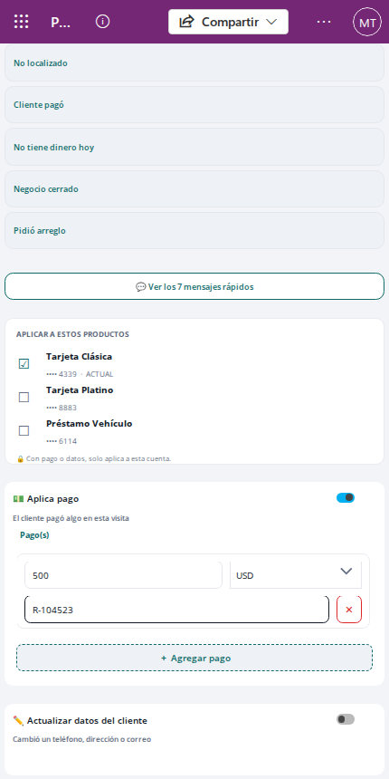

4. En **Monto**, escribí lo que pagó el cliente (por ejemplo, 500).
5. En la moneda, elegí **NIO** (córdobas) o **USD** (dólares). La app propone NIO, salvo que la cuenta solo deba en dólares.
6. En **N° de recibo**, escribí el número del recibo que le entregaste (hasta 30 caracteres).
7. Si el cliente pagó en las dos monedas o con más de un recibo, tocá **＋ Agregar pago** de nuevo y completá otra línea. Para quitar una línea, tocá **✕** a su derecha.
8. Tocá **Guardar interacción + pago**.

   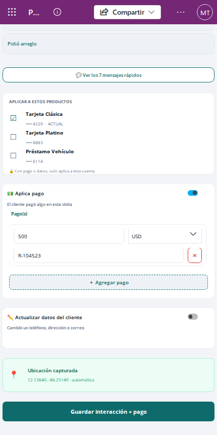

Qué esperar después: el mismo aviso de guardado que en cualquier visita. El pago aparece en **Cobrado hoy** de Inicio y en **Pagos e interacciones**. Su número (PG-…) lo pone el sistema cuando se sube.

Mensajes que te pueden aparecer al guardar:

- **«El pago es mayor que el saldo vencido de la cuenta. Revisá el monto; si está bien, tocá «Confirmar pago».»** El botón cambia a **Confirmar pago**. Revisá el monto y la moneda; si están bien, tocá **Confirmar pago**. Si cambiás el monto, la moneda o las líneas, la app vuelve a revisar.
- **«Ese número de recibo ya está registrado. Revisalo antes de guardar.»** Ese recibo ya lo usaste en otro pago. Revisá el número en tu talonario y corregilo.

⚠️ El teléfono solo puede comparar el recibo con tus pagos de los últimos 90 días. Si el recibo ya existía en otro lado, el pago se guarda igual y la oficina lo ve marcado para revisarlo. Anotá siempre el número exacto del recibo en papel que entregaste.

## Cómo actualizar los datos del cliente

Para qué: avisarle a la oficina que el cliente cambió un teléfono, una dirección o su correo. La oficina se encarga de cargarlo en el sistema del banco.

⚠️ Esto es un pedido a la oficina: la ficha del cliente en tu teléfono sigue mostrando los datos anteriores.

Igual que el pago, la actualización de datos va con una interacción y es de **una sola cuenta**.

1. En **Registrar interacción**, escribí el comentario.
2. Encendé el interruptor **✏️ Actualizar datos del cliente** («Cambió un teléfono, dirección o correo»).
3. Aparece **«Nuevos datos · dejá en blanco lo que no cambió»** con estos campos: **Teléfono casa**, **Teléfono celular**, **Teléfono trabajo**, **Dirección casa**, **Dirección EC** (la dirección donde recibe el estado de cuenta), **Dirección trabajo** y **Correo electrónico**.

   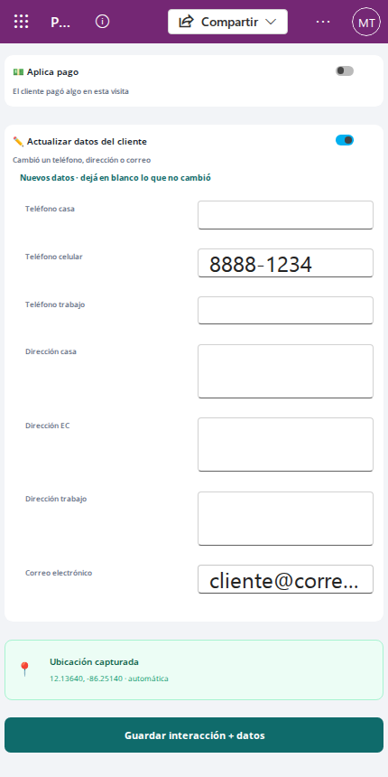

4. Escribí solo lo que cambió. Dejá en blanco el resto.
5. Tocá **Guardar interacción + datos** (o **Guardar interacción + pago + datos** si también registraste un pago).

Validaciones:

- Tenés que escribir al menos un dato.
- Los teléfonos llevan de 7 a 20 caracteres y solo pueden tener números, espacios, «+», «-» y paréntesis. Por ejemplo, «8888 1234» o «+505 2222-3333».
- El correo tiene que tener forma de correo (por ejemplo, «juan.perez@correo.com»).

Si algo está mal, el botón queda apagado y debajo dice «Falta: teléfonos de 7 a 20 dígitos y un correo válido».

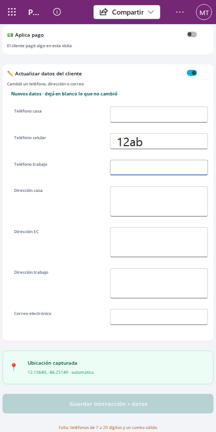

🔒 No escribas números de tarjeta en las direcciones: igual que en el comentario, el sistema los guarda ocultos.

Qué esperar después: en las interacciones de la cuenta, esa visita aparece con la marca «✏️ Datos actualizados».

## Cómo revisar los pagos e interacciones de un día

Para qué: cuadrar lo que cobraste en el día, buscar un pago o revisar las visitas de un día anterior.

1. En **Inicio**, tocá la tarjeta **Cobrado hoy**. Se abre **Pagos e interacciones** en el día de hoy y en la pestaña de pagos.
2. Arriba ves el día elegido (por ejemplo, «📅 Hoy · Lun …»), el **Total cobrado** del día (en córdobas y, si hubo, en dólares) y cuántos pagos e interacciones hay.

   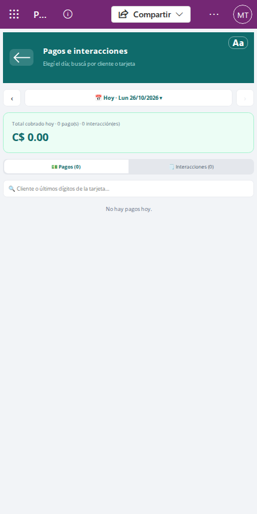

3. Tocá **💵 Pagos (N)** para ver los pagos: cliente, producto, número oculto, monto, recibo y hora.
4. Tocá **🗒 Interacciones (N)** para ver las visitas: hora, cliente, producto, comentario y marcas («💵 …», «✏️ Datos actualizados», «📍 Con ubicación» y «⏳ Pendiente de subir» si todavía no se subió).

   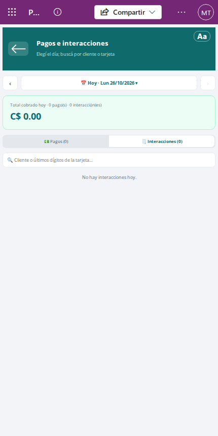

5. Para buscar, escribí en **«🔍 Cliente o últimos dígitos de la tarjeta…»** parte del nombre del cliente o los últimos dígitos de la tarjeta.
6. Tocá un pago o una interacción para abrir la ficha del cliente en la pestaña **Interacciones** y ver el comentario completo.

Para cambiar de día:

- Tocá **‹** para ir al día anterior y **›** para el siguiente (no se puede pasar de hoy).
- O tocá el día de arriba para abrir el calendario. Usá **‹** y **›** para cambiar de mes y tocá un día. **Hoy** vuelve al día de hoy y **Cerrar** cierra el calendario sin cambiar.

  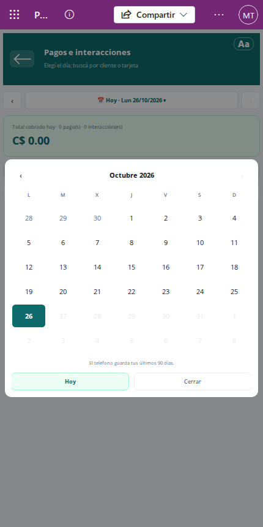

💡 El teléfono guarda tus últimos 90 días, así que no se pueden elegir días más viejos ni días futuros.

Si no hay nada, dice «No hay pagos hoy.» o «No hay interacciones hoy.» (o «… el dd/mm/aaaa.» para otro día, o «… que coincidan con «…».» si estás buscando).

Si una fila dice **«(cuenta ya no asignada)»**, esa cuenta salió de tu cartera y la fila no se puede abrir (al tocarla no pasa nada).

## Cómo revisar la sincronización

Para qué: saber si lo que registraste ya llegó a la oficina y forzar la actualización de tu cartera cuando hace falta.

1. Tocá la pastilla de estado en **Inicio** o en **Cartera**.
2. Se abre **Sincronización** («Estado de tus capturas»).

Lo que ves:

- Una franja con el **estado**:

  | Estado | Qué significa | Qué hacer |
  |---|---|---|
  | **✓ Todo subido** | «No hay capturas por subir. Los cambios del servidor bajan solos cada ~5 min» | Nada |
  | **⟳ Sincronizando…** | «Intercambiando datos con el servidor…» | Esperá a que termine |
  | **🔼 Pendiente de subir** | «Hay capturas por subir» | Conectate a una señal; se suben solas |
  | **⚠ Sincronizado con avisos** | «Tocá «Actualizar todo desde el servidor» para ver el aviso» | Seguí los pasos de abajo |
  | **⚠ Error al sincronizar** | «Tocá «Actualizar todo desde el servidor» para ver el error» | Seguí los pasos de abajo; si sigue, avisale a tu supervisor |
  | **📴 Sin conexión** | «Se suben cuando vuelva la señal» | Seguí trabajando; se suben cuando haya señal |

- **Conexión**: «En línea» o «Sin señal».
- **Última sincronización**: la app no la muestra aquí; dice «ver en «Actualizar todo desde el servidor»».
- **Pendientes por subir**: cuántas capturas (visitas y pagos) están guardadas en el teléfono y todavía no se subieron.
- **Versión de la app**: el número de versión instalada. Se actualiza cuando abrís esta pantalla con señal; sin señal muestra la última conocida, y «—» si nunca se pudo obtener. Te lo pueden pedir si reportás un problema.
- **Capturas de hoy**: aparece solo si registraste algo hoy. Cada visita muestra cliente, producto, hora y su estado:
  - **pendiente de subir**: está guardada en el teléfono y todavía no llegó. Su número IN-/PG- aparece cuando se sube.
  - **subida**: llegó completa.
  - **⚠ incompleta**: la visita subió, pero falta su pago o su actualización de datos.

  Si hoy registraste más de 100, se ven las 100 más recientes y dice «Se muestran las últimas 100 de N capturas de hoy.».

### Botones

- **↻ Recargar la lista**: vuelve a leer lo que ya está en el teléfono y rearma las pantallas (también la Cartera). No baja nada nuevo y funciona sin señal. Aparece «Lista recargada con los datos del teléfono.».
- **⟳ Actualizar todo desde el servidor** (solo con señal; sin señal dice «Sin conexión — no se puede actualizar»): abre la pantalla de estado del dispositivo de Power Apps.
  1. Tocá **⟳ Actualizar todo desde el servidor**.
  2. En la pantalla que se abre, tocá **Buscar actualizaciones** (en inglés, *Check for updates*). Ahí también ves la fecha de la última sincronización y el detalle de cualquier aviso o error.
  3. Esperá a que termine y volvé a la app. Tu cartera se recarga sola: baja lo nuevo y quita lo que ya no te corresponde.

💡 Usá **Actualizar todo desde el servidor** cuando la Cartera dice que la carga diaria no es la de hoy, cuando te avisan que te asignaron o quitaron cuentas, o cuando una captura queda **⚠ incompleta**.

Si una captura sigue **⚠ incompleta** después de actualizar, avisale a BackOffice: la visita llegó, pero su pago o sus datos nuevos no.

## Cómo trabajar sin señal

Para qué: seguir registrando visitas en zonas sin cobertura sin perder nada.

Sin señal podés hacer todo lo de esta guía: ver tu cartera, las fichas, los detalles y el número completo de la tarjeta, registrar interacciones, pagos y datos nuevos, y revisar tus pagos del día. Lo único que necesita señal es:

- **Mapa** (para abrir el mapa) y **Llamar** (necesita señal de teléfono).
- **⟳ Actualizar todo desde el servidor**.
- Ver la versión nueva de la app.

Recomendaciones:

1. Antes de salir, abrí la app con señal y revisá que la Cartera diga **«✓ Carga diaria de hoy · …»**.
2. Durante el día, guardá cada visita normalmente. Vas a ver «✓ Guardado en el teléfono. Se sube cuando vuelva la señal.».
3. Cuando tengas señal, abrí la app y dejala abierta unos minutos para que suba todo.
4. Al final del día, revisá en **Sincronización** que **Pendientes por subir** esté en 0 y que tus capturas de hoy digan **subida**.

⚠️ No borres la app, no cierres la sesión de Power Apps ni limpies los datos del teléfono mientras tengas capturas pendientes de subir: lo que no se subió se perdería.

⚠️ Mantené la fecha y la hora del teléfono correctas (en automático). El sistema usa la hora del teléfono para aceptar visitas registradas sin señal; con la hora mal, una visita puede no ser aceptada.

⚠️ No dejes pasar días sin conectarte. Si te reasignan una cuenta mientras estás sin señal, el sistema acepta tus visitas a esa cuenta si se suben dentro de las 48 horas siguientes a la visita; después de ese plazo pueden no ser aceptadas.

Para entender mejor cómo funciona el trabajo sin señal, ver [Conceptos básicos](00-conceptos.md).

## Si algo sale mal

### Si una cuenta ya no está asignada

Cuando una cuenta sale de tu cartera (el banco dejó de mandarla, el Admin la cerró o se la pasaron a otro localizador), desaparece de tu teléfono en la siguiente sincronización. Lo que registraste antes no se pierde, pero:

- En Inicio, en Pagos e interacciones y en Sincronización la fila aparece como **«(cuenta ya no asignada)»** (en Pagos e interacciones y en Sincronización, con los últimos 4 dígitos).
- Si la tocás en Inicio, aparece «Esa cuenta ya no está en tu cartera, su detalle no se puede abrir.». En Pagos e interacciones y en Sincronización la fila no se abre.

Qué hacer: nada, si ya no tenés que gestionarla. Si creés que es un error y tenés que seguir visitando al cliente, consultá con tu supervisor.

### Si tu localizador está desactivado

Al abrir la app ves solo el mensaje **«⛔ Tu localizador está desactivado.»** y «No podés ver tu cartera ni registrar visitas o pagos. Hablá con tu supervisor.». Si estabas registrando una visita, al guardar aparece «Tu localizador está desactivado: no podés registrar visitas ni pagos. Hablá con tu supervisor.».

Qué hacer: hablá con tu supervisor. Solo el Admin puede volver a activarte. Mientras tanto no vas a poder registrar nada.

### Si aparece «cartera incompleta»

Si al abrir la Cartera aparece **«Tu cartera es más grande de lo que la app puede mostrar y faltan clientes. Avisá a soporte.»**, tu cartera tiene más cuentas de las que la app puede mostrar y algunos clientes no aparecen en la lista.

Qué hacer: avisale a tu supervisor o a soporte enseguida. Sincronizar no lo arregla. Mientras tanto, trabajá con los clientes que sí ves.

### Otros mensajes

| Mensaje | Qué significa | Qué hacer |
|---|---|---|
| «No se pudo guardar la interacción: …» | El teléfono no pudo guardar la visita | Tocá el botón de guardar de nuevo. Si se repite, anotá el mensaje y avisale a tu supervisor |
| «La interacción se guardó, pero no todos los pagos (…). Corregí y tocá Guardar: solo se guardan los que faltan.» | La visita quedó guardada, pero algún pago no | Quedate en la pantalla, corregí y tocá guardar otra vez. Solo se guardan los pagos que faltan |
| «La interacción se guardó, pero no la actualización de datos (…). Tocá Guardar de nuevo.» | La visita quedó guardada, pero los datos nuevos no | Quedate en la pantalla y tocá guardar otra vez |
| «No se pudieron guardar todas las interacciones (…). Tocá Guardar de nuevo: solo se guardan las que faltan.» | Con varios productos marcados, alguno no se guardó | Quedate en la pantalla y tocá guardar otra vez |
| «El número de tarjeta no está disponible en este dispositivo. Sincronizá y volvé a intentar.» | El teléfono no tiene todavía el número completo | Conectate, esperá la sincronización y probá de nuevo |
| «N asignación(es) sin datos de la cuenta. Sincronizá para completarlas.» | Faltan datos de algunas cuentas en el teléfono | Conectate y usá **Actualizar todo desde el servidor** |
| «⚠ Carga diaria del …: todavía no es la de hoy. Sincronizá.» | Tu teléfono tiene la cartera de otro día | Conectate y usá **Actualizar todo desde el servidor** |
| En **Actualizar todo desde el servidor**, el error incluye «Tu usuario no está vinculado a ningún localizador; pedile al Admin que lo vincule en Localizadores y usuarios» | Tu usuario no está vinculado a tu localizador: el sistema no acepta tus visitas | Avisale al Admin para que lo vincule en **Localizadores y usuarios** |

⚠️ Después de un guardado a medias, **no salgas de la pantalla** antes de tocar guardar de nuevo. Si salís, se borra lo que escribiste y, al volver a registrarla, la visita se guarda dos veces.

Para más dudas, revisá las [Preguntas frecuentes](06-preguntas-frecuentes.md).
