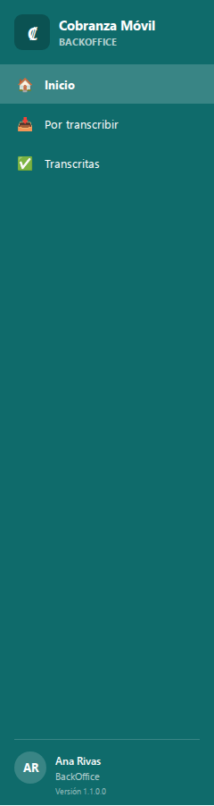
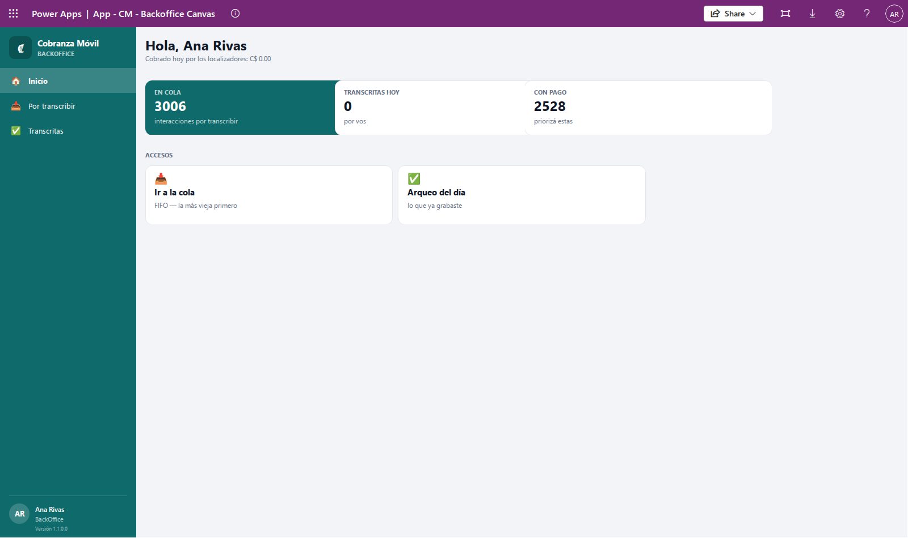
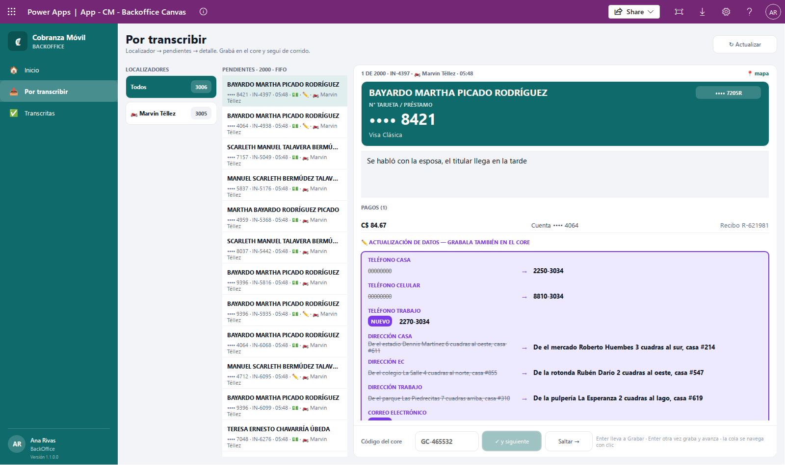
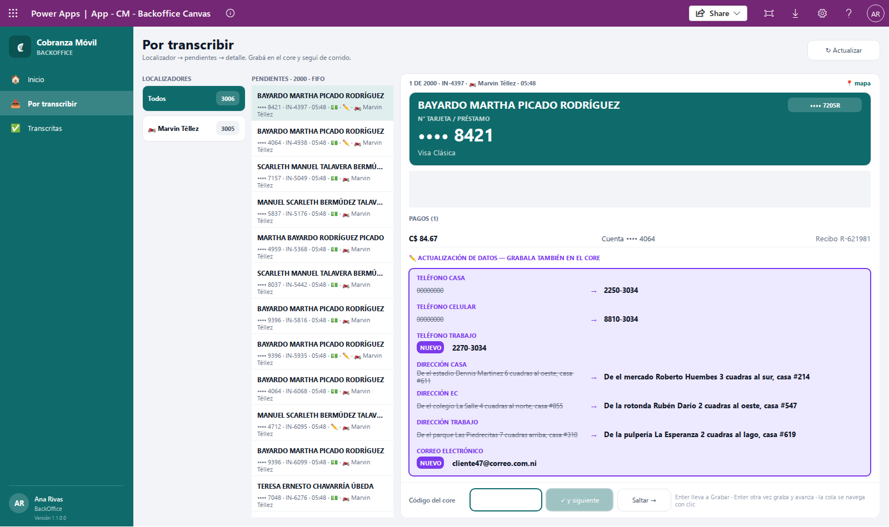
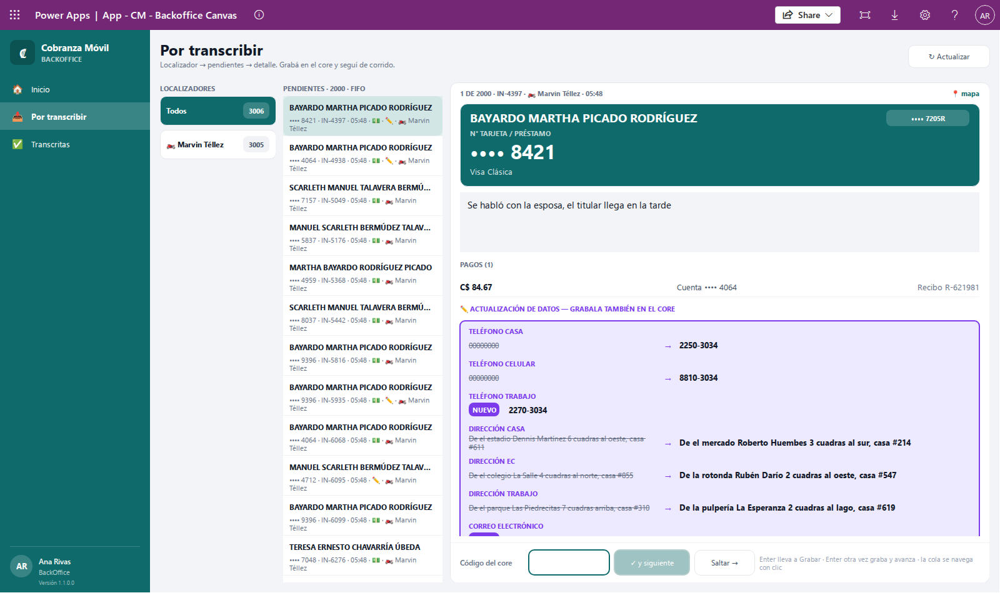
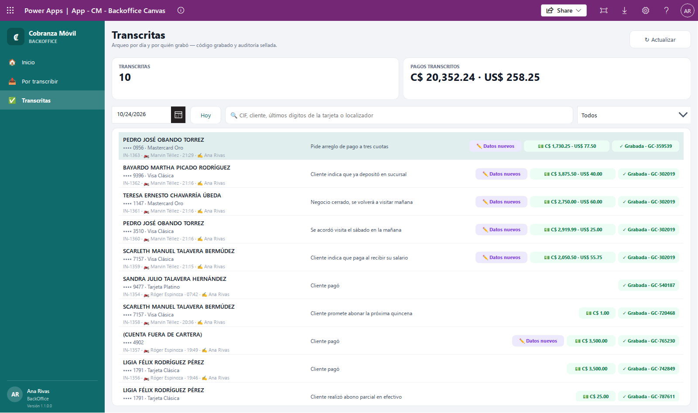
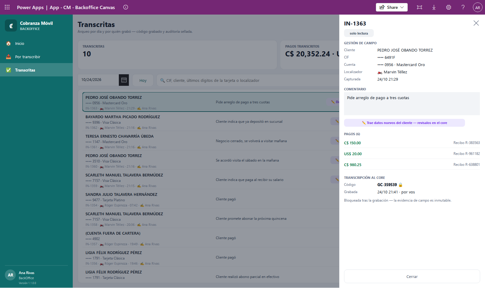
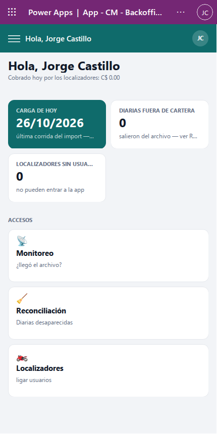

# Guía del BackOffice

Esta guía es para quien trabaja en la oficina pasando al core del banco lo que los localizadores registran en la calle. Con ella vas a poder:

- ver de un vistazo cuánto trabajo hay pendiente,
- transcribir las interacciones una por una, de la más vieja a la más nueva, y dejarlas **grabadas** con el código que te da el core,
- revisar lo que ya grabaste (vos o tus compañeros) en un día, con sus pagos.

Si todavía no tenés claro qué es una interacción, una cartera o los tipos de asignación, leé primero [Conceptos básicos](00-conceptos.md).

## Antes de empezar

### Cómo entrar

1. Abrí Power Apps en el navegador de tu computadora.
2. Abrí la app de la oficina de Cobranza Móvil (en la barra de arriba aparece como «App - CM - Backoffice Canvas»).
3. Esperá unos segundos: la app muestra **Cobranza Móvil** y **Cargando tus permisos** mientras revisa qué perfil tenés.
4. Cuando termina, entrás a **Inicio**.

Para usar estas pantallas, tu usuario tiene que tener el permiso de **BackOffice**. Si no lo tiene, pedíselo al Admin.

### Qué ves en el menú

A la izquierda está el menú. Con el perfil BackOffice tiene tres opciones:

- **Inicio**
- **Por transcribir**
- **Transcritas**

Abajo del menú aparecen tu nombre, tu perfil (**BackOffice**) y la **Versión** de la app. Si tu usuario tiene más de un perfil, el menú suma también las opciones de los otros perfiles.

💡 Si en vez de Inicio ves **Sin acceso**, tu usuario no tiene ningún perfil de Cobranza Móvil: pedile al Admin que te lo asigne. Si ves **No se pudo verificar tu acceso**, cerrá la app y volvé a abrirla; si sigue igual, avisale al Admin.

## Cómo leer la pantalla de Inicio

Para qué: saber cuánto trabajo tenés antes de empezar y entrar rápido a la cola.

Arriba aparece **Hola,** con tu nombre y, debajo, **Cobrado hoy por los localizadores:** con el total cobrado en el día por todos los localizadores, en córdobas y en dólares.

Debajo hay tres tarjetas:

| Tarjeta | Qué cuenta |
|---|---|
| **EN COLA** — interacciones por transcribir | Todas las interacciones que todavía nadie grabó en el core, de todos los localizadores. |
| **TRANSCRITAS HOY** — por vos | Las que grabaste vos hoy. |
| **CON PAGO** — priorizá estas | De las que están en cola, cuántas traen pago. |

En **ACCESOS** tenés dos atajos:

- **Ir a la cola** (FIFO — la más vieja primero): te lleva a **Por transcribir**.
- **Arqueo del día** (lo que ya grabaste): te lleva a **Transcritas**.

💡 Los números se calculan cada vez que entrás a Inicio. Si querés verlos al día, salí a otra pantalla y volvé.

## Cómo transcribir las interacciones (Por transcribir)

Para qué: pasar al core del banco cada visita que registró un localizador (comentario, pagos y datos nuevos del cliente) y dejarla marcada como **grabada**, para que nadie la vuelva a transcribir.

La cola es **FIFO**: la interacción más vieja va primero. Al entrar, la app ya te abre la primera.

### Cómo está armada la pantalla

La pantalla tiene tres partes, de izquierda a derecha:

1. **LOCALIZADORES**: arriba **Todos** y, debajo, cada localizador que tiene interacciones pendientes (con el ícono 🏍️). Cada uno muestra cuántas le faltan. Los que tienen más pendientes salen primero.
2. **PENDIENTES**: la lista de interacciones del localizador elegido, de la más vieja a la más nueva. El título dice cuántas son, por ejemplo **PENDIENTES · 12 · FIFO**; si elegiste un localizador, también muestra su primer nombre. Cada fila tiene:
   - el nombre del cliente,
   - el número de tarjeta oculto («•••• 1234»), el número de interacción (IN-…) y la hora en que se registró,
   - 💵 si trae pago y ✏️ si trae datos nuevos del cliente,
   - con **Todos** elegido, también el primer nombre del localizador.
3. **El detalle** de la interacción abierta (la que está resaltada en la lista).

💡 Si hay más de 2.000 interacciones pendientes, la lista carga solo las 2.000 más viejas. Por eso **PENDIENTES** puede decir 2.000 mientras **Todos** muestra el total real, y algunos localizadores pueden no aparecer todavía. Seguí grabando y tocá **↻ Actualizar** para traer las siguientes.

### Qué muestra el detalle

- **Arriba**: la posición en la cola y los datos de la visita, por ejemplo **1 DE 12 · IN-… · 🏍️ JUAN PÉREZ · 08:15** (número de interacción, localizador y hora).
- **📍 mapa**: abre Google Maps en el lugar donde el localizador registró la visita. Solo aparece si la visita trae ubicación.
- **La tarjeta verde**: el nombre del cliente, su CIF y, bajo **N° TARJETA / PRÉSTAMO**, el número de la cuenta en grande, con el producto debajo.
- **El comentario** que escribió el localizador.
- **PAGOS (N)**: solo si la visita trae pago. Una fila por pago con el monto (C$ o US$), la cuenta a la que se aplica («Cuenta •••• 1234», porque un cobro se puede repartir entre varias cuentas del cliente) y el número de recibo.
- **ACTUALIZACIÓN DE DATOS**: solo si el localizador marcó que el cliente cambió algún dato (ver más abajo).

Si el detalle es largo, desplazalo con la rueda del mouse: la barra del código queda siempre fija abajo.

### Ver el número de tarjeta para grabarlo en el core

🔒 En toda la app de la oficina el número de tarjeta se muestra oculto («•••• 1234»). La única excepción es la tarjeta verde del detalle en **Por transcribir** (y el detalle de **Transcritas**): ahí, con el perfil BackOffice, ves el número completo, porque lo necesitás para buscar la cuenta en el core.

- Para copiarlo, hacé clic sobre el número grande: se copia y lo podés pegar en el core.
- Si ves solo «•••• 1234», el sistema no tiene el número completo de esa cuenta o tu usuario no tiene permiso para verlo. Si te pasa con todas, avisale al Admin.
- Si en el nombre del cliente dice **(CUENTA FUERA DE CARTERA)**, la cuenta ya no está en el sistema: vas a ver el CIF y los últimos 4 dígitos que guardó la visita, pero no el número completo. Buscá la cuenta en el core con esos datos.

🔒 No anotes el número completo en papel, chats ni correos. Copialo y pegalo directo en el core.

### Datos nuevos del cliente

Si el localizador registró que cambió un teléfono, una dirección o el correo, aparece el bloque **✏️ ACTUALIZACIÓN DE DATOS — GRABALA TAMBIÉN EN EL CORE**. Por cada dato que cambió:

- el nombre del dato (**TELÉFONO CASA**, **TELÉFONO CELULAR**, **TELÉFONO TRABAJO**, **DIRECCIÓN CASA**, **DIRECCIÓN EC**, **DIRECCIÓN TRABAJO** o **CORREO ELECTRÓNICO**),
- el valor que había antes, tachado, una flecha → y el valor nuevo,
- o la etiqueta **NUEVO** si antes no había nada guardado. El correo siempre sale con **NUEVO**, porque la app no muestra el correo anterior.

Solo se muestran los datos que cambiaron. ⚠️ Grabá estos cambios en el core además del comentario y los pagos.

El título de ese bloque puede cambiar:

| Título | Qué significa | Qué hacer |
|---|---|---|
| **✏️ ACTUALIZACIÓN DE DATOS — GRABALA TAMBIÉN EN EL CORE** | Los datos nuevos llegaron con la visita. | Grabalos en el core. |
| **⚠ DATOS SIN VINCULAR (LLEGARON SEPARADOS DE LA VISITA) — REVISALOS Y GRABALOS EN EL CORE** | Llegaron datos nuevos de esa cuenta, pero no quedaron unidos a esta visita. | Revisá que correspondan y grabalos en el core. |
| **⚠ MARCADA CON DATOS NUEVOS, PERO LOS DATOS NO LLEGARON — CONSULTÁ AL LOCALIZADOR** | El localizador marcó que había datos nuevos, pero no llegaron al sistema. | Preguntale al localizador cuáles eran. |

### Recibo repetido

Si en un pago el recibo sale en rojo con **⚠ REPETIDO**, ese número de recibo ya se había usado en otro pago. El pago se guardó igual: revisalo antes de grabarlo en el core y, si hace falta, consultá al localizador o a tu supervisor.

### Paso a paso: grabar una interacción

1. Elegí un localizador en **LOCALIZADORES**, o dejá **Todos** para trabajar la cola completa.
2. Revisá el detalle de la interacción abierta (la primera de la lista).
3. Grabá la visita en el core del banco: comentario, pagos y datos nuevos, si los hay.
4. Escribí en **Código del core** el código que te devolvió el core (hasta 10 caracteres; la app lo guarda en mayúsculas).
5. Tocá **✓ y siguiente**.

Qué pasa después:

- Arriba aparece un aviso verde: **✓ IN-… grabada — siguiente:** con el nombre del próximo cliente. Si ya no queda ninguna en la cola que estás viendo, dice **✓ IN-… grabada — ¡cola vacía!**.
- La interacción sale de la cola y se abre sola la siguiente (si era la última de la lista, se abre la anterior).
- El campo **Código del core** queda vacío, listo para el próximo código.
- Los contadores de **LOCALIZADORES** se actualizan.

⚠️ Una vez grabada, la interacción queda bloqueada: no se puede cambiar el código ni volver a grabarla. Revisá bien el código antes de tocar **✓ y siguiente**.

💡 El botón **✓ y siguiente** está apagado mientras el campo **Código del core** esté vacío.

### Saltar una interacción

Si no podés grabar una interacción todavía (por ejemplo, porque falta confirmar algo con el localizador), tocá **Saltar →**. La app abre la siguiente de la cola sin grabar nada. Desde la última vuelve a la primera. La que saltaste sigue pendiente en su lugar.

**Saltar →** solo funciona si en la cola hay al menos dos interacciones.

También podés hacer clic en cualquier fila de **PENDIENTES** para abrirla directamente.

### Trabajar con el teclado

Para ir rápido, la pantalla está pensada para usarse con el teclado. Abajo lo recuerda: **Enter lleva a Grabar · Enter otra vez graba y avanza · la cola se navega con clic**.

1. Escribí el código en **Código del core**.
2. Apretá **Enter**: el cursor pasa al botón **✓ y siguiente**.
3. Apretá **Enter** otra vez: se graba y se abre la siguiente.
4. El cursor vuelve solo a **Código del core**, listo para el próximo código.

El primer **Enter** no graba nada: solo te lleva al botón. Lo mismo pasa si apretás **Tab** o hacés clic afuera del campo. Así no grabás sin querer.

Para cambiar de interacción o de localizador, usá el mouse. Después de elegir una fila, de grabar o de saltar, el cursor vuelve solo a **Código del core**.

### Actualizar la cola

La cola no se actualiza sola mientras trabajás: lo que los localizadores suben después de que abriste la pantalla no aparece hasta que la recargás. Tocá **↻ Actualizar** (arriba a la derecha) para traer lo nuevo. La app mantiene el localizador que tenías elegido y abre la primera de su cola.

La cola también se recarga cada vez que entrás a **Por transcribir** desde el menú. En ese caso vuelve a **Todos**.

### Cuando no hay nada para mostrar

| Mensaje | Qué significa |
|---|---|
| **Sin pendientes** — No hay nada por transcribir. Volvé más tarde o tocá ↻ Actualizar. | No queda ninguna interacción sin grabar. |
| **Cola vacía** — Pasá al siguiente localizador. | Terminaste la cola del localizador elegido. Elegí otro o **Todos**. |
| **Nada seleccionado** — Elegí un localizador con pendientes. | Hay pendientes, pero ninguna está abierta. Elegí un localizador o una fila. |

### Si otro BackOffice grabó la misma interacción

Varias personas pueden trabajar la misma cola a la vez. Si un compañero grabó una interacción mientras vos la tenías abierta, cuando toques **✓ y siguiente** el sistema no te deja grabarla de nuevo. Aparece un aviso rojo que empieza con **No se pudo grabar IN-…** y explica que la interacción ya fue grabada en el core (por otra persona o en otra pestaña), que no se puede volver a grabar ni cambiar su código, y que actualices la lista.

Qué hacer:

1. No la grabes de nuevo en el core: tu compañero ya lo hizo.
2. Tocá **↻ Actualizar** para sacar de tu lista lo que ya grabaron otros.
3. Seguí con la siguiente.

💡 Para no pisarse, conviene repartirse el trabajo por localizador: cada uno elige uno distinto en **LOCALIZADORES**.

⚠️ Lo mismo pasa si tenés la app abierta en dos pestañas del navegador. Trabajá en una sola.

## Cómo revisar lo grabado (Transcritas)

Para qué: hacer el arqueo del día. Ves qué interacciones se grabaron, quién las grabó, con qué código y cuánto suman los pagos.

Al entrar, la pantalla muestra lo que **vos** grabaste **hoy**.

### Las tarjetas de arriba

- **TRANSCRITAS**: cuántas interacciones hay en la lista.
- **PAGOS TRANSCRITOS**: la suma de los pagos de esas interacciones, en C$ y US$.

Las dos tarjetas cuentan lo que ves en la lista: si cambiás los filtros, cambian también.

### Filtrar por día, por quién grabó o buscar

1. **Día**: elegí la fecha en el calendario. La lista muestra lo que se **grabó** ese día (no el día en que el localizador hizo la visita). Para volver al día actual, tocá **Hoy**.
2. **Quién grabó**: en la lista desplegable de la derecha elegí **Todos**, tu nombre o el de otro compañero que grabó ese día.
3. **Buscar**: en **🔍 CIF, cliente, últimos dígitos de la tarjeta o localizador** escribí parte del CIF, del nombre del cliente o del localizador, los últimos dígitos de la tarjeta o el número de interacción (IN-…).

Mientras se cargan los datos de un día aparece **⏳ Cargando las transcritas de hoy…** (o del día que elegiste). Mientras tanto, el calendario, **Hoy** y **↻ Actualizar** quedan apagados unos segundos.

La app recuerda el día, la persona y la búsqueda si salís de la pantalla y volvés.

### Qué muestra cada fila

- El nombre del cliente y, debajo, «•••• 1234 · producto».
- El número de interacción, el localizador (🏍️), la hora de la visita y quién la grabó (✍️).
- El comentario (en pantallas anchas).
- Etiquetas: **✏️ Datos nuevos**, **⚠ Datos sin vincular** o **⚠ Datos no llegaron**, si la visita traía datos del cliente.
- 💵 con el monto de los pagos, si los hay.
- **✓ Grabada ·** y el código del core.

La lista está ordenada por hora de grabación, de la más reciente a la más vieja.

### Ver el detalle de una transcrita

1. Hacé clic en una fila.
2. Se abre un panel a la derecha con el número de interacción y la etiqueta **solo lectura**.
3. Para cerrarlo, tocá **Cerrar**, la **X** o cualquier parte oscura de la pantalla.

El panel muestra:

- **GESTIÓN DE CAMPO**: **Cliente**, **CIF**, **Cuenta** (🔒 con el perfil BackOffice, el número completo y el producto), **Localizador** y **Capturada** (fecha y hora de la visita).
- **COMENTARIO**: lo que escribió el localizador.
- Si traía datos del cliente, un aviso: **✏️ Trae datos nuevos del cliente — revisalos en el core**, **⚠ Los datos llegaron sin vincular a la visita — revisalos en el core** o **⚠ Marcada con datos nuevos, pero no llegaron — consultá al localizador**.
- **PAGOS (N)**: monto y recibo de cada pago. Se ven tres a la vez: si hay más, desplazá esa lista con la rueda del mouse.
- **TRANSCRIPCIÓN AL CORE**: **Código** (con 🔒) y **Grabada** (fecha y hora de la grabación). Junto a la fecha siempre dice «por vos», aunque la haya grabado otra persona: quién la grabó lo ves en la fila de la lista, junto a ✍️.
- La nota **Bloqueada tras la grabación — la evidencia de campo es inmutable.** Nada de lo que ves ahí se puede cambiar.

### Actualizar y mensajes

- **↻ Actualizar** vuelve a leer el día elegido. Si todo sale bien aparece **✓ Arqueo actualizado**.
- Si no hay nada que mostrar aparece **Nada para mostrar.** con el motivo, por ejemplo «No hay transcritas hoy grabadas por» y tu nombre, o «Nada coincide con» y lo que buscaste. Probá con otro día, con **Todos** o con otra búsqueda.
- ⚠️ Si aparece el aviso amarillo **Ese día hay 2.000 o más transcritas: la lista puede estar incompleta. Avisá a soporte.**, la lista y los totales de ese día pueden quedar cortos. No cierres el arqueo con esos números: avisá a soporte.
- ⚠️ Si aparece **Ese día hay más de 30.000 pagos: el arqueo de esta pantalla puede estar incompleto. Avisá a soporte.**, los totales de pagos pueden quedar cortos. Avisá a soporte.
- Si aparece **No se pudo leer las transcritas:** seguido de un detalle, revisá tu conexión y tocá **↻ Actualizar**. Si sigue, avisá a soporte.

## Cómo se ve en una pantalla angosta

La app está pensada para la computadora, pero se adapta si la ventana es angosta (por ejemplo, una tableta o el navegador achicado).

- El menú lateral se esconde. Arriba aparece una barra con el botón **☰** y el título de la pantalla.
- Para abrir el menú, tocá **☰**. El menú se abre encima del contenido.
- Para cerrarlo, elegí una opción: el menú se cierra y te lleva a esa pantalla.

Estas capturas son de otro perfil, por eso el menú tiene otras opciones. Con el perfil BackOffice vas a ver **Inicio**, **Por transcribir** y **Transcritas**.

En pantalla angosta cambian algunas cosas:

- **Por transcribir**: los localizadores aparecen como una fila de botones arriba; debajo va el detalle y, más abajo, la lista **PENDIENTES**. Después de grabar o saltar, el cursor no vuelve solo a **Código del core**: tocá el campo antes de escribir.
- **Transcritas**: las tarjetas y los filtros se apilan, y las filas no muestran el comentario (lo ves al abrir el detalle).

## Si algo sale mal

| Mensaje | Qué significa | Qué hacer |
|---|---|---|
| **Sin acceso** | Tu usuario no tiene un perfil de Cobranza Móvil. | Pedile al Admin que te asigne el perfil BackOffice. |
| **No se pudo verificar tu acceso** | La app no pudo leer tus permisos. | Cerrá y volvé a abrir la app; si sigue, avisale al Admin. |
| **No se pudo grabar IN-…** y dice que ya fue grabada en el core | Otra persona (o vos en otra pestaña) ya la grabó. | No la grabes de nuevo; tocá **↻ Actualizar**. |
| **No se pudo grabar IN-…** con otro detalle | La grabación falló (por ejemplo, sin conexión). La interacción sigue en la cola y el código que escribiste no se borra. | Revisá tu conexión y tocá **✓ y siguiente** otra vez. Si sigue, avisá a soporte con el texto del aviso. |
| **⚠ REPETIDO** junto a un recibo | Ese número de recibo ya existía. | Revisalo antes de grabar; consultá al localizador o a tu supervisor. |
| **⚠ MARCADA CON DATOS NUEVOS, PERO LOS DATOS NO LLEGARON — CONSULTÁ AL LOCALIZADOR** | Faltan los datos nuevos del cliente. | Preguntale al localizador cuáles eran. |
| Solo ves «•••• 1234» en la tarjeta verde | No hay número completo para esa cuenta o no tenés permiso. | Si te pasa con todas las cuentas, avisale al Admin. |
| **Ese día hay 2.000 o más transcritas: la lista puede estar incompleta. Avisá a soporte.** | La lista de ese día puede estar cortada. | Avisá a soporte antes de cerrar el arqueo. |
| **No se pudo leer las transcritas:** | Falló la lectura del día. | Revisá la conexión y tocá **↻ Actualizar**. |

Para más dudas, mirá las [Preguntas frecuentes](06-preguntas-frecuentes.md).
