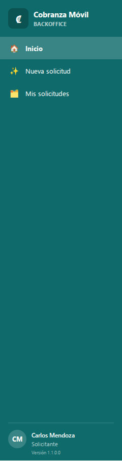
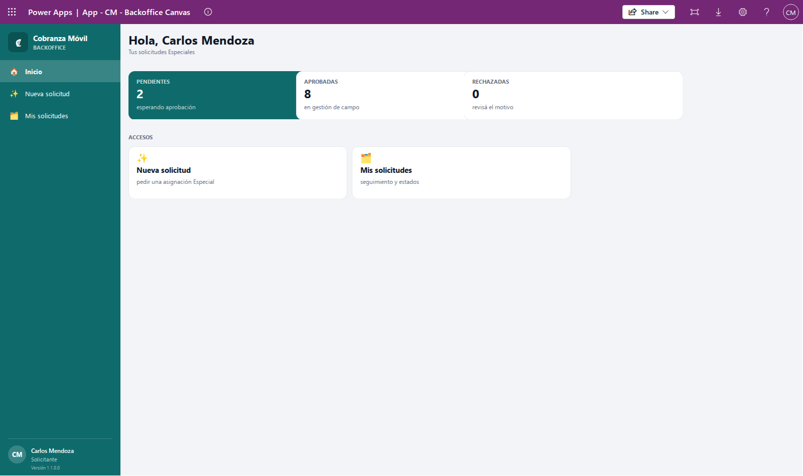
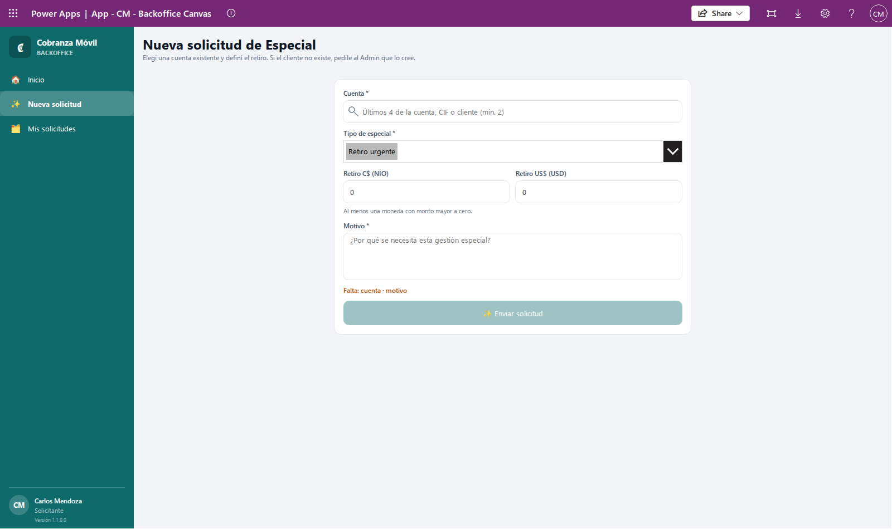
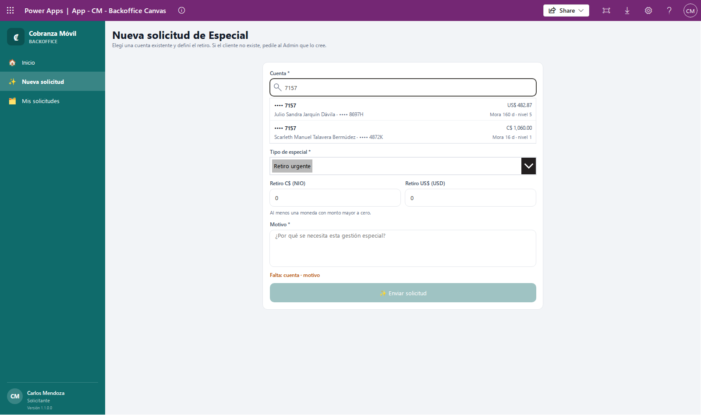
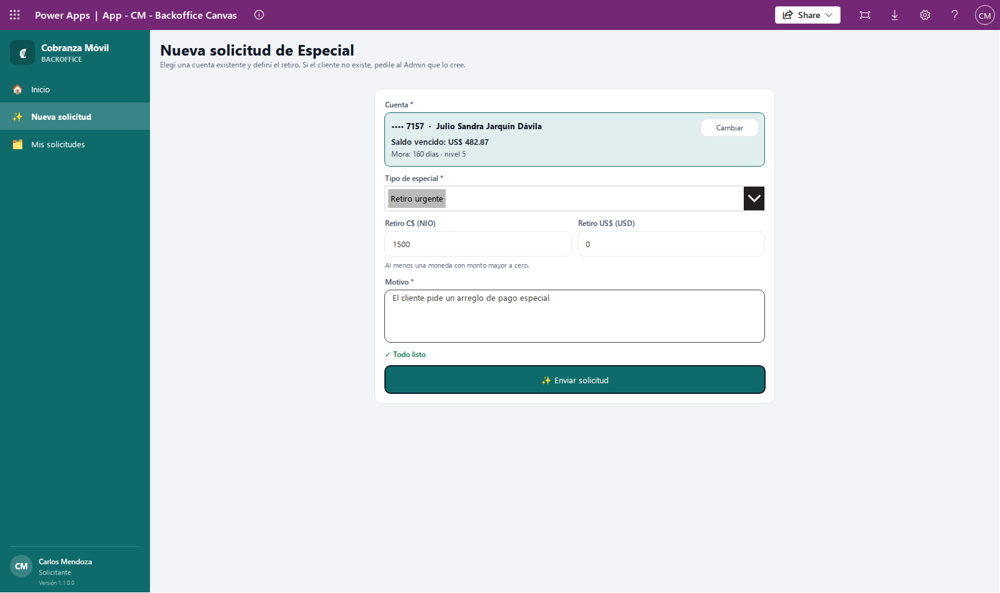
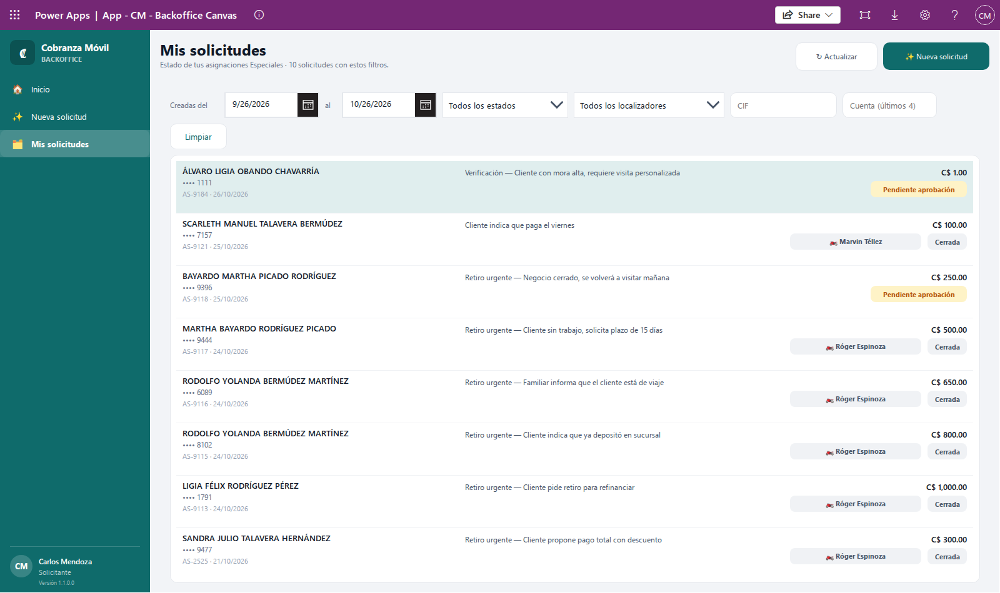
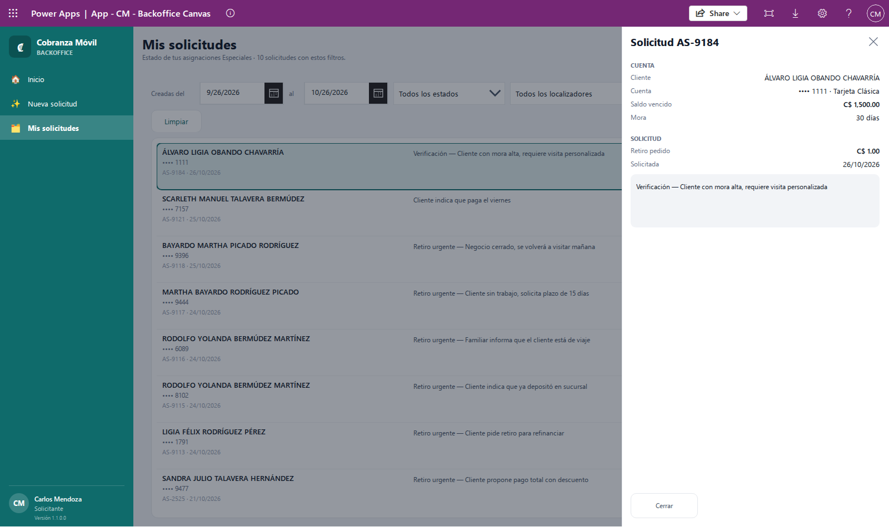

# Solicitudes de Especiales

Esta guía es para el **Solicitante**: la persona de la oficina que pide gestiones Especiales sobre cuentas que ya existen. Con ella vas a poder pedir una Especial, seguir en qué estado está cada solicitud y entender qué pasa después de que la enviás.

Si es tu primera vez con la app, leé antes [Conceptos básicos](00-conceptos.md): ahí se explica qué es una cartera y en qué se diferencian las asignaciones Diaria, Incobrable y Especial.

## Qué es una Especial y cuándo pedirla

Una **Especial** es una gestión puntual que pedís para una cuenta, aparte de lo que el banco manda todos los días en su archivo. Por ejemplo: que un localizador vaya a traer un retiro, que haga un cobro especial o que verifique algo con el cliente.

Pedí una Especial cuando una cuenta necesita una visita con un objetivo concreto que no cubre la gestión normal. La solicitud no le llega a ningún localizador hasta que un **Supervisor** la aprueba y elige quién la va a atender.

Algunas reglas que conviene tener claras desde el principio:

- **Solo para cuentas que ya existen.** No podés crear clientes ni cuentas. Si el cliente no aparece, pedíselo al Admin.
- **Una Especial activa por cuenta.** Si la cuenta ya tiene una Especial pendiente o aprobada (pedida por vos o por otra persona), no se puede pedir otra hasta que esa se cierre. Da igual el tipo de especial que elijas.
- **Una cuenta puede tener a la vez su Diaria o Incobrable y además una Especial.** Pedir una Especial no le quita la cuenta al localizador que ya la tiene.
- **No hay horario.** Podés enviar la solicitud a cualquier hora; queda con la fecha de tu día.

## Antes de empezar

1. Abrí **Power Apps** en el navegador de tu computadora.
2. Entrá a la app **App - CM - Backoffice Canvas**. Es la app de la oficina: la usan también BackOffice, Supervisor y Admin, y cada uno ve solo su menú.
3. Tu usuario tiene que tener el permiso de **Solicitante**. Si no lo tiene, pedíselo al Admin. Si no tenés ningún permiso de la app, al entrar vas a ver **Sin acceso**; si tenés otro permiso, vas a entrar pero sin las opciones del Solicitante en el menú.

Mientras la app revisa tus permisos vas a ver **Cobranza Móvil** y **Cargando tus permisos**. Después aparece el menú de la izquierda con tus tres opciones:

- **Inicio**: el resumen de tus solicitudes.
- **Nueva solicitud**: para pedir una Especial.
- **Mis solicitudes**: para ver en qué estado está cada una.

💡 En una pantalla angosta el menú se esconde: tocá **☰** arriba a la izquierda para abrirlo.

## Cómo leer tu Inicio

**Para qué:** ver de un vistazo cuántas solicitudes tenés en cada estado y entrar rápido a lo que necesitás.

Arriba vas a ver **Hola,** con tu nombre y el texto **Tus solicitudes Especiales**. Debajo hay tres tarjetas:

| Tarjeta | Qué cuenta |
|---|---|
| **PENDIENTES** («esperando aprobación») | Tus solicitudes que todavía no aprobó ni rechazó un Supervisor. |
| **APROBADAS** («en gestión de campo») | Tus solicitudes que un Supervisor aprobó. Incluye las que ya se cerraron. |
| **RECHAZADAS** («revisá el motivo») | Tus solicitudes que un Supervisor rechazó. |

En **ACCESOS** tenés **Nueva solicitud** («pedir una asignación Especial») y **Mis solicitudes** («seguimiento y estados»).

💡 Las tarjetas cuentan todas tus solicitudes, sin importar la fecha. **Mis solicitudes**, en cambio, abre mostrando solo el último mes. Por eso los números pueden no coincidir: ampliá las fechas en **Mis solicitudes** si querés ver todas.

## Cómo pedir una Especial

**Para qué:** pedir que un localizador haga una gestión puntual sobre una cuenta. Completás la cuenta, el tipo, el retiro y el motivo; el Supervisor la revisa y la asigna.

Entrá por el menú **Nueva solicitud**, por el acceso del Inicio o por el botón **✨ Nueva solicitud** de **Mis solicitudes**.

### 1. Buscá y elegí la cuenta

1. En **Cuenta \***, escribí en el buscador **Últimos 4 de la cuenta, CIF o cliente (mín. 2)**. Podés buscar de tres formas:
   - **Los últimos 4 dígitos de la cuenta**: escribí exactamente 4 dígitos, por ejemplo `1234`.
   - **El CIF del cliente**: escribí el comienzo del CIF (al menos 2 caracteres).
   - **El nombre del cliente**: escribí el comienzo del nombre tal como está registrado, por ejemplo `Juan Pé` para «Juan Pérez» (al menos 2 caracteres).
2. Debajo aparecen las cuentas que coinciden. Cada fila muestra la cuenta oculta (•••• y los últimos 4), el nombre del cliente y su CIF, el saldo vencido y la mora en días con su nivel.

   

3. Tocá la cuenta correcta. El buscador se reemplaza por una tarjeta con la cuenta elegida, su **Saldo vencido** y su **Mora**.
4. Si te equivocaste de cuenta, tocá **Cambiar** en esa tarjeta: vuelve el buscador vacío.

🔒 Nunca vas a ver el número completo de la tarjeta: la app solo muestra los últimos 4. Por eso la búsqueda por número usa solo esos 4 dígitos.

💡 Si escribís menos de 2 caracteres no aparece nada todavía. Si aparecen muchas cuentas, escribí más letras o el CIF completo para acotar.

### 2. Elegí el tipo de especial

En **Tipo de especial \*** ya viene elegido el primero de la lista. Abrí la lista y elegí el que corresponda (por ejemplo, «Retiro urgente» o «Verificación»).

Las opciones de esta lista las mantiene el Admin. Si falta un tipo que necesitás, pedíselo al Admin.

### 3. Completá el retiro

**Retiro C$ (NIO)** es el monto en córdobas y **Retiro US$ (USD)** el monto en dólares que el localizador tiene que traer.

- Los dos campos son obligatorios y vienen con `0`.
- Poné el monto en la moneda que corresponda. Si en una moneda no hay retiro, dejá `0`.
- No se aceptan montos negativos, letras ni campos vacíos.

Debajo de los montos la pantalla te recuerda **Al menos una moneda con monto mayor a cero.** Si la gestión es de retiro, completá al menos una de las dos monedas.

⚠️ La app te deja enviar con las dos monedas en `0` (por ejemplo, para una verificación sin retiro). Si tu gestión sí lleva retiro, revisá el monto antes de enviar: el localizador va a buscar exactamente lo que pongas aquí.

### 4. Escribí el motivo

En **Motivo \*** explicá **¿Por qué se necesita esta gestión especial?** Escribí lo que el Supervisor y el localizador necesitan saber: qué hay que hacer y por qué. Por ejemplo: «El cliente acordó entregar el retiro el viernes en su negocio».

🔒 No escribas números de tarjeta en el motivo. Si el texto lleva 13 dígitos o más seguidos (aunque estén separados por espacios o guiones), el sistema rechaza la solicitud.

💡 El tipo y el motivo se guardan juntos, así: «Retiro urgente — El cliente acordó…». Entre los dos no pueden pasar de 2.000 caracteres.

### 5. Revisá y enviá

Debajo del motivo, la pantalla te dice qué falta:

- **Falta:** y la lista de lo que falta, separada por «·». Por ejemplo **Falta: cuenta · motivo**. Los avisos posibles son **cuenta**, **tipo**, **monto (0 o más, en NIO y USD)** y **motivo**.
- **✓ Todo listo** cuando el formulario está completo.

El botón **✨ Enviar solicitud** queda apagado mientras falte algo.

1. Revisá la cuenta, el tipo, los montos y el motivo.
2. Tocá **✨ Enviar solicitud**.

### Qué esperar después de enviar

- Si todo salió bien, ves el aviso **✨ Solicitud enviada — quedó Pendiente de aprobación**. El formulario se limpia y la app te lleva a **Mis solicitudes**, donde tu solicitud aparece con el estado **Pendiente aprobación**.
- Si esa cuenta ya tuvo una Especial que se cerró o se rechazó, el aviso dice **✨ Solicitud enviada (se reactivó la Especial cerrada de la cuenta) — quedó Pendiente de aprobación**. Ver [Cómo volver a pedir una Especial](#cómo-volver-a-pedir-una-especial).

💡 Si salís de **Nueva solicitud** a mitad de camino y después volvés, lo que habías escrito sigue ahí, incluida la cuenta elegida. El formulario solo se limpia cuando la solicitud se envía bien.

### Errores comunes al enviar

| Lo que ves | Qué significa | Qué hacer |
|---|---|---|
| ⚠️ **Ya existe una Especial ACTIVA para la cuenta •••• 1234 (pendiente de aprobación, pedida por …). Revisala con el Supervisor.** (también puede decir «aprobada») | La cuenta ya tiene una Especial pendiente o aprobada. El aviso dice quién la pidió. No se creó nada nuevo y tu formulario queda como estaba. | Hablá con quien la pidió o con el Supervisor. Si es tuya, buscala en **Mis solicitudes**. Cuando esa Especial se cierre, vas a poder pedir otra. |
| **No se pudo enviar la solicitud de la cuenta •••• 1234:** … las notas no pueden llevar un numero de tarjeta. | El motivo tiene 13 dígitos o más seguidos, aunque estén separados por espacios o guiones. | Quitá el número del motivo y volvé a enviar. |
| **No se pudo enviar la solicitud…** … las notas pasan de 2000 caracteres. | El motivo es demasiado largo. | Resumí el motivo. |
| **No se pudo enviar la solicitud…** … la cuenta no existe o no tenes acceso a ella. | La cuenta ya no está disponible (por ejemplo, salió de cartera) o tu usuario no puede verla. | Tocá **Cambiar**, buscala de nuevo. Si sigue sin aparecer, consultá con el Admin. |
| **No se pudo enviar la solicitud…** … no se pudo crear la Especial. Volve a intentar… | Otra persona pidió una Especial para la misma cuenta casi al mismo tiempo. | Tocá **✨ Enviar solicitud** otra vez: la respuesta te va a decir quién la pidió. |
| **No se pudo enviar la solicitud…** … solo un Solicitante (o un Admin) puede pedir una asignacion Especial. | Tu usuario no tiene el permiso de Solicitante. | Pedíselo al Admin. |
| **Ninguna cuenta (últimos 4), CIF ni cliente coincide con «…».** | La búsqueda no encontró cuentas. | Revisá lo que escribiste. Con números, usá exactamente los últimos 4. Con nombre, empezá por el primer nombre. Si el cliente no existe, pedile al Admin que lo cree. |

En todos los casos de error, el formulario **no** se limpia: corregí lo que haga falta y volvé a enviar.

## Cómo seguir tus solicitudes

**Para qué:** saber en qué estado está cada Especial que pediste, a qué localizador se asignó y, si la rechazaron, por qué.

Entrá por el menú **Mis solicitudes** o por el acceso del Inicio.

Arriba ves **Mis solicitudes** y cuántas solicitudes hay con los filtros que tenés puestos. A la derecha están los botones **↻ Actualizar** y **✨ Nueva solicitud**.

Solo ves las Especiales que pediste vos. Las que pidieron otras personas, o las que manda el banco, no aparecen aquí.

### Lo que muestra cada fila

- El nombre del cliente y la cuenta oculta (•••• y los últimos 4).
- El número de la solicitud (AS-…) y la fecha en que se pidió.
- El tipo y el motivo (si es largo, se corta con «…»).
- El monto de retiro pedido.
- Si ya tiene localizador, su nombre con el ícono 🏍️.
- El estado, con su color.

### Los estados

| Estado en pantalla | Qué significa |
|---|---|
| **Pendiente aprobación** | La enviaste y espera que un Supervisor la revise. Todavía no tiene localizador. |
| **Aprobada** | Un Supervisor la aprobó y le asignó un localizador, que ves en la fila. La gestión está en la calle. |
| **Rechazada** | Un Supervisor la rechazó. Abrila para ver el motivo de rechazo. |
| **Cerrada** | La gestión terminó y el Admin la cerró con un motivo. Si llegó a aprobarse, sigue mostrando el localizador que la tuvo. |
| **Borrador** | Es un estado que el sistema usa para otros tipos de asignación. En tus solicitudes no debería aparecer; si lo ves, avisale al Admin. |

### Cómo filtrar la lista

La lista abre con las solicitudes **creadas en el último mes**, en todos los estados. Los filtros se aplican en cuanto los cambiás:

- **Creadas del … al …**: el rango de fechas en que se crearon las solicitudes.
- **Todos los estados**: elegí **Pendiente aprobación**, **Aprobada**, **Rechazada** o **Cerrada** para ver solo ese estado. **Aprobada** muestra solo las que siguen activas; las aprobadas que ya terminaron están en **Cerrada**.
- **Todos los localizadores**: elegí un localizador para ver solo las que se le asignaron.
- **CIF**: escribí el CIF del cliente (o su comienzo).
- **Cuenta (últimos 4)**: escribí los últimos 4 dígitos exactos.
- **Limpiar**: vuelve todo a como estaba al principio (último mes, todos los estados, sin localizador, CIF ni cuenta).

Los filtros se conservan mientras no cierres la app, aunque vayas a otra pantalla y vuelvas.

Tocá **↻ Actualizar** para traer los últimos cambios (por ejemplo, si el Supervisor acaba de aprobar). Al terminar ves **✓ Lista actualizada**.

Si no hay resultados, ves **Sin solicitudes** con las fechas que estás mirando y la sugerencia de probar con otras fechas o **Limpiar**.

### Cómo ver el detalle de una solicitud

1. Tocá la fila de la solicitud.
2. Se abre un panel a la derecha con el título **Solicitud AS-…**.

El panel muestra:

- **CUENTA**: **Cliente**, **Cuenta** (oculta, con el producto), **Saldo vencido** y **Mora**.
- **SOLICITUD**: **Retiro pedido** y la fecha en que se pidió (**Solicitada**).
- El tipo y el motivo completos.
- **Localizador**: aparece cuando la solicitud se aprobó.
- Si se **rechazó**: un recuadro rojo con **Motivo de rechazo:** y lo que escribió el Supervisor.
- Si se **cerró**: un recuadro con **Cerrada el** día y hora, y el motivo de cierre.

Para cerrar el panel, tocá **Cerrar**, la **×** de arriba o cualquier parte fuera del panel.

La pantalla es solo de consulta: desde aquí no se puede editar ni cancelar una solicitud.

### Errores y avisos en Mis solicitudes

| Lo que ves | Qué hacer |
|---|---|
| **No se pudo leer la lista:** … | Tocá **↻ Actualizar**. Si se repite, avisale al Admin con el texto del mensaje. |
| **Hay 2.000 o más solicitudes con estos filtros y se muestran 2.000…** | La lista está incompleta. Acotá las fechas o filtrá por estado, localizador, CIF o cuenta. |
| **Más de 50 cuentas coinciden con ese CIF o cuenta: se buscó en las primeras 50…** | Escribí el CIF completo para que la búsqueda sea exacta. |

## Cómo corregir o cancelar una solicitud pendiente

La app no tiene una opción para editar ni para cancelar una solicitud ya enviada. Si te equivocaste (cuenta, monto o motivo), avisale al Supervisor para que la **rechace** con un motivo como «Error en la solicitud». Una vez rechazada, podés pedirla de nuevo con los datos correctos.

## Cómo volver a pedir una Especial

**Para qué:** pedir otra gestión sobre una cuenta cuya Especial anterior ya terminó, o volver a intentar después de un rechazo.

No hay un botón de «reactivar». Simplemente hacé una solicitud nueva sobre la misma cuenta, con los pasos de [Cómo pedir una Especial](#cómo-pedir-una-especial).

- Si la Especial anterior de esa cuenta está **Cerrada** o **Rechazada**, el sistema la reutiliza con tus datos nuevos: vuelve a **Pendiente aprobación**, sin localizador, con tu nombre como solicitante y la fecha de hoy. El aviso dice **(se reactivó la Especial cerrada de la cuenta)** y el número AS-… es el mismo de antes.
- Si la Especial anterior todavía está **Pendiente aprobación** o **Aprobada**, no se puede: vas a ver el aviso **Ya existe una Especial ACTIVA…**.

⚠️ Si la Especial anterior la había pedido otra persona, al reactivarla pasa a ser tuya y deja de aparecer en la lista de esa persona. Lo mismo te pasa a vos si otra persona vuelve a pedir una Especial que pediste antes y ya se cerró.

💡 Una solicitud reactivada muestra la fecha nueva en **Solicitada**, pero el filtro **Creadas del … al …** usa la fecha en que se creó por primera vez. Si no la encontrás en **Mis solicitudes**, ampliá la fecha de inicio o tocá **Limpiar** y buscala por **Cuenta (últimos 4)** con un rango más amplio.

## Qué pasa después de que enviás

1. **El Supervisor la revisa.** Tu solicitud entra en la cola de **Aprobaciones** del Supervisor, por orden de llegada (la más vieja primero).
2. **La aprueba y elige el localizador**, o **la rechaza** escribiendo un motivo. En ambos casos lo vas a ver en **Mis solicitudes** (tocá **↻ Actualizar**).
3. **Si se aprueba**, la Especial le llega al teléfono del localizador elegido la próxima vez que su app se actualice. La ve en su **Cartera**, en la pestaña **Especial**, con el retiro que pediste.
4. **Si hace falta cambiar de localizador**, el Supervisor puede reasignarla. El nombre nuevo aparece en tu lista.
5. **Cuando la gestión termina**, el Admin la cierra con un motivo y en tu lista pasa a **Cerrada**. El localizador nunca la cierra por su cuenta.

Para saber cómo trabajan las otras personas con tu solicitud, ver la guía de [Supervisión](04-supervisor.md) y la de la [App del localizador](01-localizador.md).

## Si algo sale mal

| Situación | Qué hacer |
|---|---|
| Al entrar ves **Sin acceso**. | Tu usuario no tiene permiso en la app. Pedile al Admin el permiso de Solicitante. |
| Ves **No se pudo verificar tu acceso**. | Cerrá la app y volvé a abrirla. Si sigue, avisale al Admin. |
| No encontrás la cuenta en **Nueva solicitud**. | Probá con los últimos 4 exactos, con el CIF o con el comienzo del nombre. Si el cliente no existe, pedile al Admin que lo cree. |
| El botón **✨ Enviar solicitud** no se habilita. | Leé el texto **Falta:** que está encima del botón y completá lo que diga. |
| Te dice que ya existe una Especial activa. | Hablá con quien la pidió o con el Supervisor. Solo puede haber una activa por cuenta. |
| Enviaste una solicitud y no aparece en **Mis solicitudes**. | Tocá **↻ Actualizar**. Si fue una reactivación, ampliá las fechas (ver [Cómo volver a pedir una Especial](#cómo-volver-a-pedir-una-especial)). |
| Una solicitud tuya desapareció de la lista. | Revisá los filtros o tocá **Limpiar**. Si otra persona volvió a pedir esa cuenta después de que se cerró, ahora figura a nombre de esa persona. |
| Los números del Inicio no coinciden con la lista. | El Inicio cuenta todas tus solicitudes; la lista muestra solo las fechas del filtro. |

Para más dudas, consultá las [Preguntas frecuentes](06-preguntas-frecuentes.md).
