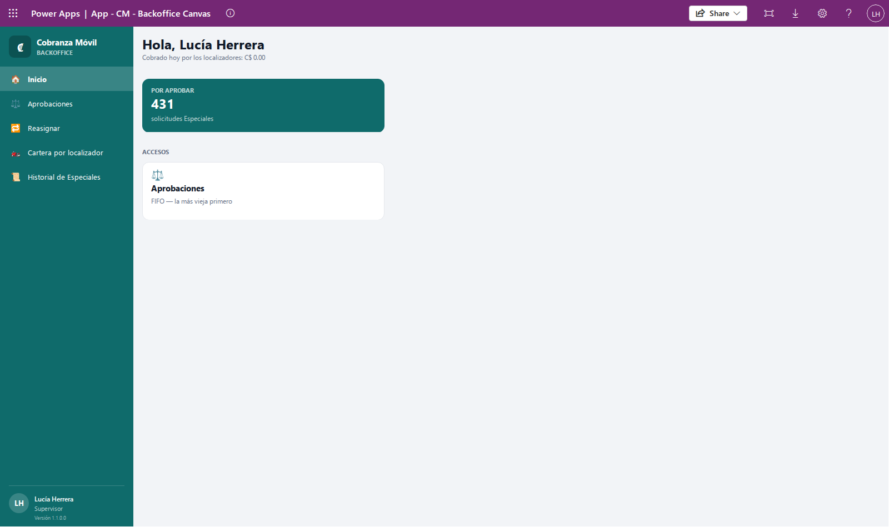
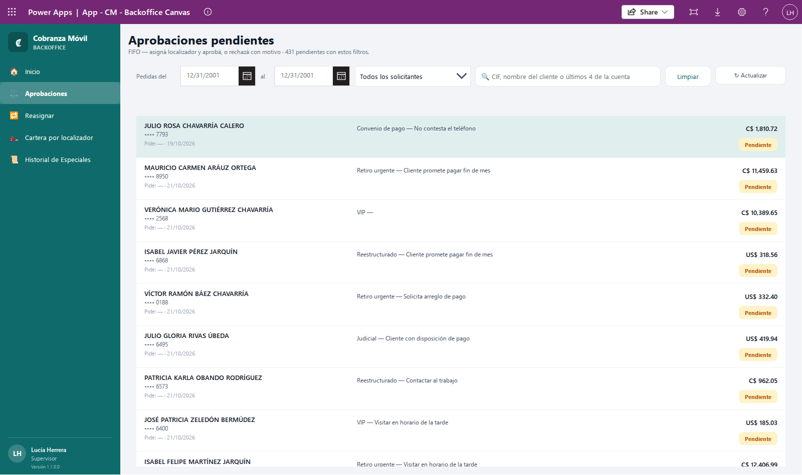
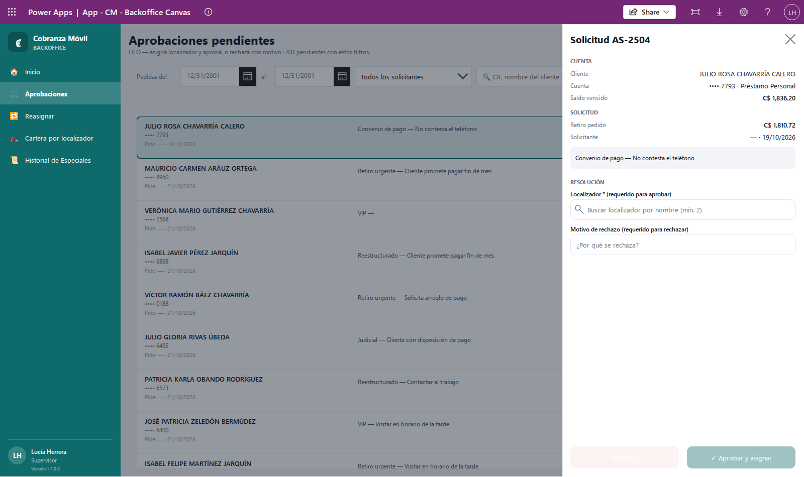
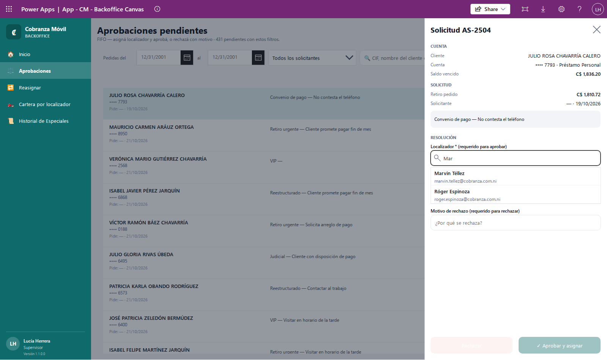
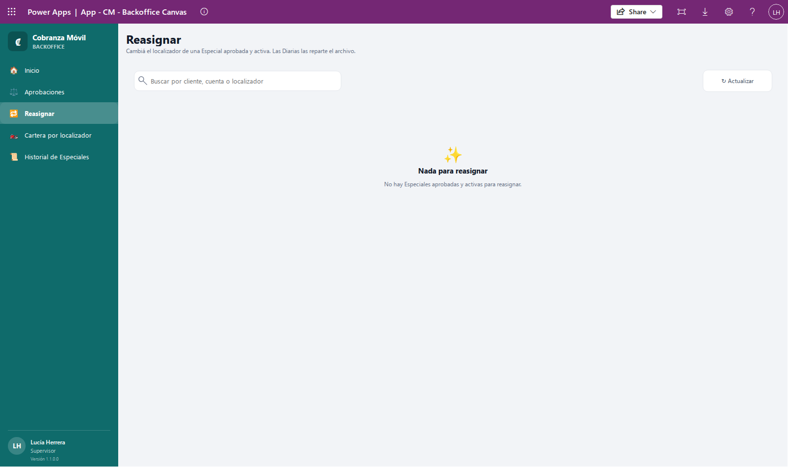
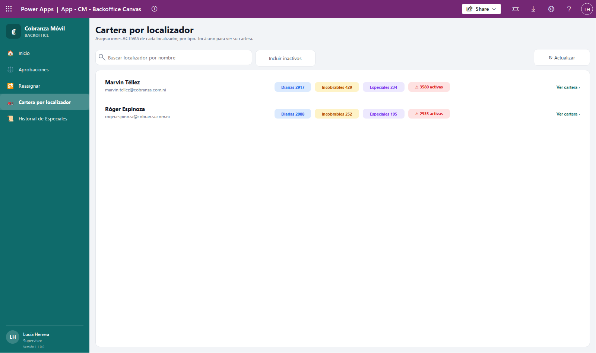
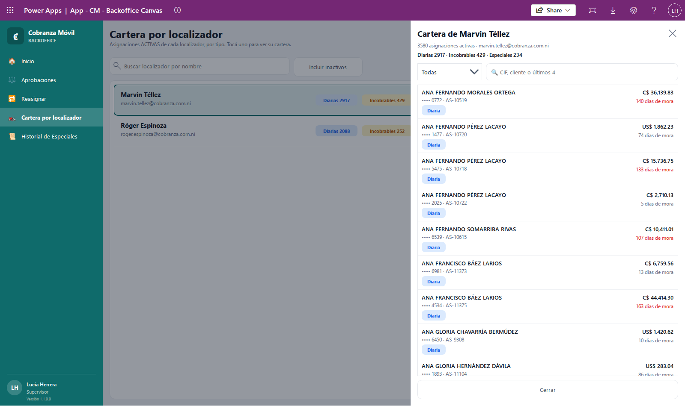
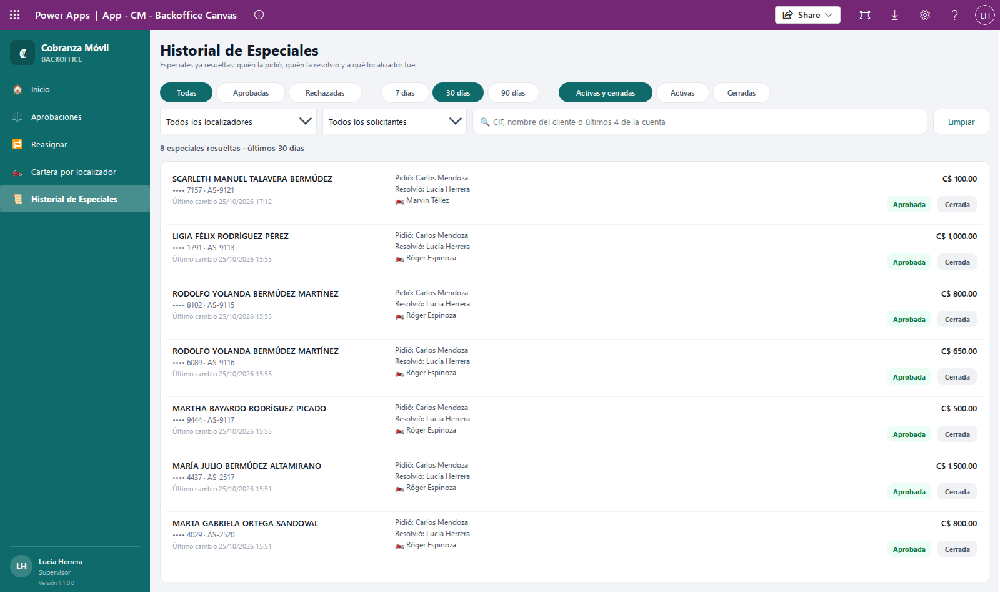
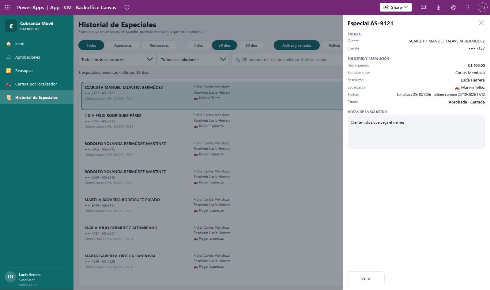

# Guía del Supervisor

Esta guía es para quien aprueba las asignaciones **Especiales** y controla la carga de trabajo de los localizadores. Con ella vas a poder revisar las solicitudes Especiales que esperan aprobación, aprobarlas eligiendo el localizador que va a hacer la gestión o rechazarlas con un motivo, pasar una Especial aprobada a otro localizador, ver la cartera de cada localizador y consultar el historial de las Especiales ya resueltas.

Si todavía no conocés los tipos de asignación (Diaria, Incobrable, Especial) o los estados de una Especial, leé primero [Conceptos básicos](00-conceptos.md).

## Contenido

- [Antes de empezar](#antes-de-empezar)
- [Cómo leer tu Inicio](#cómo-leer-tu-inicio)
- [Cómo revisar la cola de aprobaciones](#cómo-revisar-la-cola-de-aprobaciones)
- [Cómo aprobar una Especial y asignarle localizador](#cómo-aprobar-una-especial-y-asignarle-localizador)
- [Cómo rechazar una Especial](#cómo-rechazar-una-especial)
- [Cómo reasignar una Especial a otro localizador](#cómo-reasignar-una-especial-a-otro-localizador)
- [Qué ve el localizador cuando aprobás o reasignás](#qué-ve-el-localizador-cuando-aprobás-o-reasignás)
- [Cómo ver la cartera de un localizador](#cómo-ver-la-cartera-de-un-localizador)
- [Cómo consultar el historial de Especiales](#cómo-consultar-el-historial-de-especiales)
- [Si algo sale mal](#si-algo-sale-mal)

## Antes de empezar

- Entrá a la app de oficina de **Cobranza Móvil** desde Power Apps, en la computadora. También funciona en una pantalla angosta: en ese caso el menú se abre con el botón **☰**.
- Tu usuario tiene que tener el permiso de **Supervisor**. Si al entrar ves **Sin acceso**, tu usuario no tiene ningún permiso de Cobranza Móvil; si entrás pero el menú no muestra **Aprobaciones**, te falta el de Supervisor. En los dos casos, pedíselo al Admin.
- Si ves **No se pudo verificar tu acceso**, la app no pudo leer tus permisos. Cerrá la app, volvé a abrirla y, si sigue igual, avisale al Admin.

Con el permiso de Supervisor, el menú de la izquierda muestra cinco opciones: **Inicio**, **Aprobaciones**, **Reasignar**, **Cartera por localizador** e **Historial de Especiales**. Abajo del menú aparecen tu nombre, el rol **Supervisor** y la versión de la app.

🔒 Desde tu rol podés ver los datos de toda la cartera (clientes, cuentas y localizadores). Usalos solo para tu trabajo y no los compartas fuera de la operación.

## Cómo leer tu Inicio

**Para qué:** de un vistazo sabés cuánto cobraron hoy los localizadores y cuántas Especiales esperan tu decisión.

Al entrar, la pantalla **Inicio** muestra:

- **Hola, …** con tu nombre y, debajo, **Cobrado hoy por los localizadores:** con el total de pagos registrados hoy, en córdobas y en dólares.
- La tarjeta **POR APROBAR**: cuántas **solicitudes Especiales** activas están en estado Pendiente aprobación. Es el mismo número que vas a encontrar en **Aprobaciones** sin filtros.
- En **ACCESOS**, la tarjeta **Aprobaciones** (**FIFO — la más vieja primero**). Tocala para ir directo a la cola.

💡 Los números de Inicio se calculan al abrir la pantalla. Si querés verlos al día, volvé a entrar a **Inicio** desde el menú.

## Cómo revisar la cola de aprobaciones

**Para qué:** las Especiales que pide un Solicitante, las que manda el banco en su archivo y las que da de alta el Admin no llegan a ningún localizador hasta que vos las aprobás. En **Aprobaciones** las ves todas en un solo lugar.

1. En el menú, tocá **Aprobaciones**.
2. Arriba vas a ver el título **Aprobaciones pendientes** y una línea que dice cuántas hay: **… pendientes con estos filtros.**
3. Revisá la lista. Está ordenada **FIFO**: la solicitud más vieja aparece primero, para que nada se quede esperando.

Cada fila muestra:

- El nombre del cliente y la cuenta oculta (por ejemplo, **•••• 1234**).
- **Pide:** quién la solicitó y la fecha. Si la Especial vino en el archivo del banco o la dio de alta el Admin, en vez de un nombre aparece **—**.
- El tipo de Especial y el motivo de la solicitud (por ejemplo, «Retiro urgente — El cliente pidió que lo visiten el lunes»).
- El monto del retiro pedido y la etiqueta **Pendiente**.

### Filtrar la cola

Los filtros se aplican apenas los cambiás. Se mantienen mientras tengas la app abierta, aunque cambies de pantalla.

- **Pedidas del … al …**: elegí un rango de fechas en los dos calendarios. Si dejás solo uno, se usa como límite de ese lado. Si la fecha de inicio queda después de la final, la app las empareja sola. Por defecto no hay límite de fechas.
- **Todos los solicitantes**: elegí una persona para ver solo sus solicitudes. La lista trae únicamente a quienes tienen Especiales pendientes.
- **CIF, nombre del cliente o últimos 4 de la cuenta**: escribí el comienzo del CIF, parte del nombre del cliente o los últimos 4 dígitos de la cuenta.
- **Limpiar**: borra las fechas, el solicitante y la búsqueda, y vuelve a mostrar toda la cola.
- **↻ Actualizar**: vuelve a leer la cola. Usalo si otra persona pudo haber aprobado o enviado solicitudes mientras tenías la pantalla abierta. Al terminar ves **✓ Cola actualizada**.

Mientras la cola se carga, aparece **⏳ Cargando la cola de aprobación…**.

### Si la lista está vacía

- **Nada por aprobar**: no hay ninguna Especial pendiente. Las nuevas aparecen acá apenas el Solicitante las envía.
- **Sin resultados**: hay pendientes, pero ninguna coincide con tus filtros. Probá con otros o tocá **Limpiar**.

### Avisos que podés ver al filtrar

- **Hay 2.000 o más pendientes con estos filtros y se muestran 2.000 (las más viejas primero). Acotá con fechas, solicitante o el buscador.** La lista tiene un tope; acotá la búsqueda para ver las demás.
- **Más de 50 cuentas coinciden con la búsqueda: se buscó en las primeras 50. Escribí más del CIF o del nombre.** Tu búsqueda es muy amplia; escribí más letras o números.

## Cómo aprobar una Especial y asignarle localizador

**Para qué:** aprobar una Especial es decidir que la gestión se hace y quién la hace. En el mismo paso elegís el localizador; desde ese momento la Especial entra en su cartera.

1. En **Aprobaciones**, tocá la fila de la solicitud. A la derecha se abre el panel **Solicitud AS-…**.
2. Revisá los datos:
   - **CUENTA**: **Cliente**, **Cuenta** (oculta, con el producto) y **Saldo vencido**.
   - **SOLICITUD**: **Retiro pedido**, **Solicitante** con la fecha (o **—** si no la pidió un Solicitante), y el tipo y motivo de la Especial en el recuadro gris.

   

3. En **RESOLUCIÓN**, buscá el localizador en **Localizador * (requerido para aprobar)**. Escribí al menos 2 letras del comienzo de su nombre.
4. En la lista que aparece debajo, tocá el localizador. Cada resultado muestra su nombre y su correo.

   

5. El localizador elegido queda en una tarjeta con su nombre y correo. Si te equivocaste, tocá **Cambiar** y buscá otro.
6. Tocá **✓ Aprobar y asignar**. El botón solo se habilita cuando ya elegiste un localizador.

**Qué esperar después:**

- Ves el mensaje **✓ Aprobada — asignada a (nombre del localizador). Baja al celular del localizador en la próxima sincronización.**
- El panel se cierra y la solicitud sale de la cola.
- La Especial pasa a estado Aprobado y aparece en **Reasignar**, en **Cartera por localizador** (dentro de la cartera del localizador elegido) y en **Historial de Especiales**, con tu nombre como quien la resolvió.
- El Solicitante la ve como aprobada en su pantalla **Mis solicitudes** (ver [Guía del Solicitante](03-solicitante.md)).

**Errores comunes:**

- **No aparece el localizador que buscás.** El buscador solo muestra localizadores **activos** que tienen un usuario vinculado, y busca por el **comienzo** del nombre. Si ves **Ningún localizador activo con usuario empieza con «…».**, revisá cómo escribiste el nombre. Si el localizador está desactivado o no tiene usuario, pedile al Admin que lo revise en **Localizadores y usuarios**: sin usuario, la Especial no llegaría a ningún teléfono.
- **El botón ✓ Aprobar y asignar está apagado.** Todavía no tocaste un localizador de la lista.

⚠️ Al aprobar no hace falta escribir nada en **Motivo de rechazo**. Si escribiste algo ahí y después aprobás, ese texto no se guarda.

## Cómo rechazar una Especial

**Para qué:** si la gestión no corresponde, la rechazás con un motivo. El Solicitante ve ese motivo y puede pedirla de nuevo si hace falta.

1. En **Aprobaciones**, tocá la fila de la solicitud para abrir el panel **Solicitud AS-…**.
2. En **Motivo de rechazo (requerido para rechazar)**, escribí por qué se rechaza (por ejemplo, «El cliente ya tiene un arreglo de pago vigente»).
3. Tocá **Rechazar**. El botón solo se habilita cuando el motivo tiene texto.

**Qué esperar después:**

- Ves el mensaje **Solicitud rechazada**.
- El panel se cierra y la solicitud sale de la cola.
- La Especial queda **Rechazada** y **cerrada**: no llega a ningún localizador. Al estar cerrada, el Solicitante puede volver a pedir una Especial para esa misma cuenta.
- El Solicitante ve la solicitud como rechazada, con tu motivo, en **Mis solicitudes**. En **Historial de Especiales** queda registrada con tu nombre y el motivo.

⚠️ El rechazo no se puede deshacer desde la app. Si te equivocaste, el Solicitante tiene que enviar una solicitud nueva.

💡 Escribí un motivo claro: es lo único que el Solicitante va a leer para entender la decisión. No escribas números de tarjeta en el motivo.

Para cerrar el panel sin aprobar ni rechazar, tocá la **X** de arriba a la derecha o tocá fuera del panel. La solicitud sigue en la cola.

## Cómo reasignar una Especial a otro localizador

**Para qué:** si el localizador de una Especial ya aprobada no puede hacer la gestión (está de vacaciones, cambió de zona, se desactivó), la pasás a otro sin tener que rechazarla y pedirla de nuevo.

Solo podés reasignar Especiales **aprobadas y activas**. Las Diarias no se reasignan a mano: las reparte el archivo del banco cada día. Las Incobrables las reasigna el Admin.

1. En el menú, tocá **Reasignar**. El texto de arriba dice **Cambiá el localizador de una Especial aprobada y activa. Las Diarias las reparte el archivo.**
2. Buscá la Especial en **Buscar por cliente, cuenta o localizador**: podés escribir parte del nombre del cliente, los últimos dígitos de la cuenta o el nombre del localizador actual.
3. Cada fila muestra el cliente, la cuenta oculta, los días de mora, el localizador actual (con el ícono 🏍️) y la etiqueta **Especial**. Tocá la fila.
4. Se abre el panel **Reasignar AS-…** con **Cliente**, **Cuenta**, **Tipo**, **Días de mora** y **Localizador actual**.
5. En **NUEVO LOCALIZADOR \***, escribí al menos 2 letras del comienzo del nombre del nuevo localizador.
6. Tocá el localizador en la lista. El localizador actual no aparece entre los resultados. Si te equivocaste, tocá **Cambiar**.
7. Tocá **🔁 Reasignar**. El botón solo se habilita con un localizador elegido y distinto del actual.

El panel es el mismo que usa el Admin. En estas capturas se ve abierto sobre una Incobrable; en tu caso el **Tipo** dice **Especial**:

**Qué esperar después:**

- Ves el mensaje **🔁 Reasignada a (nombre del localizador). Baja al celular del localizador en la próxima sincronización.**
- El panel se cierra y la fila muestra el nuevo localizador. La Especial sigue en la lista, porque se puede volver a reasignar.
- **↻ Actualizar** vuelve a leer la lista completa.

**Si la lista está vacía:**

- **Nada para reasignar** — **No hay Especiales aprobadas y activas para reasignar.** No hay ninguna Especial que puedas mover en este momento.

  

- **Nada para reasignar** — **Ninguna asignación coincide con «…».** Tu búsqueda no encontró nada; borrala o probá con otro dato.

**Errores comunes:**

- **No aparece el localizador nuevo.** Igual que al aprobar, solo aparecen localizadores activos con usuario vinculado. Si ves **Ningún otro localizador activo con usuario empieza con «…».**, revisá el nombre o pedile al Admin que revise el localizador.
- **No encuentro una Especial.** Si todavía está pendiente, está en **Aprobaciones**, no acá. Si ya se cerró, la encontrás en **Historial de Especiales** pero ya no se puede reasignar.

## Qué ve el localizador cuando aprobás o reasignás

La app del teléfono del localizador **nunca muestra Especiales pendientes ni rechazadas**: solo las aprobadas que tiene asignadas.

- **Cuando aprobás:** la Especial no aparece al instante en el teléfono. Le llega al localizador en su próxima sincronización, que la app hace sola al abrirse y más o menos cada 5 minutos si hay señal. A partir de ahí la ve en **Cartera**, en la pestaña **Especial** y junto a las demás cuentas del cliente. Al abrir la cuenta ve el bloque **PEDIDO ESPECIAL** con **Tipo Especial**, **Retiro** (el monto que tiene que traer) y **Nota** (el motivo de la solicitud).
- **Cuando reasignás:** en su próxima sincronización, la Especial **desaparece** del teléfono del localizador anterior y **aparece** en el del nuevo, con los mismos datos. Las visitas y los pagos que el anterior ya registró quedan guardados en el sistema.
- **Cuando rechazás:** el localizador no ve nada, porque la Especial nunca llegó a su teléfono.

💡 Si el localizador te dice que no le aparece una Especial que aprobaste, pedile que abra la app con señal y espere unos minutos, o que use **Actualizar todo desde el servidor** en su pantalla **Sincronización** (ver [Guía del Localizador](01-localizador.md)).

⚠️ La Especial no se cierra sola cuando el localizador termina la gestión. La cierra el Admin desde **Cierres**, con un motivo. Avisale cuando una gestión esté completa.

## Cómo ver la cartera de un localizador

**Para qué:** ver cuántas asignaciones activas tiene cada localizador y cuáles son, para repartir mejor las Especiales y detectar a quien está sobrecargado o desactivado con cartera pendiente. Esta pantalla es solo de consulta: desde acá no se cambia nada.

1. En el menú, tocá **Cartera por localizador**. El texto de arriba dice **Asignaciones ACTIVAS de cada localizador, por tipo. Tocá uno para ver su cartera.**
2. Revisá la lista. Cada fila muestra:
   - El nombre del localizador y su correo. Si no tiene usuario vinculado, en rojo dice **⚠ Sin usuario vinculado**; si está desactivado, **⛔ Inactivo**.
   - Los contadores **Diarias**, **Incobrables** y **Especiales** con sus asignaciones activas.
   - La alerta roja **⚠ … activas** cuando el localizador tiene más asignaciones activas de las que la operación considera manejables (hoy, más de 500).
   - **Ver cartera ›**.

   

3. Para encontrar a alguien, escribí el comienzo de su nombre en **Buscar localizador por nombre**.
4. Para ver también a los localizadores desactivados, tocá **Incluir inactivos**. El botón cambia a **✓ Incluye inactivos**; tocalo otra vez para ocultarlos.
5. Tocá la fila de un localizador. Se abre el panel **Cartera de …** y, mientras carga, ves **⏳ Cargando la cartera de …**.

En el panel vas a ver:

- **… asignaciones activas** y el correo del localizador (o **sin usuario vinculado**).
- El desglose **Diarias … · Incobrables … · Especiales …**.
- Un filtro por tipo (**Todas**, **Diarias**, **Incobrables**, **Especiales**) y el buscador **CIF, cliente o últimos 4**. Cuando filtrás, el desglose agrega **· mostrando …**.
- La lista de asignaciones, ordenada por tipo y después por cliente: cliente, cuenta oculta con el número **AS-…**, etiqueta del tipo, saldo vencido y **… días de mora**. En las Especiales también aparece su estado (por ejemplo, **Aprobada**).

Para salir, tocá **Cerrar** o la **X**.

**Otros mensajes:**

- **Este localizador no tiene asignaciones activas.** No tiene cartera en este momento.
- **Ninguna asignación coincide con el filtro.** Cambiá el tipo o la búsqueda.
- **Sin localizadores** — **Todavía no hay localizadores activos.** o **Ningún localizador activo empieza con «…».** Revisá el nombre que escribiste.
- **↻ Actualizar** vuelve a leer los localizadores y sus contadores. Si todo sale bien ves **Lista actualizada**.

💡 Desactivar a un localizador no cierra ni mueve su cartera. Si ves a alguien **⛔ Inactivo** con Especiales activas, pasalas a otro localizador desde **Reasignar**. Sus Incobrables las reasigna el Admin, y sus Diarias se reparten con el archivo del banco.

## Cómo consultar el historial de Especiales

**Para qué:** revisar las Especiales que ya se resolvieron: quién las pidió, quién las aprobó o rechazó, a qué localizador fueron y si siguen activas o ya se cerraron. Es solo de consulta.

1. En el menú, tocá **Historial de Especiales**. El texto de arriba dice **Especiales ya resueltas: quién la pidió, quién la resolvió y a qué localizador fue.**
2. Elegí qué ver con los botones de arriba:
   - **Todas**, **Aprobadas** o **Rechazadas**.
   - **7 días**, **30 días** o **90 días**. Al entrar se usa **30 días**.
   - **Activas y cerradas**, **Activas** o **Cerradas**.
3. Si querés, acotá con **Todos los localizadores**, **Todos los solicitantes** o el buscador **CIF, nombre del cliente o últimos 4 de la cuenta**.
4. **Limpiar** vuelve a **Todos los localizadores**, **Todos los solicitantes** y borra la búsqueda. Los botones de estado, días y vigencia quedan como estaban.

Debajo de los filtros ves el total: **… especiales resueltas · últimos … días**.

Cada fila muestra el cliente, la cuenta oculta con el número **AS-…**, **Último cambio** con fecha y hora, **Pidió:**, **Resolvió:**, el localizador (🏍️), el monto del retiro y las etiquetas **Aprobada** o **Rechazada** y **Activa** o **Cerrada**. En las rechazadas se ve también el comienzo del motivo (**Motivo: …**). La lista está ordenada del cambio más reciente al más viejo.

💡 El período (7, 30 o 90 días) se cuenta por la fecha del **último cambio** de la Especial, no por la fecha en que se pidió. Por ejemplo, una Especial aprobada hace dos meses y cerrada ayer aparece en **7 días**.

### Ver el detalle de una Especial

1. Tocá la fila. Se abre el panel **Especial AS-…**.
2. Revisá:
   - **CUENTA**: **Cliente** y **Cuenta**.
   - **SOLICITUD Y RESOLUCIÓN**: **Retiro pedido**, **Solicitado por**, **Resolutor**, **Localizador**, **Fechas** (**Solicitada …** y **último cambio …**) y **Estado** (por ejemplo, **Aprobada · Cerrada**).
   - **NOTAS DE LA SOLICITUD**: el tipo y el motivo que escribió el Solicitante.
   - En las rechazadas, además, **Motivo de rechazo:** completo.
3. Tocá **Cerrar** o la **X** para volver a la lista.

**Otros mensajes:**

- **Sin especiales resueltas** — **Probá con otro rango de fechas u otro filtro.** No hay ninguna con los filtros elegidos.
- **⏳ Buscando las especiales de «…»…** aparece mientras se ejecuta la búsqueda por cliente o cuenta.
- **Más de 50 cuentas coinciden con la búsqueda: se buscó en las primeras 50. Escribí más del CIF o del nombre.** Escribí una búsqueda más precisa.

## Si algo sale mal

| Mensaje o situación | Qué significa | Qué hacer |
|---|---|---|
| **Sin acceso** | Tu usuario no tiene ningún permiso de Cobranza Móvil. | Pedile al Admin que te lo asigne. |
| **No se pudo verificar tu acceso** | La app no pudo leer tus permisos. | Cerrá y volvé a abrir la app; si sigue, avisale al Admin. |
| **No se pudo leer la cola: …** | Falló la lectura de **Aprobaciones**, por ejemplo por la conexión. | Revisá tu conexión y tocá **↻ Actualizar**. |
| **No se pudo aprobar AS-…: …** | El sistema no guardó la aprobación. La solicitud sigue en la cola. | Tocá **↻ Actualizar** y volvé a intentar. Si el mensaje dice que **solo un Supervisor puede aprobar, rechazar o asignar…** o que **tu rol no puede cambiar…**, tu usuario no tiene el permiso correcto: avisale al Admin. |
| **No se pudo rechazar AS-…: …** | El sistema no guardó el rechazo. La solicitud sigue en la cola. | Igual que el caso anterior. |
| **No se pudo reasignar AS-…: …** | El sistema no guardó el cambio de localizador. El panel queda abierto. | Tocá **Cancelar**, luego **↻ Actualizar**, y volvé a intentar. Si sigue, avisale al Admin. |
| **No se pudo actualizar la lista: …** | Falló la lectura en **Cartera por localizador**. | Revisá tu conexión y volvé a tocar **↻ Actualizar**. |
| El localizador no ve la Especial que aprobaste o reasignaste. | Todavía no sincronizó su teléfono. | Pedile que abra la app con señal y espere unos minutos (ver [Qué ve el localizador](#qué-ve-el-localizador-cuando-aprobás-o-reasignás)). |
| Después de **↻ Actualizar**, una solicitud que estabas por revisar ya no está en la cola. | Otra persona la resolvió o la Especial se cerró mientras estaba pendiente. | Si la resolvió otra persona, la vas a ver en **Historial de Especiales**. |

💡 Los mensajes de error pueden incluir un texto técnico después de los dos puntos. Si tenés que avisarle al Admin, copiá el mensaje completo y el número **AS-…**.

Para más dudas, revisá [Preguntas frecuentes](06-preguntas-frecuentes.md) y [Conceptos básicos](00-conceptos.md).
