# Guía del Admin

Esta guía es para quien administra Cobranza Móvil desde la oficina. Con ella vas a poder cargar el archivo diario del banco, revisar que la carga llegó completa, controlar las Diarias que el banco dejó de mandar, cerrar asignaciones a mano, dar de alta una cuenta suelta, administrar a los localizadores y sus usuarios, y mantener los datos maestros y las listas de opciones de las apps.

Si todavía no conocés los términos básicos (cartera, asignación, Diaria, Incobrable, Especial), leé primero [Conceptos](00-conceptos.md).

## Antes de empezar

- **Cómo se entra.** Abrí la app de la oficina de Cobranza Móvil desde Power Apps. Mientras revisa tus permisos vas a ver **Cargando tus permisos…**; después se abre **Inicio**.
- **Qué permiso hace falta.** Tu usuario tiene que tener el permiso de **Admin** de Cobranza Móvil. Si tenés otro permiso de Cobranza Móvil pero no el de Admin, la app abre igual, pero el menú no muestra las pantallas del Admin. Si no tenés ningún permiso de Cobranza Móvil, en lugar de Inicio vas a ver **Sin acceso** con el mensaje «Tu usuario no tiene un rol de Cobranza Móvil (SR | CM | …). Pedile al Admin que te lo asigne o te agregue al equipo correspondiente.». Pedíselo a quien administra los accesos.
- **Para cargar el archivo** tu usuario también tiene que estar en el equipo de carga. Si no está, la pantalla **Cargar archivo** te lo avisa (ver [Cómo cargar el archivo del banco](#cómo-cargar-el-archivo-del-banco)).
- **El menú.** A la izquierda tenés el menú con todas tus pantallas. En una pantalla angosta (por ejemplo, una ventana chica) el menú se esconde y se abre con el botón del encabezado.

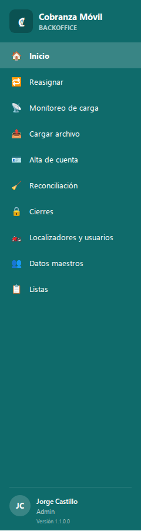

💡 Algunos mensajes de la carga nombran a **Smelter**: es la herramienta que procesa el archivo del banco dentro del sistema. No tenés que abrirla; todo se hace desde estas pantallas.

## La rutina diaria

Para que los localizadores salgan cada día con la cartera correcta, el orden es siempre el mismo:

1. **Cargá el archivo del banco** en **Cargar archivo**: primero la prueba en seco y, si sale limpia, la carga real. Ver [Cómo cargar el archivo del banco](#cómo-cargar-el-archivo-del-banco).
2. **Mirá Monitoreo de carga** y confirmá que diga **✓ Carga de hoy completada**, que el volumen sea el esperado y que no haya aviso de localizadores desactivados. Ver [Cómo revisar el Monitoreo de carga](#cómo-revisar-el-monitoreo-de-carga).
3. **Revisá Reconciliación**: qué Diarias activas no vinieron en el archivo de hoy. Ver [Cómo revisar la Reconciliación](#cómo-revisar-la-reconciliación).
4. **Revisá en Inicio la tarjeta LOCALIZADORES SIN USUARIO.** Tiene que estar en 0. Si no, vinculá a esos localizadores en **Localizadores y usuarios**.

El resto de las tareas (cierres, alta de cuenta, reasignar, maestros, listas) se hacen cuando hacen falta.

## Cómo leer la pantalla Inicio

**Para qué:** de un vistazo sabés si llegó la carga de hoy y si hay algo pendiente.

Arriba dice **Hola,** y tu nombre, y debajo **Cobrado hoy por los localizadores:** con el total cobrado en el día (en C$ y US$).

Las tres tarjetas del Admin:

| Tarjeta | Qué muestra |
|---|---|
| **CARGA DE HOY** | La fecha de la última carga si es de hoy; si no, **sin carga**. Debajo: «última corrida del import — detalle en Monitoreo». |
| **DIARIAS FUERA DE CARTERA** | Cuántas Diarias activas no vinieron en la última carga. Debajo: «salieron del archivo — ver Reconciliación». |
| **LOCALIZADORES SIN USUARIO** | Cuántos localizadores activos no tienen un usuario vinculado. Debajo: «no pueden entrar a la app». |

Debajo, en **ACCESOS**, tenés atajos a **Monitoreo** («¿llegó el archivo?»), **Reconciliación** («Diarias desaparecidas») y **Localizadores** («ligar usuarios»).

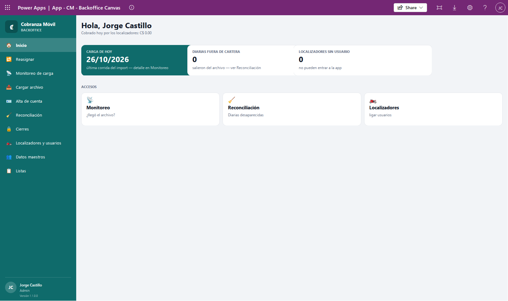

## Cómo cargar el archivo del banco

**Para qué:** el archivo diario del banco trae todas las cuentas en mora y a qué localizador le toca cada una. Al cargarlo, el sistema crea o actualiza clientes, cuentas y asignaciones, y la cartera nueva le llega a cada localizador en su próxima sincronización.

### Qué tiene que tener el archivo

El archivo lo prepara el banco; vos solo lo subís. Igual conviene saber cómo es, para reconocer un archivo equivocado:

- **Un solo archivo `.csv`, de hasta 50 MB.** La pantalla no acepta otro tipo ni uno más grande.
- **Primera fila con los encabezados** (el nombre de cada dato), separados por comas, y después una fila por cuenta.
- **Trae, por cada cuenta:** los datos del cliente (nombre, CIF, direcciones, teléfonos, departamento, distrito, trabajo), el número de tarjeta, los saldos vencidos en C$ y US$, la mora, el producto, el fiador, los montos de retiro, el **tipo de asignación** (Diaria, Incobrable o Especial), el **nombre del localizador** y la fecha de la carga.
- **Las fechas** van como aaaa-mm-dd.

🔒 El archivo trae los números de tarjeta completos. Guardalo solo donde el banco te indique y no lo reenvíes. Dentro del sistema, las pantallas muestran siempre el número oculto (•••• 1234).

⚠️ El nombre del localizador del archivo se compara letra por letra con los localizadores que ya existen. Si el banco manda un nombre nuevo o escrito distinto, la carga crea **otro** localizador, sin usuario. Revisá **LOCALIZADORES SIN USUARIO** después de cada carga.

### Pasos

1. En el menú, tocá **Cargar archivo** (o, desde **Monitoreo de carga**, el botón **📤 Cargar archivo**). La pantalla se llama **Cargar archivo del banco**.
2. En **1 · Elegí el archivo del banco**, tocá **＋ Elegir el archivo .csv** y elegí el archivo. Debajo vas a ver **✓ Listo para validar:** y el nombre del archivo.
3. Tocá **Validar (prueba en seco)**. El sistema procesa el archivo completo **sin guardar nada**, para encontrar errores antes de la carga real.
4. Esperá a que termine. Si salió limpia, vas a ver **✓ Prueba en seco limpia de «…». Si es el archivo correcto, tocá «Cargar».**
5. Tocá **Cargar**. Aparece la confirmación «Vas a cargar «…» de verdad: crea y actualiza clientes, cuentas y asignaciones. ¿Seguimos?».
6. Tocá **Sí, cargar ahora** (o **Cancelar** si te equivocaste).
7. Esperá a que la carga diga **Terminada** y tocá **📡 Ir a Monitoreo de carga**.

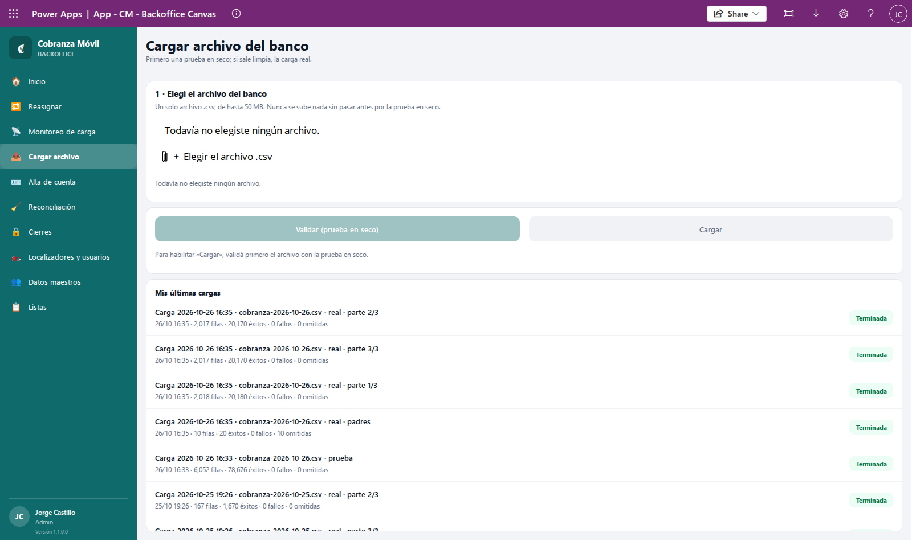

💡 **Cargar** solo se enciende si la prueba en seco terminó **sin ningún fallo** y el archivo elegido es el mismo que validaste. Si cambiás el archivo, tenés que validar de nuevo. Mientras tanto vas a ver «Para habilitar «Cargar», validá primero el archivo con la prueba en seco.».

### Qué ves mientras se procesa

Aparece un recuadro con el nombre de la carga (por ejemplo, «Carga aaaa-mm-dd hh:mm · archivo.csv · prueba» o «… · real») y su estado: **Preparando**, **En cola**, **Procesando**, **Terminada**, **Terminada con errores** o **Falló**. Tiene estos contadores:

| Contador | Qué es |
|---|---|
| **FILAS DEL ARCHIVO** (en la carga real, **FILAS (PADRES + PARTES)**) | Cuántas filas hay que procesar |
| **PROCESADAS** | Las que ya se leyeron |
| **ÉXITOS** | Las que entraron sin problema |
| **FALLOS** | Las que tuvieron error |
| **OMITIDAS** | Las que no cambiaban nada |

Y un mensaje que va contando el avance, por ejemplo:

- «⏳ Revisando en el servidor que ningún valor sea más largo que su columna.» (solo en la prueba en seco).
- «⏳ Preparando la carga: el archivo ya subió, en unos segundos se pone en cola.»
- En la carga real, que va en dos pasos: «⏳ Paso 1 de 2: productos, fiadores y localizadores …» y después «⏳ Paso 2 de 2: … partes en paralelo …». La carga real se reparte en varias partes que corren a la vez, para que termine antes.
- «⏳ Lleva más de 20 minutos y sigue en Smelter (una carga grande tarda). …» si es muy grande.

⚠️ Durante la carga real vas a ver «⚠ No cierres ni recargues la app hasta que arranquen las partes; podés usar otras pantallas. …». Podés ir a otras pantallas de la app, pero **no la cierres ni la recargues** hasta que empiece el paso 2. Si la cerrás antes, las partes quedan sin lanzar y hay que relanzarlas desde **Mis últimas cargas**.

💡 Mientras la pantalla está procesando una carga no se puede empezar otra: vas a ver «⏳ Hay una carga en curso: esperá a que termine para empezar otra.».

### Mis últimas cargas

Abajo de todo, **Mis últimas cargas** muestra tus 20 cargas más recientes: nombre, fecha y hora, y cuántas filas, éxitos, fallos y omitidas tuvo cada una, con su estado (**Terminada**, **Con errores**, **Falló**, **Procesando**, **En cola** o **Sin lanzar**). Una carga real aparece en varias filas: «· padres» y una por cada «· parte». Si todavía no cargaste nada, dice **Todavía no hay cargas tuyas**.

Si una carga quedó a medias (por ejemplo, porque se cerró la app antes de tiempo), su fila muestra un botón para resolverla. Si pasás el mouse sobre el botón, una ayuda explica qué hace:

| Botón | Cuándo aparece | Qué hace |
|---|---|---|
| **▶ Relanzar partes (N)** | El paso 1 terminó bien pero las partes nunca se pusieron en marcha | Las pone en marcha ahora |
| **✕ Descartar partes (N)** | El paso 1 no terminó bien o nunca arrancó | Marca las partes que faltan como **Falló**, sin cargar nada de ellas |
| **✕ Descartar carga** | La carga nunca se puso en marcha | La marca como **Falló**, sin cargar nada de ella |

Después de descartar, volvé a cargar el archivo completo. Volver a cargar el mismo archivo es seguro: no duplica clientes, cuentas ni asignaciones.

⚠️ Mientras una carga real esté a medias, la **Reconciliación** muestra el aviso de carga en curso y su lista no es confiable. Resolvela desde aquí.

### Errores comunes al cargar

| Mensaje | Qué significa y qué hacer |
|---|---|
| «⛔ Tiene que ser un archivo .csv: …» | Elegiste otro tipo de archivo. Quitalo con la ✕ y elegí el `.csv`. |
| «Un solo archivo por carga. Para cambiarlo, quitá el actual con la ✕.» | Ya hay un archivo elegido. Quitalo antes de elegir otro. |
| «⛔ No se ve la plantilla de Smelter "Cobranza movil". Avisá a soporte: tu usuario no está en el equipo de carga.» | Tu usuario no tiene permiso para cargar. Pedí que te agreguen al equipo de carga. |
| «El archivo no pasó la revisión y NO se cargó nada: …» | Algún valor es más largo de lo permitido. El mensaje dice en qué fila y en qué dato. Pedile al banco que lo corrija. |
| «Hay N filas con error. Avisá a soporte con el nombre de la carga: …» | Algunas filas no entraron. Si fue en la prueba en seco, **Cargar** no se habilita. Pasale a soporte el nombre de la carga. |
| «La primera etapa (productos, fiadores y localizadores) terminó con errores: NO se lanzaron las … partes y no se cargó ninguna cuenta. …» | El paso 1 falló y la carga se detuvo sin cargar cuentas. Avisá a soporte; cuando esté corregido, cargá el archivo completo de nuevo. |
| «No se pudo iniciar la carga: …», «No se pudo poner la carga en cola: …», «No se pudo partir la carga y NO se cargó nada: …» | No se cargó nada. Probá otra vez; si se repite, avisá a soporte con el nombre de la carga. |
| «⚠ La pantalla dejó de consultar después de 1 hora y media, pero la carga puede seguir en Smelter. …» | La carga puede seguir. Volvé a entrar a **Cargar archivo** más tarde y mirá su estado en **Mis últimas cargas**. |

## Cómo revisar el Monitoreo de carga

**Para qué:** responde dos preguntas: ¿llegó el archivo de hoy? y ¿cuadra el volumen?

1. En el menú, tocá **Monitoreo de carga**.
2. Mirá la banda de arriba:
   - **✓ Carga de hoy completada ·** y la fecha: la carga de hoy está. Debajo, el resumen de filas, cuentas y clientes.
   - **⛔ No ha llegado la carga de hoy**: muestra la fecha de la **Última carga** (o «Sin cargas registradas en el sistema») y te pide «Subí el archivo del banco en «Cargar archivo» y verificá la carga antes de operar la reconciliación.».
3. Compará las tarjetas con lo que esperabas:
   - **FILAS DE CARGA HOY** («desde las 00:00»): cuántas filas del archivo entraron hoy (una por cuenta).
   - **CUENTAS TOTALES** y **CLIENTES TOTALES** («en maestros»): el total de cuentas y clientes en el sistema.
4. Si cargaste hace un momento, tocá **↻ Actualizar**. Vas a ver «✓ Datos actualizados».

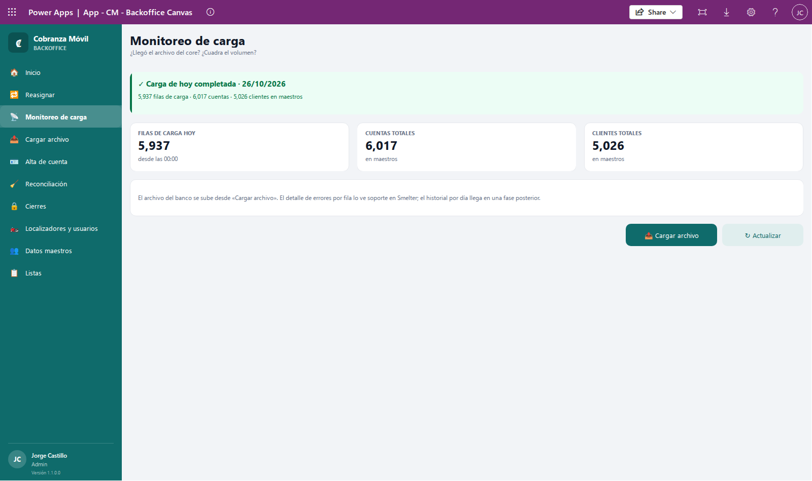

💡 Si **FILAS DE CARGA HOY** es mucho menor que en un día normal, puede que el archivo haya llegado incompleto. Consultalo con el banco **antes** de tocar la Reconciliación.

### Aviso de localizadores desactivados

Si la última carga le asignó cuentas a un localizador que está **desactivado**, aparece un aviso amarillo:

«⚠ La última carga asignó N cuenta(s) a localizador(es) desactivado(s): (nombres).» y «Reactivá el localizador en «Localizadores y usuarios» o pedí al banco que corrija el localizador en el archivo. Las Especiales e Incobrables también se pueden mover en «Reasignar».»

Esas cuentas están a nombre de alguien que no puede registrar visitas. Tenés dos caminos:

- Si el localizador sigue trabajando, **activalo** en **Localizadores y usuarios**.
- Si ya no trabaja, pasá sus Incobrables y Especiales a otra persona en **Reasignar**, y avisale al banco para que sus Diarias vengan con otro localizador en el próximo archivo (las Diarias no se reasignan a mano).

Mientras revisa, el aviso dice «⏳ Revisando localizadores…». Si no hay nada que avisar, no aparece.

El texto de abajo recuerda que el detalle de errores por fila lo ve soporte.

## Cómo revisar la Reconciliación

**Para qué:** muestra las Diarias que estaban activas y **no vinieron** en la última carga del banco. Normalmente son cuentas que el banco ya no quiere que se cobren (por ejemplo, porque se pagaron). Sirve para controlar que el archivo de hoy llegó completo y saber cuántas cuentas salieron de la cartera.

1. En el menú, tocá **Reconciliación** (o la tarjeta **DIARIAS FUERA DE CARTERA** de Inicio). La pantalla se llama **Reconciliación de Diarias**.
2. Leé el resumen: «N de M Diarias activas (P%) quedaron fuera de la cartera», con una barra que muestra la proporción.
3. Revisá la lista. Cada fila muestra el cliente, la cuenta (•••• 1234), el localizador y el día de su **última carga**, con la etiqueta **Diaria**. Si la lista es muy larga, dice «Mostrando las primeras …».
4. Si todo vino en la carga, vas a ver **Cartera cuadrada**: «Todas las Diarias activas vinieron en la carga.».

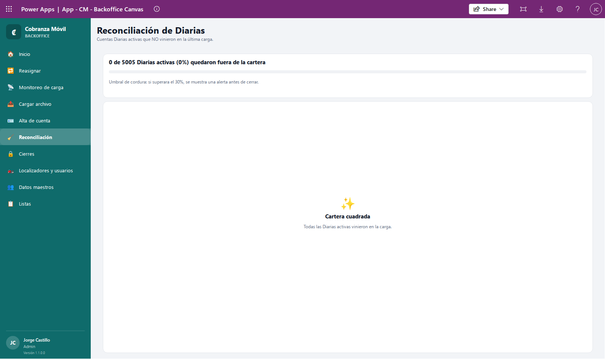

Avisos que podés ver arriba:

| Aviso | Qué significa |
|---|---|
| «⛔ Todavía no llegó la carga de HOY — la reconciliación se corre DESPUÉS del import.» | Todavía no se cargó el archivo de hoy. La lista compara contra la carga anterior. Cargá primero el archivo. |
| «⛔ Hay una carga del banco en curso (en cola, procesando o preparándose): esperá a que termine …» | Mientras se carga, las Diarias que todavía no se procesaron aparecen como fuera de cartera. Esperá a que termine (o resolvé las cargas a medias en **Mis últimas cargas**). |
| «⛔ No se puede verificar si hay una carga del banco en curso …» | El sistema no pudo comprobar el estado de la carga. Avisá a soporte. |
| «🚨 ATENCIÓN: el P% de las Diarias (…) NO vino en la carga de hoy. …» | Más del 30% de las Diarias no vino. Lo normal es mucho menos: suele ser un archivo **truncado** o una carga incompleta. Revisá el Monitoreo y consultá con el banco. |

La pantalla también recuerda el «Umbral de cordura: si superara el 30%, se muestra una alerta antes de cerrar.».

⚠️ **Cierre en lote.** Cuando hay Diarias fuera de cartera, la pantalla también permite cerrarlas todas juntas con el motivo «fuera de cartera». Al cerrarlas, desaparecen del teléfono de los localizadores. Esta acción se usa **únicamente con indicación del responsable de la operación**. Si no te lo indicaron, no la uses: limitate a revisar la lista y a informar lo que viste.

💡 Si el banco vuelve a mandar una Diaria que se cerró como fuera de cartera, el sistema la reabre sola en esa carga.

## Cómo cerrar una Incobrable o una Especial

**Para qué:** las Incobrables y las Especiales no se cierran solas con el archivo del banco. Cuando una gestión termina (la deuda se recuperó, se dio de baja, la Especial se completó o ya no aplica), la cerrás a mano y con motivo. El localizador nunca cierra una asignación.

1. En el menú, tocá **Cierres**.
2. Elegí la pestaña **🟠 Incobrables (N)** o **🟣 Especiales (N)**. El número es cuántas hay activas.
3. Si hace falta, buscá en **Cliente, CIF, últimos dígitos de la tarjeta o localizador**.
4. Tocá la fila de la asignación. Cada fila muestra el cliente, la cuenta (•••• 1234), el CIF, el localizador, los días de mora y el saldo vencido (en una Especial con retiro, el monto del retiro).

   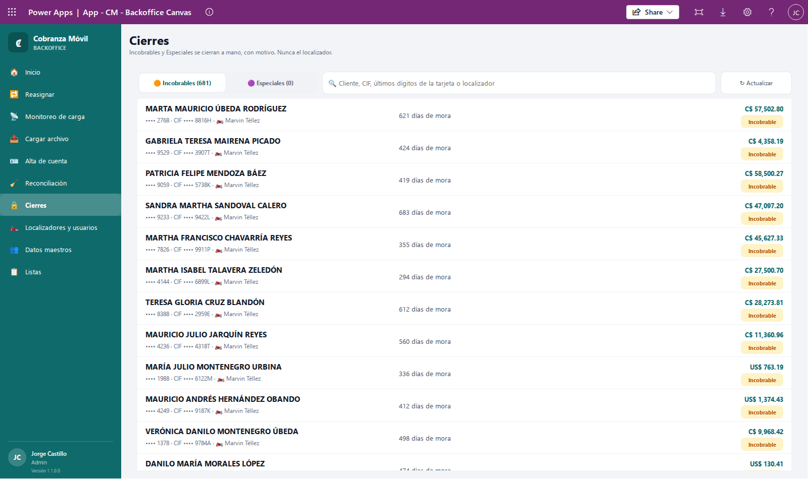

5. Se abre el panel **Cerrar asignación** con el **Cliente**, la **Cuenta**, el **Tipo** y el **Saldo vencido**. Revisá que sea la correcta.
6. En **MOTIVO DE CIERRE \***, elegí el motivo de la lista.
7. Si querés, escribí en **DETALLE** el contexto del cierre (es opcional).
8. Tocá **🔒 Cerrar asignación**. El botón se enciende solo cuando elegiste un motivo.

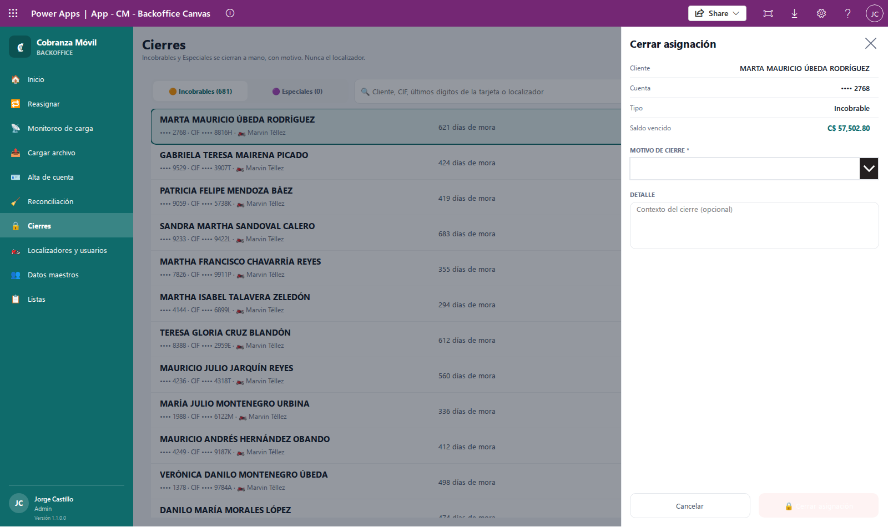

**Qué esperar:** vas a ver «🔒 Asignación cerrada —» y el motivo, y la fila desaparece de la lista. La asignación sale del teléfono del localizador en su próxima sincronización.

⚠️ La app no tiene forma de reabrir una asignación cerrada. Revisá bien antes de cerrar.

💡 Los motivos se configuran en **Listas** («Motivo de cierre · Incobrable» y «Motivo de cierre · Especial»).

💡 En **Especiales** solo aparecen las **aprobadas**. Una Especial pendiente de aprobación la resuelve el Supervisor en **Aprobaciones** (ver [04-supervisor.md](04-supervisor.md)). Las Diarias no se cierran aquí: salen de la cartera por la Reconciliación.

**Si algo sale mal:**

- **Nada activo** («No hay Incobrables activas para cerrar.» o «No hay Especiales activas para cerrar.»): no hay nada que cerrar en esa pestaña.
- **Sin resultados** («Ninguna Incobrable coincide con «…».»): revisá lo que escribiste en el buscador.
- «No se pudo cerrar AS-…: …»: el cierre no se hizo. Tocá **↻ Actualizar** y probá de nuevo; si se repite, avisá a soporte.

## Cómo dar de alta una cuenta

**Para qué:** cargar **una** cuenta que no vino en el archivo del banco, sin esperar al archivo del día siguiente. El sistema la procesa como si fuera una carga de una sola fila: primero la prueba en seco y, si sale limpia, la carga real.

1. En el menú, tocá **Alta de cuenta**.
2. Completá **1 · Datos de la cuenta (con \* son obligatorios)**:

   | Campo | Qué poner |
   |---|---|
   | **CIF del cliente \*** | El CIF tal como lo manda el banco |
   | **Nombre del cliente (si es nuevo)** | Solo si el cliente no existe; si el CIF ya existe, se usa el nombre que ya tiene |
   | **Número de tarjeta \*** | De 13 a 19 dígitos. Al lado del título ves cuántos dígitos escribiste y si el número pasa el verificador («✓ verificador OK» o «✗ no pasa el verificador»). El botón **Ocultar** / **Mostrar** tapa o muestra el número |
   | **Producto \*** | Elegilo de la lista (código y tipo) |
   | **Localizador \*** | Elegilo de la lista. Solo aparecen los localizadores **activos**, con su correo o «sin usuario» |
   | **Tipo de asignación \*** | **Especial** (viene elegida), **Diaria** o **Incobrable** |
   | **Saldo vencido C$ \***, **Saldo vencido US$ \***, **Total saldo vencido \*** | Montos de 0 o más |
   | **Días de mora \***, **Nivel de mora \*** | Números enteros |
   | **Fecha de pago (aaaa-mm-dd)** | Opcional, con ese formato |
   | **Celular**, **Dirección de la casa**, **Teléfono de la casa**, **Dirección del trabajo**, **Departamento**, **Distrito** | Datos de contacto, para un cliente nuevo |
   | **Fiador**, **Dirección del fiador** | Opcionales. Si el fiador ya existe, se usa la dirección que ya tiene |
   | **Nota** | Opcional. Nunca escribas números de tarjeta aquí |
   | **Retiro C$**, **Retiro US$** | Solo aparecen si el tipo es **Especial**: lo que el localizador tiene que traer |

3. Mirá el renglón de control debajo de los botones. Mientras falte algo, dice **Falta o corregí:** y lo que falta (por ejemplo, «CIF · saldos · mora»). Cuando está todo, dice **✓ Datos completos**.
4. Tocá **Validar (prueba en seco)**. El sistema revisa la fila sin crear nada.
5. Si sale limpia, vas a ver «✓ Prueba en seco limpia. El formulario quedó bloqueado con estos datos: si son correctos, tocá «Cargar de verdad».». Si querés cambiar algo, tocá **Corregir datos**: el formulario se desbloquea y tenés que validar de nuevo.
6. Tocá **Cargar de verdad**. Aparece la confirmación «Vas a dar de alta la cuenta de verdad (tipo, CIF …). ¿Seguimos?».
7. Tocá **Sí, dar de alta** (o **Cancelar**).

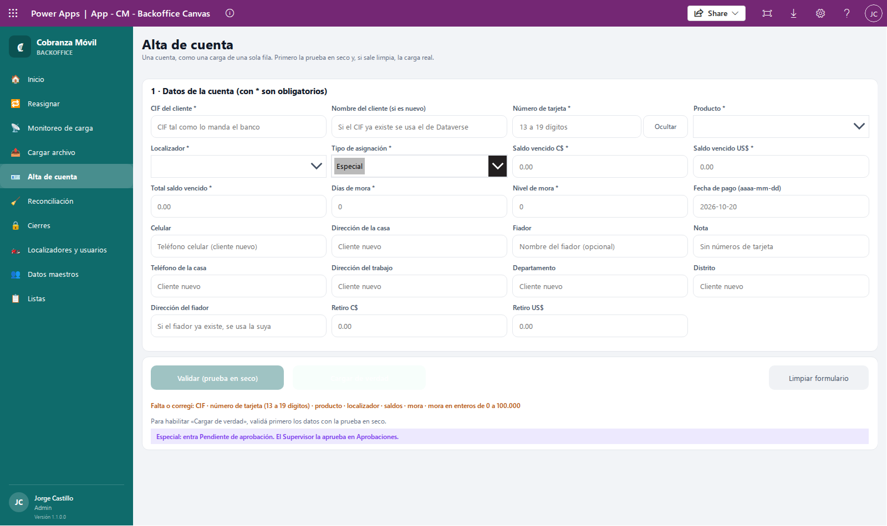

💡 **Cargar de verdad** solo se enciende después de una prueba en seco limpia con esos mismos datos. Mientras tanto vas a ver «Para habilitar «Cargar de verdad», validá primero los datos con la prueba en seco.».

**Qué esperar:** mientras se procesa vas a ver «⏳ Preparando: …» y después «⏳ Smelter está trabajando; …», con el estado y los contadores de la fila. Al terminar, «✓ Alta hecha:» con el tipo, el CIF y la cuenta (•••• 1234); en una Especial agrega «Quedó Pendiente de aprobación.». El formulario se limpia solo.

Mientras completás el formulario, debajo de los botones un aviso te recuerda qué pasa con la cuenta según el tipo que elegiste:

- **Especial:** «Especial: entra Pendiente de aprobación. El Supervisor la aprueba en Aprobaciones.». No le llega a ningún localizador hasta que se aprueba.
- **Diaria:** «⚠ Diaria: si el banco no la trae en su próximo archivo, la reconciliación la muestra fuera de cartera y se puede cerrar.».
- **Incobrable:** «⚠ Incobrable: la reconciliación no la cierra; queda activa hasta que alguien la cierre o el banco la mande como Diaria.».

Si el sistema tiene alguna observación sobre los datos, aparece debajo con ⚠.

**Limpiar formulario** borra todos los campos, incluido el número de tarjeta.

🔒 El número de tarjeta no queda guardado en la pantalla: se borra al limpiar el formulario, al terminar el alta y al salir de la pantalla.

⚠️ Si elegís un localizador **sin usuario**, la cuenta se crea igual, pero no le llega a nadie hasta que vincules a ese localizador con su usuario.

**Si algo sale mal:**

| Mensaje | Qué hacer |
|---|---|
| «Falta o corregí: número de tarjeta (13 a 19 dígitos)» o «… número de tarjeta que pase el verificador» | Revisá el número: tiene un dígito de más, de menos o equivocado. |
| «Falta o corregí: montos sin negativos» | Algún monto es negativo. Los montos van de 0 en adelante. |
| «Falta o corregí: montos hasta 1.000.000.000» | Algún monto es demasiado grande. |
| «Falta o corregí: mora en enteros de 0 a 100.000» | Días o nivel de mora con decimales o fuera de rango. |
| «Falta o corregí: fecha de pago como aaaa-mm-dd» | Escribí la fecha con ese formato, por ejemplo 2026-01-31. |
| «No se pudo registrar el alta: …» | El sistema rechazó los datos (por ejemplo, el localizador ya no está activo). El mensaje dice el motivo. Corregí y validá de nuevo. |
| «Smelter marcó la fila con error. Revisá los datos o avisá a soporte con el nombre: …» | La fila no entró. Revisá los datos; si no encontrás el problema, pasale a soporte el nombre que aparece. |
| «⏳ Hay un alta en curso: esperá a que Smelter termine.» | Esperá a que termine la anterior. |

## Cómo administrar localizadores y usuarios

**Para qué:** cada localizador del archivo del banco tiene que estar vinculado al usuario con el que esa persona entra a la app del teléfono. Sin usuario, el localizador no puede entrar a la app y sus cuentas no le llegan a nadie.

En el menú, tocá **Localizadores y usuarios**. Cada fila muestra el nombre del localizador, su correo, el usuario vinculado, si está **✓ Vinculado** o **Sin usuario**, si está **Activo** o **Inactivo**, y los botones de cada acción.

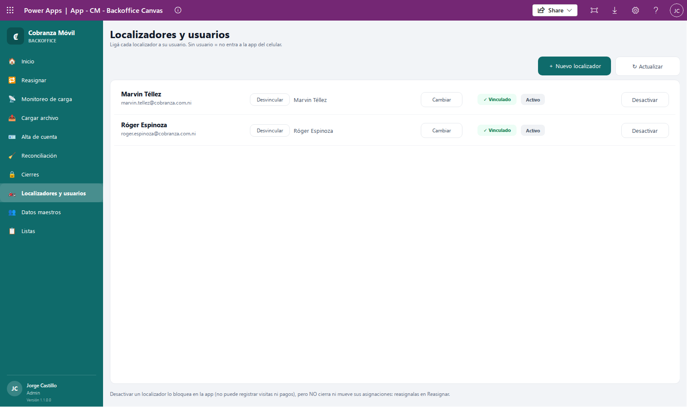

Si hay localizadores activos sin usuario, arriba aparece «⚠ N localizador(es) activo(s) sin usuario vinculado» con sus nombres y la aclaración de que esa lista debe estar **VACÍA** antes de operar.

### Crear un localizador

Normalmente los localizadores los crea solos la carga del archivo, con el nombre que manda el banco. Creá uno a mano solo si necesitás tenerlo listo antes de la carga.

1. Tocá **＋ Nuevo localizador**.
2. En **Nombre del localizador \***, escribí el nombre **EXACTO** con el que el banco lo manda en el archivo: mismas palabras, mismo orden y mismos acentos.
3. Si ya sabés qué usuario tiene, buscalo en **Usuario de Entra (opcional — tocá uno para elegirlo)**: escribí al menos 2 letras del nombre o del correo y tocá a la persona. Si te equivocaste, tocá **Quitar**.
4. Tocá **Crear localizador**.

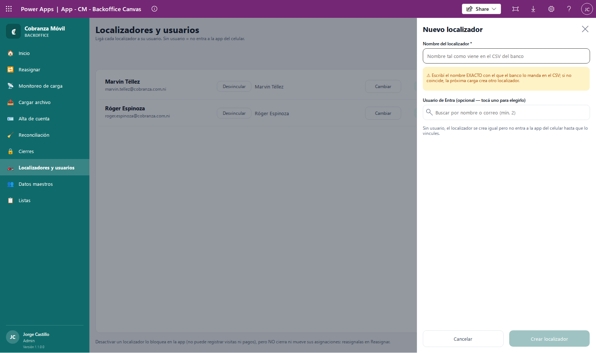

**Qué esperar:** «✓ Localizador … creado sin usuario» o «✓ Localizador … creado y vinculado a …». El localizador queda **Activo**.

⚠️ Como dice el aviso del panel: «Escribí el nombre EXACTO con el que el banco lo manda en el CSV; si no coincide, la próxima carga crea otro localizador.». Si eso pasa, vas a tener dos localizadores para la misma persona y las cuentas del archivo van a quedar en el que creó la carga.

💡 «Sin usuario, el localizador se crea igual pero no entra a la app del celular hasta que lo vincules.».

### Vincular o cambiar el usuario

1. En la fila del localizador, tocá **Vincular** (si no tiene usuario) o **Cambiar** (si ya tiene).
2. Se abre el panel **Vincular usuario —** con el nombre del localizador y el **Vínculo actual**.
3. En **Usuario de Entra (tocá uno para vincularlo)**, escribí al menos 2 letras del nombre o del correo.
4. Tocá a la persona. El vínculo se guarda en ese momento.

**Qué esperar:** «✓ … vinculado a …». Las cuentas de ese localizador pasan a la persona y le llegan al teléfono en su próxima sincronización.

### Desvincular

Tocá **Desvincular** en la fila. Vas a ver «Vínculo quitado —» y el nombre. Desde ese momento la persona ya no puede entrar a la app con ese localizador, y sus cuentas dejan de llegarle a nadie hasta que lo vincules con otro usuario.

### Activar y desactivar

Tocá **Desactivar** (o **Activar**) en la fila. Vas a ver el nombre con «desactivado» o «activado».

⚠️ Desactivar **no** cierra ni mueve las cuentas del localizador. Como dice la nota al pie: «Desactivar un localizador lo bloquea en la app (no puede registrar visitas ni pagos), pero NO cierra ni mueve sus asignaciones: reasignalas en Reasignar.». Las cuentas siguen a su nombre hasta que las reasignes. Además, si el banco le sigue mandando cuentas en el archivo, el **Monitoreo de carga** te lo avisa.

**Si algo sale mal:**

| Mensaje | Qué hacer |
|---|---|
| «Ya existe un localizador llamado «…». No se creó otro.» | Ese localizador ya existe (aunque esté escrito con otras mayúsculas). Buscalo en la lista. |
| «Escribí el nombre del localizador.» | El nombre está vacío. |
| «El usuario … no tiene correo principal: no podría entrar a la app del celular. Elegí otro.» | Ese usuario no puede usar la app del teléfono. Pedí a quien administra los accesos que lo revise, o elegí otro. |
| «… ya está vinculado a …» | Elegiste el mismo usuario que ya tenía. No cambió nada. |
| «Ningún usuario empieza con «…».» | Probá con el comienzo del nombre o del correo. |
| «No se pudo vincular …», «No se pudo desvincular …», «No se pudo cambiar el estado de …», «No se pudo crear el localizador …» | No se guardó. Tocá **↻ Actualizar** y probá de nuevo; si se repite, avisá a soporte. |
| **Sin localizadores** («El import diario todavía no creó localizadores.») | Todavía no se cargó ningún archivo. Cargalo o creá los localizadores a mano. |

## Cómo usar Datos maestros

**Para qué:** consultar los clientes y sus cuentas, completar datos de contacto y crear un cliente a mano. Los Solicitantes usan estos clientes y cuentas para pedir Especiales.

1. En el menú, tocá **Datos maestros**.
2. Buscá en **CIF o nombre…**. La búsqueda encuentra los clientes cuyo CIF o nombre **empieza** con lo que escribiste.
3. Tocá un cliente para ver su ficha: **CIF**, **DEPARTAMENTO** (y distrito), **TRABAJO**, **TELÉFONOS**, **DIRECCIONES** y **CUENTAS** (cada una con su número oculto, el tipo de producto y el saldo vencido). Tocá **Cerrar** para volver.

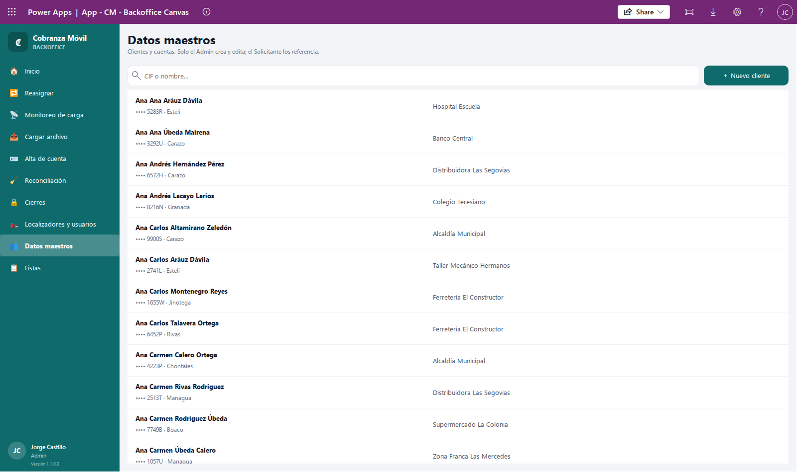

### Editar un cliente

1. En la ficha, tocá **✏️ Editar**.
2. Cambiá **Departamento**, **Distrito** o **Trabajo** y tocá **Guardar cambios**. El nombre no se puede cambiar aquí: «Nombre completo (lo actualiza la carga del banco)».
3. Para sumar un teléfono, escribilo en **AGREGAR TELÉFONO**, elegí **Celular** o **Casa** y tocá **＋**.
4. Para sumar una dirección, escribila en **AGREGAR DIRECCIÓN**, elegí **Casa**, **EC** o **Trabajo** y tocá **＋**.
5. Tocá **Volver a la ficha**.

⚠️ La carga del banco actualiza los clientes con lo que trae el archivo. Si el archivo trae otro valor para lo que editaste, la carga siguiente lo reemplaza.

### Crear un cliente

1. Tocá **＋ Nuevo cliente**.
2. Completá **CIF \*** y **Nombre completo \***, y si los tenés, **Departamento**, **Distrito**, **Trabajo**, **Teléfono celular**, **Teléfono casa**, **Dirección casa** y **Dirección trabajo**.
3. Tocá **＋ Crear cliente**.

⚠️ «El CIF debe ser el del core. Un CIF equivocado duplica el cliente en el próximo import.».

💡 Este botón crea solo el cliente. Para crear una cuenta con su asignación, usá **Alta de cuenta**.

**Si algo sale mal:**

- «Ya existe un cliente con CIF … — buscalo y editalo, no lo dupliques.»: buscalo en la lista.
- «Cliente … creado, pero no se pudo releer …» o «Cliente creado, pero no se pudo grabar …»: el cliente quedó creado pero faltó algún teléfono o dirección. Agregalo desde **✏️ Editar**.
- **Sin resultados** («Ningún CIF ni nombre empieza con «…».»): revisá lo que escribiste.
- «No se pudo guardar el cliente …», «No se pudo agregar …», «No se pudo crear el cliente …»: no se guardó; probá de nuevo y, si se repite, avisá a soporte.

## Cómo editar las Listas

**Para qué:** las listas de opciones que muestran las apps las administrás vos. Las opciones no se borran: se desactivan, para no perder lo que ya se eligió antes.

1. En el menú, tocá **Listas**.
2. En **Lista**, elegí cuál querés editar. Debajo se explica dónde se usa:

   | Lista | Dónde aparece |
   |---|---|
   | **Tipo de Especial** | En **Nueva solicitud**, el tipo de la Especial. La primera activa viene elegida. |
   | **Motivo de cierre · Incobrable** | En **Cierres**, al cerrar una Incobrable. |
   | **Motivo de cierre · Especial** | En **Cierres**, al cerrar una Especial. |
   | **Mensajes rápidos del localizador** | En el teléfono, al registrar una visita: botones que agregan el texto al comentario. Llegan al teléfono en su próxima sincronización. |

3. Para agregar una opción, escribila en **Nueva opción (hasta 100 caracteres)** y tocá **＋ Agregar**. Se suma al final.
4. Para cambiar el texto de una opción, editalo en su fila y tocá **Guardar**.
5. Para cambiar el orden, usá **↑ Subir** y **↓ Bajar**. Las apps muestran las opciones en este orden.
6. Para desactivar o reactivar una opción, tocá **✓ Activa** / **Inactiva**. Las apps solo muestran las activas.

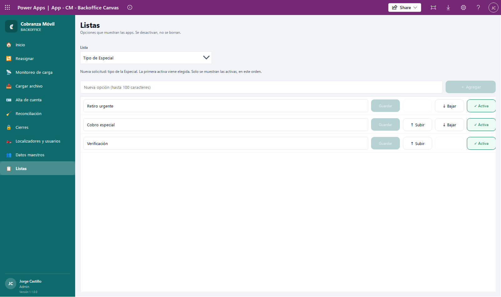

💡 Cambiar el texto de una opción no cambia lo que ya se registró antes con el texto viejo.

**Si algo sale mal:**

- «Ya existe «…» en esta lista (si está inactiva, activala).»: no se agregó porque ya está. Si aparece como **Inactiva**, reactivala.
- «Tiene que quedar al menos una opción activa en la lista.»: no podés desactivar la última opción activa.
- «No se pudo agregar: …», «No se pudo guardar: …», «No se pudo mover: …», «No se pudo cambiar: …»: no se guardó; probá de nuevo.

## Cómo reasignar una Especial o una Incobrable

**Para qué:** pasar una asignación a otro localizador, por ejemplo porque el anterior se fue de vacaciones o dejó de trabajar. Las Diarias no se reasignan: las reparte el archivo del banco.

1. En el menú, tocá **Reasignar**.
2. Elegí la pestaña **🟣 Especiales (N)** (aprobadas y activas) o **🟠 Incobrables (N)** (activas).
3. Si hace falta, buscá en **Buscar por cliente, cuenta o localizador**.
4. Tocá la fila. Cada fila muestra el cliente, la cuenta (•••• 1234), los días de mora y el localizador actual.

   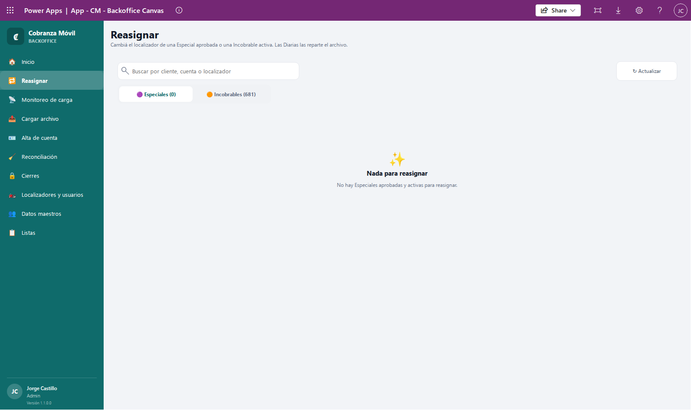

   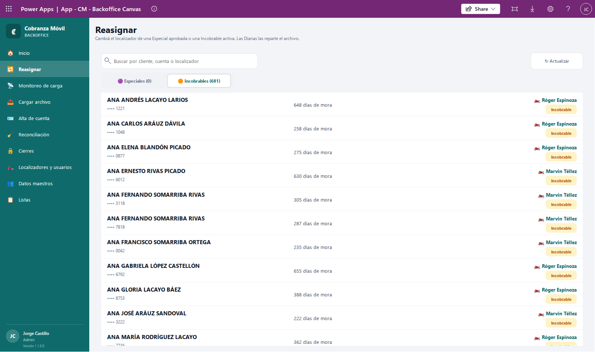

5. Se abre el panel **Reasignar** con el número de la asignación (AS-…), el **Cliente**, la **Cuenta**, el **Tipo**, los **Días de mora** y el **Localizador actual**.
6. En **NUEVO LOCALIZADOR \***, escribí al menos 2 letras del nombre y tocá a la persona. Si te equivocaste, tocá **Cambiar**.

   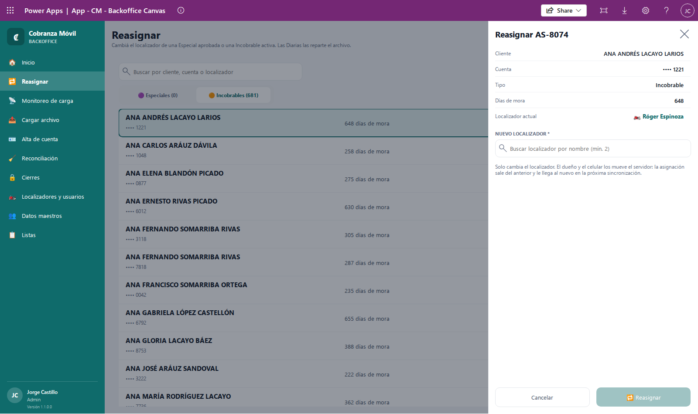

   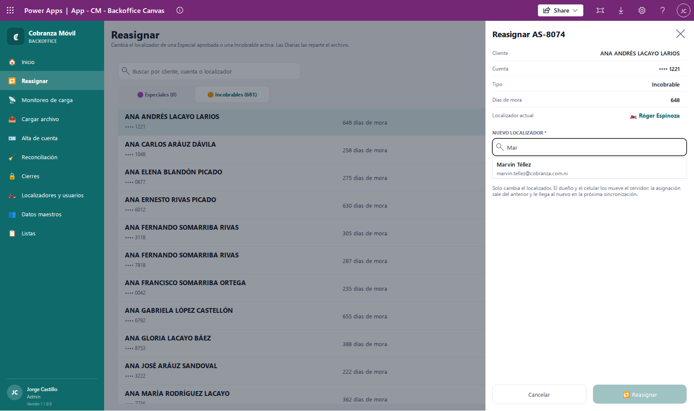

7. Tocá **🔁 Reasignar**. El botón se enciende solo cuando elegiste un localizador distinto del actual.

**Qué esperar:** «🔁 Reasignada a … . Baja al celular del localizador en la próxima sincronización.». Como dice el panel, la asignación sale del teléfono del anterior y le llega al nuevo cuando cada uno sincroniza.

💡 En el buscador solo aparecen localizadores **activos y con usuario**, y nunca el actual. Si no encontrás a alguien, revisá en **Localizadores y usuarios** que esté activo y vinculado.

**Si algo sale mal:**

- **Nada para reasignar** («No hay Especiales aprobadas y activas para reasignar.» o «No hay Incobrables activas para reasignar.»): no hay nada en esa pestaña.
- «Ninguna asignación coincide con «…».»: revisá lo que escribiste en el buscador.
- «Ningún otro localizador activo con usuario empieza con «…».»: probá con el comienzo del nombre, o revisá que esa persona esté activa y vinculada.
- «No se pudo reasignar AS-…: …»: no se guardó. Tocá **↻ Actualizar** y probá de nuevo.

## Si algo sale mal

| Lo que ves | Qué hacer |
|---|---|
| **Sin acceso** al abrir la app | Tu usuario no tiene ningún permiso de Cobranza Móvil. Pedile el de Admin a quien administra los accesos. |
| **No se pudo verificar tu acceso** («No se pudieron leer tus permisos (…). Cerrá y volvé a abrir la app; si sigue, avisale al Admin.») | Cerrá la app y abrila de nuevo. Si sigue, avisá a soporte. |
| **CARGA DE HOY** dice **sin carga** | Todavía no se cargó el archivo de hoy. Cargalo en **Cargar archivo**. |
| «⛔ No ha llegado la carga de hoy» en Monitoreo | Igual que arriba. Si ya cargaste, tocá **↻ Actualizar**. |
| «No se pudieron actualizar los datos: …» en Monitoreo | Probá de nuevo en un momento. |
| **LOCALIZADORES SIN USUARIO** mayor que 0 | Vinculá a esos localizadores en **Localizadores y usuarios**. |
| Aviso de localizadores desactivados en Monitoreo | Activá al localizador o reasigná sus cuentas (ver [Aviso de localizadores desactivados](#aviso-de-localizadores-desactivados)). |
| Aviso de carga en curso en Reconciliación | Esperá a que termine o resolvé la carga a medias en **Mis últimas cargas**. |
| Alerta 🚨 de más del 30% en Reconciliación | Probablemente el archivo llegó incompleto. Revisá el Monitoreo y consultá con el banco y con el responsable de la operación. |
| Un error de carga que no entendés | Pasale a soporte el **nombre de la carga** (por ejemplo, «Carga aaaa-mm-dd hh:mm · archivo.csv · real»). |

Para más dudas, mirá [Preguntas frecuentes](06-preguntas-frecuentes.md).
