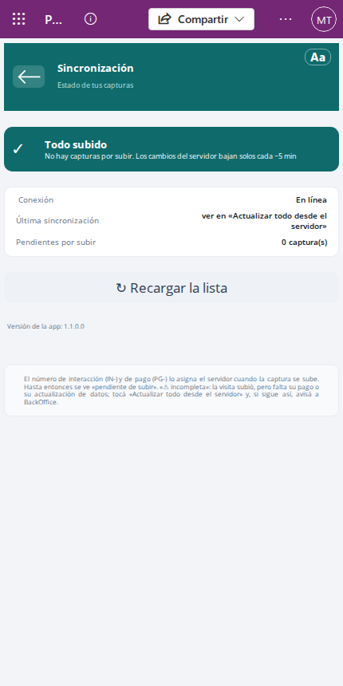
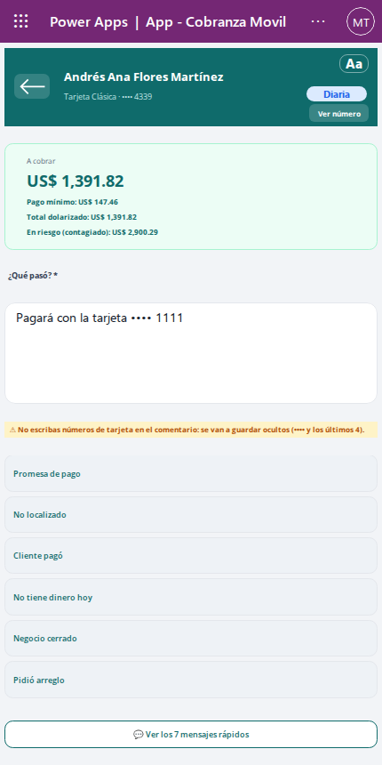
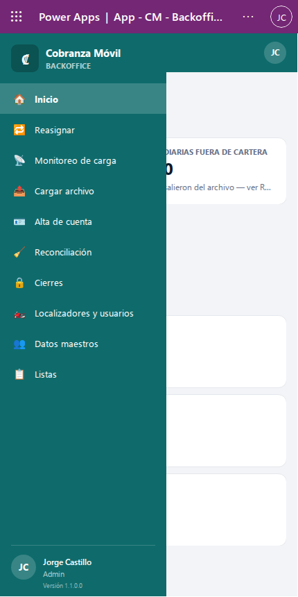

# Preguntas frecuentes

Respuestas cortas a las dudas que más se repiten al usar Cobranza Móvil, agrupadas por perfil. Cada respuesta dice qué hacer, a quién avisar si no se resuelve y dónde está la explicación completa en la guía de tu perfil. Si un término no te queda claro, mirá [Conceptos básicos](00-conceptos.md).

- [Localizador](#localizador)
- [BackOffice](#backoffice)
- [Solicitante](#solicitante)
- [Supervisor](#supervisor)
- [Admin](#admin)
- [Todos](#todos)

## Localizador

### No veo mi cartera, o me faltan clientes

Tu cartera son las cuentas que tenés asignadas, y llegan al teléfono cuando se sincroniza.

1. Revisá que el teléfono tenga señal y tocá el indicador de sincronización (arriba, por ejemplo **Todo subido**) para abrir **Sincronización**.
2. Tocá **⟳ Actualizar todo desde el servidor** y, en la pantalla que se abre, **Buscar actualizaciones**. Al volver, la cartera se recarga sola.
3. En la **Cartera**, tocá **↻** para volver a armar la lista.

Si después de sincronizar la cartera sigue vacía, lo más probable es que tu usuario todavía no esté vinculado a tu localizador. En ese caso, si registrás una visita, **Sincronización** muestra un aviso y, al tocar **⟳ Actualizar todo desde el servidor**, el mensaje dice que tu usuario no está vinculado a ningún localizador y que le pidás al Admin «que lo vincule en Localizadores y usuarios». Avisale a tu supervisor para que el Admin lo vincule. Una Especial no aparece hasta que el Supervisor la aprueba.

Más detalle: [Cómo revisar tu cartera](01-localizador.md#cómo-revisar-tu-cartera).

### La app dice «Sin conexión»

Podés seguir trabajando: la app funciona sin señal. Todo lo que registres se guarda en el teléfono y se sube solo cuando vuelva la señal (la app avisa **✓ Guardado en el teléfono. Se sube cuando vuelva la señal.**).

- No borres la app ni cierres sesión mientras tengas capturas por subir: en **Sincronización**, **Pendientes por subir** tiene que llegar a 0.
- Con señal, los cambios bajan solos cada 5 minutos, más o menos.

⚠️ Si mientras estás sin señal te quitan una cuenta, tus visitas a esa cuenta se aceptan solo si suben dentro de las 48 horas siguientes a la visita. Sincronizá en cuanto tengas señal y mantené bien la fecha y la hora del teléfono.

Más detalle: [Qué pasa cuando no hay señal](00-conceptos.md#qué-pasa-cuando-no-hay-señal).

### Registré una visita y no aparece el número IN-

Es normal mientras no se sincroniza. El número de interacción (IN-…) y el de pago (PG-…) los pone el sistema cuando la visita se sube; hasta entonces la visita aparece como **pendiente de subir**.

1. Buscá señal.
2. Abrí **Sincronización** y esperá a que diga **Todo subido**.
3. Si sigue sin número, tocá **⟳ Actualizar todo desde el servidor**.

Si la pantalla dice **Sincronizado con avisos** o **Error al sincronizar**, tocá **⟳ Actualizar todo desde el servidor** para ver el mensaje y avisale a tu supervisor con el cliente y la hora de la visita.

Más detalle: [Cómo revisar la sincronización](01-localizador.md#cómo-revisar-la-sincronización).

### En «Capturas de hoy» una visita dice «⚠ incompleta»

La visita subió, pero falta su pago o su actualización de datos.

1. Tocá **⟳ Actualizar todo desde el servidor** y esperá a que termine.
2. Si sigue **⚠ incompleta**, avisale al BackOffice con el cliente y la hora: va a revisar el pago o los datos al transcribir.

💡 La lista muestra las últimas 100 capturas del día. Si hiciste más, arriba dice cuántas se muestran.

### No me deja registrar: «Tu localizador está desactivado»

Tu localizador fue desactivado y la app bloquea el registro de visitas y pagos. No es algo que puedas arreglar desde el teléfono: hablá con tu supervisor.

Más detalle: [Si algo sale mal](01-localizador.md#si-algo-sale-mal).

### «Esa cuenta ya no está en tu cartera» o «(cuenta ya no asignada)»

La cuenta se cerró o se la asignaron a otro localizador. Las visitas que ya registraste no se pierden: siguen en **Pagos e interacciones** con los últimos 4 dígitos de la tarjeta, pero el detalle de la cuenta ya no se abre.

Si creés que es un error, avisale a tu supervisor.

### Escribí un número de tarjeta en el comentario

La app te avisa con **⚠ No escribas números de tarjeta en el comentario: se van a guardar ocultos (•••• y los últimos 4).** El aviso no te impide guardar.

🔒 Borrá el número antes de guardar. Si ya guardaste, el sistema lo guarda oculto (por ejemplo, •••• 1234) y nadie ve el número completo en el comentario. No hace falta avisar a nadie.

Más detalle: [Aviso de número de tarjeta en el comentario](01-localizador.md#aviso-de-número-de-tarjeta-en-el-comentario).

### ¿Por qué no veo el número completo de la tarjeta?

🔒 Por seguridad, la app muestra siempre el número oculto (•••• y los últimos 4). Si lo necesitás, en el detalle de la cuenta o al registrar la visita tocá **Ver número**: se muestra durante 30 segundos y se vuelve a ocultar solo.

Si aparece **El número de tarjeta no está disponible en este dispositivo. Sincronizá y volvé a intentar.**, sincronizá con señal y probá de nuevo.

Más detalle: [Ver el número completo de la tarjeta](01-localizador.md#ver-el-número-completo-de-la-tarjeta-ver-número).

### El botón Guardar está apagado y dice «Falta: …»

Debajo del botón, la app dice qué falta. Los casos más comunes:

| Mensaje | Qué hacer |
|---|---|
| **Falta: comentario** | Escribí qué pasó en la visita o tocá un mensaje rápido |
| **monto y recibo en cada pago** | Completá el monto y el número de recibo de cada pago, o quitá el pago con **×** |
| **recibos sin repetir** | Dos pagos de la misma visita tienen el mismo recibo |
| **teléfonos de 7 a 20 dígitos y un correo válido** | Revisá los datos nuevos del cliente |

Más detalle: [Si el botón de guardar está apagado](01-localizador.md#si-el-botón-de-guardar-está-apagado).

### «Ese número de recibo ya está registrado»

El teléfono ya tiene otro pago guardado con el mismo número de recibo, y no te deja guardar. Revisá el recibo en papel y corregí el número. Si de verdad es el mismo recibo, hablá con tu supervisor antes de guardar.

### Me pide «Guardar sin ubicación» o «Confirmar pago»

- **Guardar sin ubicación**: el GPS no dio la ubicación. Activalo, esperá unos segundos y volvé a tocar guardar. Si no hay forma, tocá **Guardar sin ubicación**.
- **Confirmar pago**: el pago es mayor que el saldo vencido de la cuenta. Revisá el monto; si está bien, tocá **Confirmar pago**.

### «La interacción se guardó, pero no todos los pagos»

La visita se guardó, pero algún pago no. Sin salir de la pantalla, corregí lo que indique el mensaje y tocá guardar de nuevo: la app guarda solo los pagos que faltan. Si salís antes, la visita se puede guardar dos veces. Si el mensaje se repite, avisale a tu supervisor.

### La cartera dice «⚠ Carga diaria del …: todavía no es la de hoy. Sincronizá.»

El teléfono todavía no recibió los saldos de hoy. Con señal, tocá **⟳ Actualizar todo desde el servidor** en **Sincronización**. Si después de sincronizar sigue igual, avisale a tu supervisor: puede que la carga del día no haya terminado.

### «Tu cartera es más grande de lo que la app puede mostrar y faltan clientes. Avisá a soporte.»

Tu cartera pasó el tamaño que la app puede mostrar y algunos clientes no aparecen. Sincronizar no lo arregla. Avisale a tu supervisor para que se comunique con soporte.

### Un cliente aparece como «Cuenta sin datos»

La asignación llegó, pero la cuenta todavía no. Sincronizá con señal; la app también lo avisa con **… asignación(es) sin datos de la cuenta. Sincronizá para completarlas.**

### ¿Hasta qué fecha puedo ver mis pagos?

El teléfono guarda tus últimos 90 días. En **Pagos e interacciones** podés elegir cualquier día de ese período.

Más detalle: [Cómo revisar los pagos e interacciones de un día](01-localizador.md#cómo-revisar-los-pagos-e-interacciones-de-un-día).

### La letra es muy chica o muy grande

Tocá **Aa** y elegí el tamaño (**Normal**, **Grande**, **Muy grande** o **Máximo**) y el tema (**☀ Día** o **🌙 Noche**). Queda guardado en el teléfono.

## BackOffice

### «No se pudo grabar IN-…» y dice que «ya fue grabada en el CORE»

El aviso rojo explica que otra persona (o vos en otra pestaña) ya grabó esa interacción. No se puede grabar de nuevo ni cambiar su código.

1. Tocá **↻ Actualizar** para que salga de la cola.
2. Buscala en **Transcritas** para ver quién la grabó y con qué código.

Más detalle: [Si otro BackOffice grabó la misma interacción](02-backoffice.md#si-otro-backoffice-grabó-la-misma-interacción).

### Grabé un código equivocado

Una interacción grabada queda bloqueada: la app no permite cambiar su código. Anotá el número IN-… y el código correcto, y avisale a tu supervisor.

### Un pago dice «⚠ REPETIDO»

Ese número de recibo ya existía en otro pago. El sistema no lo rechaza: lo marca para que lo revisés. Comparalo con el otro pago en el core antes de grabarlo y, si hay dudas, consultá al localizador.

### «⚠ MARCADA CON DATOS NUEVOS, PERO LOS DATOS NO LLEGARON — CONSULTÁ AL LOCALIZADOR»

El localizador indicó que el cliente cambió sus datos, pero esos datos todavía no llegaron. Consultá al localizador: puede que su teléfono no haya terminado de sincronizar. Si el bloque dice **⚠ DATOS SIN VINCULAR (LLEGARON SEPARADOS DE LA VISITA) — REVISALOS Y GRABALOS EN EL CORE**, los datos llegaron separados de la visita: revisá que correspondan y grabalos igual en el core.

Más detalle: [Datos nuevos del cliente](02-backoffice.md#datos-nuevos-del-cliente).

### ¿Por qué veo el número completo de la tarjeta y otros perfiles no?

🔒 Solo el BackOffice lo ve, porque lo necesita para transcribir. Aparece en **Por transcribir** (si lo tocás, se copia) y en el detalle de **Transcritas**. Si la cuenta ya salió de la cartera, se muestra oculto.

### El cliente dice «(cuenta fuera de cartera)»

La cuenta ya no está en el sistema, pero la interacción conserva el CIF y los últimos 4 de la tarjeta. Transcribila igual con esos datos.

### «Se muestran las N más antiguas» o «la lista puede estar incompleta»

- En **Por transcribir**, la cola es muy grande y se muestran las más antiguas primero. Seguí trabajando: las demás aparecen a medida que grabás y actualizás.
- En **Transcritas**, **Ese día hay 2.000 o más transcritas: la lista puede estar incompleta. Avisá a soporte.** Avisale a tu supervisor para que se comunique con soporte.

Más detalle: [Cómo revisar lo grabado (Transcritas)](02-backoffice.md#cómo-revisar-lo-grabado-transcritas).

## Solicitante

### No encuentro la cuenta para mi solicitud

Escribí al menos 2 caracteres: los últimos 4 de la cuenta, o el comienzo del CIF o del nombre del cliente. Si el cliente no existe en el sistema, pedile al Admin que lo cree.

Más detalle: [Cómo pedir una Especial](03-solicitante.md#cómo-pedir-una-especial).

### «Ya existe una Especial ACTIVA para la cuenta…»

Esa cuenta ya tiene una Especial en curso. El mensaje dice en qué estado está y quién la pidió. No se crea otra: revisala con el Supervisor.

### Me rechazaron la solicitud

En **Mis solicitudes**, elegí la solicitud en estado **Rechazada**: el detalle muestra el **Motivo de rechazo**. Si corregís lo que faltaba, podés volver a pedirla desde **Nueva solicitud**; la app avisa que se reactivó la Especial de la cuenta y queda **Pendiente de aprobación**.

Más detalle: [Cómo seguir tus solicitudes](03-solicitante.md#cómo-seguir-tus-solicitudes).

### No veo una solicitud vieja

**Mis solicitudes** muestra el último mes. Cambiá las fechas en **Solicitadas del … al …** o tocá **Limpiar** para volver a los filtros iniciales.

## Supervisor

### La Especial no le llega al localizador

Revisá estos puntos en orden:

1. Que esté aprobada: una Especial pendiente nunca baja al teléfono.
2. Que el localizador sincronice con señal: la Especial le llega en la próxima sincronización.
3. Que el localizador esté activo y vinculado a su usuario. Si al buscarlo dice **Ningún localizador activo con usuario empieza con «…»**, pedile al Admin que lo vincule o lo active.

Más detalle: [Cómo aprobar una Especial y asignarle localizador](04-supervisor.md#cómo-aprobar-una-especial-y-asignarle-localizador).

### No puedo reasignar una Diaria

Las Diarias las reparte el archivo del banco: no se reasignan a mano. Vos podés reasignar Especiales aprobadas y activas; el Admin, además, Incobrables.

Más detalle: [Cómo reasignar una Especial a otro localizador](04-supervisor.md#cómo-reasignar-una-especial-a-otro-localizador).

### Un localizador tiene «⚠ N activas» en Cartera por localizador

Tiene más asignaciones activas de las que se consideran manejables. Revisá su cartera con **Ver cartera ›** y, si hace falta, reasigná sus Especiales.

Más detalle: [Cómo ver la cartera de un localizador](04-supervisor.md#cómo-ver-la-cartera-de-un-localizador).

### Un localizador desactivado todavía tiene cartera

Desactivar no cierra ni mueve sus asignaciones. En **Cartera por localizador**, marcá **Incluir inactivos** para verlo y reasigná sus Especiales en **Reasignar**.

## Admin

### La carga diaria no terminó, o «⛔ No ha llegado la carga de hoy»

1. Abrí **Monitoreo de carga** y tocá **↻ Actualizar**.
2. Si la carga de hoy no aparece, revisá en **Cargar archivo**, en **Mis últimas cargas**, el estado de la última: **En cola**, **Procesando**, **Terminada**, **Con errores**, **Falló** o **Sin lanzar**.
3. Si quedó **Falló** o **Con errores**, avisá a soporte con el nombre de la carga.
4. Si no se cargó nada, subí el archivo de nuevo.

Si una carga quedó a medias, su fila ofrece **▶ Relanzar partes (N)**, **✕ Descartar partes (N)** o **✕ Descartar carga**, según en qué punto quedó. La guía del Admin explica cuándo aparece cada uno.

⚠️ Durante la carga real podés ir a otras pantallas, pero no cierres ni recargues la app hasta que arranquen las partes. Si la cerrás antes, las partes quedan sin lanzar y hay que relanzarlas desde **Mis últimas cargas**.

Más detalle: [Cómo cargar el archivo del banco](05-admin.md#cómo-cargar-el-archivo-del-banco) y [Cómo revisar el Monitoreo de carga](05-admin.md#cómo-revisar-el-monitoreo-de-carga).

### Aparece el aviso de localizadores desactivados

**⚠ La última carga asignó N cuenta(s) a localizador(es) desactivado(s): …** quiere decir que el banco mandó cuentas a personas que están desactivadas, y nadie las va a visitar. Debajo, el aviso dice: «Reactivá el localizador en «Localizadores y usuarios» o pedí al banco que corrija el localizador en el archivo. Las Especiales e Incobrables también se pueden mover en «Reasignar».»

- Si el localizador sigue trabajando, activalo en **Localizadores y usuarios**.
- Si ya no trabaja, pasá sus Incobrables y Especiales a otra persona en **Reasignar** y pedile al banco que sus Diarias vengan con otro localizador en el próximo archivo.

Más detalle: [Aviso de localizadores desactivados](05-admin.md#aviso-de-localizadores-desactivados) y [Activar y desactivar](05-admin.md#activar-y-desactivar).

### La Reconciliación muestra un aviso arriba

| Aviso | Qué quiere decir y qué hacer |
|---|---|
| **⛔ Todavía no llegó la carga de HOY — la reconciliación se corre DESPUÉS del import.** | Todavía no se cargó el archivo del día: la lista compara contra la carga anterior. Cargá primero el archivo |
| **⛔ Hay una carga del banco en curso …** | Mientras se carga, las Diarias que todavía no se procesaron se ven como fuera de cartera. Esperá a que la carga termine o resolvé las cargas a medias en **Mis últimas cargas** |
| **⛔ No se puede verificar si hay una carga del banco en curso …** | El sistema no pudo comprobar el estado de la carga. Avisá a soporte |
| **🚨 Supera el umbral de cordura (30%). …** | Más del 30% de las Diarias no vino: suele ser un archivo incompleto. Revisá el **Monitoreo de carga** y consultá con el banco |

⚠️ El cierre en lote de la Reconciliación se usa únicamente con indicación del responsable de la operación. Si no te lo indicaron, limitate a revisar la lista y a informar lo que viste.

Más detalle: [Cómo revisar la Reconciliación](05-admin.md#cómo-revisar-la-reconciliación).

### Cerré una asignación por error

Desde la app no se puede reabrir un cierre hecho en **Cierres**. Anotá el cliente, la cuenta y el motivo, y avisá a soporte. En el caso de una Especial, el Solicitante puede volver a pedirla.

### Creé un localizador y la carga siguiente creó otro con un nombre parecido

El nombre tiene que ser EXACTO al que manda el banco en el archivo; si no coincide, la carga crea otro localizador. Revisá el nombre que trae el archivo y avisá a soporte si quedaron dos.

Más detalle: [Crear un localizador](05-admin.md#crear-un-localizador).

### Edité los datos de un cliente y volvieron a cambiar

La carga diaria pisa lo que trae el banco. Los cambios hechos en **Datos maestros** duran hasta la próxima carga que traiga ese dato. Para que el cambio quede, tiene que venir corregido en el archivo del banco.

### Cambié un mensaje rápido y el localizador no lo ve

Los cambios de **Listas** llegan al teléfono en la próxima sincronización. Pedile al localizador que sincronice con señal. Las opciones no se borran: se desactivan, y lo que ya se registró no cambia.

## Todos

### Una persona nueva no puede entrar o ve «Sin acceso»

- **App de la oficina**: «Sin acceso» quiere decir que su usuario no tiene un perfil de Cobranza Móvil. El mensaje pide que el Admin le asigne el permiso o la agregue al equipo correspondiente. Si dice **No se pudo verificar tu acceso**, cerrá y volvé a abrir la app; si sigue, avisale al Admin.
- **App del teléfono**: además del permiso de localizador, el Admin tiene que vincular su usuario a su localizador en **Localizadores y usuarios**. Sin ese vínculo, la persona entra pero no ve cartera.

Más detalle: [Vincular o cambiar el usuario](05-admin.md#vincular-o-cambiar-el-usuario).

### La app muestra una versión vieja

Después de una actualización, la app puede seguir mostrando la versión anterior unos minutos. Cerrala por completo y volvé a abrirla con señal. La versión se ve en **Sincronización** (**Versión de la app**) en el teléfono, y al pie del menú en la app de la oficina. Sin señal, el teléfono muestra la última versión que conoció.

Si después de un rato sigue la versión vieja, avisá a soporte.

### En una pantalla chica no veo el menú de la app de la oficina

En pantallas angostas el menú lateral se esconde. Tocá **☰** arriba a la izquierda para abrirlo.

### Una lista dice «se muestran 2.000»

Las pantallas de la oficina traen hasta 2.000 filas por búsqueda. Si aparece ese aviso, acotá con fechas, estado o el buscador. Si es una lista que no se puede acotar, avisá a soporte.

### ¿Cuánto tiempo se guardan los datos?

| Dato | Cuánto dura |
|---|---|
| Visitas y pagos en el teléfono del localizador | Últimos 90 días |
| Visitas, pagos y actualizaciones de datos en el sistema | 2 años |
| Saldos de la carga diaria de cada día | 7 días |
| Una cuenta que el banco dejó de mandar | 14 días más, siempre que no tenga visitas por transcribir |
| Asignaciones cerradas | Se conservan como historia; desaparecen del teléfono |

Una visita conserva el CIF y los últimos 4 de la tarjeta aunque su cuenta ya no exista. Nada se borra desde las apps.

Más detalle: [Conceptos básicos](00-conceptos.md).

### ¿Por qué todos los números de tarjeta salen como •••• 1234?

🔒 Es una protección: las pantallas muestran solo los últimos 4 dígitos. El número completo solo lo ven el localizador que tiene la cuenta (con **Ver número**, por 30 segundos) y el BackOffice al transcribir.
